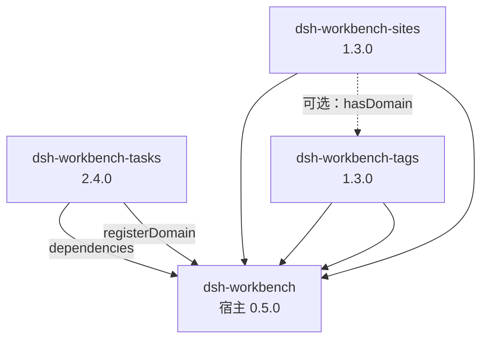
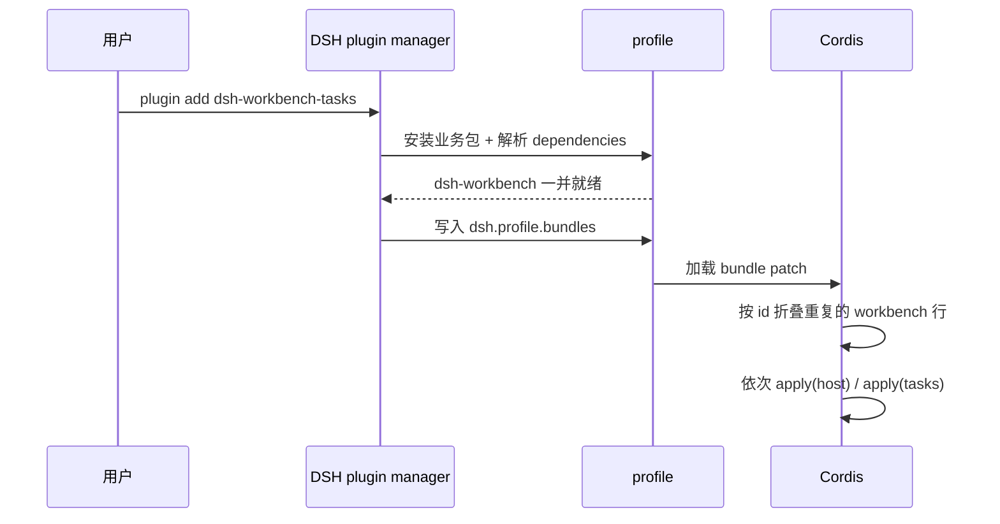

# 04 · 插件体系（DSH 原生插件）

## 结论

个人工作台、任务、标签、站点都是 **DSH 可以直接安装的普通插件**，不再有自建的
「工作台插件市场」和运行时下载器。

- `dsh-workbench`：宿主/共享运行时，提供 SQLite、HTTP 桥、SSE、agent 工具、
  账号同步和客户端页面框架；
- `dsh-workbench-tasks` / `dsh-workbench-tags` / `dsh-workbench-sites`：
  三个业务插件，各自贡献数据表、action 与视图；
- 业务插件在 `dependencies` 中声明 `dsh-workbench`，并在自己的
  `cordis.patch.yml` 中同时插入 `dsh-workbench` 行与自身行。DSH 安装业务插件时
  会把宿主一起装进 profile；Cordis loader 按 `id` 折叠重复的 `workbench` 行，
  所以多个业务插件并存时宿主只有一个实例。

安装与卸载全部交给 DSH 的插件管理（`dsh plugin add/remove` 或设置里的插件页），
工作台客户端不再提供「子插件」安装页。

> 发布命名：源码内宿主包名仍是 `dsh-workbench`，但 npm 上该名字已被无关项目占用，
> 因此对外发布名是 `dsh-workbench-host`。`scripts/stage-release.mjs` 会在发布树中
> 统一改写 name、cordis patch 与客户端 ModuleLoader 的 id；业务包的依赖也随之指向
> `dsh-workbench-host`。详见 [14-发布与插件市场](./14-发布与插件市场.md)。



## 包结构

```
packages/shell/                 # dsh-workbench 宿主
├── package.json                # dsh.bundle.patch + dsh.client
├── cordis.patch.yml            # 插入 workbench 行
├── src/index.ts                # 宿主服务、域注册中心、HTTP/工具/SSE
├── client/client.js            # 卡片首页 + 业务插件全屏页
└── lib/                        # tsc 产物

packages/addons/tasks/          # dsh-workbench-tasks 业务插件
├── package.json                # 依赖 dsh-workbench；声明 bundle patch 与 client
├── cordis.patch.yml            # 同时插入 workbench 与 workbench-tasks
├── lib/index.js                # Node：apply(ctx) 注册 domain
├── lib/db.js / tasks.js / tree.js
└── lib/client.js               # 浏览器：ModuleLoader 包装 + registerAddon
```

`packages/addons/*/lib/` 是直接签入的源码，不需要构建；根 `.gitignore` 单独放行
`packages/addons/*/lib/`。宿主与 core/sdk/cloud 的 `lib/` 仍是构建产物。

## 业务插件 manifest

以任务为例：

```jsonc
{
  "name": "dsh-workbench-tasks",
  "version": "2.4.0",
  "type": "module",
  "main": "lib/index.js",
  "files": ["lib", "cordis.patch.yml", "package.json"],
  "exports": {
    ".": "./lib/index.js",
    "./client": "./lib/client.js",
    "./package.json": "./package.json"
  },
  "dependencies": {
    "dsh-workbench": "file:../../shell-dist"   // 发布时改成正式版本号
  },
  "dsh": {
    "bundle": { "patch": "./cordis.patch.yml" },
    "client": { "platform": "web", "inject": ["dsh-workbench"] }
  },
  "wb": { "addon": { "id": "wb-addon-tasks", "title": "任务记录", ... } }
}
```

- `dsh.bundle.patch` 让 DSH 把插件作为 bundle 激活；
- `dsh.client.inject` 保证业务客户端模块在宿主的 `client.js` 之后加载，
  此时 `window.__WB_HOST__` 已就绪；
- `wb.addon` 是声明式元数据（id/title/version/tables/views/toolActions），
  便于文档、测试和后续工具读取；运行时的域定义在 `lib/index.js` 里。

`cordis.patch.yml`：

```yaml
- insert:
    - id: workbench
      name: 'dsh-workbench'
      config:
        enabled: true
    - id: workbench-tasks
      name: 'dsh-workbench-tasks'
```

## 宿主服务

宿主在 `apply(ctx)` 中创建服务并 `ctx.provide("workbench", host)`。
业务插件：

```js
export const inject = ["workbench"];

export function apply(ctx) {
  ctx.effect(() => ctx.workbench.registerDomain({
    id: "wb-addon-tasks",
    title: "任务记录",
    description: "任务树 + 9 个视图…",
    version: "2.4.0",
    tables: ["task", "task_node", "task_dep"],
    views: [{ id: "tasks", title: { zh: "任务记录", en: "Tasks" } }],
    setup(api) {
      ensureSchema(api.db);
      registerTaskActions(api);
      registerTreeActions(api);
    },
  }), "tasks-domain");
}
```

`WorkbenchHost` 的接口：

| 方法 | 说明 |
| --- | --- |
| `registerDomain(def)` | 注册域；返回清理函数。id 冲突/初始化失败只记录错误，不拖垮宿主 |
| `hasDomain(id)` | 域是否已注册且可用 |
| `listDomains()` | 公开信息列表（id/title/description/version/tables/views/actions/error） |
| `invoke(name, args, origin)` | 按 `namespace.action` 调业务 action |
| `actionNames()` | 所有已注册 action 及所属域 |
| `emit(event, data)` | 向客户端广播 SSE |

`DomainDef.setup(api)` 收到的 `api` 保持业务插件原有形状：

| 字段 | 说明 |
| --- | --- |
| `api.db` | 宿主打开的 `node:sqlite` DatabaseSync |
| `api.addon` | `{ id, version, dir }`，兼容旧插件代码 |
| `api.shellVersion` | 宿主版本（当前 0.5.0） |
| `api.hasDomain(id)` / `api.hasAddon(id)` | 跨插件能力探测（站点检测标签） |
| `api.action(name, def)` / `api.tool` | 注册 action；`def={description?,input?,execute,render?}` |
| `api.emit(event, data?)` | 广播域事件，SSE 收到 `{ domainId, event, data }` |
| `api.log(...args)` | 带域前缀日志 |


### action 自描述与 agent 调用（0.4.0）

宿主导出两个 meta action，任何 agent 无需读源码即可自举：

| action | 说明 |
| --- | --- |
| `actions.list` | 按域列出全部 action、必填项与参数名；`{ domain }` 过滤（`tasks` / `wb-addon-tasks`），`{ detail: true }` 附带完整 JSON Schema |
| `actions.help` | `{ action: "tasks.bulkUpdate" }` → 单个 action 的描述、完整 input、逐参数说明与 `examples` |

返回结构：

```js
// actions.list
{ shellVersion, domains: [{ id, title, version, enabled, error, actionCount }],
  actions: [{ name, domain, description, required, params }] }

// actions.help
{ name, domain, description, input, params: [{ name, type, required, description, enum }], examples }
```

Workbench 工具的入参统一放进 `args`：

```js
Workbench({ action: "tasks.bulkUpdate", args: { ids: ["..."], patch: { priority: 0 }, dryRun: true } })
```

旧版顶层字段（`due_at` / `note` / `tags` / `tagIds` / `dirIds` / `parentId` /
`deadline` / `start_at` / `assignee` / `limit`）若不在目标 action 的真实 schema 里，
会被剔除并在结果文本前置 `⚠ <action> 不接受这些参数，已忽略`，不再静默丢弃。

### 破坏性操作的 dryRun 约定（tasks 2.2.0+）

`tasks.bulkUpdate` / `tasks.bulkCreate` / `tasks.bulkDelete` / `tasks.sweepShutdown` /
`tasks.migrate` / `tasks.timelineRefactor` 均支持 `{ dryRun: true }`：只做校验与
计划，不写库；结果中的 `wouldUpdate` / `wouldCreate` / `wouldDelete` / `ids` /
`items` 描述将影响的范围。`tasks.bulkUpdate` 的 `patch` 只接受
`title, description, status, type, priority, difficulty, publishDate, targetDate,
doneDate, shutdownDate, tableId, sort, tagIds`（未知字段直接报错），`skipMissing: true`
可跳过不存在/已删除的 id。tasks 2.3.0 起 `tasks.reorder` 也支持 `dryRun`。

### 任务依赖、标签关联与排序（tasks 2.3.0 / tags 1.2.0）

- `task_dep(task_id, depends_on_id)` 存任务依赖，`tasks.link` / `tasks.unlink` /
  `tasks.depends` 负责写读；link 会拒绝自依赖与成环，`depends` 返回
  `dependsOn`（上游）、`blocks`（下游）与 `blocked`（上游仍有 ACTIVE/SHUTDOWN/RESTARTED）。
- 标签复用 `tag_mapping(item_type='task')`：`tags.link` / `tags.unlink` /
  `tags.itemsOf` 是通用接口；`tasks.create` / `tasks.update` / `tasks.bulkUpdate`
  可直接传 `tagIds`（整体替换），`tasks.get` / `tasks.list` 会聚合 `tags`。
- `task.sort` 存手动排序值，`tasks.reorder({ ids })` 按数组顺序重写（默认步长
  100），`tasks.list({ sort: "manual" })` 按它排序。
- `task.dedupe_key` 提供幂等创建：同键未删除任务存在时 `tasks.create` 直接返回
  已有任务并带 `deduped: true`，避免 agent 重试重复建任务。

`setup` 可以返回 `dispose()`，也可以在 `DomainDef` 上提供 `dispose`；
域被替换或宿主停止时调用。

## 客户端

业务插件的 `package.json` 用 `exports["./client"]` 指向浏览器模块。模块由 DSH
客户端加载器按 ModuleLoader 格式加载：

```js
window.__ModuleLoader__.load({
  id: "dsh-workbench-tasks",
  factory(require) {
    var host = window.__WB_HOST__;
    // …组件…
    host.registerAddon({
      id: "wb-addon-tasks",
      version: "2.4.0",
      views: [{ id: "tasks", title: { zh: "任务记录", en: "Tasks" }, component: TasksView }],
    });
    return { name: "dsh-workbench-tasks", inject: [], apply: function () {} };
  },
});
```

- `window.__WB_HOST__` 提供 `react/jsx/h/registerAddon`，以及当前已注册域的
  `addons` 只读列表（用于 `hasAddon` 探测）；
- 视图 props：`{ api, lang, addonId, t }`；
- `api.call(action, args)` → `POST /workbench/api/domains/:id/actions/:action`，
  返回 `{ ok, result, text }` 或 `{ ok:false, error }`；
- `api.subscribe(fn)` 接收 SSE 的 `{ event, data }`；
- 首页是卡网格，每张卡来自 `registerAddon` 的 views；点卡进入沉浸式全屏页
  （`position:fixed` 覆盖 DSH 侧栏），左上角「返回首页」；同域多视图时全页内切换。

## 数据备份

宿主提供按模块导出/导入，细节见 [15-数据备份](./15-数据备份.md)。

- `DomainDef.exportData(ctx)` / `DomainDef.importData(raw, ctx)` 是可选能力；
  `listDomains()` 的 `backup` 字段告诉客户端该域是否支持；
- 宿主只打包/解压 zip、校验 manifest、把模块 JSON 原文路由给对应域，不解析业务数据；
- 每个模块自己校验 `schemaVersion`，按行 UPSERT 并做 `updated_at` LWW；
- 模块文件：tasks 导出 task + task_node + task_dep；tags 导出 tag + 非 site 的 tag_mapping；
  sites 导出 site + site_node + site_node_mapping + site 的 tag_mapping；
- 导入按模块隔离，单模块失败不影响其它模块，最终返回逐模块报告；
- 备份格式 `formatVersion=1`，与当前版本不匹配时返回 422 并提示升级。

## 安装 / 卸载 / 升级

```bash
# 本地开发：先构建宿主，再装业务插件（会带宿主）
pnpm build && node scripts/dist-shell.mjs
dsh plugin --profile web add file:$PWD/packages/shell-dist
dsh plugin --profile web add file:$PWD/packages/addons/tasks

# 卸载业务插件（数据表保留；没有其它业务插件时宿主可一并移除）
dsh plugin --profile web remove dsh-workbench-tasks
```

DSH 的 profile 会：

1. 把业务插件装进 `~/.dsh/profiles/<name>/node_modules/`；
2. 解析 `dependencies`，把 `dsh-workbench` 一起装上；
3. 把业务插件加入 `dsh.profile.bundles`；
4. 启动时按 bundle patch 插入宿主与业务插件行，Cordis 按 id 去重；
5. 业务插件 `apply` 时向宿主注册域，客户端按 `dsh.client.inject` 顺序加载。



失败隔离：单个域的 `setup` 抛错时只把该域标为不可用并记录 `error`，宿主和其
它域继续工作；DSH 侧的包安装失败由 DSH 插件管理器报错，不会影响已运行实例。

**卸载只卸载代码，不删数据库表**：`task/task_node`、`tag/tag_mapping`、
`site/site_node/site_node_mapping` 留在 `workbench.db`，重装后继续可见。
`~/.dsh/workbench/addons/` 是旧运行时市场的遗留目录，新架构不再读取。

## 跨插件依赖：站点 × 标签

站点把标签当可选能力：

- 宿主提供 `api.hasDomain("wb-addon-tags")`（`hasAddon` 为兼容别名）；
- `sites.capabilities` 返回 `{ tags: boolean }`；
- 标签域不存在时，站点页隐藏标签列、标签筛选和表单的标签步骤，
  建站时忽略 `tagIds`，但不删除已有 `tag_mapping`；
- 装上标签后重新探测，标签 UI 与关联能力自动恢复。

## 三个业务插件

| 包 | 域 id | 表 | action 数 | 视图 |
| --- | --- | --- | --- | --- |
| `dsh-workbench-tasks@2.4.0` | `wb-addon-tasks` | task / task_node / task_dep | 31 | 任务记录（9 视图、任务树、时间线、依赖、排序） |
| `dsh-workbench-tags@1.3.0` | `wb-addon-tags` | tag / tag_mapping | 8 | 标签（含通用关联，允许重名） |
| `dsh-workbench-sites@1.3.0` | `wb-addon-sites` | site / site_node / site_node_mapping / tag_mapping | 18 | 站点（目录树、链接、标签） |

版本、接口和验收细节见 [09](09-任务模块迁移方案.md)、[10](10-标签模块迁移方案.md)、
[11](11-站点模块迁移方案.md)。

## 安全边界

- 四个包都是 DSH 原生插件，运行在 DSH 的插件进程内，按 DSH 的信任模型安装；
- 业务插件与宿主共享 SQLite 连接，靠约定只写自己声明的表；
- 不再有 tarball 下载、tar 解包和 sha256 校验流程；
- 数据同步仍以 `sync_change_log` 为队列，业务表由各域自己维护；
- 参与同步的表由 `DomainDef.sync.tables` 声明：`mode: "row"` 走行级 LWW，
  `mode: "tree"` 由 `reconcile(remoteRows, localRows)` 收敛后整表 full 覆盖；
  未声明 `sync` 的域按 `tables` 推导为 row；
- `tag_mapping` / `site_node_mapping` 声明唯一键与 `uniquePolicy: "lww-tombstone"`，
  同键不同 id 时保留 updated_at 大的一方，输者软删。