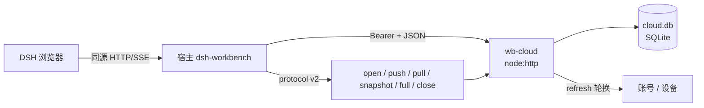
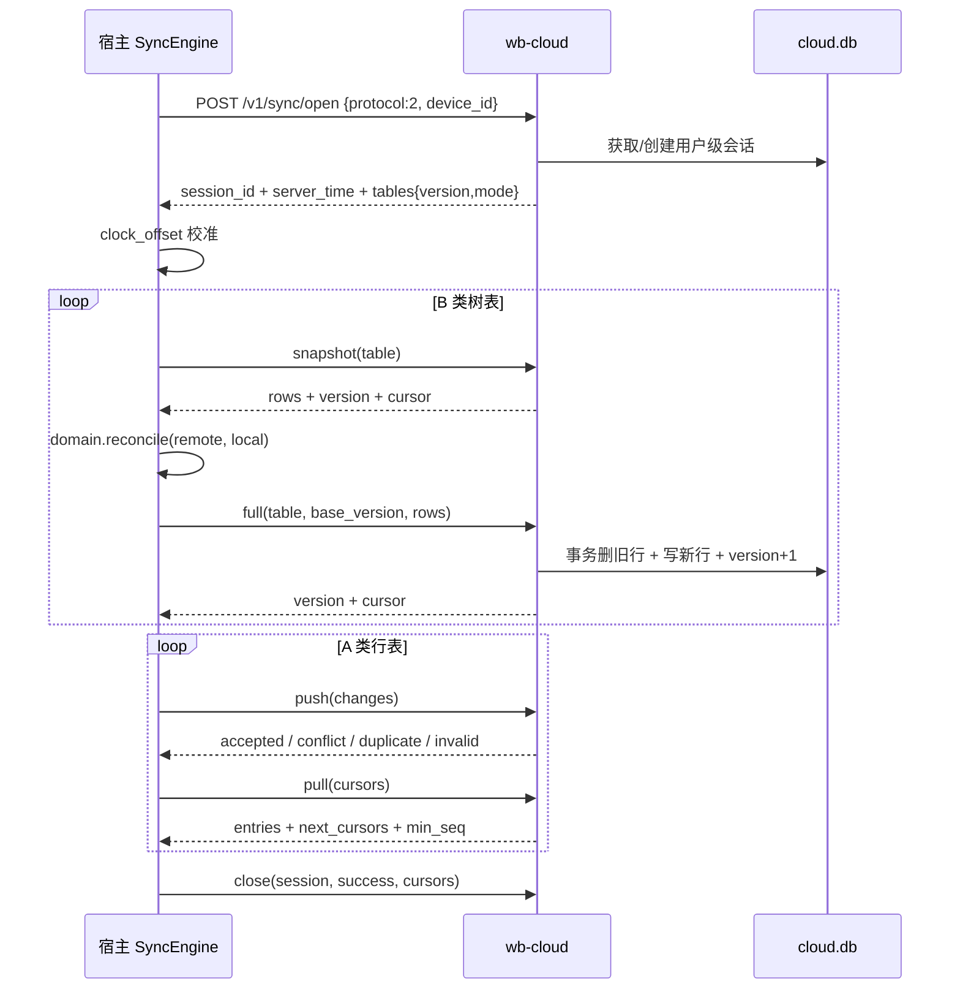

# 06 · 云端设计（Workbench Cloud）

## 职责边界

云端只负责 **账号、设备、数据备份同步**。业务插件由 DSH 从 npm / 本地路径安装，云端不认识插件包，也不提供插件目录或下载。

代码位置：`packages/cloud`，入口 `node packages/cloud/lib/server.js`。
默认只监听 `127.0.0.1:8791`，数据目录默认 `~/.dsh/workbench/cloud`。



## 技术实现

| 项     | 实现                                                |
| ------ | --------------------------------------------------- |
| 运行时 | Node 22+，TypeScript，零第三方运行时依赖            |
| HTTP   | `node:http`（不是 Fastify）                       |
| 数据库 | `node:sqlite`，文件在 `<data>/cloud.db`         |
| 密码   | `scrypt` 散列（`scrypt_N_r_p_salt_hex`）        |
| 会话   | access token + refresh token 轮换；refresh 存散列   |
| 传输   | 明文 HTTP，仅本机/内网；正式部署放在 TLS 反向代理后 |
| 请求体 | JSON，上限 16MB                                     |

## 数据模型

```sql
users(id, email UNIQUE, pass_hash, created_at)
refresh_tokens(token_hash PRIMARY KEY, user_id, device_id, expires_at, replaced_by)
devices(id, user_id, name, last_cursor, last_sync_at, cursors,
        PRIMARY KEY(id, user_id))

-- 一次同步一把用户级锁；同设备重新 open 会顶掉旧会话
sync_sessions(user_id PRIMARY KEY, session_id UNIQUE, device_id,
              opened_at, expires_at)

-- 同步核心：每个 (table,row) 的服务端最新态 + 拉取序
change_log(server_seq AUTOINCREMENT, user_id, device_id, client_epoch, client_seq,
           table_name, row_id, op, payload, updated_at,
           UNIQUE(user_id, device_id, client_epoch, client_seq))
row_states(user_id, table_name, row_id, payload NOT NULL, deleted, updated_at,
           PRIMARY KEY(user_id, table_name, row_id))

-- 树表整表版本与模式（row / tree）
sync_table_state(user_id, table_name, version, mode, updated_at,
                 PRIMARY KEY(user_id, table_name))
```

## API

```
POST /v1/auth/signup | /login | /refresh        # 返回 access/refresh + device_id
GET  /v1/me                                     # 用户 + 设备列表
DELETE /v1/devices/:id                          # 吊销设备

POST /v1/sync/open       { protocol: 2, device_id }
  resp: { session_id, server_time, expires_at, tables: { <table>: { version, mode } } }
POST /v1/sync/push       { session_id, client_epoch, changes:[{ client_seq, table_name, row_id,
                           op, payload, updated_at }] }
  resp: { accepted_up_to, results:[accepted|conflict|duplicate|invalid|equal] }
POST /v1/sync/pull       { session_id, cursors: { <table>: n }, limit }
  resp: { entries, next_cursors, has_more, min_seq }
POST /v1/sync/snapshot   { session_id, table }
  resp: { rows, cursor, version, mode }
POST /v1/sync/full       { session_id, table, base_version, rows }
  resp: { version, cursor }            # base_version 不匹配返回 409 version_conflict
POST /v1/sync/close      { session_id, success, cursors }
```

要点：

- **只支持 protocol v2**：`open` 校验 `protocol === 2`，否则 426。
- **会话锁**：同一用户只保留一个会话；另一台设备持有中返回 409 `sync_locked`。
  会话 TTL 300 秒，push/pull/snapshot/full 每次续期；`close` 释放。
- **push 幂等**：以 `(device_id, client_epoch, client_seq)` 去重；重复推同一区间
  返回 `duplicate`，`accepted_up_to` 照常推进。
- **pull 按表游标**：客户端为每张表记 `server_seq` 水位；云端日志出现缺口
  （`min_seq > cursor + 1`）时客户端改用 snapshot 重建。
- **鉴权**：除 signup/login/refresh 外都需要 Bearer access token；refresh 轮换，
  旧 refresh 再用即拒绝。
- **无业务白名单**：服务端只校验表名格式与 payload 大小，表集合来自插件声明的
  `DomainDef.sync`，新增业务表不用改云端。
- **LWW**：`row_states` 按 `updated_at` 比较；相等时已有服务端行胜，冲突返回完整
  `current` 行供客户端写 `conflict_shadow`。
- **树表整表覆盖**：`sync_table_state.version` 做乐观锁；`full` 在同一事务内删旧行、
  写新行、写一条 `op=reset` 日志并递增版本。
- **限额**：push 500 条/次；单条 payload 1MB；full 10000 行 / 16MB；snapshot 20000 行；
  pull 1000 条/页。

同步一轮的端到端时序：



## 规模预期与降级

个人工具量级（万级行/用户），单实例 SQLite 余量足够。真正要预留的是
**协议稳定性**：服务端对未知业务表只做通用存储，新增插件表不需要迁移云端。

## 未做

- 端到端加密、字段级合并；
- docker-compose / TLS 一键部署；
- 同步可视化页与故障注入测试；
- refresh token 家族重放检测之外的审计日志。
