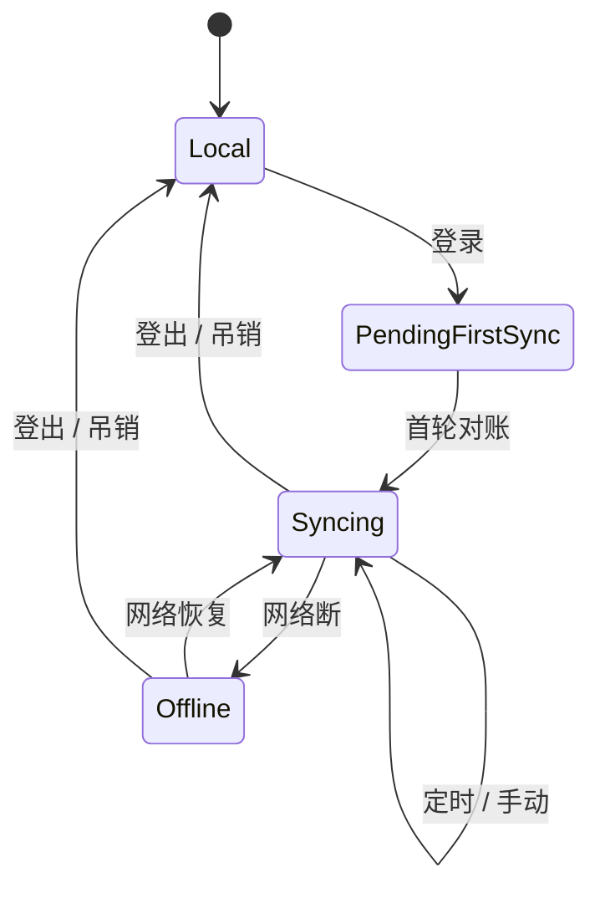

# 07 · 同步与登录设计

> 状态说明：本文是 v1 实现与早期设计记录，部分流程已被 protocol v2 取代。
> 目标方案与实现进度以 [16-数据同步方案](./16-数据同步方案.md) 为准。当前差异：
> - 同步循环在 packages/shell/src/sync.ts 的 SyncEngine，已有会话锁、时钟校准、
>   B 类树整表覆盖、按表游标、冲突闭环；触发仍是登录后 + 固定 30 秒；
> - 冲突破平不是按 device_id 字典序，而是严格 LWW（updated_at 大者胜，相等时服务端已有行胜）；
>   冲突写入 conflict_shadow 并可在账号页处理；
> - 密码散列当前是 scrypt，不是本文写的 Argon2id。

## 状态机（客户端）



**未登录时数据全写 SQLite、零云依赖**——这条产品承诺在架构上的落点是：
change log 无条件记录 + sync_state 缺省 cursor=0。登录只是"开始消费日志"，不存在格式迁移。

## 同步引擎循环（core/sync）

```text
every 30s 或 事件触发（登录 / 手动 / 事件）:
  1. open: POST /v1/sync/open { protocol: 2, device_id }
     → session_id / server_time / expires_at / tables{version,mode}
     → clock_offset = server_time - (T1 + T2) / 2
  2. 先 B 类树表：版本一致且无脏 → 跳过；否则 snapshot → domain.reconcile
     → 本地整表替换 → full(base_version) → 409 时重试最多 3 次
  3. 再 A 类行表：按表 push 200 条 / 批 → 按表 pull(cursor)
     → applyRemoteUpsert / applyRemoteDelete；冲突写 conflict_shadow
  4. close(session, success, cursors)；失败表记 failed_tables，下一轮续传
```

### 冲突解决：LWW per field？还是 per row？

一期 **per row 整行 LWW（按 updated_at 毫秒；相等时服务端已有行胜，不再按 device_id 破平）**，理由：

- 任务/打卡类单行字段少、并发编辑同一行的概率极低；
- 整行比较实现一页纸，可解释、可测试；
- push 响应里带 conflict/current 明细，客户端把本地版本与服务端版本写入
  `conflict_shadow` 表，并在账号页提供 keep_local / keep_server / dismiss，绝不静默吞数据。

演进项（写进 proto version，不改现有语义）：payload 增加 per-field lamport，
将来富文本类 addon 可选升级到字段级合并或接入 Yjs。

### 删除与墓碑

- 全部软删（deleted_at），pull 侧同样只认墓碑；
- 物理回收必须晚于 `max(90天, 所有设备 cursor 最小值)`，否则慢设备重新上线会"复活"已删数据；
  回收任务先检查 sync_state 各设备 cursor（05 的容量节与之呼应）。

## 账号与安全

- 密码 scrypt（实现是 `scrypt_N_r_p_salt_hex`，不是 Argon2id）；传输仅 TLS；服务端不落明文 token（refresh 存 hash，轮换式：旧 refresh 使用即判失窃、全族撤销）。
- 登录入口在 DSH 内：工作台设置页弹表单 → client fetch 走同源 HTTP 桥 → host 代发云端请求
  （浏览器不经手长期凭据；access token 只在 host 内存 + 0600 文件缓存，重启重连用 refresh 静默换发）。
- **设备管理**：每台 DSH 安装生成 device_id（UUID 存 sync-state.json），云端可见列表、支持远程吊销；
  吊销后该设备 push 收 401_device_revoked，UI 显式降级为本地模式并提示。

## 隐私边界（一期决策 + 预留）

- 一期不做 E2EE：服务端要执行 LWW 就必须读 payload；这是明确取舍，文档向用户声明
  （个人任务数据、单一自托管默认）。
- 预留 `crypto_profile: "plain" | "e2ee-v1"` 字段在 auth/proto 里；
  e2ee-v1 路线：客户端 libsodium secretbox 加密 payload + 服务端改用 rev 向量做无内容合并（代价：失去服务端破平能力，需带 lamport 时钟）——列为 M4 之后的独立提案。
- 本地登出即删除全部云凭据与 server_seq，回到纯本地库；卸载保留数据库（宿主惯例）。

## 失败模式清单（都要有测试）

| 场景                            | 行为                                                                                    |
| ------------------------------- | --------------------------------------------------------------------------------------- |
| push 成功但响应丢失             | 幂等重推 (device,seq) 区间，服务端去重                                                  |
| 双设备同时改同一行              | 后到者输 LWW，输方收到 conflicts 入 shadow 表并可一键"以本地为准重试"（作为一次新写入） |
| 时钟回拨/漂移                   | updated_at 用 max(墙钟, 已知最大rev时间+1ms) 单调化，防乱序覆盖                         |
| schema 落后（另一设备更旧版本） | 未知字段透传保留；未知 op/table 暂存 dead-letter，UI 提示升级                           |
| 磁盘满/DB 锁死                  | 同步引擎暂停且不丢 change log；错误进诊断页，agent 工具面 Workbench(stats) 可见         |
