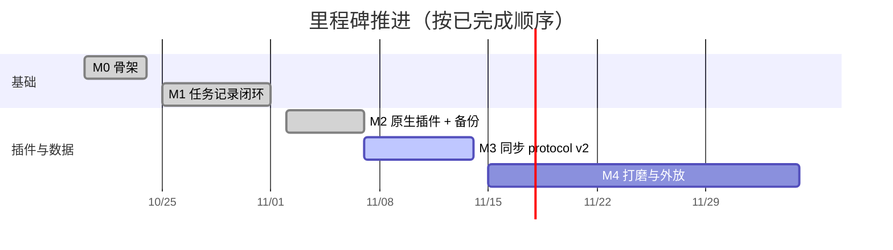

# 08 · 路线图与里程碑

原则：**每周都有可用的东西装在 DSH 里**；先打通宿主，再逐个迁移业务模块，
最后补同步与打磨。

状态标记：✅ 已完成　🟡 部分完成　⬜ 未开始

## M0 · 骨架 — "能装上" ✅

- pnpm workspace + TypeScript；宿主构建出 DSH ModuleLoader 形态的 `client.js`；
- 宿主最小版：`settings.plugins.tab` 出现「个人工作台」，打开 `workbench.db`；
- 发布形态是 `packages/shell-dist`（`scripts/dist-shell.mjs` 生成，内联 `@wb/core`），
  通过 `dsh plugin --profile web add file:.../shell-dist` 装进 DSH；
- 验收：重启 DSH 后设置页看到工作台，重复安装幂等。

## M1 · 任务记录闭环 — "单人真能用" ✅

- `@wb/sdk` 类型契约（DomainDef / 客户端桥 / action）；
- 「任务记录」插件：`task/task_node` 表、20 个 action、9 个视图、
  任务树 + 时间线 + 重启 + 批量归并/迁表；
- HTTP 桥 + SSE（任务变更秒级刷新）；
- `Workbench` agent 工具：按 `namespace.action` 动态分发；
- 真实 GUI 验收：创建/改名/优先级/完成（难度）/关闭/重启/时间线/批量/树操作/搜索。

## M2 · 原生插件体系 — "业务插件可独立安装" ✅

- 四个 DSH 原生包：`dsh-workbench`、`dsh-workbench-tasks`、
  `dsh-workbench-tags`、`dsh-workbench-sites`；
- 业务插件 `dependencies` 声明宿主，`cordis.patch.yml` 同时插入宿主行与自身行；
  Cordis 按 id 折叠重复的 `workbench` 行，多业务插件并存时宿主单实例；
- 宿主 `ctx.provide("workbench", host)`，业务插件 `inject:["workbench"]`，
  `apply(ctx)` 里 `registerDomain`；
- 客户端模块走 `dsh.client.inject:["dsh-workbench"]`，ModuleLoader +
  `window.__WB_HOST__.registerAddon`；
- 首页卡片来自已注册域，点卡片进入沉浸式全页；「子插件」安装页已删除，
  安装/卸载交给 DSH 插件管理；
- 跨插件依赖：站点用 `hasDomain("wb-addon-tags")` 探测标签，未装时隐藏标签 UI；
- 失败隔离：单个域 `setup` 抛错只标记该域不可用，宿主与其它域继续工作；
- 数据备份：首页「数据备份」，按模块导出/导入 zip，模块自解析、宿主只路由；
  格式版本校验与逐模块失败报告；
- 未做：包签名（交给 DSH/npm 信任链）、命令浮层、快速面板。

### M2 验收证据

`pnpm build && node scripts/dist-shell.mjs` 后运行 `pnpm test:e2e`（串行）：

1. `test-native.mjs`：假 ctx 启动宿主，加载任务/标签/站点三个 `apply`，
   断言 3 个域、59 个 action；调用 `tasks.create/list`、`tags.create`、
   `siteNodes.create` + `sites.create`；
2. `test-clients.mjs`：Node vm + DOM/React stub 加载四个 client.js，
   断言注册 `wb-addon-tasks/tags/sites` 三个视图；
3. `test-tags.mjs`：标签建/查/重名/软删/同名重建/映射级联 + v2 表迁移；
4. `test-sites.mjs`：目录树懒加载/路径、站点建/查/过滤/换目录/换标签、
   移动子树、删目录保站点、删站点软删、能力探测；
5. `test-backup.mjs`：三模块导出/只选任务/全量导入/硬删后恢复/格式不兼容 422；
6. `test-sync.mjs`：真实云端存储 + 宿主 SyncEngine，断言首轮 backfill、树表 version、
   push 冲突写 shadow、移动树节点后云端 parent_id 更新、冲突处理。

真实 DSH 进程验证（2026-11-07，独立 `DSH_HOME=/tmp/dsh-wb-native`）：

- 临时 profile 安装三个业务包后启动，日志出现
  `tasks domain ready 2.4.0`、`tags domain ready 1.3.0`、`sites domain ready 1.3.0`；
- `GET /workbench/api/domains` 返回 3 个域，shellVersion 0.5.0；
- 首页 3 张卡，任务/标签/站点全页正常，HTTP 创建任务后 SSE 自动刷新；
- 移除标签包重启后，站点页标签列与标签筛选消失；
- 备份页显示模块与数据表，导出/导入与不兼容提示均验证；
- 临时实例已停止，不触碰主 DSH。

## M3 · 云端与同步 — "两台机器一致" 🟢

- 已有：protocol v2 会话锁 + 时钟校准；A 类行增量 + 按表游标；B 类
  task_node/site_node 快照 + reconcile + 整表 full；快照回填；push/pull 冲突写
  `conflict_shadow` 并在账号页处理；唯一键 lww-tombstone；单表失败继续 +
  `sync_dead_letter`；登录后立即 + 30 秒后台同步；`/sync/status`、
  `/sync/conflicts`、`/sync/conflicts/:id/resolve`；凭据文件 0600；
- 证据：`pnpm test:sync` 覆盖首轮 backfill / 树整表 / 行 push+pull / push 冲突 /
  冲突处理 / 唯一键冲突；`pnpm test:e2e` 全绿；
- 未做：窗口聚焦/网络恢复触发、脏检查与指数退避、待推条数与死信 UI、
  云端 change_log 保留策略、5k 任务与 48h 断网压测、故障注入；
- 验收目标：两台 DSH 各 5k 任务互改 10 分钟内收敛；断网 48h 正确合并；
  时钟回拨测试通过。

## M4 · 打磨与外放 ⬜

- 统计概览、附件 blob、导入导出（JSON/CSV）；
- 性能：change_log 截断、索引审计、client bundle 预算；
- 文档站与「写一个自己的业务插件」教程；
- 评估 E2EE 与字段级合并。

## 风险登记册

| 风险 | 缓解 |
| --- | --- |
| `node:sqlite` 在旧 Node 不可用 | DSH 运行在 Node ≥22.5；否则回退 better-sqlite3（未实现） |
| 宿主 slot/API 破坏性变更 | 特性探测 + 客户端 host bridge 缺省提示 |
| 多业务插件重复插入 workbench 行 | 各行 id/name/config 完全一致；Cordis 按 id 折叠 |
| 业务插件只装了一半（缺宿主） | 在 `dependencies` 声明宿主，由 DSH/pnpm 解析 |
| 同步语义踩坑（删除复活、回环） | 07 的失败模式转集成测试，M3 合入门槛 |
| 共享 JS context 的域互相影响 | 域初始化失败隔离；数据边界靠约定，后续再评估沙箱 |