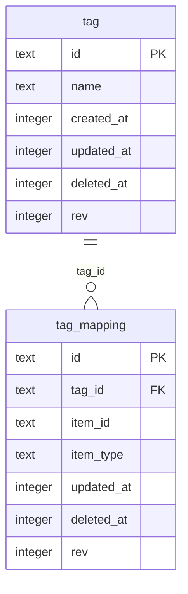

# 10 · 标签模块迁移方案

> 状态：已完成（2026-11-07）。实现为 DSH 原生插件 `dsh-workbench-tags@1.3.0`
> （域 id `wb-addon-tags`），业务全部本地，云端只负责账号与数据备份。
> task 模块见 [09](09-任务模块迁移方案.md)。
>
> 同步方案补充（2026-11-07）：已确认**允许标签重名**。落到 protocol v2 时移除
> `uk_tag_name` 与创建时的重名校验（见 [16 §11.1](16-数据同步方案.md)）。
> 当前 1.3.0 已按“允许重名”实现：移除唯一索引，创建时不再查重。

## 1. 结论

- 原 `sheepone-tag` 只有「分页、创建、删除」三个后端动作；前端还调用了后端
  不存在的 `GET /tag/search`。迁移时保留这三个语义，并补上本地搜索。
- 数据落在工作台 SQLite 的 `tag` 与 `tag_mapping` 两张表；`tag_mapping`
  由站点插件以 `item_type='site'` 读写，标签插件本身不暴露映射 UI。
- 经典物理删除改为软删除：`deleted_at`。这样同一名称可以在删除后重新创建，
  也避免同步时把已删行「复活」。
- UI 不再是旧版随机底色列表；改为固定调色板（按 id 哈希）+ 搜索/创建/删除/
  批量删除/分页，交互与字段语义保持一致。

## 2. 原模块契约

### 2.1 后端接口

| 方法 | 路径 | 入参 | 返回 | 语义 |
| --- | --- | --- | --- | --- |
| GET | `/tag?pageSize=&pageNumber=` | 页码、页大小 | `TagListResponse{current,size,total,records}` | 按 `update_time desc` 分页 |
| POST | `/tag` | `{name}` | `Boolean` | 创建；空名/重名报错 |
| DELETE | `/tag?id=` | id | `Boolean` | 旧实现物理删除，无级联 |

旧后端没有 `/tag/search`，但前端 `services/tagService.tsx` 有
`GET /tag/search?text=`（仅离线 mock 生效）。本次补为本地 action。

### 2.2 实体与前端字段

`Tag`（表 `tag`，继承 BaseEntity）：`id Integer`、`name String`、
`createTime`、`updateTime`；无 `isDeleted`。前端 `TagItem` 使用
`{id,name,createTime}`，列表 header 为 `Tag Name / Create Time`。

前端 `pages/Tag.tsx` 的行为：

- 顶部 Antd `Search` 没有接逻辑；创建使用 Input + CheckSquare 按钮；
- 每行背景从 7 个颜色里 `Math.random`，前面一个无行为 Checkbox；
- 分页 18 条/页；没有删除入口；
- `tagService` 还声明了 `TagCreateRequest{name}`、`TagListRequest extends PageRequest`、
  `SearchTagRequest{text}`。

### 2.3 跨模块依赖

- site：`tagIds:number[]`、`tags:TagBase[]`、`TagSearch` 与标签筛选；
- storage：`storage_tag_mapping` + Redis `getTagIdToNameMap` 拼标签名。

迁移后 site 直接读 `tag`、读写 `tag_mapping`，不再依赖 storage 的映射表。

## 3. 目标数据模型

平台列统一使用 `created_at / updated_at / deleted_at / rev`，与 task 模块一致；
v2 的 `is_deleted/update_time/create_time` 只在导入时识别。

```sql
CREATE TABLE tag (
  id TEXT PRIMARY KEY,
  name TEXT NOT NULL,
  created_at INTEGER NOT NULL,
  updated_at INTEGER NOT NULL,
  deleted_at INTEGER,
  rev INTEGER NOT NULL DEFAULT 1
);

CREATE TABLE tag_mapping (
  id TEXT PRIMARY KEY,
  tag_id TEXT NOT NULL,
  item_id TEXT NOT NULL,
  item_type TEXT NOT NULL,
  created_at INTEGER NOT NULL,
  updated_at INTEGER NOT NULL,
  deleted_at INTEGER,
  rev INTEGER NOT NULL DEFAULT 1
);
```

索引：

- `idx_tag_name ON tag(name) WHERE deleted_at IS NULL`：**普通索引**，
  1.3.0 起允许重名（不作唯一约束）；
- `idx_tag_updated_at`、`idx_tag_created_at`；
- `idx_tag_mapping_tag`、`idx_tag_mapping_item(item_type,item_id)`；
- `uk_tag_mapping(tag_id,item_id,item_type) WHERE deleted_at IS NULL`。

`tag_mapping.item_type` 用字符串口径（site 为 `'site'`），与 v2 一致；
不沿用 storage 的 `storage_tag_mapping` 表名。



同名标签是两条独立记录，各自拥有映射；删除其中一条不会影响另一条。

## 4. 字段与语义映射

| 旧字段/行为 | 新实现 | 说明 |
| --- | --- | --- |
| `tag.id Integer` | `id TEXT` | 与工作台其它 addon、v2 同步主键统一 |
| `createTime/updateTime` | `created_at/updated_at` | 毫秒时间戳；接口仍输出格式化 `createTime` |
| 物理删除 | `deleted_at` + `rev+1` | 删除后同名可重建 |
| 删除不清理映射 | 级联软删 `tag_mapping` | 避免 site 侧留下悬空标签 |
| 无搜索 | `tags.search` | `instr(lower(name), lower(text)) > 0` |
| 随机颜色 | 固定 8 色调色板 | 按 id 哈希，刷新不跳色 |
| 无删除 UI | 行内两步确认 + 批量删除 | 删除前显示「确认删除」 |
| 18 条/页 | 默认 18，最大 200 | 与旧前端一致 |

## 5. Action 契约

所有 action 只读写本地 SQLite；返回结果放在统一的 `{ok:true,result}` 信封里。

| action | 参数 | 返回 | 说明 |
| --- | --- | --- | --- |
| `tags.list` | `pageNumber,pageSize,text` | `{current,size,total,pages,pageable,records,text}` | `records` 每项 `{id,name,createTime,updateTime,createdAt,updatedAt}` |
| `tags.search` | `text,pageNumber,pageSize` | 同 `tags.list` | 兼容旧 `/tag/search` |
| `tags.create` | `name` | `{id,tag}` | trim、空名/超过 64 字报错；**允许重名** |
| `tags.delete` | `id` | `{id,deleted,missing,removedMappings}` | 软删标签及映射 |
| `tags.byIds` | `ids[]`（最多 500） | `{records}` | 供 site 聚合标签 |

写操作都会写 `sync_change_log`（`origin=sync` 时跳过回写），并 emit
`tags-changed`；壳通过 SSE 广播为 `addon-event`。

## 6. UI

- 入口：工作台首页「标签」card → 沉浸式全屏页；
- 顶部：标题/说明、搜索框、搜索/清空、新建标签；
- 新建：内联表单，Enter 或「创建」提交，错误就地显示；
- 列表：标签 chip（颜色按 id 固定）、创建时间、删除；
- 删除：第一次点「删除」变为「确认删除 / 取消」，二次确认后才执行；
- 多选：行首 checkbox + 全选；选中后出现「已选 N / 删除」，同样两步确认；
- 分页：18/页，上一页/下一页 + 总条数；
- 状态：加载中、空态、搜索无结果、错误 + 重试、toast；
- 实时：SSE `tags-changed` 自动刷新当前页；
- 窄屏：隐藏时间列、搜索框占满、按钮收窄。

## 7. v2 旧表迁移

`ensureSchema` 在建表前做一次检测：

1. 表存在且没有 `updated_at`、但有 `update_time` → 视为 v2 表；
2. `ALTER TABLE ... RENAME TO tag_legacy_v2_<timestamp>`，保留旧表；
3. 按平台列建新表，把旧行搬过来：
   `create_time→created_at`、`update_time→updated_at`、
   `is_deleted<>0→deleted_at=update_time`；
4. 删除旧表上的旧索引（避免 `CREATE INDEX IF NOT EXISTS` 被同名旧索引挡住）；
5. 迁移失败只记日志、保留旧表，不阻塞 addon 启动。

`tag_mapping` 同样处理。迁移是幂等的：新表已有 `updated_at` 时不会重复迁移。

## 8. 云端与备份边界

- 安装由 DSH 负责：`dsh plugin add dsh-workbench-tags`（或本地 file: 包），
  不再依赖任何云端插件目录；
- `tag` / `tag_mapping` 均为行级同步（A 类），字段包含
  `updated_at/deleted_at/rev`，由 `DomainDef.sync` 声明参与同步；
- protocol v2 下两表均为 A 类行级同步：按表游标 push/pull，`updated_at` 大者胜，
  相等时服务端已有的行胜；输方写 `conflict_shadow`；
- `tag_mapping` 声明唯一键 `(tag_id,item_id,item_type)` + `lww-tombstone`：
  远端插入与本地未删行唯一键冲突时，先比 `updated_at`，旧的一方软删成墓碑，
  避免 `DELETE+INSERT` 撞唯一索引；
- `tags.delete` 的级联软删会为每条 mapping 写完整墓碑 payload，
  避免同步端把旧关联复活。

## 9. 实现文件

| 文件 | 内容 |
| --- | --- |
| `packages/addons/tags/package.json` | DSH 原生 manifest：依赖 `dsh-workbench`，`dsh.bundle.patch` + `dsh.client.inject`，`wb.addon` 元数据声明 tables `tag/tag_mapping`、views `tags`、5 个 toolActions |
| `packages/addons/tags/lib/db.js` | DDL、索引、时间/ID、事务、change_log、v2 迁移 |
| `packages/addons/tags/lib/tags.js` | list/search/create/delete/byIds 与 render |
| `packages/addons/tags/lib/index.js` | `apply(ctx)` 注册域；`migrations=[]`，setup 内 `ensureSchema` + 注册 action |
| `packages/addons/tags/lib/client.js` | 浏览器视图，`__WB_HOST__.registerAddon` |

## 10. 验收记录

- `node --check` 四个 JS 文件通过；
- `node scripts/test-tags.mjs`：创建/分页/搜索/重名/空名/软删/同名重建/
  按 id 取标签/`tag_mapping` 级联软删/v2 表迁移全部通过，输出 `TAGS TEST PASS`；
- `pnpm test:e2e` 输出 `E2E PASS`（`test-native` 覆盖域注册与 action，
  `test-clients` 覆盖客户端模块与 registerAddon，`test-tags` 覆盖数据行为）；
- 真实工作台（`http://127.0.0.1:3080`）：安装插件 → 首页出现
  「标签」card → 创建「工作」「生活」→ 搜索「工作」只剩一条 → 行内删除
  取消/确认 → 批量删除 → 空态；console 无报错；
- 原生架构下由 DSH 安装/卸载；卸载只删代码，`tag/tag_mapping` 数据保留；
- 截图：`/Users/yyq/Downloads/wb-tags-empty.png`。

## 11. 未做 / 后续

- 标签编辑（旧模块也没有）与标签合并；
- `tag_mapping` 的独立 UI（站点表单已内置标签选择器）；
- 标签颜色持久化（当前颜色由 id 推导，刷新稳定，但不允许用户自定义）；
- 标签合并/自动去重（当前明确保留同名独立记录）；
- 旧 storage 的 `getTagIdToNameMap` Redis 缓存不迁移，site 直接查本地表。
