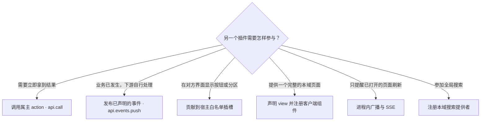

# 工作台架构指南

工作台开发有两个入口。了解一个功能归谁负责、有哪些协作方式、调用失败后由谁处理，从这份指南开始。需要执行具体的开发、测试与交付步骤，请看[仓库约定](../AGENTS.md)。本文对应宿主 0.15.0、SDK 0.6.0。

## 从要解决的问题选机制



例如，在邮件详情加「建任务」，任务插件贡献按钮，用自己的权限写入任务。在保险箱解锁后补收邮件，保险箱只发布解锁事件，邮件插件收到后决定是否同步。这两条链路分别体现**界面由谁扩展**和**业务结果由谁处理**。参见[视图与跨插件界面](架构文档/07-视图与跨插件界面.md)、[事件队列](架构文档/06-事件队列.md)。

## 业务插件向 DSH 贡献会话角色

业务插件在后端的 `ctx.workbench.registerDomain(def)` 中提供可选的 `roles` 数组。已有插件可以省略该字段。下面是一项纯对话角色声明。

```js
roles: [{
  id: "reviewer",
  name: "文稿审阅者",
  description: "审阅用户提供的文稿并标出待核实的结论",
  version: "1",
  instructions: "领到文稿用 docs.read 取正文；先引用待核实的原句，再说明需要什么证据。",
  actions: [],   // 可选：只用于管理页展示与按动作名检索，不构成权限
}]
```

（字段语义、校验规则、注入时机与版本绑定的完整说明见
[13 会话角色](架构文档/13-会话角色.md)；本节只给接入示例。）

`id` 在本域内唯一，由小写字母开头，可以包含小写字母、数字、下划线和连字符。宿主根据注册来源拼出完整 ID，例如 `wb-addon-docs/reviewer`。`actions` 是可选的参考清单，只用于界面展示与按动作名检索，**不构成权限**：选了角色也能调任意动作，该做什么、涉及哪些动作写在 `instructions` 里。同域重名、空白规则或通配符仍会被注册校验拒绝。

用户可以不选择角色，此时宿主返回空的角色提示。选定角色后，宿主在组装模型请求时注入当前角色规则。兼容命令可用 `bindMessageRole(sessionId, messageId, roleId)` 将角色仅绑定到自己派发的消息，派发失败时调用返回的撤销函数。[SDK 定义与校验](../packages/sdk/src/roles.ts) · [契约测试](../packages/sdk/test/roles.test.mjs)

## 章节导航

| 你的问题 | 对应章节 |
| --- | --- |
| 浏览器、宿主进程、SQLite 和业务插件怎样连接？哪些目录是源码？ | [01 总体架构](架构文档/01-总体架构.md) |
| 开库、迁移、同步冲突与回滚如何工作？ | [02 Core 与本地存储](架构文档/02-Core与本地存储.md) |
| 插件和宿主分别声明、实现与校验哪些接口？ | [03 SDK 与插件契约](架构文档/03-SDK与插件契约.md) |
| 怎样注册一个域？哪些能力靠声明生效，哪些要在 `setup` 实现？卸载要收回什么？ | [04 宿主与业务插件](架构文档/04-宿主与业务插件.md) |
| 界面、agent 和插件怎样调用同一个业务动作？如何设计和验证参数契约？ | [05 Action 机制](架构文档/05-Action机制.md) |
| 插件怎样声明发布与订阅？`onEvent` 怎样消费？广播与定向投递怎么选？失败与重复投递怎样处理？ | [06 事件队列](架构文档/06-事件队列.md) |
| 怎样注册新视图？怎样把自己的按钮放进其他插件，并跳回来源页面？ | [07 视图与跨插件界面](架构文档/07-视图与跨插件界面.md) |
| 表、标签映射、配置、同步与备份分别由谁维护？ | [08 数据、配置与同步](架构文档/08-数据配置与同步.md) |
| 为什么某个 action 在界面能用、agent 却看不到？到哪里查失败记录？ | [09 权限、审计与安全](架构文档/09-权限审计与安全.md) |
| 为什么仓库代码已改，运行中的插件仍表现为旧版本？ | [10 构建、安装与发布](架构文档/10-构建安装与发布.md) |
| 修改一份跨插件契约时，哪些图、规范、能力清单与测试需要一起更新？ | [11 文档分工与演进](架构文档/11-文档分工与演进.md) |
| 子插件怎样接入跨域搜索？各域搜哪些字段，如何排查空结果？ | [12 跨域搜索](架构文档/12-跨域搜索.md) |
| 会话角色怎样声明、注入、限制动作？升级后旧会话为什么失效？ | [13 会话角色](架构文档/13-会话角色.md) |
| 哪些定时/阈值逻辑该搬进内置规则、哪些必须留在代码里？ | [14 自动化逻辑盘点](docs/架构文档/14-自动化逻辑盘点.md) |

## 读图时区分四种身份

| 身份 | 邮件插件中的例子 | 用途 |
| --- | --- | --- |
| npm 包名 | `dsh-workbench-mail` | 安装、依赖和客户端模块加载 |
| 业务域 id | `wb-addon-mail` | 后端域、浏览器视图注册与来源归属 |
| Action 名 | `mail.onEvent` | 定位同域注册的可调用动作，再按来源检查权限 |
| 事件类型 | `vault.unlocked` | 把发布事实与订阅方关联，消费方按类型分派 |

同一功能往往用到多个名字。排查「按钮看得到但调用失败」时，分别核对前端注册的域 id、所属 action 和来源权限。排查「声明了监听却没收到事件」时，再核对运行时订阅和投递状态。

公开类型以 [SDK 契约](../packages/sdk/src/index.ts) 为准，运行行为可从[宿主注册入口](../packages/shell/src/index.ts)往下追。按插件查当前功能可读[功能清单](插件功能清单.md)，追溯早期设计取舍可读[设计记录](specs/README.md)。
