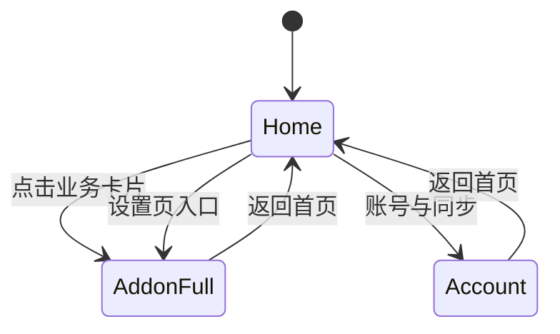

# 03 · UI 设计（工作台客户端界面）

## 前提：DSH 插件页面本来就是 React

实测结论：内置与社区插件的 client bundle 全部运行在共享 `react/jsx-runtime`，
样式管道支持 CSS Modules（宿主注入 `<style data-plugin-css>`），并有
`dsh-client-ui-theme` 的约 114 个 `--dsw-alias-*` 语义令牌。
所以"精美 UI"不需要引入 Vue 或新框架——**在同一棵 React 树里做设计**即可，
且自动跟随皮肤中心换肤。

## 信息架构

工作台是**卡片首页 + 业务插件沉浸式全页**的两级结构，主入口有两个，渲染同一个
`WorkbenchPage`：

| 入口 | slot | 定位 |
| --- | --- | --- |
| 左侧导航「工作台」 | `sidebar.panellist` + `main` | 主入口，占满主内容区 |
| 设置页插件 tab | `settings.plugins.tab` | 设置内打开同一页面 |

侧栏图标选型：主入口用 lucide `layout-dashboard` 的几何（一大三小），不用四等分方块——四等分
是「更多」入口的造型，一格只有三个入口，撞形就分不清；也不用「外框 + 内线」造型（如
`panels-top-left`），它和「上下文洞察」的表格图标同族。图标的 `size` 必须由插槽透传、描边
固定 1.5，并带 `aria-hidden="true"`，这样折叠/展开与浅色/深色下都跟相邻入口同尺度。
实机对照见 [assets/53-sidebar-icon/light-dark-compare.png](assets/53-sidebar-icon/light-dark-compare.png)。

首页布局（按栏目分段的卡片网格）：

```
┌───────────────────────────────────────────────────────┐
│ 工作台                                                 │
│ 离线优先 · 业务插件由 DSH 安装                         │
├───────────────────────────────────────────────────────┤
│ 工作与计划 2                                           │
│ ┌ 记录 ─────────┐ ┌ 标签 ──────────┐                   │
│ │ 任务树 + 9 视图  │ │ 创建与管理标签  │                   │
│ └─────────────────┘ └────────────────┘                 │
│ 沟通与消息 1                                           │
│ ┌ 邮件 ──────────┐                                    │
│ └─────────────────┘                                    │
│                                                       │
│ 工作台管理                                             │
│ ┌ 账号与同步 ─────┐                                   │
│ │ 登录、备份与同步 │                                   │
│ └─────────────────┘                                   │
└───────────────────────────────────────────────────────┘
```

- 每张业务 card 由已注册域（`/workbench/api/domains`）自动生成，图标取标题首字，
  显示版本与描述；没有已加载业务插件时显示空态；
- 业务 card 按**栏目**分段：栏目由宿主定义（`packages/shell/src/infra/categories.ts` 的
  `HOME_CATEGORIES`，顺序即首页顺序），插件在 `registerDomain` 里用 `category` 声明归属；
  每段显示「栏目名 + 插件数」，空栏目不渲染，段内保持注册顺序；
  未声明、空串或未知栏目 id 一律落兜底栏目「其他」（宿主打日志、不阻断注册），
  宿主没下发 `categories` 时回退成平铺单网格。栏目样式沿用 `.wb-home-grid` 栅格，
  `<=760px` 单列；栏目 id 一经发布只能新增不能改名；
- 点 card 进入该业务插件全页：沉浸式 `position:fixed; inset:0`，占满整个应用视口
  （覆盖 DSH 侧栏），顶部仅有「← 返回首页」与右侧的插件标题/版本 badge；
  标题/描述由业务视图自带，避免重复大标题；
- 同一插件多个视图时，全页内显示视图切换；单视图不显示切换条；任务、标签、站点的页签顺序为「统计 → 记录 → 配置 → 数据」，统计排第一；
- 管理区只剩「账号与同步」；插件安装/升级/卸载交给 DSH 设置页的插件列表；
- 窄屏 <760px 时卡片改为单列，主内容区 padding 收窄，全页顶栏隐藏标题文字只留图标与版本。



## 后续入口（未实现）

| 入口 | slot | 定位 |
| --- | --- | --- |
| 快速面板 | `sidebar.right.pane.tab` | 会话侧随时速记/勾选今日任务，弱干扰 |
| 命令浮层 | `shell.overlay` | ⌘K 式快捷录入与跳转（M2 再做） |

## 视觉规范（对齐宿主 token，做出"工作台感"）

- 颜色只用 `--dsw-alias-label-*/border-*/state-business-primary` 等语义变量，
  **不写死色值**——这是与内置页面拉开质感又不跳戏的关键；
- 圆角/阴影用 `--dsw-radius-*` / `--dsw-elevation-*`；
- 数据密度高于聊天页：卡片 + 微图表（自绘 SVG，避免引重型图表库进宿主 bundle）；
- 动效克制：列表 FLIP、勾选打勾动画（CSS-only），尊重 `prefers-reduced-motion`；
- i18n：宿主与各业务插件各自内置 zh/en 文案。
- 列表状态用**视觉分层**表达，不只靠一条色条：行首一个状态图标（未读＝闭合信封
  `--wb-accent`、已读＝开启信封 `--wb-muted` + `opacity:.7`）＋文字层（未读 650 字重
  正文色、已读 400 字重且 `color-mix(in srgb,currentColor 72%,transparent)` 减淡）。
  图标本身 `aria-hidden`，语义写在容器的 `role="img"` + `aria-label`/`title` 上，
  键盘焦点仍落在整行按钮；参考对照见
  [`assets/51-mail-unread-read/light-dark-narrow.png`](./assets/51-mail-unread-read/light-dark-narrow.png)。

## 组件分层

```
packages/shell/client/client.js     # 宿主：卡片首页、账号页、沉浸式框架、__WB_HOST__
packages/addons/*/client/client.src.cjs  # 业务源码：require("react") + 各自引入 lucide-react 图标
packages/addons/*/lib/client.js     # 业务构建产物：ModuleLoader 模块，注册 view 组件
```

- 宿主只提供壳与共享桥（`react/jsx/h`、`registerAddon`、`__WB_HOST__.addons`），
  不规定业务内部组件；业务插件自带样式（id 去重、更新 textContent）与交互；
- 业务视图通过 `api.call(action)` 走宿主 HTTP，通过 `api.subscribe(fn)` 接收
  `domains-changed` / `domain-event`（例如 `tasks-changed`、`sites-changed`）；
- 跨插件能力通过 `host.addons` 判断（例如站点检测标签插件是否加载），
  而不是直接 import 另一个插件。

- **富文本正文由内容决定纸面**：邮件正文在沙箱 iframe 里渲染，纸面配色先看邮件自己的背景声明——浅色设计给浅纸面、深色设计给深纸面，未声明时才跟随界面主题；正文文字色由纸面亮度决定（不是直接抄主题文字色），保证对比度 ≥ 4.5:1。邮件自带的 `prefers-color-scheme` 按应用主题求值，不跟随操作系统。页头提供「按原信配色 / 跟随界面主题」切换，默认值来自配置项 `display.mailTheme`，外框统一垫一层 `--wb-card` 底与内边距，避免白块/暗块贴边。

## 锁定态（保险箱门禁）

敏感插件（保险箱三页、邮件四个视图）在服务端 `vault.status` 返回未解锁、
未初始化、未安装或读失败时，**只渲染锁定卡，不渲染任何业务内容**：

- 共享组件 `packages/addons/lib/vault-lock.cjs`：`create({ prefix, wrapClass,
  Icon, title, hint })` 返回 `use`（4 秒轮询 `vault.status`，默认
  `locked: true`，fail-closed）、`Panel`（`.{prefix}-lock-card`，
  `role="status"` + `aria-live="polite"`，图标 + 标题 + 一句引导 + 可选错误提示）、
  `gate`（`gate(Inner, h, React, C)` 包一层，锁定时代替 Inner 渲染 Panel）与
  `styles()`（三条卡片规则，颜色全部取 `--wb-border`/`--wb-card`/`--wb-muted`）。
- 内层视图在锁定时**根本不挂载**，因此列表、详情、选中项、在途响应一并消失；
  解锁后下一次轮询（≤4 秒）自动恢复，不需要刷新页面。
- 邮件页的锁定文案必须点明范围：「锁定期间不显示发件人、主题、正文与附件」。
- 服务端同侧门禁：`mail` 域的 action 除 `mail.providerList`、`mail.actionSchema`
  外统一先查 `vault.status`，锁定时抛 `code=VAULT_LOCKED`，agent 与界面都拿不到
  邮件字段（见 `docs/插件功能清单.md` 8.8）。
- 回归：`npm run test:vault-lock`、`npm run test:mail-vault-gate`。

## 实时性

UI 直接读 SQLite 经 HTTP 桥返回的 JSON；本地变更通过 SSE 广播
（`/workbench/api/events`），同页多开与快速面板自动一致。
不用 WebSocket：同源单工、只读通知，SSE 更便宜且断线自愈。

## 备选路线对比

| 路线 | 说明 | 结论 |
| --- | --- | --- |
| 独立站点（新 webServer prefix 挂整套 SPA） | 可以带 router/图表任意框架 | ✗ 一期不做：脱离宿主主题、要自己处理鉴权与皮肤；留作"大屏模式"演进项 |
| iframe 承载业务页面 | 任意技术栈 | △ 强隔离备选，见 04；默认走同 tree React |
| 宿主 slot 内 React（本方案） | 共享主题/语言/加载器，体验一体 | ✓ |
