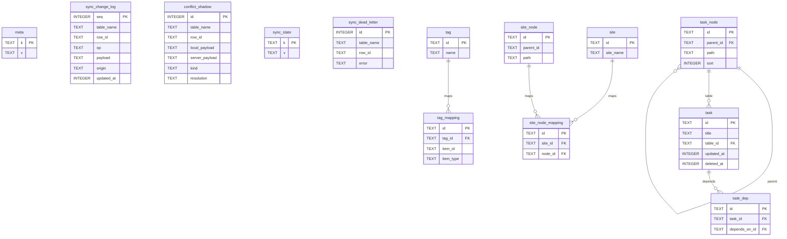
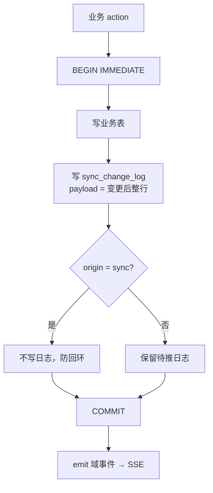

# 05 · 本地存储设计（SQLite）

## 为什么直连 SQLite 而不是宿主 storageDomain

宿主 `storageDomain` 的先例是 **zod KV → 单个 JSON 文件**：读全量、写全量、进程内事件。
工作台的负载不同：

- 要按条件查询（今日任务、标签过滤、打卡连续性统计）；
- 同步需要**行级增量**与变更游标；
- 业务插件各自建表，数据量随时间增长。

JSON 域全部不匹配。实现选择 `node:sqlite`（Node ≥22.5 内置，零原生依赖），
由壳在 `openDb()` 中统一打开并开启 WAL；不在本机另起数据库进程。

## 文件布局（实现）

```
~/.dsh/workbench/
├── workbench.db              # WAL 模式；单进程权威
├── workbench.db-wal / -shm   # SQLite 运行时文件
├── cloud-creds.json          # 云端登录凭据（0600，refresh token）
└── files/                    # 文件字节，内容寻址（见 17）
    ├── blobs/<aa>/<bb>/<sha256>
    └── staging/              # 上传中的 .part
```

业务插件不再是“解包到 workbench 目录里的代码”，而是 DSH 原生包：
代码在 `~/.dsh/profiles/<profile>/node_modules/dsh-workbench-*`，
由 DSH 的 `plugin add/remove` 管理。工作台目录只保留数据与账号凭据。
卸载业务插件只移除代码，**不删数据库表**；重装后数据仍在。
数据备份的 zip 由用户下载/选择，不写入 `~/.dsh/workbench/`。

## Schema：平台表与业务表分离



壳只建平台表（`packages/core/src/schema.ts`）：

```sql
PRAGMA journal_mode=WAL;

CREATE TABLE IF NOT EXISTS meta (
  k TEXT PRIMARY KEY, v TEXT NOT NULL
);

-- 通用变更日志：写事务内追加；未推送尾部即待同步队列
CREATE TABLE IF NOT EXISTS sync_change_log (
  seq INTEGER PRIMARY KEY AUTOINCREMENT,
  table_name TEXT NOT NULL,
  row_id TEXT NOT NULL,
  op TEXT NOT NULL,              -- upsert | delete | reset
  payload TEXT,                  -- 变更后整行 JSON；delete 也为完整墓碑行
  origin TEXT NOT NULL,          -- ui | agent | sync | import | sync-repair | conflict-resolve
  updated_at INTEGER NOT NULL
);

-- LWW 输方的远端版本留档，绝不静默吞数据
CREATE TABLE IF NOT EXISTS conflict_shadow (
  id INTEGER PRIMARY KEY AUTOINCREMENT,
  table_name TEXT NOT NULL,
  row_id TEXT NOT NULL,
  local_payload TEXT,
  server_payload TEXT,
  kind TEXT NOT NULL DEFAULT 'pull',       -- pull | push | unique | pull-equal
  resolution TEXT NOT NULL DEFAULT 'server',-- server | local
  server_updated_at INTEGER,
  local_updated_at INTEGER,
  resolved_at INTEGER NOT NULL
);

CREATE TABLE IF NOT EXISTS sync_state (
  k TEXT PRIMARY KEY, v TEXT NOT NULL      -- 水位/账号绑定/epoch/时钟偏移/失败表
);

CREATE TABLE IF NOT EXISTS sync_dead_letter (
  id INTEGER PRIMARY KEY AUTOINCREMENT,
  table_name TEXT NOT NULL,
  row_id TEXT NOT NULL,
  op TEXT NOT NULL,
  payload TEXT,
  error TEXT,
  attempts INTEGER NOT NULL DEFAULT 1,
  created_at INTEGER NOT NULL,
  updated_at INTEGER NOT NULL
);
```

业务表不在宿主里，由各业务插件的 `setup` / `migrations` 创建。以「任务记录」为例
（`packages/addons/tasks/lib/db.js`；`migrations` 为空，`setup` 里的 `ensureSchema`
先检测旧表并迁移，再执行 DDL；旧库缺 `task.sort` / `task.dedupe_key` 时
用 `ALTER TABLE` 补列并补索引）：

```sql
CREATE TABLE IF NOT EXISTS task (
  id TEXT PRIMARY KEY,
  title TEXT NOT NULL,
  description TEXT NOT NULL DEFAULT '',
  status TEXT NOT NULL DEFAULT '0',      -- 0 ACTIVE / 1 SHUTDOWN / 2 DONE / 3 RESTARTED
  type TEXT NOT NULL DEFAULT '0',        -- 0 WORK / 1 LIFE / 2 STUDY / 3 DEV
  priority INTEGER NOT NULL DEFAULT 0,
  difficulty REAL,
  table_id TEXT NOT NULL,                -- 所属任务表（task_node.type='1'）
  timeline_key TEXT,
  restart_key TEXT,
  publish_date TEXT NOT NULL,            -- YYYY-MM-DD
  target_date TEXT NOT NULL,
  done_date TEXT,
  shutdown_date TEXT,
  sort INTEGER NOT NULL DEFAULT 0,        -- 手动排序（tasks.reorder）
  dedupe_key TEXT,                       -- 幂等创建键（tasks.create 的 dedupeKey）
  created_at INTEGER NOT NULL,
  updated_at INTEGER NOT NULL,
  deleted_at INTEGER,
  rev INTEGER NOT NULL DEFAULT 1
);
CREATE INDEX IF NOT EXISTS idx_task_table_id ON task(table_id);
CREATE INDEX IF NOT EXISTS idx_task_open
  ON task(status, target_date) WHERE deleted_at IS NULL;
CREATE INDEX IF NOT EXISTS idx_task_sort ON task(sort);
CREATE INDEX IF NOT EXISTS idx_task_dedupe ON task(dedupe_key) WHERE dedupe_key IS NOT NULL;

-- 任务依赖：task_id 阻塞于 depends_on_id
CREATE TABLE IF NOT EXISTS task_dep (
  id TEXT PRIMARY KEY,
  task_id TEXT NOT NULL,
  depends_on_id TEXT NOT NULL,
  created_at INTEGER NOT NULL,
  updated_at INTEGER NOT NULL,
  deleted_at INTEGER,
  rev INTEGER NOT NULL DEFAULT 1
);
CREATE UNIQUE INDEX IF NOT EXISTS uk_task_dep
  ON task_dep(task_id, depends_on_id) WHERE deleted_at IS NULL;

CREATE TABLE IF NOT EXISTS task_node (
  id TEXT PRIMARY KEY,
  name TEXT NOT NULL,
  type TEXT NOT NULL,                    -- 0 GROUP / 1 TABLE / 2 ROOT
  parent_id TEXT NOT NULL DEFAULT '0',
  path TEXT NOT NULL,                    -- /1/2/3/
  sort INTEGER NOT NULL DEFAULT 0,
  depth INTEGER NOT NULL DEFAULT 0,
  created_at INTEGER NOT NULL,
  updated_at INTEGER NOT NULL,
  deleted_at INTEGER,
  rev INTEGER NOT NULL DEFAULT 1
);
CREATE INDEX IF NOT EXISTS idx_task_node_path ON task_node(path);
CREATE INDEX IF NOT EXISTS idx_task_node_sort ON task_node(parent_id, sort);
```

其他索引（`idx_task_status/updated_at/timeline/restart`、`idx_task_node_parent/type`）
见 `packages/addons/tasks/lib/db.js`。

「标签」插件（`packages/addons/tags/lib/db.js`）另建两条行级表：

```sql
CREATE TABLE IF NOT EXISTS tag (
  id TEXT PRIMARY KEY,
  name TEXT NOT NULL,
  created_at INTEGER NOT NULL,
  updated_at INTEGER NOT NULL,
  deleted_at INTEGER,
  rev INTEGER NOT NULL DEFAULT 1
);
CREATE TABLE IF NOT EXISTS tag_mapping (
  id TEXT PRIMARY KEY,
  tag_id TEXT NOT NULL,
  item_id TEXT NOT NULL,
  item_type TEXT NOT NULL,               -- 例如 'site'
  created_at INTEGER NOT NULL,
  updated_at INTEGER NOT NULL,
  deleted_at INTEGER,
  rev INTEGER NOT NULL DEFAULT 1
);
-- 标签允许重名：只建普通索引，不再建唯一索引，tags.create 也不查重
CREATE INDEX IF NOT EXISTS idx_tag_name ON tag(name) WHERE deleted_at IS NULL;
CREATE UNIQUE INDEX IF NOT EXISTS uk_tag_mapping
  ON tag_mapping(tag_id, item_id, item_type) WHERE deleted_at IS NULL;
```

「站点」插件（`packages/addons/sites/lib/db.js`）建三张表：

```sql
CREATE TABLE IF NOT EXISTS site (
  id TEXT PRIMARY KEY,
  site_name TEXT NOT NULL DEFAULT '未命名',
  description TEXT NOT NULL DEFAULT '',
  bindable INTEGER NOT NULL DEFAULT 1,
  site_link TEXT,                        -- JSON 链接数组
  created_at INTEGER NOT NULL,
  updated_at INTEGER NOT NULL,
  deleted_at INTEGER,
  rev INTEGER NOT NULL DEFAULT 1
);

CREATE TABLE IF NOT EXISTS site_node (
  id TEXT PRIMARY KEY,
  name TEXT NOT NULL,
  parent_id TEXT NOT NULL DEFAULT '0',   -- 0 是虚拟根，不落库
  path TEXT NOT NULL,                    -- /a/b/c/
  sort INTEGER NOT NULL DEFAULT 0,
  depth INTEGER NOT NULL DEFAULT 0,
  created_at INTEGER NOT NULL,
  updated_at INTEGER NOT NULL,
  deleted_at INTEGER,
  rev INTEGER NOT NULL DEFAULT 1
);

CREATE TABLE IF NOT EXISTS site_node_mapping (
  id TEXT PRIMARY KEY,
  site_id TEXT NOT NULL,
  node_id TEXT NOT NULL,
  created_at INTEGER NOT NULL,
  updated_at INTEGER NOT NULL,
  deleted_at INTEGER,
  rev INTEGER NOT NULL DEFAULT 1
);
CREATE UNIQUE INDEX IF NOT EXISTS uk_site_node_mapping
  ON site_node_mapping(site_id, node_id) WHERE deleted_at IS NULL;
```

目录树不用 MPTT：`parent_id + path + sort + depth`，子树查询用
`path LIKE '/x/%'`，移动只重写被移动子树。站点与标签的关系复用
`tag_mapping(item_type='site')`，不重复建标签表。

通用列约定（参与同步的表）：`id`（UUIDv7）、
`rev`、`updated_at`（毫秒）、`deleted_at`（软删除墓碑）。addon 的 `tables` 字段只是
声明与校验，真正建表/加列由它自己的迁移代码完成。

## 写路径纪律



1. addon 通过注入的 `api.db` 写自己的表；壳不提供 repository 层，也不感知业务列；
2. 每次业务写应同时追加 `sync_change_log`（任务 addon 已这样做），
   未推送的尾部就是天然的待同步队列，无需第二份 outbox；
3. `origin='sync'` 的应用远端变更**不写** change_log，防止回环；
4. 远端 upsert 采用整行 LWW：`updated_at` 新者胜，输方写入 `conflict_shadow`；
   表不存在时（业务插件已卸载）静默跳过，不阻塞同步；
5. `tag_mapping` / `site_node_mapping` 的唯一键冲突按 lww-tombstone 处理：输者
   软删并补 repair 日志，胜者写入；
6. 写操作在 SQLite 单连接上串行执行，WAL 提供崩溃安全。

## 迁移策略（现状）

- 壳启动时对 `workbench.db` 执行一次 `SCHEMA_SQL`（全部 `IF NOT EXISTS`）；
- 业务插件每次加载时按其 `migrations` 数组顺序执行 SQL，因此迁移必须幂等
  （`CREATE TABLE IF NOT EXISTS`；加列前用 `PRAGMA table_info` 探测）；
  「任务记录」「标签」「站点」是例外：`migrations` 为空，`setup` 内先执行
  `ensureSchema`，这样能在建新表之前看到旧表并完成数据搬迁（详见
  `packages/addons/tasks/lib/db.js`、`packages/addons/tags/lib/db.js`、
  `packages/addons/sites/lib/db.js`）；
- 尚未引入 `user_version`、`addon_migrations` 记录和迁移前自动备份；
  这些是 M3 的硬化项，当前靠幂等 SQL 保证重复加载安全；
- 跨版本 payload 演进遵循"加字段不减字段"，老客户端忽略未知字段。

## 容量与清理（部分待做）

- `sync_change_log` 目前只增不减；计划在推送成功后按 seq 截断，保留 90 天窗口；
- 软删除行计划 180 天后物理回收；
- 暂存目录已有 1 小时清理；数据库备份与 VACUUM 调度尚未实现。
