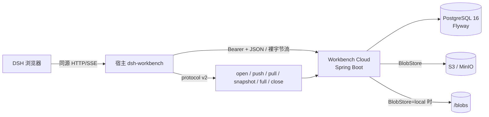
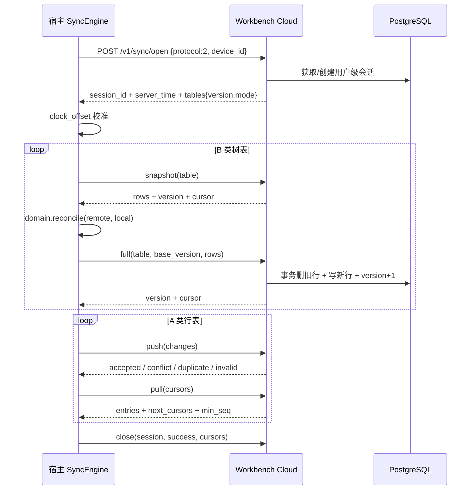

# 06 · 云端设计（Workbench Cloud）

## 职责边界

云端是独立的 Java 服务，负责 **账号、设备、数据同步**，以及文件字节的对象存储索引。
业务插件仍然由 DSH 从 npm / 本地路径安装，云端不认识插件包，也不提供插件目录或下载。
宿主不登录、不联网时，本地工作台完整可用；云端只是可选的跨设备同步与备份节点。

代码位置：独立仓库 `dsh-workbench-cloud`（[GitHub](https://github.com/ityyq777/dsh-workbench-cloud) /
[Gitee](https://gitee.com/yang7it/dsh-workbench-cloud)），不是宿主仓库的 `packages/cloud`。
默认监听 `0.0.0.0:8791`，运行数据在仓库下的 `./data/`（PostgreSQL 与本地 blob 目录）。



## 技术实现

| 项 | 实现 |
| --- | --- |
| 运行时 | Java 21，Maven 3.8+ |
| 框架 | Spring Boot 3.4.5：spring-web、spring-jdbc、actuator |
| 数据库 | PostgreSQL 16，HikariCP，Flyway 启动迁移 |
| 数据访问 | `JdbcTemplate` 手写 SQL；不用 JPA/ORM，不隐藏 SQL |
| 对象存储 | AWS SDK for Java v2（S3），兼容 MinIO / R2 / OSS |
| 密码 | BouncyCastle `scrypt`（N=16384, r=8, p=1），格式 `scrypt_N_r_p_salt_hash` |
| 令牌 | access token + refresh token 随机串，数据库只存 SHA-256；refresh 轮换 |
| 传输 | 明文 HTTP，仅本机/内网；正式部署放 TLS 反向代理后 |
| 文件上传 | 原始字节流，边收边写临时文件并算 SHA-256，不把文件读进内存 |

## 工程结构

```text
dsh-workbench-cloud/
├── pom.xml
├── docker-compose.yml              # 只起 PostgreSQL，不打包应用镜像
├── .env.example
└── src/main/
    ├── java/com/dsh/workbench/cloud/
    │   ├── WorkbenchCloudApplication.java
    │   ├── config/                 # CloudProperties / S3Config / BlobStoreConfig
    │   ├── web/                    # Auth / Me / Sync / Files 控制器与异常处理
    │   ├── service/                # AuthService / SyncService / FileService
    │   │                           # BlobStore + LocalBlobStore + S3BlobStore
    │   │                           # BlobRefIndex / BlobGc
    │   └── util/                   # CanonicalJson / Json / Ids / Hex
    └── resources/
        ├── application.yml
        └── db/migration/V1__cloud.sql
```

## 数据模型

```sql
users(id text PRIMARY KEY, email text UNIQUE, pass_hash text, created_at bigint)
access_tokens(token_hash text PRIMARY KEY, user_id, device_id, expires_at bigint)
refresh_tokens(token_hash text PRIMARY KEY, user_id, device_id,
               expires_at bigint, replaced_by text)
devices(id, user_id, name, last_cursor bigint, last_sync_at bigint, cursors text,
        PRIMARY KEY(id, user_id))

-- 一次同步一把用户级锁；同设备重新 open 会顶掉旧会话
sync_sessions(user_id PRIMARY KEY, session_id UNIQUE, device_id,
              opened_at bigint, expires_at bigint)

-- 同步核心：每个 (table,row) 的服务端最新态 + 拉取序
change_log(server_seq bigserial PRIMARY KEY, user_id, device_id,
           client_epoch text, client_seq bigint, table_name, row_id, op,
           payload jsonb, updated_at bigint,
           UNIQUE(user_id, device_id, client_epoch, client_seq))
row_states(user_id, table_name, row_id, payload jsonb NOT NULL,
           deleted boolean, updated_at bigint,
           PRIMARY KEY(user_id, table_name, row_id))

-- 树表整表版本与模式（row / tree）
sync_table_state(user_id, table_name, version bigint, mode text, updated_at,
                 PRIMARY KEY(user_id, table_name))

-- 文件字节索引（见 17）：对象在 local 磁盘或 S3
blobs(user_id, sha256, size bigint, mime, backend, storage_key, state,
      created_at bigint, verified_at bigint, last_access_at bigint,
      PRIMARY KEY(user_id, sha256))
blob_refs(user_id, file_id, sha256, deleted boolean, updated_at bigint,
          PRIMARY KEY(user_id, file_id))
```

- 所有时间戳都是 Unix 毫秒（`bigint`），与宿主的 `updated_at` 语义一致。
- `deleted` 是真正的 `boolean`；宿主同步行里的软删标记仍然是 `deleted_at`。
- `row_states` 不复制业务表白名单；服务端只校验表名格式与 payload 大小。
- `blob_refs` 是派生索引，可从 `row_states WHERE table_name='file'` 全量重建。

## API

```text
POST /v1/auth/signup | /login | /refresh        # 返回 accessToken/refreshToken/userId/deviceId
GET  /v1/me                                     # 用户 + 设备列表
DELETE /v1/devices/:id                          # 吊销设备

POST /v1/sync/open       { protocol: 2, device_id }
  resp: { ok, session_id, server_time, expires_at, tables: { <table>: { version, mode } } }
POST /v1/sync/push       { session_id, client_epoch, changes:[{ client_seq, table_name, row_id,
                           op, payload, updated_at }] }
  resp: { ok, accepted_up_to, results:[accepted|conflict|duplicate|invalid|equal] }
POST /v1/sync/pull       { session_id, cursors: { <table>: n }, limit }
  resp: { ok, entries, next_cursors, has_more, min_seq }
POST /v1/sync/snapshot   { session_id, table }
  resp: { ok, rows, cursor, version, mode }
POST /v1/sync/full       { session_id, table, base_version, rows }
  resp: { ok, version, cursor }            # base_version 不匹配返回 409 version_conflict
POST /v1/sync/close      { session_id, success, cursors }

# 文件字节面（独立于 sync 会话；见 17）
POST /v1/files/check     { hashes: [...] }   # 云端已有 / 缺失
PUT  /v1/files/blobs/:sha256                 # 裸字节流上传，Content-Length 必填
GET  /v1/files/blobs/:sha256                 # 下载；S3 默认 302 预签名，?proxy=1 走代理
HEAD /v1/files/blobs/:sha256
GET  /v1/files/quota
```

要点：

- **只支持 protocol v2**：`open` 校验 `protocol === 2`，否则 426 `protocol_required`。
- **会话锁**：同一用户只保留一个会话；另一台设备持有中返回 409 `sync_locked`，
  带 `retry_after_ms`。会话 TTL 默认 300 秒（夹在 10–600 秒之间），
  push/pull/snapshot/full 每次续期；`close` 释放。
- **push 幂等**：以 `(device_id, client_epoch, client_seq)` 去重；重复推同一区间
  返回 `duplicate`，`accepted_up_to` 照常推进。
- **pull 按表游标**：客户端为每张表记 `server_seq` 水位；云端日志出现缺口
  （`min_seq > cursor + 1`）时客户端改用 snapshot 重建。limit 默认 200、上限 1000。
- **鉴权**：除 signup/login/refresh 与健康检查外都需要 Bearer access token；
  refresh 轮换，旧 refresh 再用即拒绝。
- **无业务白名单**：服务端只校验表名格式与 payload 大小，表集合来自插件声明的
  `DomainDef.sync`，新增业务表不用改云端。
- **LWW**：`row_states` 按 `updated_at` 比较；相等时已有服务端行胜，冲突返回完整
  `current` 行供客户端写 `conflict_shadow`。
- **树表整表覆盖**：`sync_table_state.version` 做乐观锁；`full` 在同一事务内删旧行、
  写新行、写一条 `op=reset` 日志并递增版本。

同步一轮的端到端时序：



## 文件字节面

### 上传

`PUT /v1/files/blobs/:sha256`：

1. `:sha256` 必须是小写 64 位十六进制；否则 400 `invalid_sha256`。
2. `Content-Length` 必填，缺失返回 411 `length_required`；请求体走原始字节流。
3. 边写临时文件边算 SHA-256，同时校验单文件上限（默认 200MB）→ 413 `file_too_large`。
4. 实际字节数与 `Content-Length` 不符 → 422 `size_mismatch`；
   哈希与路径参数不符 → 422 `sha256_mismatch`。
5. 已有同一 `(user, sha256)` 且 `state='ready'`、大小相同时直接返回
   `200 { ok, sha256, size, deduped: true }`（仍会读完并校验请求体，避免半截连接）。
6. 配额 `SUM(size) WHERE state='ready'` + 本次大小超过 20GB → 413 `quota_exceeded`。
7. 写入 BlobStore（S3 或本地目录），再 upsert `blobs` 为 `ready`；
   首次写入返回 201 `deduped:false`。对象存储失败返回 503 `blob_store_unavailable`。

`storage_key = u/<userId>/<sha[0:2]>/<sha256>`；`backend` 按写入时的配置记录，
读时按行里的 `backend` 选择实现。

### 检查与配额

```http
POST /v1/files/check
{ "hashes": ["9f2c...", "..."] }

200 { "ok": true, "have": ["9f2c..."], "missing": ["..."] }
```

- 单批最多 200 个；格式错误 400 `invalid_hashes` / `invalid_sha256`。
- `have` 只表示数据库有 `ready` 行，不逐个 HEAD 对象；对象丢失由下载 404 暴露。

```http
GET /v1/files/quota
200 { "ok": true, "used_bytes": 123, "quota_bytes": 21474836480, "blob_count": 9 }
```

### 下载

- `GET` 必须有 `blobs(state='ready')` 行，且存在 `blob_refs(deleted=false)`；
  否则 404 `blob_not_found` / `blob_not_referenced`（防止按哈希探测）。
  `HEAD` 只要求 `blobs` 行存在，不检查引用。
- `local`：流式返回，支持 `Range`（206 + `Content-Range`）。
- `s3`：默认 302 到 300 秒预签名 URL，只带 `Location` 与 `Cache-Control: no-store`；
  客户端跟随时要**去掉 Authorization**。带 `?proxy=1` 时服务端代理流式返回，
  仍支持 Range。
- 代理/本地响应头：`Content-Type`（取 blob 的 MIME，缺省 octet-stream）、
  `Content-Length`、`Accept-Ranges: bytes`、`X-Content-Type-Options: nosniff`。
  真实文件名与 `Content-Disposition` 由宿主按 `file` 行决定。

### 引用与 GC

`blob_refs` 在 push 接受 `file` 行后由 `BlobRefIndex` 维护：存活 `file` 写
`deleted=false`，墓碑或 `sha256` 变化写 `deleted=true`。`file_link` 不携带 sha，
不参与引用。

`BlobGc` 每 6 小时跑一次（`wb.files.gc-interval-ms`）：删除
`created_at < now - 7d` 且没有任何存活引用的 blob；先删对象，再删 `blobs` 行，
对象删除失败则保留行下次重试。被引用的 blob 永不因时间删除。

## 配置与部署

| 变量 | 默认 | 说明 |
| --- | --- | --- |
| `WB_PORT` / `WB_BIND` | `8791` / `0.0.0.0` | 监听地址 |
| `WB_DB_URL` | `jdbc:postgresql://127.0.0.1:55432/workbench` | PostgreSQL JDBC URL |
| `WB_DB_USER` / `WB_DB_PASSWORD` | `workbench` / — | 必须改密码 |
| `WB_BLOB_BACKEND` | `s3` | `s3` 或 `local` |
| `WB_BLOB_DIR` | `./data/blobs` | local 后端根目录 |
| `WB_S3_ENDPOINT` | 空 | MinIO/S3 端点 |
| `WB_S3_REGION` | `us-east-1` | 签名区域 |
| `WB_S3_BUCKET` | `workbench` | 私有桶，启动时自动创建 |
| `WB_S3_PREFIX` | 空 | 对象 key 前缀 |
| `WB_S3_ACCESS_KEY_ID` / `WB_S3_SECRET_ACCESS_KEY` | — | 凭证只从环境/私有文件读 |
| `WB_S3_FORCE_PATH_STYLE` | `true` | MinIO 需要 |
| `WB_S3_SSE` | 空 | 配置项已预留；当前实现不发送 SSE 头 |
| `WB_FILES_MAX_BYTES` | `209715200` | 单文件 200MB |
| `WB_FILES_QUOTA_BYTES` | `21474836480` | 每用户 20GB |
| `WB_FILES_GC_GRACE_DAYS` | `7` | 孤儿 blob 宽限期 |

开发/服务器部署（不打应用镜像）：

```bash
git clone https://gitee.com/yang7it/dsh-workbench-cloud.git
cd dsh-workbench-cloud
cp .env.example .env && chmod 600 .env
# 填 PostgreSQL 密码与 MinIO AK/SK
docker compose up -d postgres
set -a; . ./.env; set +a
mvn -DskipTests package
nohup java -jar target/workbench-cloud.jar > app.log 2>&1 &
curl -s http://127.0.0.1:8791/v1/health
```

服务器上的 PostgreSQL 是独立容器 `workbench-postgres`，只绑定
`127.0.0.1:55432`，数据在 `./data/postgres`；不要复用机器上其他项目的数据库。
Flyway 在启动时自动执行 `V1__cloud.sql`。

### MinIO 兼容性

- 旧版 MinIO（如 `RELEASE.2023-07-11`）不接受 AWS SDK 2.30 默认附加的可选
  CRC32 校验和。客户端必须设置
  `requestChecksumCalculation=WHEN_REQUIRED` 与
  `responseChecksumValidation=WHEN_REQUIRED`，否则 PUT 会报
  `SignatureDoesNotMatch`。
- MinIO 走 path-style，`WB_S3_FORCE_PATH_STYLE=true`；开发期直接使用 HTTP
  endpoint 即可。`WB_S3_ALLOW_INSECURE` 是预留配置，当前实现未做 scheme 校验。
- 桶保持私有；不要配置“自动过期删除”，GC 由应用负责。
- S3 返回的 XML 错误不原样透传给浏览器；对象存储异常统一映射为
  `503 blob_store_unavailable`。

## 规模预期与降级

个人工具量级（万级行/用户、几十 GB 文件），单实例 Spring Boot + PostgreSQL
足够。真正要预留的是**协议稳定性**：服务端对未知业务表只做通用存储，
新增插件表不需要迁移云端。数据库或对象存储不可用时，宿主继续本地工作，
同步与文件传输按退避重试，不阻塞本地读写。

## 未做

- TLS、systemd、监控告警与数据库备份的一键化；
- 本地 blob → S3 的在线迁移脚本（当前靠逐行改 `backend/storage_key`，见 17）；
- 分片上传与 S3 直传（`upload_sessions` 尚未建表）；
- 端到端加密、字段级合并；
- 同步可视化页与故障注入测试；
- refresh token 家族重放检测之外的审计日志。
