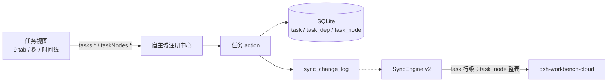
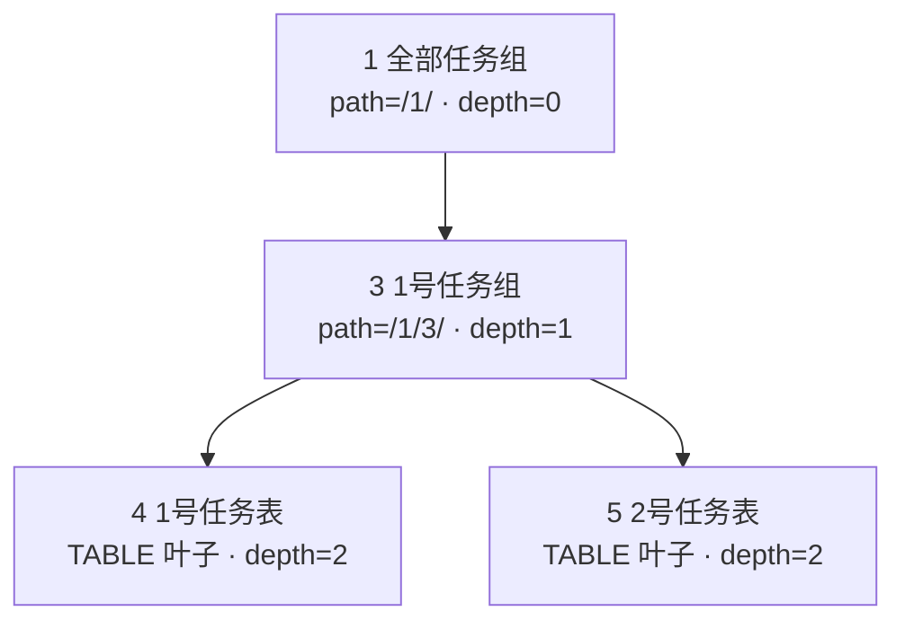
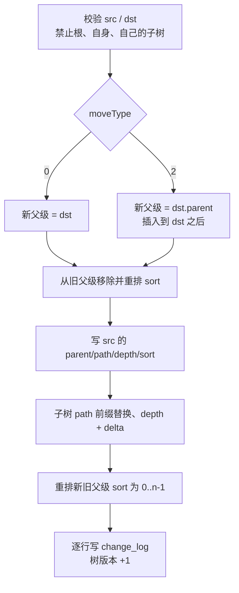

# 09 · 任务模块迁移方案

> 状态：设计稿，**本轮不改代码**。
> 目标：把 `_archive/sheepone-system` 的 task / task_node 模块，1:1 复刻到工作台子插件
> `wb-addon-tasks` 中；前端交互、字段语义保持不变，树结构由 MPTT 改为路径枚举。
> 云端只做数据备份，不承担任何业务逻辑。



## 0. 结论先行

1. **业务全部本地化**：任务的创建、列表、状态流转、时间线、重启、树操作、级联删除
   全部在本地 SQLite 完成，不调用云端接口。云端只接收备份数据。
2. **数据模型**：`task` 采用行级备份；`task_node` 采用整树快照备份，不能逐行 merge。
3. **树模型**：`parent_id + path + sort + depth`，`path` 形如 `'/1/3/7/'`，
   根节点固定 `id='1'`、`parent_id='0'`、`type='2'`（ROOT_GROUP）。
4. **接口形态**：以工作台 addon action 为准（`tasks.*` / `taskNodes.*`），
   旧前端的 `/task`、`/task_node` 作为适配层别名，不再作为服务端路由。
5. **字段命名**：数据库用 snake_case；接口用旧前端的 camelCase；
   `timeline_key`、`restart_key`、`table_id` 全部改为 TEXT（存节点 id 字符串）。
6. **删除语义**：用户看到的效果仍是“删掉子树/任务”；底层改为软删除，
   否则备份同步会把已删数据“复活”。这是有意的语义修正。
7. **不照抄旧 bug**：旧实现有 9 处确定缺陷（`shutdownDate` 丢失、描述编辑不提交、
   `path` 缺失、`parentId/parent` 不一致、`children/multiple_children/migrate` 缺失、
   `moveType` 被忽略、`tableId` 校验错表等）。本方案按“功能等价、缺陷修正”处理，
   逐条列在第 7.3 节。

---

## 1. 原模块盘点

### 1.1 原后端接口（Spring MVC）

源码：
`_archive/sheepone-system/sheepone-tasks/src/main/java/com/sheepone/system/tasks/controller/`。

| # | 方法 | 路径 | 请求 | 返回 | 业务要点 |
|---|---|---|---|---|---|
| 1 | POST | `/task` | `TaskCreateRequest` | `boolean` | 按 `source` 分三条创建路径 |
| 2 | PUT | `/task` | `UpdateTaskRequest` | `boolean` | 按 `type` 单字段更新 |
| 3 | POST | `/task/list` | `TaskListRequest` | `TaskListResponse` | 9 个 tab、分页/非分页两套 |
| 4 | POST | `/task/selected` | `List<Integer>` | `List<Task>` | 按 id 批量取 |
| 5 | GET | `/task/timeline?timelineKey=` | query | `List<Task>` | 时间线，排除 RESTARTED |
| 6 | PUT | `/task/timeline` | `{ids,timelineKey}` | `boolean` | 批量改时间线 key |
| 7 | GET | `/task/restart?restartKey=` | query | `List<Task>` | 重启链 |
| 8 | POST | `/task_node` | `{parentId,type}` | `boolean` | 新建组/表节点 |
| 9 | DELETE | `/task_node?id=` | query | `boolean` | 删子树，并删表节点下的任务 |
| 10 | POST | `/task_node/path` | `{nodeId}` | `List<TaskNodePathResponse>` | 根→当前节点路径 |
| 11 | GET | `/task_node/tree` | 无 | `List<TaskTreeNode>` | 实现是 `List.of(单棵树)` |
| 12 | PUT | `/task_node` | `{id,name}` | `boolean` | 重命名 |
| 13 | PUT | `/task_node/move` | `{nodeToMoveId,newParentId,newBrotherNodeId}` | `boolean` | controller 忽略 brother，固定 `moveType=0` |

另有定时任务（无 HTTP）：

- `TaskScheduler @Scheduled(cron = "0 0 0 * * ?")` → `shutdownTasks()`：
  `ACTIVE` 且 `target_date <= today` 的任务改为 `SHUTDOWN`，`shutdown_date = today`。

### 1.2 前端实际在用的接口

源码：`_archive/sheepone-fronted/src/services/tasksService.tsx`、
`_archive/sheepone-fronted/src/configs/GlobalRequest.tsx`。

- baseURL：`http://127.0.0.1:4170/api`
- 响应信封：`ServerResponse<T> = { code: string; data: T; msg: string }`，调用方读 `response.data.data`
- GET 参数放 axios `params`；数组用 `qs` 的 `arrayFormat: 'repeat'`
  （即 `?ids=1&ids=2`，不是 `ids[]=1`）
- POST/PUT 参数放 body

| 前端函数 | 方法/路径 | 参数 | 消费方 |
|---|---|---|---|
| `createTask` | POST `/task` | `TaskCreateRequest` | 创建弹窗 |
| `updateTask` | PUT `/task` | `UpdateTaskRequest` | 标题/描述/优先级/状态 |
| `getTaskList` | POST `/task/list` | `TaskListRequest` | 列表、卡片 |
| `getSelectedTaskList` | POST `/task/selected` | `number[]` | 批量选择面板 |
| `getTimelineList` | GET `/task/timeline` | `timelineKey` | 时间线 |
| `refactorTaskTimeline` | PUT `/task/timeline` | `{ids,timelineKey}` | 时间线批量重构 |
| `getRestartList` | GET `/task/restart` | `restartKey` | 重启链 |
| `migrateTable` | PUT `/task/migrate` | `{ids,tableId}` | 批量迁移到另一张表（**旧后端没有此接口**） |
| `createTaskNode` | POST `/task_node` | `{parentId,type}` | 树新增 |
| `deleteTaskNode` | DELETE `/task_node` | `id` | 树删除 |
| `getCurrentTaskListPath` | GET `/task_node/path` | `id` | 面包屑（**旧后端是 POST + nodeId**） |
| `getTaskNodeTree` | GET `/task_node/tree` | 无 | 首次整树 |
| `updateTaskNodeName` | PUT `/task_node` | `{id,name}` | 重命名 |
| `moveTaskNode` | PUT `/task_node/move` | `{sourceId,targetId,moveType}` | 拖拽（**旧后端字段名不同**） |
| `getTaskNodeChildren` | GET `/task_node/children` | `id` | 懒加载（**旧后端没有**） |
| `getMultipleNodeDirectChildren` | GET `/task_node/multiple_children` | `ids[]` | 拖拽后局部刷新（**旧后端没有**） |

### 1.3 旧数据模型

#### task

表 `task`，实体 `_archive/sheepone-system/sheepone-entities-mybatis/src/main/java/com/sheepone/system/entity/tasks/Task.java`：

| 字段 | 类型 | 说明 |
|---|---|---|
| `id` | Integer PK | 自增/数据库分配 |
| `title` | String | 标题 |
| `description` | String | 描述，可空 |
| `status` | String | `0` ACTIVE / `1` SHUTDOWN / `2` DONE / `3` RESTARTED |
| `type` | String | `0` WORK / `1` LIFE / `2` STUDY / `3` DEV |
| `priority` | Integer | 0..10；UI 滑块 1..10 |
| `difficulty` | Float | 0..5，前端半星 |
| `table_id` | Integer | 所属 `task_node`，必须是 TABLE |
| `timeline_key` | Integer | 时间线 key；默认创建时等于自身 id |
| `restart_key` | Integer | 重启源任务 id |
| `publish_date` | LocalDate | 发布日期 |
| `target_date` | LocalDate | 计划完成 |
| `done_date` | LocalDate | 实际完成 |
| `shutdown_date` | LocalDate | 关闭日期 |
| `create_time` | LocalDateTime | 继承 `BaseEntity` |
| `update_time` | LocalDateTime | 继承 `BaseEntity` |

没有 `is_deleted`，旧实现删除是物理删除。没有 `path` 字段。

#### task_node

表 `task_node`，实体 `TaskNode` 继承 `BaseMpttEntity`：

| 字段 | 类型 | 说明 |
|---|---|---|
| `id` | Integer PK | 节点 id |
| `name` | String | 节点名，默认“未命名” |
| `type` | String | 后端只有 `0` GROUP / `1` TABLE |
| `parent` | Integer | 父节点 id，根为 0 |
| `lft` / `rgt` | Integer | MPTT 左右值 |
| `tree_id` | Integer | 树 id；任务树固定 `TASK_TREE_ID=0` |
| `depth` | Integer | 层级 |
| `create_time` / `update_time` | LocalDateTime | 时间戳 |

删除是物理删；没有软删。

### 1.4 业务规则（必须保留）

#### 创建任务

`TaskServiceImpl.createTask` 的校验：

1. `title` 非 blank；
2. `tableId != null && tableId > 0`；
3. `publishDate != null`；
4. `targetDate != null && !targetDate.isBefore(publishDate)`；
5. `type` 必须是 `TaskTypeEnum`；
6. `status` 必须是 `TaskStatusEnum`，但**排除 RESTARTED**；
7. `ACTIVE`：`priority` 非空且 0..10；
8. `DONE`：`doneDate` 非空、`!doneDate.isBefore(publishDate)`、`difficulty` 非空且 0..5；
9. `SHUTDOWN`：`shutdownDate` 非空且 `!shutdownDate.isBefore(publishDate)`；
10. `source != TASK_TABLE` 时 `timelineKey` 非空且 `>0`。

创建分支：

- `source = TASK_TABLE`：走 `createTaskInTaskTable`，插入后把 `timelineKey`、`restartKey` 都设为自身 id。
- `source = TASK_TIMELINE`：走 `createTaskInTimeline`，`timelineKey` 用入参，插入后 `restartKey = 自身 id`。
- `source = TASK_RESTART`：先 `updateStatusOnRestart(restartKey)`，再走 `createTaskInRestart`；
  新任务 `status` 固定 ACTIVE，`restartKey`、`timelineKey` 都用入参。

> 已知缺陷：`createTask` 用 `baseMapper.existById(tableId)` 校验“任务表是否存在”，
> 实际查的是 `task` 表主键，不是 `task_node`。迁移时改为查 `task_node` 且 `type='1'`。

#### 更新任务

`UpdateTaskRequest.type` 四选一：

- `PRIORITY`：0..10；
- `DESCRIPTION`：null 归一为 `''`；
- `TITLE`：非空（旧代码只判 null，未判 blank）；
- `STATUS`：必须带 `date`；`DONE` 时 `difficulty` 0..5。

`updateStatus` 的写库语义：

- 总是写 `status`；
- 仅 `DONE` 时写 `done_date = date`、`difficulty`；
- 仅 `SHUTDOWN` 时写 `shutdown_date = date`。

没有状态迁移合法性校验（例如 DONE 可以改回 ACTIVE）。本方案保留“单字段更新”的语义，
但建议补状态机校验；见第 9 节待确认。

#### 列表（9 个 tab）

`TaskListTab`：

| 值 | 名称 | 条件 | 分页 |
|---|---|---|---|
| 0 | EMERGENCY 紧急任务 | `(priority >= 6 OR target_date <= today + 2)`，最后仍强制 `status = ACTIVE` | 否 |
| 1 | WORK 工作任务 | `type = 0`，强制 `status = ACTIVE` | 否 |
| 2 | LIFE 生活任务 | `type = 1`，强制 `status = ACTIVE` | 否 |
| 3 | STUDY 学习任务 | `type = 2`，强制 `status = ACTIVE` | 否 |
| 4 | DEV 开发任务 | `type = 3`，强制 `status = ACTIVE` | 否 |
| 5 | SHUTDOWN 已关闭 | `filterRestarted=true` → `status=SHUTDOWN`；false → `status=RESTARTED` | 是 |
| 6 | ACTIVE 已开启 | `status = ACTIVE` | 是 |
| 7 | DONE 已完成 | `status = DONE` | 是 |
| 8 | OVERVIEW 总览 | `filterRestarted=true` → `status != RESTARTED`；false → 不加条件 | 是 |

公共过滤：

- `titleKey` 非空 → `title LIKE '%' || ? || '%'`；
- `tableId` 非 null → `table_id = ?`；
- 否则 `groupId` 非 null → 取该组子树内所有 TABLE 节点 id，再 `table_id IN (...)`；空则返回空列表；
- `tab >= 5` 时 `checkedTypes` 必须非空，追加 `type IN (...)`；
- `tab 5/8` 的 `filterRestarted` 旧代码要求非 null。

排序：

- tab 0..4（非分页）：`priority DESC, target_date ASC, publish_date DESC`；
- tab 5..8（分页）：`publish_date DESC`。

分页响应：`{ records, current, size, total }`。

#### 时间线 / 重启

- 时间线：`timeline_key = ? AND status != RESTARTED ORDER BY publish_date ASC`。
- 重启链：`restart_key = ? ORDER BY publish_date ASC`。
- 批量重构：`ids` 非空、`timelineKey > 0`，批量改 `timeline_key`。

#### 重启状态流转

`updateStatusOnRestart(restartKey)`：

1. 该 `restart_key` 下所有 ACTIVE → SHUTDOWN，`shutdown_date = today`；
2. 再把这些 SHUTDOWN → RESTARTED；
3. 恒返回 true。

#### 树操作（旧 MPTT）

- `TASK_TREE_ID = 0`；
- `createTaskNode(parentId, type)`：`parentId >= 1`，type 合法，默认 name“未命名”；
- `deleteNode(id)`：取整棵子树 → 筛出 TABLE 节点 → `deleteByNodeIds` 物理删这些表下任务 →
  `deleteNodeById` 物理删节点；
- `updateNode(id,name)`：id 非空、name 非 blank、节点存在、新名不能与旧名相同；
- `move(source,target,moveType)`：校验存在且不同，调 MPTT 移动；
- `getCurrentTaskListPath(nodeId)`：返回根→当前节点。

### 1.5 前后端矛盾清单

这些是迁移时必须处理的事实，不是猜测：

| # | 矛盾 | 证据 | 处理 |
|---|---|---|---|
| 1 | 后端 Task 没有 `path`，前端却直接 `task.path.map` | `TaskListItemBreadcrumb.tsx`、`TaskTimelineLineItem.tsx` | 新接口为每个 task 返回 `path: TaskPathNode[]` |
| 2 | 后端树字段是 `parentId`，前端读 `node.parent` | `TaskTreeNode.java`、`TaskAntdTreeUtilsSingleton.tsx` | 新接口同时返回 `parent` 与 `parentId` |
| 3 | 前端用 `/task_node/children`、`/multiple_children`、`/task/migrate`，后端没有 | `tasksService.tsx` | 新 addon 实现这三个接口 |
| 4 | 路径接口方法/字段不一致 | 前端 GET `?id=`；后端 POST `{nodeId}` | 统一为 `taskNodes.path {id}` |
| 5 | 移动请求字段不一致 | 前端 `{sourceId,targetId,moveType}`；后端 `{nodeToMoveId,newParentId,newBrotherNodeId}` | 统一前端字段，真正实现 `moveType=0/2` |
| 6 | `shutdownDate` 创建时永远不提交，且旧 Mapper 不写该列 | `TaskCreateModal.tsx`、`TaskMapper.java` | 新实现提交并持久化 |
| 7 | 描述编辑永远不提交 | `TaskListItemDescription.tsx` 比较自身 | 修正条件 |
| 8 | `tableId` 校验查错表 | `TaskServiceImpl.createTask` | 改查 `task_node(type='1')` |
| 9 | 后端无 ROOT_GROUP，前端有 `type='2'` | `TaskEnums.tsx` vs `TaskNodeTypeEnum.java` | 新库保留 `type='2'`，只用于根节点 |
| 10 | 旧库无软删，v2 要求软删 | 实体无 `is_deleted`；v2 方案 §3.2.4 | 新库软删，UI 过滤 |
| 11 | v2 的 `timeline_key` 仍是 INTEGER，但 id/restart_key 已 TEXT | v2 DDL | 统一 TEXT |
| 12 | 归档 Mapper XML 已陈旧 | `TaskMapper.xml` priority=VARCHAR、列名 `difficult` | 不参考 XML，按实体/服务语义 |

---

## 2. 目标架构与约定

### 2.1 落在哪个插件

沿用现有业务插件（DSH 原生包）：

- 包：`dsh-workbench-tasks`
- 域 id：`wb-addon-tasks`
- 视图：`views: [{ id: "tasks", title: { zh: "任务记录", en: "Tasks" } }]`
- 表：`task`、`task_dep`、`task_node`
- Node 侧：`lib/index.js` 导出 `apply(ctx)`，通过 `ctx.workbench.registerDomain`
  注册域；域定义里 `migrations` 留空，`setup(api)` 开头做 detect → migrate → DDL，
  再注册 action
- 浏览器侧：`client/client.src.cjs` 写视图，`pnpm build:clients` 打包成 `lib/client.js`，通过 `window.__WB_HOST__.registerAddon` 注册任务视图

不新增第二个插件；任务与树属于同一业务域，必须同生命周期安装/卸载。

### 2.2 业务全部本地

所有 action 只读写 `api.db`。禁止在 action 内调用云端：

- 不调用 `/v1/sync/*`；
- 不调用任何云端插件目录；
- 不调用任何“服务端计算”的接口。

云端只在上层备份任务中被动接收数据。即使云端不可达，任务模块也必须完整可用。

### 2.3 传输与信封

工作台已有通道：

```text
POST /workbench/api/domains/wb-addon-tasks/actions/<action>
body: action 参数
→ { ok: true, result, text } | { ok: false, error }
```

浏览器侧统一走：

    props.api.call("tasks.list", { tab: 0 })
    // → { ok: true, result } | { ok: false, error }

旧前端使用 axios + `ServerResponse`。迁移时在客户端加一层 **service adapter**：

- 旧调用 `getTaskList(params)` → `api.call("tasks.list", params)`；
- 旧调用读 `response.data.data` → adapter 直接返回 `result`；
- 旧调用期望 `boolean` 的写接口 → adapter 把 `{ok:true}` 映射为 `true`；
- 这样旧组件的调用点几乎不用改，只替换 service 实现。

### 2.4 ID / 时间 / 时区

- 新 ID：UUIDv7 字符串；迁移旧数据时保留旧整数 id 的十进制字符串，
  避免改 `task.table_id` / `timeline_key` / `restart_key` 的引用。
- 日期字段：`YYYY-MM-DD` 字符串，空值统一 `null`（不再用 `''`）。
- 时间戳：`created_at` / `updated_at` 为毫秒整数。
- “今天”按宿主本地时区计算（当前环境 `Asia/Shanghai`）；旧定时任务用服务器本地时区，
  迁移后保持一致，不做 UTC 日期截断。
- 根节点 id 固定字符串 `"1"`；`parent_id` 根为 `"0"`。
- **ID 类型要贯穿 UI**：新 API 统一字符串 id。旧前端把 id 当 number
  （`TaskAntdTreeUtilsClass` 构造 `super(1,0)`，`children[0].id === 1`），
  移植时必须把 rootId/parentId 改成字符串并检查所有 `===` 比较；不要混用 number/string。

### 2.5 数据库列 ↔ 接口字段

数据库 snake_case，接口 camelCase（与旧前端一致）：

| DB 列 | API 字段 | 说明 |
|---|---|---|
| `id` | `id` | 字符串 |
| `table_id` | `tableId` | 节点 id 字符串 |
| `timeline_key` | `timelineKey` | 字符串 |
| `restart_key` | `restartKey` | 字符串 |
| `publish_date` | `publishDate` | `YYYY-MM-DD` |
| `target_date` | `targetDate` | 同上 |
| `done_date` | `doneDate` | 同上，可 null |
| `shutdown_date` | `shutdownDate` | 同上，可 null |
| `created_at` | — | 仅 DB/备份，不返回给 UI |
| `updated_at` | — | 仅 DB/备份 |
| `deleted_at` | — | 仅 DB/备份 |
| `rev` | — | 仅 DB/同步 |
| `parent_id` | `parent` + `parentId` | 同时返回，兼容两种读法 |
| `path` / `sort` / `depth` | 同名 | 树节点返回 |

### 2.6 错误模型

action 抛出 `Error`，壳统一转为 `{ok:false,error}`。错误码不额外包装，错误文案用中文，
与旧前端 `message.warning` 的文案保持一致。建议固定以下前缀，便于 UI 直接展示：

- `参数错误：...`
- `任务不存在：...`
- `任务表不存在：...`
- `节点不存在：...`
- `不能移动到自己的子树：...`
- `根节点不能删除/移动`

---

## 3. 目标接口清单

### 3.1 action 总表

| # | action | 对应旧接口 | 类型 | 本地/云端 |
|---|---|---|---|---|
| 1 | `tasks.create` | POST `/task` | 写 | 纯本地 |
| 2 | `tasks.update` | PUT `/task` | 写 | 纯本地 |
| 3 | `tasks.list` | POST `/task/list` | 读 | 纯本地 |
| 4 | `tasks.selected` | POST `/task/selected` | 读 | 纯本地 |
| 5 | `tasks.timeline` | GET `/task/timeline` | 读 | 纯本地 |
| 6 | `tasks.restart` | GET `/task/restart` | 读 | 纯本地 |
| 7 | `tasks.timelineRefactor` | PUT `/task/timeline` | 写 | 纯本地 |
| 8 | `tasks.migrate` | PUT `/task/migrate` | 写 | 纯本地 |
| 9 | `tasks.sweepShutdown` | 旧定时任务 | 写（内部） | 纯本地 |
| 10 | `taskNodes.tree` | GET `/task_node/tree` | 读 | 纯本地 |
| 11 | `taskNodes.children` | GET `/task_node/children` | 读 | 纯本地 |
| 12 | `taskNodes.multipleChildren` | GET `/task_node/multiple_children` | 读 | 纯本地 |
| 13 | `taskNodes.path` | GET `/task_node/path` | 读 | 纯本地 |
| 14 | `taskNodes.create` | POST `/task_node` | 写 | 纯本地 |
| 15 | `taskNodes.rename` | PUT `/task_node` | 写 | 纯本地 |
| 16 | `taskNodes.move` | PUT `/task_node/move` | 写 | 纯本地 |
| 17 | `taskNodes.delete` | DELETE `/task_node` | 写 | 纯本地 |

> `tasks.sweepShutdown` 不对 UI 暴露；由 addon `setup` 启动时执行一次，并在本地午夜定时执行。
> 它仍是普通 action，便于测试和 agent 手动触发。

### 3.2 Task 数据结构（API）

```json
{
  "id": "3",
  "title": "需求标题",
      "description": "",
      "status": "0",
      "type": "0",
      "priority": 8,
      "difficulty": 3.5,
      "review": "",
      "tableId": "4",
      "timelineKey": "3",
      "restartKey": "3",
      "publishDate": "2026-11-07",
      "targetDate": "2026-11-10",
      "doneDate": null,
      "shutdownDate": null,
  "path": [
    { "id": "1", "name": "全部任务组", "type": "2" },
    { "id": "3", "name": "1号任务组", "type": "0" },
    { "id": "4", "name": "1号任务表", "type": "1" }
  ]
}
```

`path` 是**每个任务都必须返回的数组**，根→所属 TABLE 节点。旧后端缺这个字段，
新实现不能省；否则旧列表项和面包屑会崩。

### 3.3 TaskNode 数据结构（API）

```json
{
  "id": "3",
  "name": "1号任务组",
  "type": "0",
  "parent": "1",
  "parentId": "1",
  "path": "/1/3/",
  "sort": 0,
  "depth": 1,
  "children": []
}
```

- 所有节点都返回 `children`，没有子节点时为 `[]`，不能省略；
  旧前端 `toDataNode` 会执行 `node.children.map`。
- `tree` 返回完整树：一个根对象，`children` 递归。
- `children` 返回直接子节点；`id="0"` 返回 `[root]`，其中 root 的 `children` 是直接子节点，
  每个子节点 `children: []`（供懒加载）。
- `multipleChildren` 返回 `[{ id, children: [] }]`。

### 3.4 逐个 action 契约

#### 3.4.1 tasks.create

请求：

    {
      "source": "0",
      "title": "需求标题",
      "description": "",
      "type": "0",
      "status": "0",
      "priority": 8,
      "difficulty": null,
      "publishDate": "2026-11-07",
      "targetDate": "2026-11-10",
      "doneDate": null,
      "shutdownDate": null,
      "tableId": "4",
      "timelineKey": null,
      "restartKey": null
    }

> `source` 也接受 `TASK_TABLE` / `TASK_TIMELINE` / `TASK_RESTART` 名称作为别名；
> 旧前端实际发送数值字符串 `"0"` / `"1"` / `"2"`。

返回：

    { "id": "3", "task": { /* 3.2 结构 */ } }

语义与旧实现一致，额外修正：

- `tableId` 必须存在且 `task_node.type='1'`；
- `SHUTDOWN` 必须写 `shutdown_date`；
- `doneDate` / `shutdownDate` 空值写 null，不写 `''`；
- 新任务的 `path` 由 `tableId` 反查。

#### 3.4.2 tasks.update

请求：

    {
      "type": "STATUS",
      "taskId": "3",
      "status": "2",
      "date": "2026-11-07",
      "difficulty": 3.5,
      "priority": 9,
      "title": "新标题",
      "description": "..."
    }

返回：`{ "task": { ... } }`。

规则同 1.4；`DESCRIPTION` 允许空串；`TITLE` 要求 trim 后非空；
`STATUS` 写日期列的逻辑保持旧行为（只 DONE/SHUTDOWN 写）。

#### 3.4.3 tasks.list

请求：

    {
      "tab": 0,
      "titleKey": "",
      "tableId": null,
      "groupId": "1",
      "pageNumber": 1,
      "pageSize": 12,
      "filterRestarted": true,
      "checkedTypes": ["0", "1", "2", "3"]
    }

返回：

    {
      "records": [ /* TaskItem[]，含 path */ ],
      "current": 1,
      "size": 12,
      "total": 42,
      "pageable": true
    }

规则见 1.4。补充：

- tab 0..4：`pageable=false`，忽略 `pageNumber/pageSize`，`current=1`、`size=records.length`；
- tab 5..8：默认 `pageNumber=1`、`pageSize=12`；非法值夹到 `>=1`，`pageSize` 上限 200；
- `checkedTypes` 在 tab>=5 时如果为空，返回参数错误（旧前端会 warning，不会发空）；
- `filterRestarted` 在 tab 5/8 缺省按 `true` 处理，避免旧前端遗漏时报错。

#### 3.4.4 tasks.selected

请求：`{ "ids": ["3", "4"] }`

返回：`TaskItem[]`（含 path）。空数组返回 `[]`。过滤 `deleted_at IS NULL`。

#### 3.4.5 tasks.timeline

请求：`{ "timelineKey": "3" }`

返回：`TaskItem[]`，条件 `timeline_key = ? AND status != '3'`，按 `publish_date ASC`。

#### 3.4.6 tasks.restart

请求：`{ "restartKey": "3" }`

返回：`TaskItem[]`，条件 `restart_key = ?`，按 `publish_date ASC`。

#### 3.4.7 tasks.timelineRefactor

请求：

    { "ids": ["3", "5"], "timelineKey": "3" }

返回：`{ "updated": 2 }`。校验 ids 非空、timelineKey 非空；事务内批量更新。

#### 3.4.8 tasks.migrate

请求：

    { "ids": ["3", "5"], "tableId": "7" }

返回：`{ "updated": 2 }`。校验目标节点存在且 `type='1'`；只改 `table_id`，
不改 `timeline_key` / `restart_key`。旧后端没有此接口，这是补齐项。

#### 3.4.9 tasks.sweepShutdown

请求：`{ "today": "2026-11-07" }`（可省略，默认本地今天）

返回：`{ "updated": 3 }`。

条件：`status='0' AND target_date <= today AND deleted_at IS NULL`；
置 `status='1'`、`shutdown_date=today`、`updated_at=now`、`rev=rev+1`，逐行写变更日志。

#### 3.4.10 taskNodes.tree

请求：`{}`

返回：`TaskNode[]`，只有一个根对象，递归 `children`。旧后端 `List.of(单棵树)`，保持。

#### 3.4.11 taskNodes.children

请求：`{ "id": "0" }`

返回：

- `id="0"`：`[root]`，root.children 为直接子节点，子节点 `children: []`；
- 其它：直接子节点数组；TABLE 节点返回 `[]`。

#### 3.4.12 taskNodes.multipleChildren

请求：`{ "ids": ["3", "4"] }`

返回：

    [
      { "id": "3", "children": [ /* 直接子节点，children: [] */ ] },
      { "id": "4", "children": [] }
    ]

旧前端用这个结果做 `updateMultipleNodeChildren` 局部替换。

#### 3.4.13 taskNodes.path

请求：`{ "id": "4" }`

返回：

    [
      { "id": "1", "name": "全部任务组", "type": "2" },
      { "id": "3", "name": "1号任务组", "type": "0" },
      { "id": "4", "name": "1号任务表", "type": "1" }
    ]

根→当前节点，含自身。节点不存在返回参数错误。

#### 3.4.14 taskNodes.create

请求：`{ "parentId": "3", "type": "0" }`（type 0/1）

返回：`{ "id": "7", "node": { ... } }`。

规则：

- `parentId` 必须存在、未删除、`type != '1'`（TABLE 不能有子节点）；
- 不能通过此接口创建 ROOT_GROUP；
- name 初始“未命名”；
- `sort = max(兄弟 sort) + 1`；
- `path = parent.path + id + '/'`；`depth = parent.depth + 1`。

#### 3.4.15 taskNodes.rename

请求：`{ "id": "3", "name": "新名字" }`

返回：`{ "node": { ... } }`。

规则：id 存在、name trim 非空、长度 <= 20（与旧 UI 的 maxLength 一致）、
不能与当前名完全相同。旧后端只校验“不能与旧名相同”，不校验同级重名；本方案保持
“允许同级重名”，避免改变用户数据语义。

#### 3.4.16 taskNodes.move

请求：

    {
      "sourceId": "3",
      "targetId": "7",
      "moveType": 0
    }

`moveType`：

- `0`：作为 `targetId` 的最后一个子节点；
- `2`：作为 `targetId` 的同级，插到 target 后面。

返回：`{ "node": { ... } }`。

规则：

- source/target 都存在、未删除、不相同；
- source 不能是根；
- target 不能是 source 的后代（防环）；
- `moveType=2` 时 target 不能是根（根没有父级可插）；
- 事务内重算 source 子树 path/depth，重排旧父级和新父级的 sort；
- 旧前端 `info.node.expanded ? 0 : 2` 的语义要真正生效（旧后端固定 0，是 bug）。

#### 3.4.17 taskNodes.delete

请求：`{ "id": "3" }`

返回：

    { "deletedNodes": 3, "deletedTasks": 12 }

规则：

- 根节点不可删；
- 取 `path LIKE '/1/3/%'`（含自身；更稳妥的是用该节点自身 `path` 前缀）；
- 子树中所有 TABLE 节点下的任务软删；
- 所有节点软删；
- 事务内完成；写一条整树快照变更（见 6.3）。

---

## 4. 字段定义

### 4.1 task

    CREATE TABLE IF NOT EXISTS task (
      id            TEXT PRIMARY KEY,
      title         TEXT NOT NULL,
      description   TEXT NOT NULL DEFAULT '',
      status        TEXT NOT NULL DEFAULT '0',
      type          TEXT NOT NULL DEFAULT '0',
      priority      INTEGER NOT NULL DEFAULT 0,
      difficulty    REAL,
      review        TEXT NOT NULL DEFAULT '',
      table_id      TEXT NOT NULL,
      timeline_key  TEXT,
      restart_key   TEXT,
      publish_date  TEXT NOT NULL,
      target_date   TEXT NOT NULL,
      done_date     TEXT,
      shutdown_date TEXT,
      created_at    INTEGER NOT NULL,
      updated_at    INTEGER NOT NULL,
      deleted_at    INTEGER,
      rev           INTEGER NOT NULL DEFAULT 1
    );
    CREATE INDEX IF NOT EXISTS idx_task_table_id    ON task(table_id);
    CREATE INDEX IF NOT EXISTS idx_task_status      ON task(status);
    CREATE INDEX IF NOT EXISTS idx_task_updated_at  ON task(updated_at);
    CREATE INDEX IF NOT EXISTS idx_task_timeline    ON task(timeline_key);
    CREATE INDEX IF NOT EXISTS idx_task_restart     ON task(restart_key);
    CREATE INDEX IF NOT EXISTS idx_task_open        ON task(status, target_date)
      WHERE deleted_at IS NULL;

字段说明：

| 字段 | 类型 | 必填 | 语义 | 备份 |
|---|---|---|---|---|
| `id` | TEXT | 是 | 主键，UUIDv7 或迁移保留的旧 id 字符串 | 是，备份键 |
| `title` | TEXT | 是 | 标题，trim 后非空 | 是 |
| `description` | TEXT | 是 | 描述，空为 `''` | 是 |
| `status` | TEXT | 是 | 0/1/2/3 | 是 |
| `type` | TEXT | 是 | 0/1/2/3 | 是 |
| `priority` | INTEGER | 是 | 0..10；DONE/SHUTDOWN 可为 0 | 是 |
| `difficulty` | REAL | 否 | 0..5，半星粒度 | 是 |
| `review` | TEXT | 是 | 完成感受，空为 `''`；完成弹窗填写，卡片可双击改 | 是 |
| `table_id` | TEXT | 是 | 所属 TABLE 节点 id | 是，引用 |
| `timeline_key` | TEXT | 否 | 时间线 key，通常是某个 task id | 是，引用 |
| `restart_key` | TEXT | 否 | 重启源任务 id | 是，引用 |
| `publish_date` | TEXT | 是 | `YYYY-MM-DD` | 是 |
| `target_date` | TEXT | 是 | `YYYY-MM-DD` | 是 |
| `done_date` | TEXT | 否 | `YYYY-MM-DD` | 是 |
| `shutdown_date` | TEXT | 否 | `YYYY-MM-DD` | 是 |
| `created_at` | INTEGER | 是 | 创建毫秒 | 是 |
| `updated_at` | INTEGER | 是 | 更新毫秒，LWW 依据 | 是 |
| `deleted_at` | INTEGER | 否 | 软删墓碑 | 是 |
| `rev` | INTEGER | 是 | 本地版本号，每次写 +1 | 是，同步元数据 |

> `priority` 旧库允许 0，UI 对 ACTIVE 用 1..10；不要加 `CHECK(priority>=1)`，
> 否则 DONE/SHUTDOWN 的历史 0 值会迁移失败。

### 4.2 task_node

    CREATE TABLE IF NOT EXISTS task_node (
      id          TEXT PRIMARY KEY,
      name        TEXT NOT NULL,
      type        TEXT NOT NULL,
      parent_id   TEXT NOT NULL DEFAULT '0',
      path        TEXT NOT NULL,
      sort        INTEGER NOT NULL DEFAULT 0,
      depth       INTEGER NOT NULL DEFAULT 0,
      created_at  INTEGER NOT NULL,
      updated_at  INTEGER NOT NULL,
      deleted_at  INTEGER,
      rev         INTEGER NOT NULL DEFAULT 1
    );
    CREATE INDEX IF NOT EXISTS idx_task_node_parent ON task_node(parent_id);
    CREATE INDEX IF NOT EXISTS idx_task_node_path   ON task_node(path);
    CREATE INDEX IF NOT EXISTS idx_task_node_sort   ON task_node(parent_id, sort);
    CREATE INDEX IF NOT EXISTS idx_task_node_type   ON task_node(type);

字段说明：

| 字段 | 类型 | 必填 | 语义 | 备份 |
|---|---|---|---|---|
| `id` | TEXT | 是 | 主键 | 是，快照键 |
| `name` | TEXT | 是 | 节点名，<=20 字符 | 是 |
| `type` | TEXT | 是 | 0 GROUP / 1 TABLE / 2 ROOT_GROUP | 是 |
| `parent_id` | TEXT | 是 | 根为 `'0'` | 是，权威父子关系 |
| `path` | TEXT | 是 | `/1/3/7/`，含自身，尾斜杠 | 快照包含，但可由 parent 重建 |
| `sort` | INTEGER | 是 | 同级 0..n-1 | 快照包含，权威顺序 |
| `depth` | INTEGER | 是 | 根 0 | 快照包含，可由 path 推导 |
| `created_at` | INTEGER | 是 | 创建毫秒 | 是 |
| `updated_at` | INTEGER | 是 | 更新毫秒 | 是 |
| `deleted_at` | INTEGER | 否 | 软删 | 是 |
| `rev` | INTEGER | 是 | 版本号 | 是 |

### 4.3 枚举

| 枚举 | 值 | 含义 |
|---|---|---|
| TaskType | `0` / `1` / `2` / `3` | WORK / LIFE / STUDY / DEV |
| TaskStatus | `0` / `1` / `2` / `3` | ACTIVE / SHUTDOWN / DONE / RESTARTED |
| TaskNodeType | `0` / `1` / `2` | GROUP / TABLE / ROOT_GROUP |
| TaskListTab | `0`..`8` | EMERGENCY / WORK / LIFE / STUDY / DEV / SHUTDOWN / ACTIVE / DONE / OVERVIEW |
| TaskCreateSource | `0` / `1` / `2` | TASK_TABLE / TASK_TIMELINE / TASK_RESTART |
| TaskItemPutType | `0` / `1` / `2` / `3` | STATUS / PRIORITY / TITLE / DESCRIPTION |

默认优先级（旧前端 `TaskTypeDefaultPriority`）：

- WORK 8
- LIFE 6
- STUDY 4
- DEV 2

### 4.4 旧字段 → 新字段映射

| 旧（Java/DB） | 新 DB | 新 API | 说明 |
|---|---|---|---|
| `id Integer` | `id TEXT` | `id` | 旧 id 转十进制字符串；新 id 用 UUIDv7 |
| `parent Integer` | `parent_id TEXT` | `parent` + `parentId` | 根 `'0'` |
| `lft/rgt/tree_id` | 删除 | — | 不再需要 |
| `depth` | `depth` | `depth` | 根 0 |
| `create_time` | `created_at` | — | 毫秒 |
| `update_time` | `updated_at` | — | 毫秒 |
| 无 | `deleted_at` | — | 软删 |
| 无 | `rev` | — | 本地版本 |
| `timeline_key Integer` | `timeline_key TEXT` | `timelineKey` | 因为 task id 改为 TEXT |
| `restart_key Integer` | `restart_key TEXT` | `restartKey` | 同上 |
| `table_id Integer` | `table_id TEXT` | `tableId` | 同上 |
| 无 | `path` | `path` | 由 `table_id` 反查任务路径 |

---

## 5. 树结构：MPTT → 路径枚举

### 5.1 目标不变量

1. 有且只有一个根：`id='1'`、`parent_id='0'`、`type='2'`、`path='/1/'`、`depth=0`、`sort=0`。
2. 非根节点 `parent_id` 必须指向未删除的 GROUP/ROOT_GROUP 节点；TABLE 不能有子节点。
3. `path = parent.path + id + '/'`；根 `path='/1/'`。
4. `depth = path` 中斜杠数 - 2；根 `/1/` 有 2 个斜杠，depth=0。
5. 同一父节点下 `sort` 为 0..n-1，不重复；拖拽/新增/删除后重排。
6. 无环；`source` 不能移动到自己的子树。
7. 子树查询：`path LIKE '/1/3/%'`（含自身用 `/1/3/` 或 `LIKE '/1/3/%'` 加自身条件）。
8. 软删：节点删除后 `deleted_at` 非空；其子树与表下任务一起软删；查询全部过滤。



### 5.2 为什么不用 MPTT

旧 MPTT 的 `lft/rgt` 是全局区间编码。移动一个节点会改动几十上百行，
在多端备份/恢复时会把变更面放大，且无法局部合并。路径枚举把移动限制在
“自身 + 子树”的 `path` 更新，`sort` 只影响同层少数行，适合本地优先 + 云端备份。

### 5.3 迁移前置检查

在旧库上执行（只读）：

    -- 节点总数
    SELECT COUNT(*) FROM task_node;
    -- 每个 tree_id 的根
    SELECT tree_id, COUNT(*) FROM task_node WHERE parent = 0 GROUP BY tree_id;
    -- parent 指向不存在的节点
    SELECT c.id FROM task_node c
    LEFT JOIN task_node p ON p.id = c.parent
    WHERE c.parent <> 0 AND p.id IS NULL;
    -- lft/rgt 基本合法性
    SELECT id, lft, rgt FROM task_node WHERE lft >= rgt;
    -- 任务引用了不存在的表节点
    SELECT t.id, t.table_id FROM task t
    LEFT JOIN task_node n ON n.id = t.table_id
    WHERE n.id IS NULL OR n.type <> '1';
    -- 任务引用了不存在的时间线/重启 key（仅报告，不阻断）
    SELECT id, timeline_key FROM task WHERE timeline_key IS NOT NULL
      AND timeline_key NOT IN (SELECT id FROM task);

迁移前必须：

- 停写（或把 DB 复制一份做离线迁移）；
- 备份 `workbench.db`；
- 记录旧表行数、每棵树节点数、任务数；
- 若 `task.table_id` 有孤儿，**中止迁移并输出清单**，不要静默挂到根；
  可以由人工指定“未分类”表节点后再迁移。

### 5.4 单棵树迁移算法

以一棵树为例，输入旧 `task_node(id,name,type,parent,lft,rgt,tree_id,depth)`：

1. **确定根**
   - 若该树根 `id=1`：直接复用，`type` 改为 `2`（ROOT_GROUP）。
   - 若根不是 1：创建合成根 `id='1'`、`name='全部任务组'`、`type='2'`、
     `parent_id='0'`、`path='/1/'`、`depth=0`、`sort=0`；
     旧根挂到 `parent_id='1'`，`sort` 按旧根顺序（多棵树时按 `tree_id, lft` 排序）。
   - 若旧数据里存在 id=1 但不是根：**中止**，输出冲突节点；不要强行复用 id 1。
2. **按 lft 建父子关系**
   - 节点按 `lft ASC` 排序；
   - 用栈：当前节点入栈前，弹出栈顶中 `rgt < 当前.lft` 的节点；
   - 栈顶即父节点；
   - 同时校验 `parent` 列与栈顶一致；不一致记入 `migration_report`，
     以 `parent` 列为准并输出警告；若 `parent` 指向不存在节点，中止。
3. **分配 sort**
   - 对每个父节点，其直接子节点按 `lft ASC` 排序，`sort=0,1,2,...`。
4. **计算 path / depth（自顶向下）**
   - 根：`path='/1/'`，`depth=0`；
   - 子：`path=parent.path + id + '/'`，`depth=parent.depth+1`。
5. **类型映射**
   - 旧根（parent=0）→ `type='2'`；
   - 其余 `0` 保持 GROUP，`1` 保持 TABLE。
6. **ID 映射**
   - 保留旧 id 的十进制字符串（`1001` → `'1001'`），避免改任务引用；
   - 合成根固定 `'1'`；
   - 新节点才用 UUIDv7；
   - 旧 task 的 `table_id/timeline_key/restart_key` 全部 `String(oldValue)`；
     空/0 的 `timeline_key/restart_key` 按旧语义补自身 id（仅当旧值为 0/null 且
     该任务在旧库确实没有有效 key 时；否则保留原值）。
7. **时间戳 / 软删 / rev**
   - `created_at = create_time` 毫秒；空则用 `updated_at` 或迁移时刻；
   - `updated_at = update_time` 毫秒；空则用 `created_at`；
   - `deleted_at = NULL`；
   - `rev = 1`。
8. **写入新表**
   - 先写 `task_node_new`，再写 `task_new`；
   - 全部在一个事务内；
   - 旧表改名为 `task_legacy_YYYYMMDD` / `task_node_legacy_YYYYMMDD`，保留回滚；
   - 新表 rename 为正式名。
9. **校验**（见 5.6），失败则回滚事务并恢复旧表名。

### 5.5 多棵树

旧 `task_node` 有 `tree_id`（任务树固定 0，但表结构允许多棵）。处理：

- 按 `tree_id` 分组，每组独立按 5.4 建树；
- 若只有一个 `tree_id` 且根 id=1：保持单根；
- 若有多个 `tree_id`：合成根 1，所有旧根作为 1 的子节点，`sort` 按
  `tree_id ASC, root.lft ASC` 排序；
- 旧 `tree_id` 不进入新表；
- 前端仍只看到一棵树，符合旧 UI 的“全部任务组”交互。

### 5.6 迁移校验 SQL

    -- 1. 根唯一
    SELECT COUNT(*) FROM task_node_new WHERE parent_id='0' AND type='2';
    -- 期望 1

    -- 2. 非根 parent 必须存在且不是 TABLE
    SELECT c.id FROM task_node_new c
    LEFT JOIN task_node_new p ON p.id=c.parent_id
    WHERE c.parent_id<>'0' AND (p.id IS NULL OR p.type='1' OR p.deleted_at IS NOT NULL);

    -- 3. path 与 parent 一致
    SELECT c.id FROM task_node_new c
    JOIN task_node_new p ON p.id=c.parent_id
    WHERE c.path <> p.path || c.id || '/';

    -- 4. depth 与 path 一致
    SELECT id FROM task_node_new
    WHERE depth <> (LENGTH(path) - LENGTH(REPLACE(path,'/','')) - 2);

    -- 5. 同级 sort 唯一
    SELECT parent_id, sort, COUNT(*) FROM task_node_new
    WHERE deleted_at IS NULL
    GROUP BY parent_id, sort HAVING COUNT(*)>1;

    -- 6. 任务引用的表节点有效
    SELECT t.id, t.table_id FROM task_new t
    LEFT JOIN task_node_new n ON n.id=t.table_id
    WHERE n.id IS NULL OR n.type<>'1' OR n.deleted_at IS NOT NULL;

    -- 7. 环检测（递归 CTE 限制深度）
    WITH RECURSIVE walk(id, path, cycle) AS (
      SELECT id, '/'||id||'/', 0 FROM task_node_new WHERE parent_id='0'
      UNION ALL
      SELECT c.id, w.path||c.id||'/', w.cycle+1
      FROM task_node_new c JOIN walk w ON c.parent_id=w.id
      WHERE w.cycle < 100
    )
    SELECT id FROM walk WHERE cycle >= 100;

### 5.7 增量树操作算法

#### 新建节点

    parent = get(parentId)  // 未删除，type != '1'
    id = uuidv7()
    path = parent.path + id + '/'
    depth = parent.depth + 1
    sort = max(sort of children(parentId)) + 1  // 无子节点为 0
    INSERT task_node(...)
    bumpTreeRevision()

#### 重命名

    node = get(id)
    name = trim(name)
    if !name || name.length > 20 -> error
    if name === node.name -> error "新名称不能与旧名称相同"
    UPDATE task_node SET name=?, updated_at=?, rev=rev+1 WHERE id=?
    bumpTreeRevision()

#### 移动



```text
src = get(sourceId); dst = get(targetId)
    if src.id === '1' -> error 根不能移动
    if src.id === dst.id -> error
    if dst.path.startsWith(src.path) -> error 不能移动到自己的子树
    if moveType === 0:
        newParent = dst
    else if moveType === 2:
        if dst.parent_id === '0' -> error 根不能作为同级目标
        newParent = get(dst.parent_id)
    else error

    oldParent = src.parent_id
    oldPath = src.path
    newPath = newParent.path + src.id + '/'

    BEGIN
      // 1. 先从旧父级移除，并重排旧父级 sort
      // 2. 计算插入位置：
      //    moveType 0 -> 末尾；moveType 2 -> dst.sort + 1，后续兄弟 sort +1
      // 3. 更新 src.parent_id/path/depth/sort
      // 4. 子树 path 前缀替换，depth 加 delta
      //    UPDATE task_node
      //    SET path = ? || SUBSTR(path, LENGTH(?) + 1),
      //        depth = depth + ?,
      //        updated_at = ?, rev = rev + 1
      //    WHERE path LIKE oldPath || '%'
      // 5. 重排 newParent 的 sort 为 0..n-1
      // 6. 重排 oldParent 的 sort 为 0..n-1
      // 7. bumpTreeRevision()
    COMMIT

注意：第 4 步的 `SUBSTR` 长度用旧 path 的字符长度；SQLite `LENGTH` 对 TEXT 按字符，
id 是 ASCII，安全。更新顺序建议先更新 src 自身，再更新子树，避免 `LIKE` 命中新路径。
```

#### 删除

```text
node = get(id)
    if node.id === '1' -> error 根不能删除
    ids = SELECT id FROM task_node WHERE path LIKE node.path || '%' AND deleted_at IS NULL
    tableIds = SELECT id FROM task_node WHERE id IN ids AND type='1'
    BEGIN
      UPDATE task SET deleted_at=?, updated_at=?, rev=rev+1
        WHERE table_id IN tableIds AND deleted_at IS NULL
      UPDATE task_node SET deleted_at=?, updated_at=?, rev=rev+1
        WHERE id IN ids
  bumpTreeRevision()
COMMIT
```

### 5.8 迁移边界与失败处理

- 迁移在 addon `setup()` 第一次加载时执行，用 `meta` 键 `task_migrated_v1` 标记；
- 迁移前检测旧表是否存在；不存在则只建新表；
- 旧表存在但迁移标记已存在：跳过；
- 迁移失败：保留旧表、写 `meta` 错误信息、addon `enabled=false`，不拖垮壳；
- 迁移报告写入 `~/.dsh/workbench/task-migration-report.json`，包含：
  行数、根、孤儿、lft 校验、任务引用孤儿、耗时；
- 回滚：用 `task_legacy_*` / `task_node_legacy_*` 恢复，或从 `workbench.db` 备份恢复。

### 5.9 现有工作台 `tasks` 表的迁移（真实运行数据）

归档里的 task 模块是 `task` + `task_node`；当前工作台已经装过一版简化任务 addon，
用的是 `tasks` 表（字段：id/title/note/status/priority/due_at/tags/rev/updated_at/deleted_at）。
真实 `WB_HOME=/Users/yyq/.dsh/workbench` 里已经有 2 条这样的数据。迁移必须同时处理
这两个来源，不能只认归档的 MPTT 表：

1. **优先归档迁移**：若存在旧 `task` / `task_node`（MPTT），按 5.4–5.8 迁移。
2. **否则迁移当前 tasks**：若存在 `tasks` 且没有 `task`，按下面的映射迁到新 `task`。
3. **都没有**：初始化一棵最小树，保证用户可以立即新建任务：
   - 根：`id='1'`、`name='全部任务组'`、`type='2'`、`parent_id='0'`、`path='/1/'`、`depth=0`、`sort=0`；
   - 组：`id='2'`、`name='默认任务组'`、`type='0'`、`parent_id='1'`、`path='/1/2/'`、`depth=1`、`sort=0`；
   - 表：`id='3'`、`name='默认任务表'`、`type='1'`、`parent_id='2'`、`path='/1/2/3/'`、`depth=2`、`sort=0`。

当前 `tasks` 表的字段映射：

| 旧 `tasks` | 新 `task` | 规则 |
|---|---|---|
| `id` | `id` | 保留原 UUID 字符串 |
| `title` | `title` | 原样 |
| `note` | `description` | 原样；空为 `''` |
| `status` | `status` | `open` → `'0'` ACTIVE；`done` → `'2'` DONE |
| `priority` | `priority` | 1 高 → 8，2 中 → 6，3 低 → 4；其余夹到 0..10 |
| `due_at` | `target_date` | 毫秒转宿主本地 `YYYY-MM-DD`；空则用 `updated_at` 的日期 |
| `updated_at` | `publish_date` | 作为发布日期；若迁移时能拿到更早时间，优先用更早时间 |
| `updated_at` | `done_date` | 仅 `status='done'` 时写本地日期；否则 null |
| — | `shutdown_date` | null |
| `tags` | — | 新模型没有 tags；丢弃并写入迁移报告（不静默） |
| `rev` | `rev` | 保留；缺省 1 |
| `updated_at` | `updated_at` | 毫秒；缺省迁移时刻 |
| — | `created_at` | 用 `updated_at` |
| `deleted_at` | `deleted_at` | 原样；软删行保留墓碑 |
| — | `table_id` | 指向上面新建的“默认任务表” id（默认 `'3'`；若 3 被占用则取下一个空闲数字 id） |
| — | `timeline_key` / `restart_key` | 都设为自身 `id`（与旧默认创建语义一致） |
| — | `type` | 统一 `'0'` WORK（旧表没有类型） |
| — | `difficulty` | null（旧表没有难度；DONE 行也允许 null，UI 需容忍） |

迁移步骤：

1. 建根/组/表三个节点（若已有节点则复用，不重复插入）；
2. 逐行读取 `tasks`，按上表转换；
3. 校验 `title` 非空、`target_date` 可解析；坏行写入报告并跳过，不阻断整批；
4. 旧表改名为 `tasks_legacy_YYYYMMDD`，保留回滚；
5. 迁移报告记录：总行数、成功数、跳过数、丢弃的 tags 数。

> **检测顺序必须在建新表之前**：addon 的 `migrations` 目前是先 `CREATE TABLE`；
> 新实现要先读 `PRAGMA table_info`，按列指纹判断 `task` 是旧归档表
> （有 `create_time/update_time`、无 `rev`）还是新表（有 `created_at/updated_at/rev`），
> 再决定迁移；否则新表一建，旧 `tasks` 分支就永远进不去。旧归档表名就是 `task`，
> 迁移时先改名为 `task_legacy_*`，再建新 `task`。
>
> 当前 SDK 的 `migrations` 只接受 SQL 字符串，无法在 `CREATE TABLE` 前做列指纹检测；
> 因此任务 addon 的 `migrations` 置空，把建表/迁移都放在 `setup(api)` 开头执行。
> 如果后续扩展 SDK 支持函数式 migration，再把这段逻辑移回 `migrations`。

> 注意：当前 `tasks` 表的 `priority` 是 1/2/3（1 最高），新模型是 0..10（10 最高）；
> 上面的 8/6/4 映射只保证相对顺序，不保证与原值数值相等。若希望保留原值，可改为
> `priority = 11 - oldPriority`（1→10、2→9、3→8），但会改变与归档任务的优先级分布；
> 默认采用 8/6/4，和旧前端 `TaskTypeDefaultPriority` 的量级一致。

---

## 6. 云端备份边界

### 6.1 接口分类：全部纯本地

| 接口 | 是否访问云端 | 说明 |
|---|---|---|
| `tasks.create/update/delete`（delete 走树删除或状态） | 否 | 本地 SQLite |
| `tasks.list/selected/timeline/restart` | 否 | 本地查询 |
| `tasks.timelineRefactor/migrate` | 否 | 本地事务 |
| `tasks.sweepShutdown` | 否 | 本地定时 |
| `taskNodes.*` | 否 | 本地树操作 |
| 备份任务（不在 UI） | 是 | 只上传/下载数据，不计算业务 |

唯一会访问云端的是**备份引擎**，它不是任务模块的 action，也不允许被 UI 直接调用。

### 6.2 字段分类

| 字段 | 业务使用 | 备份 | 说明 |
|---|---|---|---|
| task 全部用户字段 | 是 | 是 | title/description/status/type/priority/difficulty/review/table_id/timeline_key/restart_key/四个日期 |
| `task.id` | 是 | 是 | 备份键；必须稳定 |
| `task.created_at` | 否 | 是 | 审计/恢复 |
| `task.updated_at` | 否 | 是 | LWW 依据 |
| `task.deleted_at` | 查询过滤 | 是 | 墓碑；不备份会复活 |
| `task.rev` | 否 | 是 | 本地版本；冲突诊断 |
| `task_node.id/name/type/parent_id` | 是 | 是 | 树结构权威 |
| `task_node.sort` | 是 | 是 | 同级顺序权威 |
| `task_node.path/depth` | 查询 | 快照包含 | 派生缓存；恢复时可重建 |
| `task_node.created_at/updated_at/deleted_at/rev` | 否 | 是 | 同 task |

> “仅用于备份同步”的不是用户字段，而是 `rev/updated_at/deleted_at`
> 这组元数据，以及 `task_node` 的整树快照。`path/sort/depth` 是本地派生状态，
> 但必须进快照，否则恢复后顺序会丢；恢复时以 `parent_id + sort` 重建 `path/depth`。

### 6.3 备份协议

#### task：行级

- 上行：`{table:"task", id, op:"put"|"delete", payload, updated_at, rev}`；
- 下行：按 `id` LWW，`updated_at` 大者胜；平局用 `rev`；输方写 `conflict_shadow`；
- 删除用 `deleted_at` 墓碑，不物理删；
- 云端只存 payload，不校验状态机、不计算 `shutdown`、不级联。

#### task_node：整树快照（B 类）

- 上行：`{table:"task_node", revision, rootId:"1", nodes:[...]}`；
- `nodes` 包含未删除和保留期内的墓碑节点；
- 下行：整表替换（本地优先），然后：
  1. 按 `parent_id` 重建父子；
  2. 丢弃本地 `path/depth`，按 5.1 重算；
  3. 按 `sort` 重排同级；
  4. 修复孤儿：父节点不存在的节点挂到根，`sort` 追加；
- **禁止**按行 merge `task_node`；否则会出现重复 `sort`、路径断裂；
- 恢复顺序：先 `task_node` 快照，再 `task` 行；避免任务引用不存在的表。

#### 平台实现（protocol v2，2026-11-07）

`sync_change_log` 仍记录行级变更，但同步引擎按表类型分流：

| 表 | 类型 | 上行 | 下行 |
|---|---|---|---|
| `task` | A 行级 | 增量 change_log，200 条/批 | 按 `updated_at` LWW，输方写 `conflict_shadow` |
| `task_node` | B 树表 | 先 `snapshot` 取服务端版本，域内 `reconcile`，再整表 `full` 覆盖 | 整表快照，本地重建 path/depth/sort |

关键约束：

- 树表 `full` 带 `base_version` 乐观锁；版本冲突返回 409，重新 snapshot 后重试，最多 3 次；
- 服务端对整表执行“删该表全部行 + 批量写入”，并追加一条 `op=reset` 的 `change_log`；
- 拉取端遇到 `reset` 会跳过增量、触发整表 snapshot，避免逐行合并导致 `sort` 重复；
- 树 `reconcile` 修复孤儿与重复 `sort`，返回 `dirtyRowTables` 时由引擎补行级 repair；
- 同步顺序固定“先树后行”，任务引用表节点时不会指向不存在的表。

详见 [16 · 数据同步方案](16-数据同步方案.md) §9。

---

## 7. UI 契约映射（1:1）

### 7.1 页面区域 → action

| UI 区域 | 首次加载 | 交互 | action |
|---|---|---|---|
| 任务树 Drawer | `tree` | 展开 | `taskNodes.children` |
| 树新增组/表 | — | 菜单 | `taskNodes.create` |
| 树重命名 | — | 内联编辑 | `taskNodes.rename` |
| 树拖拽 | — | drop | `taskNodes.move`（0/2） |
| 树删除 | — | 管理模式 | `taskNodes.delete` |
| 顶部面包屑 | `path` | 点击节点 | 更新 targetNodes + `tasks.list` |
| 任务列表/卡片 | `tasks.list` | 切 tab、搜索、分页、过滤 | `tasks.list` |
| 标题编辑 | — | onEnd | `tasks.update` TITLE |
| 描述编辑 | — | onEnd | `tasks.update` DESCRIPTION |
| 优先级 +/- | — | 按钮 | `tasks.update` PRIORITY |
| 完成 | — | 难度 + 感受弹窗 | `tasks.update` STATUS + DONE + difficulty + review |
| 关闭 | — | 按钮 | `tasks.update` STATUS + SHUTDOWN |
| 时间线 | — | 打开 | `tasks.timeline` |
| 时间线新建 | — | 弹窗 | `tasks.create` source=TASK_TIMELINE |
| 重启 | — | 打开 | `tasks.restart` |
| 重启创建 | — | 弹窗 | `tasks.create` source=TASK_RESTART |
| 批量选择 | — | 打开 | `tasks.selected` |
| 时间线重构 | — | 确认 | `tasks.timelineRefactor` |
| 批量迁表 | — | 确认 | `tasks.migrate` |
| 全局新建 | — | 弹窗 | `tasks.create` source=TASK_TABLE |
| 午夜关闭 | — | 定时 | `tasks.sweepShutdown` |

### 7.2 需要保留的 UI 行为

- 9 个 tab 的顺序、名称、分页/非分页规则；
- 列表/卡片两种展示，卡片 33% 宽 / 41vh 高；
- 列表项高度 13.4vh、左侧 2% 选择框、右侧 98% 内容；
- 优先级 `Thunderbolt` + 数字；类型图标 Home/Book/UnorderedList；
- 标题/描述 copyable；标题搜索词红色高亮；
- ACTIVE 才显示优先级 +/-、完成、关闭；DONE 显示半星难度与完成感受（`review`，双击可改）；
- 已完成不加删除线、不置灰；只有已关闭（SHUTDOWN）才整行删除线 + 灰色；
- 每张任务卡片的路径（任务组 › 任务表）单独一行，与第几周/日期等元信息分离；
- 任务树抽屉：顶部搜索（按层级过滤）+ 管理模式 chip；节点按类型显示组/表图标与子节点计数；行尾图标动作新建组、新建表、重命名、删除（管理模式）；底部常驻「新建组 / 新建表」；
- 时间线当前任务标记、restart 线按钮条件（`status != RESTARTED && restartKey != id`）；
- 批量选择面板的三张卡布局与“以某个任务为 base 重构时间线”的交互；
- 树只在管理模式可拖拽；TABLE 为叶子；非 TABLE 才显示新增菜单；
- 根节点 id=1 的特判（`updateNodeChildrenByKey` 会在 `children[0].id===1` 时替换整树）。

### 7.3 有意修正的旧缺陷

| # | 旧行为 | 新行为 | 原因 |
|---|---|---|---|
| 1 | 任务响应无 `path` | 每个任务返回 `path` | 旧前端会崩 |
| 2 | 树只有 `parentId` | 同时返回 `parent`/`parentId` | 兼容旧前端两种读法 |
| 3 | 没有 children/multiple/migrate | 实现 | 旧前端已调用 |
| 4 | 路径是 POST + nodeId | `taskNodes.path {id}` | 统一前端契约 |
| 5 | move 固定 0，忽略 2 | 真正实现 0/2 | 拖拽同级是现有交互 |
| 6 | 创建 SHUTDOWN 不传/不写 shutdownDate | 传并写 | 否则状态与日期不一致 |
| 7 | 描述编辑条件恒 false | 修正 | 功能不可用 |
| 8 | `existById(tableId)` 查 task 表 | 查 task_node(type=1) | 校验错表 |
| 9 | 物理删除 | 软删除 + UI 过滤 | 备份同步需要墓碑 |

> 如果要求“连 bug 也 1:1”，第 3/4/5/6/7 项需要回退；建议不回收，否则新环境仍不可用。
> 这一点需要确认；默认按“功能等价、缺陷修正”实施。

---

## 8. 实施与验收（已完成 2026-11-07）

**状态**：任务模块已作为 DSH 原生插件 `dsh-workbench-tasks` 落地并完成真实工作台验收。

- 实现文件：`packages/addons/tasks/lib/db.js`（schema/迁移）、`tasks.js`、`tree.js`、`index.js`（域注册 + 31 个 action）、`client.js`（顶部面包屑与搜索同排、其下左侧 9 视图导航 + 列表/卡片 + 树 + 弹窗，窄屏回退横排）。
- 自动化：`pnpm test:e2e` 依次运行 `test-native`（3 域/59 action）、`test-clients`（四个客户端模块 + 三个 registerAddon）、`test-tags`、`test-sites`，输出 `E2E PASS`。
- 真实 DSH：独立 `DSH_HOME` 的临时实例安装任务/标签/站点后，日志出现 `tasks domain ready` 等；首页 3 张卡、任务全屏页、HTTP action + SSE 刷新均正常；从 profile 移除标签包重启后，站点标签 UI 自动隐藏。
- 真实 GUI：工作台首页卡片网格 → 点「任务记录」进入沉浸式全屏页（覆盖 DSH 侧栏） → 返回首页 → 账号与同步页正常（子插件管理卡已删除）；任务页内创建/改名/优先级/完成（难度 3.5）/关闭/重启/时间线/批量归并/迁表/任务树新建、改名、拖拽（0 与 2）、删除、搜索均已验证；已把面包屑与搜索改为同一行、左侧导航移到面包屑下方；已把任务类型的小图标改为「工作/生活/学习/开发」文字标签，避免方块图标被误认成复选框；升级后 4 条任务与测试组/表保留，console 无报错。
- 同步：protocol v2 已实现；`task` 走 A 类行级 LWW，`task_node` 走 B 类整树 `snapshot → reconcile → full`，树操作逐行写 `change_log`（含 `sort` 重排与完整删除墓碑）。

### 8.2 增量（2026-11-07）

- 新增 `task_dep` 表与 `tasks.depends` / `tasks.link` / `tasks.unlink`：link 拒绝自依赖与成环，depends 返回
  `dependsOn` / `blocks` / `blocked`。
- `task.sort` + `tasks.reorder`：按 id 数组重写手动排序（默认步长 100），`tasks.list` 支持 `sort: "manual"`。
- `task.dedupe_key` + `tasks.create({ dedupeKey })`：同键直接返回已有任务（`deduped: true`）。
- 标签关联：`tags.link` / `tags.unlink` / `tags.itemsOf` 通用接口；`tasks.create` / `tasks.update` /
  `tasks.bulkUpdate` 接受 `tagIds`，`tasks.get` / `tasks.list` 聚合 `tags`。
- 可观测：`tasks.history`、`tasks.changelog`；导出：`tasks.export`（json/csv/markdown）；
  统计：`tasks.stats({ groupBy: "type|tableId|status|priority", from, to })`。
- 测试：`scripts/test-native.mjs` 覆盖标签关联、幂等创建、依赖成环、排序、历史、导出与分组统计。

### 8.1 阶段

1. **schema + 迁移**：在 `packages/addons/tasks/lib/index.js` 的 `setup` 开头建
   `task` / `task_node` 新表；旧表检测必须发生在 `CREATE TABLE` 之前，
   并覆盖“旧归档 task/task_node”与“当前工作台 tasks”两条路径。
   实现上把 `migrations` 置空，在 `setup` 开头完成 detect → migrate → DDL。
2. **task repository/actions**：创建、更新、列表、时间线、重启、批量操作。
3. **tree repository/actions**：tree/children/multiple/path/create/rename/move/delete。
4. **client**：把旧 `services/tasksService.tsx` 的调用适配到 `api.call`；
   按旧组件结构实现树、列表、时间线、批量面板、创建弹窗。
5. **备份**：`task` 行级 + `task_node` 快照；补平台同步通道。
6. **测试**：迁移 fixture、CRUD、tab、树移动、删除级联、软删、恢复。

### 8.2 验收用例

- 只有一棵树、根 id=1；迁移后根 `type=2`，path 正确；
- 多棵树；合成根 1，顺序按 tree_id/lft；
- 旧 id 非 1 的根；不 remap 任务引用；
- 500 节点、1000 任务；迁移耗时与校验通过；
- 创建任务三条 source 分支；
- 9 个 tab 的过滤/排序/分页；
- 树新增/重命名/拖拽 0/2/删除；
- 拖拽到自己的子树被拒绝；
- 当前 `tasks` 表 2 行迁移后 title/note/status/priority/targetDate 正确，
  tags 丢弃写入报告；旧表保留为 `tasks_legacy_*`；
- 删除 TABLE 节点，任务软删；重装 addon 后数据仍在；
- 备份快照恢复后 path/sort/depth 自洽；
- 云端不可达时全部本地功能可用。

### 8.3 性能

- 任务列表按 `table_id/status/updated_at` 索引；
- 树查询按 `path` 索引；个人数据量（数千节点）下 `LIKE` 可接受；
- 一次拖拽只更新子树行，避免全表重排；
- 迁移用单事务 + 预编译语句；大表分批插入时注意事务大小。

---

## 9. 关键决策（已按默认实施）

以下默认值已经落地（2026-11-07）；如果后续需求不同，再调整：

1. **根节点**：固定物理根 `id='1'`、`type='2'`，保留旧前端 `super(1,0)` 特判。
   多棵树合成到该根下。若旧库根 id 不是 1，创建合成根，不改旧 id。
2. **字段命名**：采用工作台现有约定 `rev/updated_at/deleted_at`，
   不采用 v2 的 `is_deleted/update_time/create_time`；避免与平台同步代码分叉。
   `created_at` 是新增列，旧数据由 `create_time` 映射。
3. **软删除**：采用软删除；用户可见行为不变。若坚持旧物理删除，备份会复活数据。
4. **缺陷修正**：默认修正第 7.3 节 9 项；不做 bug-for-bug。
5. **`timeline_key` 类型**：TEXT（存 task id），修正 v2 DDL 的 INTEGER 不一致。
6. **`task_node` 同步**：整树快照，不逐行 merge；需要平台扩展。
7. **状态机**：旧实现允许任意状态互转；本方案先保持“单字段更新”，
   是否补 `ACTIVE→DONE/SHUTDOWN`、`RESTARTED→...` 的合法迁移，待确认。
   默认**不加**，以保持 1:1。
8. **同名节点**：旧后端只禁止“与自身旧名相同”，不禁止同级重名；
   本方案保持允许同级重名（UI 只做 maxLength=20）。若需要唯一，另加约束。
9. **分页默认值**：`pageNumber=1`、`pageSize=12`；旧前端 pageSizeOptions 为 6/12/24。
10. **时区**：按宿主本地时区计算“今天”，与旧服务器本地时区一致。

---

## 10. 附：旧接口 → 新 action 适配表

给客户端 service adapter 用：

| 旧调用 | 新 action | 参数转换 | 返回值转换 |
|---|---|---|---|
| `createTask(body)` | `tasks.create` | 原样；`tableId` 转字符串 | `result.task` 返回；adapter 返回 `true` |
| `updateTask(body)` | `tasks.update` | `taskId` 转字符串 | `true` |
| `getTaskList(body)` | `tasks.list` | `tableId/groupId` 转字符串；数组原样 | 直接返回 `result` |
| `getSelectedTaskList(ids)` | `tasks.selected` | `{ids: ids.map(String)}` | 直接返回 `result` |
| `getTimelineList(key)` | `tasks.timeline` | `{timelineKey:String(key)}` | 直接返回 |
| `getRestartList(key)` | `tasks.restart` | `{restartKey:String(key)}` | 直接返回 |
| `refactorTaskTimeline(body)` | `tasks.timelineRefactor` | ids 转字符串 | `true` |
| `migrateTable(body)` | `tasks.migrate` | ids/tableId 转字符串 | `true` |
| `createTaskNode(body)` | `taskNodes.create` | `parentId` 转字符串 | `true` |
| `deleteTaskNode(id)` | `taskNodes.delete` | `{id:String(id)}` | `true` |
| `updateTaskNodeName(body)` | `taskNodes.rename` | id 转字符串 | `true` |
| `moveTaskNode(body)` | `taskNodes.move` | source/target 转字符串 | `true` |
| `getTaskNodeTree()` | `taskNodes.tree` | 无 | 直接返回 |
| `getTaskNodeChildren(id)` | `taskNodes.children` | `{id:String(id)}` | 直接返回 |
| `getMultipleNodeDirectChildren(ids)` | `taskNodes.multipleChildren` | ids 转字符串 | 直接返回 |
| `getCurrentTaskListPath(id)` | `taskNodes.path` | `{id:String(id)}` | 直接返回 |

---

## 11. 参考文件

- 后端 controller：
  `_archive/sheepone-system/sheepone-tasks/src/main/java/com/sheepone/system/tasks/controller/TaskController.java`
  `_archive/sheepone-system/sheepone-tasks/src/main/java/com/sheepone/system/tasks/controller/TaskNodeController.java`
- 后端 service：
  `_archive/sheepone-system/sheepone-tasks/src/main/java/com/sheepone/system/tasks/service/impl/TaskServiceImpl.java`
  `_archive/sheepone-system/sheepone-tasks/src/main/java/com/sheepone/system/tasks/service/impl/TaskNodeServiceImpl.java`
- Mapper：
  `_archive/sheepone-system/sheepone-entities-mybatis/src/main/java/com/sheepone/system/mapper/tasks/TaskMapper.java`
  `_archive/sheepone-system/sheepone-entities-mybatis/src/main/java/com/sheepone/system/mapper/tasks/TaskNodeMapper.java`
- 前端 service：
  `_archive/sheepone-fronted/src/services/tasksService.tsx`
  `_archive/sheepone-fronted/src/configs/GlobalRequest.tsx`
  `_archive/sheepone-fronted/src/models/tasks/request.tsx`
  `_archive/sheepone-fronted/src/models/tasks/response.tsx`
- 前端树/列表/时间线组件：
  `_archive/sheepone-fronted/src/components/Tasks/`
  `_archive/sheepone-fronted/src/contexts/tasks/`
- v2 方案：
  `_archive/sheepone_v2/重构方案.md` §3.2.3 / §3.2.4 / §3.2.5 / §7.3
  `_archive/sheepone_v2/client/lib/data/services/tree_service.dart`
  `_archive/sheepone_v2/client/lib/data/database/tables/business/task_table.dart`
  `_archive/sheepone_v2/client/lib/data/database/tables/business/task_node_table.dart`
