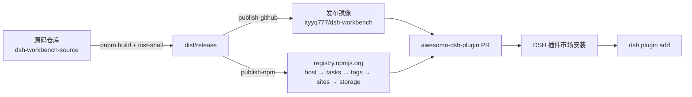

# 发布与插件市场

> 状态：发布树、npm 发布脚本、GitHub 发布仓库已就绪；npm 正式发布与市场 PR
> 需要等 GitHub 账号解除 24 小时安全限制后执行。

> 当前源码版本：tasks 2.10.11、tags 1.6.7、sites 1.8.3、storage 1.1.0；本轮为四插件共享数据视图重构及 storage UI 功能增强。storage 已接入构建、校验和发布树流程，但本轮版本仍需重新构建、验证与完整安装；源码版本更新不代表已上传 npm 或完成市场收录。首次发布时为 storage 新增独立市场条目，仍遵守每个 PR 最多3个 entry。

## 1. 发布链路

五个插件不再由自建云端分发，改为三层：

| 层 | 位置 | 作用 |
| --- | --- | --- |
| 源码 | https://github.com/ityyq777/dsh-workbench-source | pnpm monorepo；开发、构建、测试、提交 |
| npm | registry.npmjs.org | 插件市场首选的安装来源 |
| 发布镜像 | https://github.com/ityyq777/dsh-workbench | 只放 `dist/release` 产物；市场 url 指向各包目录 |
| 市场列表 | https://github.com/awesome-dsh-plugin/awesome-dsh-plugin | 收录 PR，市场页面读取此列表 |

云端（Workbench Cloud）只负责账号、设备、数据备份同步，不参与插件分发。



## 2. 包名

npm 上 `dsh-workbench` 已被无关项目占用（v0.16.1，lee259/dsh-workbench），
因此宿主发布名改为 `dsh-workbench-host`；源码内部仍叫 `dsh-workbench`，
只在发布树中改写。

| 用途 | 包名 |
| --- | --- |
| 宿主 | `dsh-workbench-host` |
| 任务 | `dsh-workbench-tasks` |
| 标签 | `dsh-workbench-tags` |
| 站点 | `dsh-workbench-sites` |
| 储物 | `dsh-workbench-storage` |

文档里不写死版本号：具体版本以各包 `package.json` 与 npm 上的最新版本为准；
发布历史只保留在本文末尾的「发布记录」。

业务包的 `dependencies` 指向 `dsh-workbench-host`，所以安装任意业务插件时，
npm/DSH 会一并解析宿主。

## 3. 生成发布树

```sh
pnpm build
node scripts/dist-shell.mjs
pnpm stage:release
```

输出：

```text
dist/release/
  README.md
  LICENSE
  packages/host/       dsh-workbench-host
  packages/tasks/      dsh-workbench-tasks
  packages/tags/       dsh-workbench-tags
  packages/sites/      dsh-workbench-sites
  packages/storage/    dsh-workbench-storage
  marketplace/         awesome-dsh-plugin 条目草稿（5 份 YAML）
```

`scripts/stage-release.mjs` 会：

- 改写宿主 `name`、`cordis.patch.yml` 的 `name`、客户端 ModuleLoader 的 `id`；
- 业务包依赖改为 `dsh-workbench-host` 的兼容版本范围，`dsh.client.inject` 同步改写；
- 补齐 description/license/author/keywords/repository/homepage/bugs/engines；
- 删除 private/devDependencies/scripts；
- 为每个包生成 README 与 LICENSE；
- 生成五个市场 YAML 草稿。

可用环境变量覆盖：`NPM_HOST_NAME`、`GITHUB_OWNER`、`GITHUB_REPO`。

## 4. npm 发布

```sh
# 1) 登录官方 registry（本机默认是 npmmirror，必须显式指定）
npm login --registry=https://registry.npmjs.org

# 2) 先 dry-run
pnpm publish:npm

# 3) 真正发布（宿主必须最先）
pnpm publish:npm -- --publish
# 有 2FA 时
pnpm publish:npm -- --publish --otp=123456
```

`scripts/publish-npm.mjs` 默认 dry-run；发布顺序为 host → tasks → tags → sites → storage；
已存在的同名版本会跳过；输出每个包的 tarball 内容。

当前四个包名均可在 npm 查询为空（尚未发布）。GitHub 账号有 24 小时安全限制，
到期后再执行正式发布。

## 5. GitHub 源码仓库与发布镜像

项目有两个 GitHub 仓库，历史互相独立：

| 仓库 | 角色 | 内容 |
| --- | --- | --- |
| https://github.com/ityyq777/dsh-workbench-source | 源码主仓库（`origin`） | pnpm monorepo、docs、scripts；所有开发提交进这里 |
| https://github.com/ityyq777/dsh-workbench | 发布镜像 | `packages/{host,tasks,tags,sites}` + README + LICENSE + marketplace 草稿 |

- 发布镜像默认分支 `main`，由 `stage-release.mjs` 的产物推送；源码在源码主仓库。
- 不要在发布镜像里直接改代码；下一次发布会被覆盖。
- 源码主仓库只配置自己的 `origin`，不配置发布镜像 remote。
- 源码仓库与镜像历史无关，不要在源码目录里 `git push` 到镜像；源码仓库已不配置
  该 remote。镜像同步走 `pnpm publish:github`：

```sh
pnpm stage:release          # 生成 dist/release
pnpm publish:github         # dry-run，列出将要提交的差异
pnpm publish:github -- --publish
```

脚本在独立工作区 `~/.dsh/workbench/release-mirror` 里 checkout 镜像 `main`、用
`dist/release` 覆盖、提交并推送；token 只在推送时经临时 `GIT_ASKPASS` 传入，不写进
remote URL 或 git config。

仓库已设置 MIT、public。市场要求仓库带 `dsh-plugin` topic；当前 token 无
topics 权限（API 返回 403），需要在 GitHub 网页或权限更高的 token 下补上。

## 6. 插件市场（awesome-dsh-plugin）

市场页面是 dshmarket.com，收录靠公开列表仓库的 PR：

- 条目文件：`data/plugins/<owner>__<repo>.yml`
- 必填：`url`、`name`、`category`、`description.en`
- 本仓库是 monorepo，因此：
  - `url` 指向 `https://github.com/ityyq777/dsh-workbench/tree/main/packages/<sub>`
  - `name` 用 `ityyq777/dsh-workbench#<sub>`
  - 文件名用 `ityyq777__dsh-workbench--packages-<sub>.yml`
- 每个 PR 最多 3 个 entry，所以拆两个 PR：
  1. host + tasks + tags
  2. sites
- 收录条件：
  - 仓库 `package.json` 声明 `dsh.bundle`；
  - 仓库创建满 1 天（CI 会自动重跑放行）；
  - 仓库带 `dsh-plugin` topic；
  - 真实可用代码，不是纯聚合包。

已准备的 fork 是 `ityyq777/awesome-dsh-plugin`，两个分支已推送但尚未开 PR：

- `add-workbench-host-tasks-tags`（host + tasks + tags）
- `add-workbench-sites`（sites）

等 npm 发布完成、仓库满 1 天并补上 `dsh-plugin` topic 后，再从这两个分支各开一个 PR。

四个草稿在 `dist/release/marketplace/`：

| 包 | category |
| --- | --- |
| host | ui |
| tasks | workflow |
| tags | tools |
| sites | tools |

## 7. 已验证

- `pnpm build`、`node scripts/dist-shell.mjs` 通过；
- `pnpm test:e2e`：NATIVE / CLIENT / TAGS / SITES / BACKUP 全通过；
- 旧 Node 云端 `test:sync` 已随 `packages/cloud` 移除；云端同步由独立
  `dsh-workbench-cloud` 仓库维护，宿主 SyncEngine 的新云端端到端入口待迁移；
- 用 `file:` 把 `dist/release` 四包装进临时 profile：
  - profile 直接依赖为 `dsh-workbench-host` + 三个业务包；
  - bundles 正确包含四个包；
  - 启动临时 DSH 后 `/workbench/api/domains` 返回 3 个域与宿主 shellVersion；
  - 首页 4 张卡片（任务/站点/标签/账号与同步），任务沉浸式全页正常；
  - 浏览器 console 无 error。
- 临时实例与 3099 端口已关闭；主 3080 未重启。

## 7.1 单包独立安装（2026-11-12 实测）

结论先说：**四个业务包都可以单独安装**，装任意一个就会自动带上宿主，无需先装
`dsh-workbench-host`；但它们是「工作台宿主上的功能插件」，不是能脱离宿主独立运行的
DSH 应用——业务包的 `lib/index.js` 都是 `export const inject = ["workbench"]`，
数据库、HTTP 路由、agent 工具与前端外壳全部由宿主提供。

三个容易误解的点：

1. **`dsh.profile.bundles` 里只有业务包**。宿主不是 bundle，而是由业务包
   `cordis.patch.yml` 里的插件行一并加载；所以「bundles 没写宿主」不等于宿主没装。
2. **宿主前端外壳同样会加载**。侧栏出现「工作台」入口、首页出现该插件的卡片，
   就说明宿主 client 已经注入成功——这也是单包安装真正跑通的判据。
3. **npm 安装和 `file:` 安装的包名不同**。npm 上宿主叫 `dsh-workbench-host`
   （源码里仍叫 `dsh-workbench`），`dump-config` 里宿主行 `name` 会随之不同。

安装命令（二选一）：

```sh
# 市场 / npm 路径：装业务包即自动带入宿主
dsh plugin --profile web add dsh-workbench-tasks@5.2.6

# 本地源码包路径：先 pnpm build && node scripts/dist-shell.mjs，再装业务包目录
dsh plugin --profile web add "file:$PWD/packages/addons/tasks"
```

验证脚本（可复跑，自己起临时实例、用完清理）：

```sh
node scripts/verify-standalone-install.mjs --all                    # 四个 npm 包逐个验证
node scripts/verify-standalone-install.mjs --spec "file:$PWD/packages/addons/storage"
node scripts/verify-standalone-install.mjs --spec dsh-workbench-tags@1.7.0 --keep   # 保留实例手工点页面
```

脚本断言 13 项：全新 profile 创建、单包安装、bundles 只登记业务包、宿主被依赖带入、
业务包 `wb.addon.minShell` 与已装宿主版本相容、`dump-config` 同时含宿主行与业务行、
实例启动拿到 token、token 换得 auth cookie、首页 200、`/workbench/api/domains` 返回
单一域、域版本与清单一致、`shellVersion` 与已装宿主一致、域 manifest 带视图（说明前端
已加载）。退出码 0 全通过 / 1 有失败 / 2 环境问题。

2026-11-12 实测结果（`--all`，全部 13/13）：

| 业务包 | 装到的宿主 | 域 | 视图数 | 结论 |
| --- | --- | --- | --- | --- |
| `dsh-workbench-tasks@5.2.6` | `dsh-workbench-host@0.6.5` | `wb-addon-tasks@5.2.6` | 5 | 通过 |
| `dsh-workbench-tags@1.7.0` | `dsh-workbench-host@0.6.5` | `wb-addon-tags@1.7.0` | 4 | 通过 |
| `dsh-workbench-sites@1.10.0` | `dsh-workbench-host@0.6.5` | `wb-addon-sites@1.10.0` | 4 | 通过 |
| `dsh-workbench-storage@1.5.1` | `dsh-workbench-host@0.6.5` | `wb-addon-storage@1.5.1` | 4 | 通过 |

浏览器侧同时人工核对过（任务/标签/站点/储物四个全新 profile，端口 58701–58704，
以及 npm 路径的 58705）：侧栏「工作台」按钮在、首页有对应卡片、插件页页签可切换、
console 无 error；页面里只请求 `/workbench/api/{domains,record,sync/status}`，
插件前端由 DSH 客户端注入链加载，不做额外独立请求。

### 版本下限与宿主版本

每个业务包在 `package.json` 的 `wb.addon.minShell` 声明宿主下限，脚本会实际比对：

| 业务包 | 当前版本 | minShell |
| --- | --- | --- |
| tasks | 5.2.6 | 0.6.3 |
| tags | 1.7.0 | 0.5.0 |
| sites | 1.10.0 | 0.5.0 |
| storage | 1.5.1 | 0.5.7 |

npm 上宿主当前是 **0.6.5**；源码已是 0.6.6（含「全屏页返回按钮不再被窗口拖拽区吞掉」
的修复），尚未发布。用 npm 装业务包时拿到的宿主是 0.6.5，四个包都能正常跑；想要那条
修复，需要等宿主 0.6.6 发布，或按 AGENTS.md 用 `file:` 装本地构建。

### 已知边界（不是 bug，别当 bug 修）

- **不能脱离宿主**：只装业务包时宿主是被依赖带进来的；宿主缺失或版本低于 `minShell`
  时插件无法注册，工作台页面不会有卡片。要真正拆成独立应用属架构级改造，另立任务。
- **`bundles` 不登记宿主**：`dsh plugin list` / profile 视图里看不到宿主那一行，属预期。
- **卸载业务包不会自动卸宿主**：`node_modules/dsh-workbench-host` 会残留，需要时单独
  `dsh plugin --profile <p> remove dsh-workbench-host`。
- **宿主版本会被依赖范围拉动**：业务包依赖 `dsh-workbench-host: ^0.6.5`，重装业务包时
  pnpm 可能顺带升级宿主；装完回读 profile 里宿主的 `package.json` 版本，别默认版本不变。
- **同一 profile 装多个业务包没问题**：四个包共享同一份宿主，desktop 主实例就是这种形态。

## 8. 待办清单

- [ ] npm 账号解除限制后登录官方 registry；
- [ ] `pnpm publish:npm -- --publish`（host 先行）；
- [ ] 给 GitHub 仓库补 `dsh-plugin` topic；
- [ ] 仓库满 1 天后，fork awesome-dsh-plugin，按两个 PR 提交四个条目；
- [ ] 市场 PR 通过后，在 dshmarket 搜索验证四个插件可安装；
- [ ] 如 token 已出现在对话/日志中，发布完成后轮换。

## 9. 发布记录（历史追溯）

| 日期 | 宿主 | 任务 | 标签 | 站点 | 变更 |
| --- | --- | --- | --- | --- | --- |
| 2026-11-07 | 0.4.0 | 2.2.0 | 1.1.1 | 1.2.1 | 新增 `actions.list` / `actions.help` 自描述；Workbench 工具入参统一为 `args`，旧顶层假字段会被剔除并告警；tasks 新增 `get`、`bulkUpdate`、`bulkCreate`、`bulkDelete`，破坏性批量 action 支持 `dryRun`；`tasks.list` 增加 status / priorityMin-Max / targetFrom-To / sort 过滤排序 |
| 2026-11-07 | 0.4.0 | 2.3.0 | 1.2.0 | 1.2.1 | tasks 新增 `history` / `changelog` / `export` / `reorder` / `depends` / `link` / `unlink`，新增 `task_dep` 表、`task.sort`、`task.dedupe_key`，`create/update/bulkUpdate` 支持 `tagIds`；tags 新增通用 `link` / `unlink` / `itemsOf` |
| 2026-11-07 | 0.5.0 | 2.4.0 | 1.3.0 | 1.3.0 | 同步 protocol v2：会话锁、时钟校准、按表游标、树表整表覆盖、快照回填、冲突闭环与账号页冲突处理、唯一键 lww-tombstone；标签允许重名；删除写完整墓碑；新增 `test:sync` |
| 2026-11-08 | 0.5.1 | 2.4.2 | 1.3.2 | 1.3.2 | 插件配色全面改用 DSH 官方 token（brand-primary / state-* / label-primary-inverted / bg-layer / toast-*），修复换肤不跟随；输入区「记录」胶囊样式改为插件加载即注入，并对切换失败给出可见错误 |

> 本表只记录已发布批次，供追溯；其他文档一律不写版本号。
> 最近一批本地已构建并通过 `pnpm test:native`（59 actions）、`test:clients`
> 与 tags/sites/backup/e2e 测试；npm 发布仍受账号安全限制，未推送。
