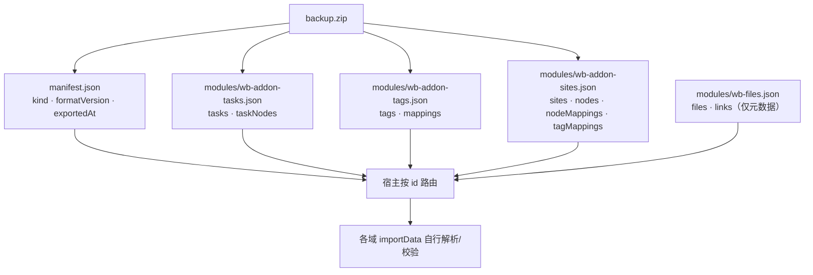
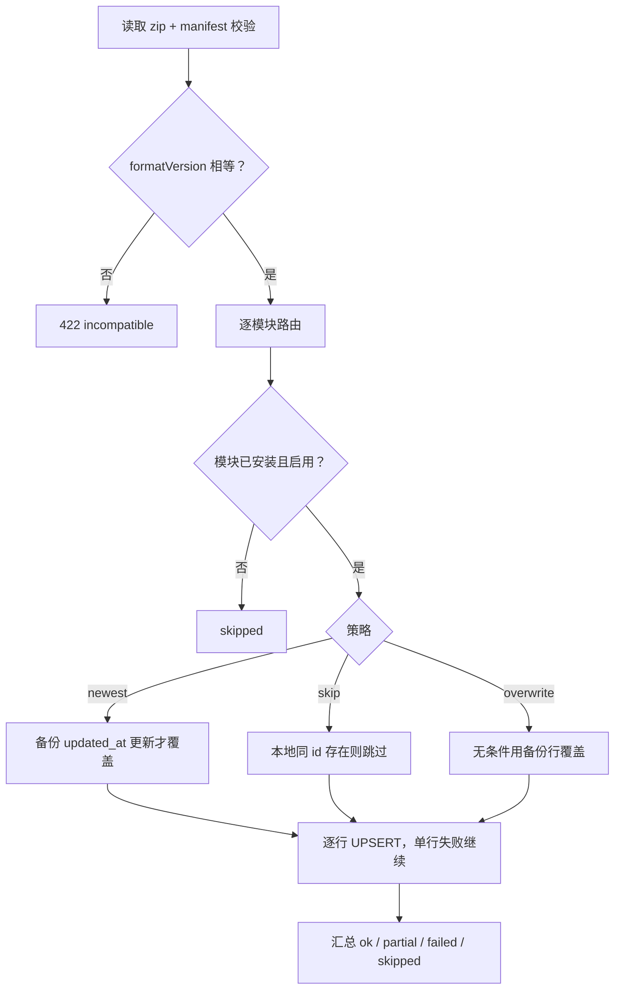
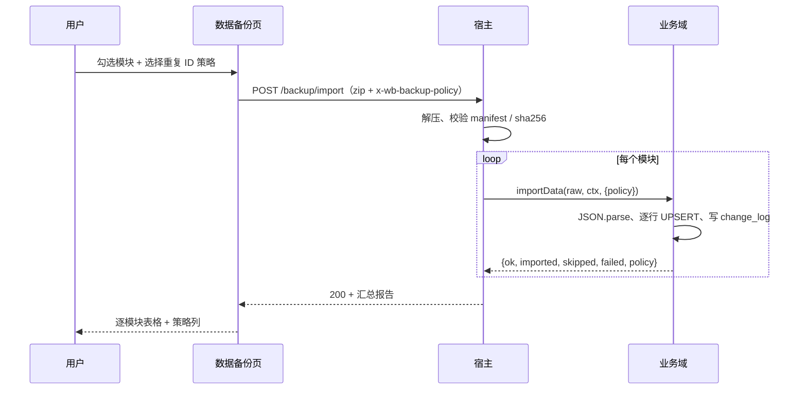

# 15 · 数据备份（按模块导出 / 导入）

> 状态：已实现。宿主与三个业务插件（版本见各自 package.json）。

## 目标

个人工作台允许用户选择模块导出数据，导出的 zip 可以再导入回来。约束：

- 每个业务模块自己序列化、自己解析、自己校验；宿主不解析模块 JSON。
- 宿主只做三件事：调用各域的导出回调、打包 zip、解压后按模块 id 路由。
- 导出文件带格式版本、导出时间、壳版本；不兼容时拒绝导入并提示。
- 导入按模块独立执行；一个模块失败不阻止其它模块，最后汇总成功/失败报告。
- 导入只合并（upsert），不删除本地已有数据；重复 ID 的策略可按模块配置：以时间最新为主（默认）、保留本地跳过、用备份覆盖。

## 导入依赖（宿主 0.5.6 / SDK 0.1.1）

域可以声明 `backupAfter?: string[]`，指定同一备份清单内应先尝试导入的域。宿主在写入前完成稳定拓扑排序，每轮选择原清单中最早满足依赖的模块；无声明时保持原顺序。排序读取已安装插件声明，不从备份文件接受执行依赖。

清单不存在的依赖被忽略，允许单模块恢复；缺失业务引用仍由域校验。依赖模块失败不自动阻断其他模块，继续生成逐模块报告。循环依赖在任何 importData 调用前拒绝整次导入。storage 使用 `backupAfter: ["wb-addon-tags"]`，保证恢复标签在物品映射之前。备份文件 formatVersion 保持1。

## 文件格式

扩展名 .zip，根目录：

```text
manifest.json
modules/<domainId>.json
```

manifest.json：

```json
{
  "kind": "dsh-workbench-backup",
  "formatVersion": 1,
  "shellVersion": "<宿主版本>",
  "exportedAt": "2026-11-07T13:08:46.265Z",
  "modules": [
    {
      "id": "wb-addon-tasks",
      "title": "任务记录",
      "version": "<版本>",
      "file": "modules/wb-addon-tasks.json",
      "size": 1234,
      "sha256": "…"
    }
  ]
}
```

- formatVersion 当前为 1；导入时要求精确相等，不做模糊兼容。
- shellVersion 仅记录，不参与拒绝；模块版本由模块自己声明和校验。
- 每个模块文件的 size/sha256 在导入前校验。
- 文件名固定为 modules/<id>.json；不允许绝对路径、反斜杠或 ..。
- manifest 可选 `files: { included: false, count, totalBytes }`，只用于告知用户“本次未含字节”，不是导入拒绝条件。



## 各模块格式

> 配置不进备份：三个业务插件的「配置」存在本机 `meta`，不属于业务数据，
> `schemaVersion` 仍为 1，导入导出结构不变。详见
> [20-配置表与配置页设计](./20-配置表与配置页设计.md)。

所有模块文件都是：

```json
{ "schemaVersion": 1, "...": [] }
```

### 任务（wb-addon-tasks）

```json
{
  "schemaVersion": 4,
  "tasks": ["task 全行，含 dedupe_key / deleted_at / rev"],
  "taskNodes": ["task_node 全行，含 path/depth/sort"]
}
```

导出包含软删行（tombstone），否则导入后已删除的数据会“复活”。
任务行按 created_at 排序，节点按 depth, sort 排序，便于阅读。
5.0.0 起任务依赖整体移除，备份不再导出 `taskDeps`；旧备份里的 `taskDeps` 会被忽略，导入回执会注明忽略条数。任务去重键（`task.dedupe_key`）与目录排序（`task_node.sort`）随行一起恢复。

### 标签（wb-addon-tags）

```json
{
  "schemaVersion": 1,
  "tags": ["tag 全行"],
  "mappings": ["tag_mapping 全行，但排除 item_type='site'"]
}
```

站点标签映射归站点模块；标签模块导出时排除，导入时也跳过，
避免和站点模块重复写同一行。

### 文件（wb-files）

```json
{
  "schemaVersion": 1,
  "files": ["file 全行，含 sha256 / size / deleted_at / rev"],
  "links": ["file_link 全行，含 owner_type / owner_id"]
}
```

`wb-files` 是宿主内置域。**一期只备份元数据，不打包文件字节**：
`packages/shell/src/infra/zip.ts` 当前限制单条 32MB、总量 64MB、最多 200 条，
且全内存、不支持 ZIP64；字节改为通过云端同步保留（见 17 §9）。
导入时 `file` 行可能对应当前设备没有的 blob，报告为 `missingBlobs`，不阻塞其它模块。

### 站点（wb-addon-sites）

```json
{
  "schemaVersion": 1,
  "sites": ["site 全行"],
  "nodes": ["site_node 全行"],
  "nodeMappings": ["site_node_mapping 全行"],
  "tagMappings": ["tag_mapping 全行，仅 item_type='site'"]
}
```

## 导入语义

1. 宿主读取 zip，校验 manifest 的 kind、formatVersion、模块列表。
2. 按模块 id 查找当前已注册且启用的域：
   - 未安装或已禁用 → 该模块 skipped；
   - 域没有 importData → failed；
   - 文件缺失 / size / sha256 不符 → failed。
3. 把模块 JSON 原文和该模块的导入策略交给域的 importData(raw, ctx, options)；宿主不 JSON.parse。
4. 每个模块可以独立选择重复 ID 策略（默认 newest）：
   - newest：按 updated_at 做 LWW，备份行比本地新才覆盖，否则计入 skipped；
   - skip：本地已存在同 id 就保留本地，整行计入 skipped，不看时间；
   - overwrite：同 id 直接用备份行覆盖，即使备份更旧；本地没有则插入。
5. 模块自己解析并逐行 UPSERT：
   - 单行异常计入 failed，继续处理下一行；
   - 有导入行时写 sync_change_log（origin = import），以便后续同步。
6. 模块返回 { ok, imported, skipped, failed, policy, message }；宿主汇总为：

```json
{
  "ok": true,
  "summary": { "total": 3, "ok": 3, "partial": 0, "failed": 0, "skipped": 0 },
  "results": ["逐模块报告"],
  "exportedAt": "…",
  "shellVersion": "<宿主版本>",
  "formatVersion": 1
}
```

ok 为 failed === 0 && partial === 0；部分行失败时模块是 partial，
整体仍会返回 200，让用户看到完整报告。

策略只影响导入，不写入备份包；同一份备份可以在不同设备上选择不同策略。
旧宿主/旧模块不传策略时按 newest 处理。





## HTTP API

| 方法 | 路径 | 说明 |
| --- | --- | --- |
| GET | /workbench/api/backup/export?modules=id1,id2 | 导出 zip；all 或省略为全部可导出模块 |
| POST | /workbench/api/backup/import | 请求体为 zip；可选请求头 x-wb-backup-policy 传模块策略 JSON；返回汇总报告 |

x-wb-backup-policy 示例：

```json
{ "wb-addon-tasks": "newest", "wb-addon-tags": "skip", "wb-addon-sites": "overwrite" }
```

键为模块 id，值为 newest / skip / overwrite；缺省模块按 newest，
非法值回退 newest，请求头不是合法 JSON 时整体按默认策略处理。

错误：

- 422 + { ok:false, code:"incompatible" }：formatVersion 不匹配；
- 400 + { ok:false, code:"invalid" }：zip/manifest 无效、路径不安全、校验和不符等；
- 500 + { ok:false, code:"export" }：导出时某个域抛错（不产出缺数据的备份）。

## 客户端 UI

- 首页「工作台管理」新增「数据备份」卡片；
- 勾选区按模块列出标题、版本、可导出/可导入能力与描述；
- 每个模块 card 右侧有齿轮按钮，点击后在 card 内展开「重复 ID 时」策略：
  - 以时间最新为主（默认）；
  - 保留本地（跳过）；
  - 用备份覆盖；
  - 配置按模块独立保存在页面状态里，不常驻展示；
- 导出完成后「导出结果」按表逐行展示：左侧表名（task / task_node / tag / …），
  右侧是所属模块与版本；不再按模块分组；
- 默认全选；支持全选/清空；导出只带选中的模块；
- 「导入备份」选择 .zip，成功后显示：
  - 汇总（成功/部分成功/失败/跳过）；
  - 导出时间、壳版本、格式版本；
  - 逐模块表格（状态、策略、导入、跳过、失败、message）；
- 格式不兼容显示「备份格式版本不兼容，请升级工作台后再导入」；
- 导入只合并，不删除本地已有数据。

## 安全与限制

- zip 读取上限：200 个文件、单文件 32MB、解压总量 64MB；
- 拒绝 ZIP64、分卷、加密、data descriptor、未知压缩方法；
- 拒绝绝对路径、反斜杠、..、重名 entry；
- 校验每个 entry 的 CRC32 与大小；manifest 额外校验 sha256；
- 不执行备份中的任何代码，模块 JSON 由各模块按自己的 schema 解析；
- 目前没有加密、签名和增量备份；导出文件由用户自行保管。

## 已验证

- node scripts/test-backup.mjs：三模块导出、只选任务、全量导入、硬删任务与依赖后导入恢复、
  `task_dep` 与 `task.sort` 随备份恢复、formatVersion=2 返回 422，以及
  overwrite / skip / newest 三种策略 → BACKUP TEST PASS；
- node scripts/e2e.mjs：包含上述测试，串行全部通过 → E2E PASS；
- 临时 DSH 实例（3099）真实 UI：齿轮默认 newest、策略下拉三项、导出结果为 8 行按表明细
  （task、task_node、tag、tag_mapping、site、site_node、site_node_mapping、tag_mapping）、
  导入报告含策略列、导出 200、不兼容提示、仅导出任务时请求 modules=wb-addon-tasks。
