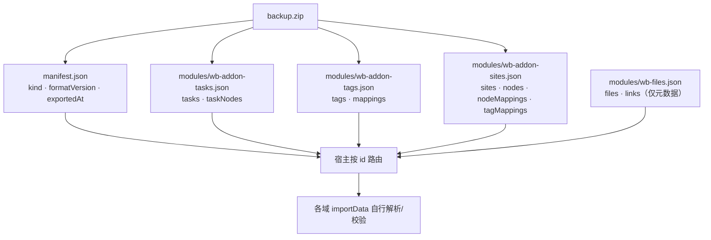
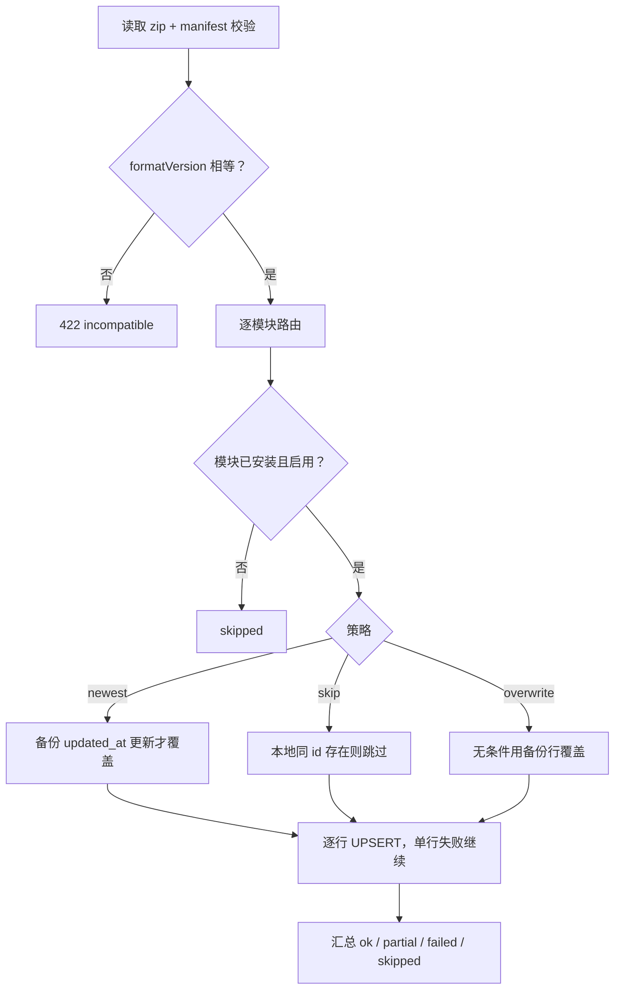
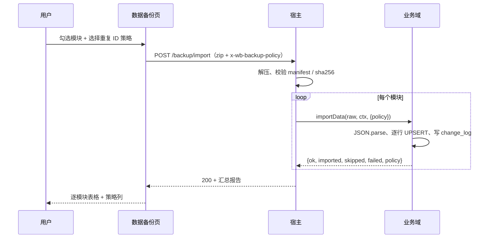

# 15 · 数据备份（按模块导出 / 导入）

> 状态：已实现。宿主（0.6.x）与四个可备份业务插件（tasks / tags / sites / storage）按模块导出导入；
> 消息插件（message）主动不备份，作为「只落本机」的范例写在第 2 节。版本见各包 package.json。

## 目标

个人工作台允许用户选择模块导出数据，导出的 zip 可以再导入回来。约束：

- 每个业务模块自己序列化、自己解析、自己校验；宿主不解析模块 JSON。
- 宿主只做三件事：调用各域的导出回调、打包 zip、解压后按模块 id 路由。
- 导出文件带格式版本、导出时间、壳版本；不兼容时拒绝导入并提示。
- 导入按模块独立执行；一个模块失败不阻止其它模块，最后汇总成功/失败报告。
- 导入只合并（upsert），不删除本地已有数据；重复 ID 的策略可按模块配置：以时间最新为主（默认）、保留本地跳过、用备份覆盖。

## 导入依赖（宿主 0.5.6 / SDK 0.1.1）

域可以声明 `backupAfter?: string[]`，指定同一备份清单内应先尝试导入的域。宿主在写入前完成稳定拓扑排序，每轮选择原清单中最早满足依赖的模块；无声明时保持原顺序。排序读取已安装插件声明，不从备份文件接受执行依赖。

清单不存在的依赖被忽略，允许单模块恢复；缺失业务引用仍由域校验。依赖模块失败不自动阻断其他模块，继续生成逐模块报告。循环依赖在任何 importData 调用前拒绝整次导入。storage 使用 `backupAfter: ["wb-addon-tags"]`，保证恢复标签在物品映射之前。备份文件 formatVersion 保持1。

## 插件接入契约（宿主 0.6.x / SDK 0.1.1）

这一节写给要接入备份的新插件作者：不读宿主源码也能知道要声明什么、宿主会做什么、
哪些声明其实和备份无关。

一句话：**备份内容只有一个来源——`DomainDef.exportData()` 的返回值**。宿主不定业务
schema、不解析模块 JSON，只负责调用回调、打包、校验，解压后按域 id 路由
（`packages/shell/src/infra/backup.ts:1-3`）。

### 字段映射

| 声明 | 出现在哪里 | 对备份的实际作用 | 不写会怎样 |
| --- | --- | --- | --- |
| `id` | manifest 的 `modules[].id`、模块文件名 `modules/<id>.json` | 导入时按它找**已注册且启用**的域；找不到 → 该模块 `skipped`（`backup.ts:251`） | 必填 |
| `title` / `version` | manifest 展示字段、导出结果表格 | 只用于展示与审计；版本**不**参与拒绝，由模块自己在 JSON 里校验 | 必填（version 也会写进报告） |
| `tables` | `DomainPublicInfo.tables`，客户端/文档/调试台展示；写 `sync` 时作为默认行级同步清单 | **不驱动备份**：导出哪些数据只由 `exportData` 决定 | 可省略 |
| `exportData(ctx)` | 备份页的「可导出」能力与导出内容 | 唯一数据来源；缺省即不可导出（全量导出会跳过并在 `manifest.skipped` 注明） | 不实现＝不备份 |
| `importData(raw, ctx, options)` | 「可导入」能力、逐模块导入报告 | `raw` 是模块 JSON 原文，插件自己 parse/校验/逐行 UPSERT；`options.policy` 是 newest / skip / overwrite | 不实现＝导入时该模块 `failed` |
| `backupAfter` | 导入前的稳定拓扑排序 | 声明「本域写入前先尝试导入这些域」；只读已安装插件声明，备份清单里缺依赖就忽略 | 省略＝按清单原顺序 |
| `DomainPublicInfo.backup { export, import }` | 客户端备份页勾选项与能力标签 | 由宿主按方法是否存在推导，只读 | 自动生成，不能手写 |

证据：`DomainDef` 定义在 `packages/sdk/src/index.ts:204-225`；公开信息
`packages/shell/src/index.ts:157`、`161-162`；导出调用 `backup.ts:159-162`；
导入调用 `backup.ts:251`、`:266`；客户端过滤 `packages/shell/client/system-tabs.cjs:110`，
能力标签 `:241-242`。

### `tables` 的真实用途

1. 进 `listDomains()` 的公开信息，供客户端、文档和调试台展示；
2. 作为 `sync` 的默认值：只写 `tables`、不写 `sync` 时，宿主按
   `{ name, mode: "row" }` 推定（`packages/shell/src/index.ts:161-162`），这些表会参与云端行同步；
3. 仅此而已——**没有「按 tables 自动导出」的逻辑**。

所以 `tables` 写全但 `exportData` 返回空对象，备份里就是空模块；反过来只实现
`exportData`、`tables` 留空，数据照样进备份包。

### 主动不备份怎么写

以消息插件为例（`packages/addons/message/lib/index.js:5-6`、`:85-90`）：

```js
host.registerDomain({
  id: "wb-addon-message",
  title: "消息",
  version: "0.1.0",
  tables: ["message"],
  sync: { tables: [] }, // 显式置空；不写会按 tables 推定 row 同步
  views: [...],
  setup(api) { /* 建表、注册 action */ },
  // 故意不实现 exportData / importData
});
```

效果：

- 备份页不列该模块（客户端只列 `backup.export === true` 的域），勾选导出自然也不会带上它；
- 别人手工塞进备份包的该模块：已安装但没有 `importData` → `failed`（报告写明「模块未启用或
  未实现数据导入」），未安装 → `skipped`；
- 云端同步不含它（`sync.tables` 为空）。

### 导出端点契约

`GET /workbench/api/backup/export?modules=<id,id…>`：

| 请求 | 结果 |
| --- | --- |
| 不传 `modules`、传 `modules=` 或 `modules=all` | 200；只打包 `enabled && 有 exportData` 的域，被跳过的域写进 `manifest.skipped`（`reason: "no-export"`） |
| 显式列表，全部可导出 | 200；只含列出的模块，manifest 不带 `skipped` |
| 显式列表含不可导出模块 | 400 `{"ok":false,"code":"not_exportable","error":"模块未实现数据导出：消息"}` |
| 显式列表含未知模块 | 400 `{"ok":false,"code":"invalid","error":"模块未安装：…"}` |
| 一个可导出模块都没有 | 400 `code: "invalid"` |
| 某个域导出时抛异常 / 打包失败 | 500 `code: "export"`（不返回堆栈，日志记录模块 id） |

```sh
# 全量导出：消息这类不备份的域会被跳过，并在 manifest.skipped 里注明
curl -b "$COOKIE" -o backup.zip "http://127.0.0.1:<port>/workbench/api/backup/export"

# 只导出任务与储物
curl -b "$COOKIE" -o part.zip \
  "http://127.0.0.1:<port>/workbench/api/backup/export?modules=wb-addon-tasks,wb-addon-storage"

# 显式请求不备份的域：400 not_exportable（不是 500）
curl -b "$COOKIE" "http://127.0.0.1:<port>/workbench/api/backup/export?modules=wb-addon-message"
```

备份页固定传具体 id（只列出 `backup.export === true` 的域），所以界面永远走「显式列表」分支；
上面这些状态码是给脚本和第三方调用方的契约，错误文案可直接展示给用户。

注意：别只删 `exportData` / `importData` 而留下 `tables` 不写 `sync`——那样宿主会把它当行级
同步表推上云，和「只落本机」的意图相反。

### 新插件接入 checklist

1. 表由插件自己 `setup` 建，只把**真实存在**的表名写进 `tables`。
2. 实现 `exportData(ctx)`：返回 `{ schemaVersion, ...数据键 }`；导出软删行（否则删除会
   「复活」）；排序稳定（本项目统一按 id 或 created_at + id），便于比对与 diff。
3. 实现 `importData(raw, ctx, options)`：自己 `JSON.parse`；校验 `schemaVersion`；按
   `options.policy` 逐行 UPSERT；单行异常计入 `failed` 后继续；有写入时写
   `sync_change_log`（origin=import）。
4. 需要别的域先恢复（如标签→引用方）就声明 `backupAfter`，用域 id 而不是包名。
5. 跑 `node scripts/test-backup.mjs`（导出、导入、三种策略、格式不兼容）；必要时在
   `scripts/test-native.mjs` 加域级断言。
6. 起一个临时实例，确认备份页出现勾选项与「可导出 / 可导入」标签，导出结果里能看到自己的表。
7. 在本文「各模块格式」补小节，并在下面「当前能力一览」加一行。

### 当前能力一览（2026-11-12，源码版本）

| 包 | 域 id | 版本 | 备份 JSON（schemaVersion） | backupAfter | 说明 |
| --- | --- | --- | --- | --- | --- |
| 宿主 | — | 0.6.7 | — | — | 只收集、打包、校验、路由，不导出业务数据 |
| tasks | `wb-addon-tasks` | 5.2.13 | 5：`tasks`、`taskNodes`、`taskTimelines`、`taskTimelineLinks`、`taskWorkspaces`、`taskWorkspaceLinks`，另含 `timelineMigrationRecords` | — | 含软删行；导入兼容 1–5，旧版本缺工作区/时间线键时按空数组 |
| tags | `wb-addon-tags` | 1.7.0 | 1：`tags`、`mappings`（排除 `item_type='site'`） | — | 站点标签映射归 sites |
| sites | `wb-addon-sites` | 1.10.0 | 1：`sites`、`nodes`、`nodeMappings`、`tagMappings`（仅 `item_type='site'`） | — | 站点标签随站点一起恢复 |
| storage | `wb-addon-storage` | 1.5.2 | 1：`storage`、`tagMappings`（`item_type='storage'`）、`tagReferences` | `["wb-addon-tags"]` | 先恢复标签；快照用于按名称校正 tag_id |
| message | `wb-addon-message` | 0.1.0 | 不备份 | — | 显式 `sync:{tables:[]}`，只落本机 SQLite |

> `wb-files`（文件元数据）目前只存在于 [17-文件存储设计](./17-文件存储设计.md) 的设计稿，
> 当前宿主源码没有注册该域，所以不在上表；等它落地后按本节的 checklist 补一行。

## 文件格式

扩展名 .zip，根目录：

```text
manifest.json
modules/<domainId>.json
```

manifest.json：

```json
{
  "kind": "dsh-workbench-backup",
  "formatVersion": 1,
  "shellVersion": "<宿主版本>",
  "exportedAt": "2026-11-07T13:08:46.265Z",
  "modules": [
    {
      "id": "wb-addon-tasks",
      "title": "任务记录",
      "version": "<版本>",
      "file": "modules/wb-addon-tasks.json",
      "size": 1234,
      "sha256": "…"
    }
  ],
  "skipped": [{ "id": "wb-addon-message", "title": "消息", "reason": "no-export" }]
}
```

- formatVersion 当前为 1；导入时要求精确相等，不做模糊兼容。
- `skipped` 是可选字段，只在全量导出且确有域被跳过时出现；导入侧完全忽略它，
  旧备份包（没有该字段）与新备份包都能导入。
- shellVersion 仅记录，不参与拒绝；模块版本由模块自己声明和校验。
- 每个模块文件的 size/sha256 在导入前校验。
- 文件名固定为 modules/<id>.json；不允许绝对路径、反斜杠或 ..。
- manifest 可选 `files: { included: false, count, totalBytes }`，只用于告知用户“本次未含字节”，不是导入拒绝条件。



## 各模块格式

> 配置不进备份：四个业务插件的「配置」存在本机 `meta`，不属于业务数据，
> `schemaVersion` 仍为 1，导入导出结构不变。详见
> [20-配置表与配置页设计](./20-配置表与配置页设计.md)。

所有模块文件都是：

```json
{ "schemaVersion": 1, "...": [] }
```

### 任务（wb-addon-tasks）

```json
{
  "schemaVersion": 5,
  "tasks": ["task 全行，含 dedupe_key / owner / claimed_at / claim_token / 软删列 / rev"],
  "taskNodes": ["task_node 全行，含 path / sort / depth"],
  "taskTimelines": ["task_timeline 全行"],
  "taskTimelineLinks": ["task_timeline_link 全行"],
  "taskWorkspaces": ["task_workspace 全行"],
  "taskWorkspaceLinks": ["task_workspace_link 全行"],
  "timelineMigrationVersion": 1,
  "timelineMigrationRecords": ["meta 里 task_timeline_migration:* 的键值对"]
}
```

导出包含软删行（tombstone），否则导入后已删除的数据会“复活”。
各表统一 `ORDER BY id ASC`，便于稳定比对。
5.0.0 起任务依赖整体移除，备份不再导出 `taskDeps`；旧备份里的 `taskDeps` 会被忽略，导入回执会注明忽略条数。
导入兼容 `schemaVersion` 1–5：1 是最老格式（无时间线两张表），5 之前缺工作区两张表时按空数组恢复。
任务去重键（`task.dedupe_key`）、目录排序（`task_node.sort`）与接取字段随行一起恢复。

### 标签（wb-addon-tags）

```json
{
  "schemaVersion": 1,
  "tags": ["tag 全行"],
  "mappings": ["tag_mapping 全行，但排除 item_type='site'"]
}
```

站点标签映射归站点模块；标签模块导出时排除，导入时也跳过，
避免和站点模块重复写同一行。

### 文件（wb-files）

```json
{
  "schemaVersion": 1,
  "files": ["file 全行，含 sha256 / size / deleted_at / rev"],
  "links": ["file_link 全行，含 owner_type / owner_id"]
}
```

`wb-files` 目前是 [17-文件存储设计](./17-文件存储设计.md) 里的内置域设计，**当前宿主源码尚未注册该域**，真实实例里看不到这个模块。设计意图是一期只备份元数据、不打包文件字节：
`packages/shell/src/infra/zip.ts` 当前限制单条 32MB、总量 64MB、最多 200 条，
且全内存、不支持 ZIP64；字节改为通过云端同步保留（见 17 §9）。
导入时 `file` 行可能对应当前设备没有的 blob，报告为 `missingBlobs`，不阻塞其它模块。

### 站点（wb-addon-sites）

```json
{
  "schemaVersion": 1,
  "sites": ["site 全行"],
  "nodes": ["site_node 全行"],
  "nodeMappings": ["site_node_mapping 全行"],
  "tagMappings": ["tag_mapping 全行，仅 item_type='site'"]
}
```

### 储物（wb-addon-storage）

```json
{
  "schemaVersion": 1,
  "storage": ["storage 全行，含 location / stock / img_list / 软删列 / rev"],
  "tagMappings": ["tag_mapping 全行，仅 item_type='storage'"],
  "tagReferences": ["{ id, name } 标签快照，仅本模块引用到的标签"]
}
```

储物声明 `backupAfter: ["wb-addon-tags"]`，导入时先尝试恢复标签域。
`tagReferences` 是标签名称快照：标签导入会把同名标签合并到同一个规范 id，储物侧用快照里的
名称把 `tag_mapping.tag_id` 重新指向存活标签；快照存在但找不到同名标签时直接报错
（「请先恢复标签备份」），所以单模块恢复仍需标签数据在位，`backupAfter` 只负责顺序。
没有 `tagReferences` 的旧版物品备份按原 `tag_id` 精确匹配，找不到标签同样报错。

## 导入语义

1. 宿主读取 zip，校验 manifest 的 kind、formatVersion、模块列表。
2. 按模块 id 查找当前已注册且启用的域：
   - 未安装或已禁用 → 该模块 skipped；
   - 域没有 importData → failed；
   - 文件缺失 / size / sha256 不符 → failed。
3. 把模块 JSON 原文和该模块的导入策略交给域的 importData(raw, ctx, options)；宿主不 JSON.parse。
4. 每个模块可以独立选择重复 ID 策略（默认 newest）：
   - newest：按 updated_at 做 LWW，备份行比本地新才覆盖，否则计入 skipped；
   - skip：本地已存在同 id 就保留本地，整行计入 skipped，不看时间；
   - overwrite：同 id 直接用备份行覆盖，即使备份更旧；本地没有则插入。
5. 模块自己解析并逐行 UPSERT：
   - 单行异常计入 failed，继续处理下一行；
   - 有导入行时写 sync_change_log（origin = import），以便后续同步。
6. 模块返回 { ok, imported, skipped, failed, policy, message }；宿主汇总为：

```json
{
  "ok": true,
  "summary": { "total": 3, "ok": 3, "partial": 0, "failed": 0, "skipped": 0 },
  "results": ["逐模块报告"],
  "exportedAt": "…",
  "shellVersion": "<宿主版本>",
  "formatVersion": 1
}
```

ok 为 failed === 0 && partial === 0；部分行失败时模块是 partial，
整体仍会返回 200，让用户看到完整报告。

策略只影响导入，不写入备份包；同一份备份可以在不同设备上选择不同策略。
旧宿主/旧模块不传策略时按 newest 处理。





## HTTP API

| 方法 | 路径 | 说明 |
| --- | --- | --- |
| GET | /workbench/api/backup/export?modules=id1,id2 | 导出 zip；all 或省略为全部可导出模块 |
| POST | /workbench/api/backup/import | 请求体为 zip；可选请求头 x-wb-backup-policy 传模块策略 JSON；返回汇总报告 |

x-wb-backup-policy 示例：

```json
{ "wb-addon-tasks": "newest", "wb-addon-tags": "skip", "wb-addon-sites": "overwrite" }
```

键为模块 id，值为 newest / skip / overwrite；缺省模块按 newest，
非法值回退 newest，请求头不是合法 JSON 时整体按默认策略处理。

错误：

- 422 + { ok:false, code:"incompatible" }：formatVersion 不匹配；
- 400 + { ok:false, code:"invalid" }：zip/manifest 无效、路径不安全、校验和不符等；
- 500 + { ok:false, code:"export" }：导出时某个域抛错（不产出缺数据的备份）。

## 客户端 UI

- 首页「工作台管理」新增「数据备份」卡片；
- 勾选区按模块列出标题、版本、可导出/可导入能力与描述；
- 每个模块 card 右侧有齿轮按钮，点击后在 card 内展开「重复 ID 时」策略：
  - 以时间最新为主（默认）；
  - 保留本地（跳过）；
  - 用备份覆盖；
  - 配置按模块独立保存在页面状态里，不常驻展示；
- 导出完成后「导出结果」按表逐行展示：左侧表名（task / task_node / tag / …），
  右侧是所属模块与版本；不再按模块分组；
- 默认全选；支持全选/清空；导出只带选中的模块；
- 「导入备份」选择 .zip，成功后显示：
  - 汇总（成功/部分成功/失败/跳过）；
  - 导出时间、壳版本、格式版本；
  - 逐模块表格（状态、策略、导入、跳过、失败、message）；
- 格式不兼容显示「备份格式版本不兼容，请升级工作台后再导入」；
- 导入只合并，不删除本地已有数据。

## 安全与限制

- zip 读取上限：200 个文件、单文件 32MB、解压总量 64MB；
- 拒绝 ZIP64、分卷、加密、data descriptor、未知压缩方法；
- 拒绝绝对路径、反斜杠、..、重名 entry；
- 校验每个 entry 的 CRC32 与大小；manifest 额外校验 sha256；
- 不执行备份中的任何代码，模块 JSON 由各模块按自己的 schema 解析；
- 目前没有加密、签名和增量备份；导出文件由用户自行保管。

## 已验证

- node scripts/test-backup.mjs：三模块导出、只选任务、全量导入、硬删任务与依赖后导入恢复、
  `task_dep` 与 `task.sort` 随备份恢复、formatVersion=2 返回 422，以及
  overwrite / skip / newest 三种策略 → BACKUP TEST PASS；
- node scripts/e2e.mjs：包含上述测试，串行全部通过 → E2E PASS；
- 临时 DSH 实例（3099）真实 UI：齿轮默认 newest、策略下拉三项、导出结果为 8 行按表明细
  （task、task_node、tag、tag_mapping、site、site_node、site_node_mapping、tag_mapping）、
  导入报告含策略列、导出 200、不兼容提示、仅导出任务时请求 modules=wb-addon-tasks。
