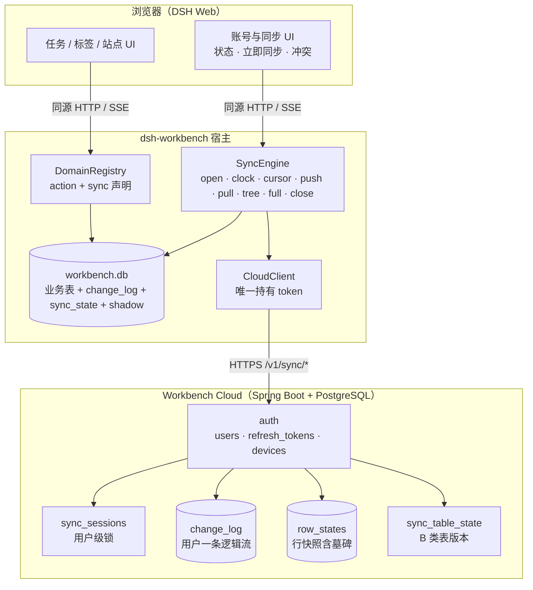
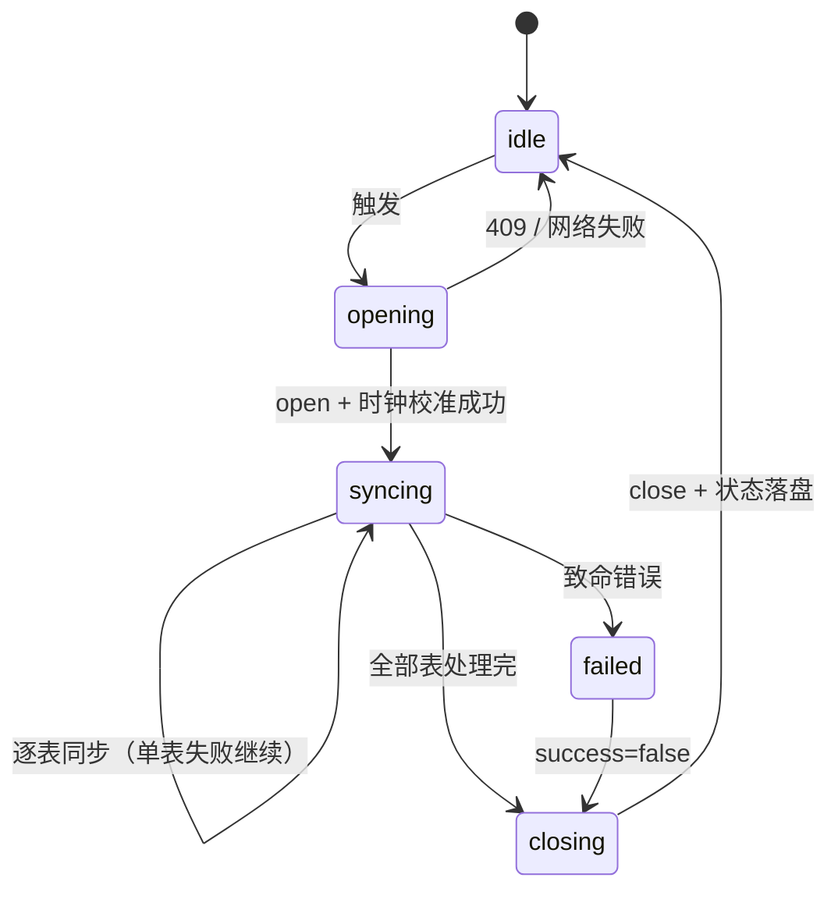

# 16 · 数据同步方案（protocol v2）

> 状态：协议 v2 已实现（2026-11-07），实现进度与未完成项见 §0.2。范围：dsh-workbench
> 宿主 + tasks / tags / sites + 自托管 cloud；不包含插件分发（见 04 / 14）。

## 0. 结论

改造前的同步**方向**与 sheepone_v2 一致：本地 SQLite 权威、离线优先、云端只做哑存储、
A/B 两类表、行级 LWW、软删墓碑、登录门禁、每设备 device_id。但**流程**是简化版：
没有会话锁、没有时钟校准、没有 B 类树整表覆盖、没有冲突闭环、没有按表游标和快照回填。

本方案（已实现）把上述能力补齐，协议升到 v2，并针对当前代码做 7 个工程化决定：

1. A 类行级表走增量日志 + LWW；B 类树表走整表快照 + 本地重建 + 全量覆盖。
2. 每次同步先 open 会话拿用户级锁，并用 serverTime 校准时钟，最后 close。
3. 不使用 v2 的 lastSyncDeviceId 快路径，改为**按表 cursor + snapshot bootstrap**：
   首次/落后设备直接拉整表快照，日常只拉该表的增量日志，语义等价且更简单。
4. 墓碑不再用 payload=null，而是**完整行 JSON + deleted_at**；服务端 row_states 与
   snapshot 都能拿到足够字段做比较与建树。
5. 严格 LWW：updated_at 大者胜；相等时服务端已有行胜出。客户端 pull 遇到更旧远端
   行时保留本地并补一条 repair 变更，冲突写入 conflict_shadow，闭环不丢数据。
6. 本地库与云端账号**一对一绑定**，并引入 sync_epoch，避免换账号/恢复备份后
   (device_id, client_seq) 幂等键碰撞造成数据漏同步。
7. 同步表由业务插件在 DomainDef 里声明，宿主聚合；云端不再维护硬编码表白名单，
   只做表名与大小校验。新插件不需要改云端就能同步。

### 0.1 与 sheepone_v2 的对照

| 能力 | v2 方案 | 当前实现 | 本方案 |
| --- | --- | --- | --- |
| 本地权威 / 离线写 | 是 | 是 | 是 |
| 云端职责 | 哑存储 + merge | 哑存储 + LWW | 哑存储 + merge |
| A 类行级同步 | 是 | 是（简化） | 是 |
| B 类树整表覆盖 | 是 | 否 | 是 |
| 用户级同步锁 | Redis 锁 | 无 | SQLite sync_sessions，TTL |
| 时钟校准 | serverTime + offset | 无 | 同 v2 |
| 首次/落后设备 | lastSyncDeviceId 快路径 / 全量比对 | 从 cursor=0 回放，可能卡住 | snapshot bootstrap + 按表 cursor |
| 冲突闭环 | 服务端返回 serverRows，客户端覆盖 | 返回 conflicts 但客户端忽略 | push 冲突覆盖 + pull 旧行 repair |
| 失败恢复 | 单表重试 3 次、失败表继续 | 整轮 catch 吞错 | 同 v2，并记录失败表 |
| 触发 | 启动/手动/30 分钟/网络恢复 | 固定 30 秒轮询 | 启动/登录/手动/定时/在线，脏检查 + 退避 |
| 表分类来源 | 方案文档硬编码 | 无统一分类 | DomainDef.sync 声明 |
| 存储 | MySQL + Redis | node:sqlite 单进程 | PostgreSQL 16（独立 Java 云端） |

结论：**设计原则一致，实现要对齐到本文；不是照搬 v2 的每个接口**。

### 0.2 实现进度（2026-11-07）

已完成：

- 云端 protocol v2：`sync_sessions`、`row_states.deleted`、`change_log.client_epoch`、
  `sync_table_state`、`devices.last_sync_at/cursors`；open/push/pull/snapshot/full/close
  路由；只保留 protocol v2。
- 本地：`sync_state` 账号绑定与 epoch、按表水位；`conflict_shadow` 扩展列；
  `sync_dead_letter`；旧库自动补列。
- 宿主：`SyncEngine` 会话/时钟/按表游标/快照回填/树整表 full/行增量/冲突闭包/repair/
  单表失败继续；登录后立即一轮 + 每 30 秒后台同步；`/sync/status`、`/sync/conflicts`、
  `/sync/conflicts/:id/resolve`。
- 插件：tasks / tags / sites 声明 `DomainDef.sync`；task_node / site_node 树 reconcile；
  树排序变化写 change log；删除写完整墓碑；标签名唯一（uk_tag_name，软删的不占位）；tag_mapping /
  site_node_mapping 声明唯一键并按 `lww-tombstone` 收敛。
- 客户端：账号页显示最后同步时间、冲突数、失败表、时钟偏移；订阅 `sync-status` /
  `sync-done` SSE，后台同步完成后自动刷新；冲突列表支持保留本地 / 采用云端 / 忽略。
- 测试：旧 Node 云端 `scripts/test-sync.mjs` 已随 `packages/cloud` 移除；
  云端 protocol v2 契约由独立 `dsh-workbench-cloud` 仓库维护。

尚未实现 / 有意保留的差异：

- 触发只有“登录后立即 + 固定 30 秒”；没有窗口聚焦、网络恢复、脏数据才同步、指数退避。
- `/sync/status` 还没有待推条数与最近错误详情。
- 冲突页只列出 shadow，未展示 payload 差异；死信只有计数，没有页面。
- 云端 change_log 还没有 180 天保留/截断任务。
- 树表 `replaceRows` 在 snapshot 与写入之间若正好有 UI 写同一个表，仍可能被整表替换
  覆盖（单进程事件循环下窗口很短，后续可加写入队列）。
- 账号切换仍要求新的 `WB_HOME`，没有导出/重置绑定流程。

## 1. 目标与非目标

### 1.1 目标

- 同一账号多台设备最终收敛：A 类按行 LWW，B 类树结构整体自洽。
- 离线可用：未登录/断网时所有业务写入照常进本地 change log；恢复后自动续传。
- 不丢用户数据：冲突有 shadow，删除有墓碑，失败不推进水位。
- 新设备/重装/新增插件可自举：快照 + 增量，不依赖历史日志是否完整。
- 不要求云端理解业务表；新增业务表只改插件声明，不改云端代码。
- 可观测：UI 能看到最后同步时间、待推数量、冲突、失败表与具体错误。

### 1.2 非目标

- 不做字段级合并/CRDT/Yjs；整行 LWW 是明确取舍。
- 不做 E2EE：服务端要读 payload 才能做 LWW；后续单独提案。
- 不做附件/二进制同步；附件走独立通道。
- 不做多人共享同一份数据；一个本地库只属于一个云端账号。
- 不做服务端按表业务校验；服务端只校验协议、表名、大小与版本。

## 2. 术语

| 术语 | 含义 |
| --- | --- |
| A 类表 | 行级表，行之间无全局顺序依赖，逐行 LWW |
| B 类表 | 树表，sort/path/depth 有全局语义，必须整表重建后覆盖 |
| 行版本 | 行的 updated_at（毫秒，已校准） |
| 墓碑 | deleted_at 非空的完整行 JSON |
| 水位 | 已确认处理到的日志位置（push/pull 各自按表维护） |
| 快照 | 服务端某张表在某时刻的全部 row_states（含墓碑） |
| reset | 一次 full push 后在 change_log 里写的表级重置标记 |
| 会话 | 一次 open → 若干 push/pull/full → close 的同步过程，持用户级锁 |
| repair | 客户端发现远端行比本地旧时，补写的一条待推送变更 |

## 3. 数据分类与声明

### 3.1 当前同步表

| 域 | 表 | 类别 | 说明 |
| --- | --- | --- | --- |
| tasks | task | A | 任务行，引用 task_node.id |
| tasks | task_node | B | 任务树，根固定 id=1 |
| tags | tag | A | 标签；名称唯一，见 11.1 |
| tags | tag_mapping | A | 标签映射；item_type=site 的行由 sites 写入 |
| sites | site | A | 站点 |
| sites | site_node | B | 站点目录树，虚拟根 id=0 不落库 |
| sites | site_node_mapping | A | 站点-目录映射 |
| sites | tag_mapping | A | 与 tags 共享同一张表，按 item_type 区分 |

历史表 tasks / habits 不再声明，不参与同步；旧数据已在迁移时改名，不再读取。

### 3.2 表归属规则

- A 类表允许被多个域声明（tag_mapping），但类别必须一致；同步按表进行，不按域。
- B 类表必须只有一个 owner 域，且提供 reconcile；宿主拒绝重复声明。
- 宿主把所有域的声明聚合成 SyncTableRegistry，作为 push/pull 的表清单。
- 云端不维护业务表白名单，只校验表名正则并限制数量/大小。

### 3.3 插件声明 API

在 packages/sdk/src/index.ts 扩展（实现阶段落地）：

```ts
export type SyncMode = "row" | "tree";

export interface DomainSyncTable {
  name: string;
  mode: SyncMode;
  /** 仅 tree：把远端快照合并进本地，重建 sort/path/depth，返回最终整表行。 */
  reconcile?: (remoteRows: SyncRow[]) => SyncReconcileResult;
  /** 仅 row：唯一键列组合，用于唯一约束冲突处理。 */
  uniqueKeys?: string[][];
  /** 仅 row：唯一冲突策略，默认 server-wins。 */
  uniquePolicy?: "server-wins" | "lww-tombstone" | "relax";
}

export interface SyncReconcileResult {
  rows: SyncRow[];
  /** reconcile 过程中级联改写的 A 类表，宿主随后按行同步。 */
  dirtyRowTables?: string[];
}

export interface DomainDef {
  // ...现有字段
  sync?: { tables: DomainSyncTable[] };
}

export interface DomainSetupApi {
  // ...现有字段
  now(): number;          // 已校准、单调的毫秒时钟
  markSyncDirty?(table: string): void; // 可选：显式标记表脏
}
```

兼容规则：没有 sync 字段的域，按现有 tables 推导为 row 类；tree 必须显式声明并提供
reconcile。宿主在 registerDomain 时校验：表名正则、类别冲突、tree 缺 reconcile 直接
把该域标记为 error（不影响其他域）。

tasks 的声明示例：

```ts
sync: {
  tables: [
    { name: "task", mode: "row" },
    { name: "task_node", mode: "tree", reconcile: reconcileTaskTree }
  ]
}
```

### 3.4 为什么树表必须整表覆盖

树的 sort 只有在一组完整兄弟列表里才有意义。逐行 merge 会出现两台设备对同一组兄弟
给出两套 sort，合并后同序号重复、path 与 parent 不一致。正确顺序是：

1. 合并节点集合（按 id，可逐节点 LWW）；
2. 在本地以单一视角重建树：修孤儿、重排 sort、重算 path/depth；
3. 把最终整表（含墓碑）覆盖回服务端。

这也是早期 P0 问题（tree.js 的兄弟 sort 重排没有写 change log）的解法：
代码已补上逐行 change_log；但 B 类顺序正确性最终仍由整表 full push 保证，
不依赖逐行合并。

## 4. 总体架构



    ┌──────────────────────── 浏览器（DSH Web） ────────────────────────┐
    │ 任务/标签/站点 UI       账号与同步 UI（状态、立即同步、冲突）        │
    │        │                        │                                 │
    │        └──── 同源 HTTP/SSE ─────┘                                 │
    └────────────────────────┬──────────────────────────────────────────┘
                             │ /workbench/api/*
    ┌────────────────────────▼──────────────────────────────────────────┐
    │ dsh-workbench 宿主                                                 │
    │  ├─ DomainRegistry（tasks/tags/sites 的 action + sync 声明）        │
    │  ├─ SyncEngine（open/clock/cursor/push/pull/tree/full/close）       │
    │  ├─ workbench.db（业务表 + sync_change_log + sync_state + shadow）  │
    │  └─ CloudClient（唯一持有 access/refresh token 的地方）             │
    └────────────────────────┬──────────────────────────────────────────┘
                             │ HTTPS /v1/sync/*
    ┌────────────────────────▼──────────────────────────────────────────┐
    │ Workbench Cloud（Spring Boot + PostgreSQL，独立仓库）              │
    │  ├─ auth（users / refresh_tokens / devices）                       │
    │  ├─ sync_sessions（用户级锁）                                      │
    │  ├─ change_log（按用户一条逻辑流）                                  │
    │  ├─ row_states（行快照，含墓碑）                                    │
    │  └─ sync_table_state（B 类表版本）                                  │
    └────────────────────────────────────────────────────────────────────┘

### 4.1 职责边界

- 浏览器不直接访问云端，不持有长期 token；只调宿主的 /account、/sync/now、
  /sync/status、/sync/conflicts。
- 宿主负责协议、锁、时钟、游标、冲突、失败重试；业务域负责表结构、树重建、唯一冲突
  与级联语义。
- 云端只负责鉴权、隔离、LWW merge、整表替换、日志与快照；不解析业务字段含义。

### 4.2 一次同步的时序

1. 触发（启动/登录/手动/定时/在线）。
2. 门禁：已登录、token 有效、本地无 in-flight、账号绑定一致。
3. POST /v1/sync/open：拿 session、serverTime、各 B 类表版本。
4. 时钟校准：offset = serverTime - (T1 + T2) / 2。
5. B 类表逐张：比较版本 → 必要时 snapshot + reconcile → 需要时 full push。
6. A 类表逐张：首同步 snapshot bootstrap → 回填本地 → push 增量 → pull 增量。
7. POST /v1/sync/close：success 标记，释放锁，更新 last_sync_at。
8. 发 SSE sync-status / sync-done，UI 刷新。

## 5. 同步契约

### 5.1 行版本

每张同步表必须有以下列（现有 addons 已具备）：

| 列 | 类型 | 语义 |
| --- | --- | --- |
| id | TEXT PK | 行身份，UUIDv7 |
| created_at | INTEGER | 创建毫秒 |
| updated_at | INTEGER | 最后一次写入毫秒，已校准、单调 |
| deleted_at | INTEGER NULL | 墓碑时间；非空即删除 |
| rev | INTEGER | 本地修订号，仅审计，不参与跨端比较 |

硬性要求：

- 任何业务写入（create/update/delete/树 move/rebuild/backup import）都必须推进
  updated_at；删除必须同时写 deleted_at 和 updated_at。
- change log 的 delete 条目 payload 必须是**完整墓碑行**，不再传 null。
  当前 tasks/lib/tasks.js:552-554、tasks/lib/tree/tree.js:279-287、tags 与 sites 的 delete
  路径都需要改。
- 不接受“只改 sort 不写 updated_at”的树操作；整表 full push 会带上最终 sort。

### 5.2 比较规则

定义 isNewer(incoming, current)：

1. incoming.updated_at > current.updated_at → 是；
2. 小于 → 否；
3. 相等 → 否（服务端已有行胜出）。

客户端 pull 的规则稍宽：远端 updated_at >= 本地 updated_at 时应用远端；相等且 payload
不同也应用远端并记 shadow。这样即使两台设备同一毫秒写同一行，也一定会收敛到服务端
当前行，而不是各保留各的。

payload 相等判断用 stable stringify（对象 key 递归排序）比较，避免 JSON 字段顺序造成
假冲突。

### 5.3 墓碑

- 删除 = 整行保留，deleted_at 非空，updated_at 推进。
- 服务端 row_states.payload 永远非空；deleted 列由 payload.deleted_at 派生，供统计与
  索引使用。
- snapshot 返回墓碑；B 类 reconcile 必须把远端墓碑合并进本地，不能只处理未删行。
- 墓碑物理清理晚于 max(180 天, 所有设备最小 cursor)；当前阶段先保留，不做自动清理。

### 5.4 变更日志

本地 sync_change_log 结构不变：

```sql
seq INTEGER PK AUTOINCREMENT,
table_name TEXT NOT NULL,
row_id TEXT NOT NULL,
op TEXT NOT NULL,              -- upsert | delete
payload TEXT,                  -- 完整行 JSON；delete 也是完整墓碑
origin TEXT NOT NULL,          -- ui | agent | import | repair
updated_at INTEGER NOT NULL
```

规则：

- origin=sync 不写日志（远端应用造成的本地变化不能再回声）。
- origin=repair 是冲突闭环补写的待推送行，payload 用当前本地行，updated_at 不变。
- 同一行连续多次写入允许保留多条日志；push 时按 row 合并，只发最后一条。
- 树表的日志只用于“这张表脏了”的判断；顺序正确性由 full push 保证。

### 5.5 水位

全部改为按表维护，键里带账号，避免换账号串数据：

```text
push_after:<userId>:<table>   -- 已推送到服务端的本地 seq
pull_cursor:<userId>:<table>  -- 已拉取到的服务端 server_seq
table_version:<userId>:<table>-- 本地已知的 B 类表服务端版本
backfill_done:<userId>:<table>-- 首次 v2 同步是否已把存量本地行补进日志
```

全局 push_after 只作为迁移来源：首次 v2 同步时，把旧值复制到各表，再删除旧键。

## 6. 本地数据模型

### 6.1 sync_state 键

| 键 | 值 | 说明 |
| --- | --- | --- |
| account_user_id | TEXT | 本地库绑定的云端账号；首次登录写入 |
| sync_epoch | TEXT | 本库首次同步生成的 UUID；幂等键的一部分 |
| clock_offset | INTEGER | 服务端时间 - 本地时间，毫秒 |
| last_sync_at | INTEGER | 最近一次成功 close 的本地时间 |
| last_sync_ok | 0/1 | 最近一轮是否成功 |
| last_sync_error | TEXT | 最近错误码/消息，供 UI |
| failed_tables | JSON | 本轮失败的表与错误 |
| push_after / pull_cursor / table_version / backfill_done | 见 5.5 | 按表水位 |

### 6.2 conflict_shadow 扩展

现有表保留，增加列：

    ALTER TABLE conflict_shadow ADD COLUMN kind TEXT NOT NULL DEFAULT 'pull';
    ALTER TABLE conflict_shadow ADD COLUMN resolution TEXT NOT NULL DEFAULT 'open';
    ALTER TABLE conflict_shadow ADD COLUMN server_updated_at INTEGER;
    ALTER TABLE conflict_shadow ADD COLUMN local_updated_at INTEGER;

kind: pull（远端覆盖本地）/ push（推送被服务端拒绝）/ repair（本地胜出但已补推）。
resolution: open / use_server / use_local / ignored。
只保留最近 1000 条；UI 可查看，后续提供“以本地为准重试/使用云端”动作。

### 6.3 sync_dead_letter

    CREATE TABLE IF NOT EXISTS sync_dead_letter (
      id INTEGER PRIMARY KEY AUTOINCREMENT,
      table_name TEXT NOT NULL,
      row_id TEXT NOT NULL,
      op TEXT NOT NULL,
      payload TEXT,
      error TEXT NOT NULL,
      created_at INTEGER NOT NULL
    );

用于：未知表/未知 op、payload 校验失败、唯一约束无法自动解决、schema 不兼容。
记录后推进该表水位，避免一条坏行卡死整轮；UI 显示数量。

### 6.4 账号绑定

本地业务表没有 user_id。若允许同一 workbench.db 登录不同账号，A 账号的数据会被推到
B 账号，造成串号。因此：

- 首次登录成功时写 account_user_id。
- 之后登录的 userId 必须相同；不同则 /account/login 返回 409 account_mismatch，
  UI 提示“此工作台已绑定另一个账号，请使用独立工作区/DSH profile”。
- 登出不清除绑定；换账号需要新的 WB_HOME（或由维护命令显式解绑并清空本地业务表）。
- 这是硬约束，不做行级 user_id 隔离。

### 6.5 同步 epoch

同步 state 保存 sync_epoch（UUID）。push 请求带 epoch，服务端幂等键为
(user_id, device_id, epoch, client_seq)。这样备份恢复/重建库后 seq 从 1 开始也不会
被服务端误判为重复。change_log 云端表需要增加 client_epoch 列（见 7.3）。

## 7. 云端数据模型

### 7.1 sync_sessions

    CREATE TABLE IF NOT EXISTS sync_sessions (
      user_id TEXT PRIMARY KEY,
      session_id TEXT NOT NULL UNIQUE,
      device_id TEXT NOT NULL,
      opened_at INTEGER NOT NULL,
      expires_at INTEGER NOT NULL
    );

单进程 SQLite 下用表实现用户级锁；不引入 Redis。

### 7.2 row_states 扩展

    CREATE TABLE IF NOT EXISTS row_states (
      user_id TEXT NOT NULL,
      table_name TEXT NOT NULL,
      row_id TEXT NOT NULL,
      payload TEXT NOT NULL,          -- 完整行 JSON，墓碑也非空
      deleted INTEGER NOT NULL DEFAULT 0,
      updated_at INTEGER NOT NULL,
      PRIMARY KEY (user_id, table_name, row_id)
    );
    CREATE INDEX IF NOT EXISTS idx_row_states_table
      ON row_states(user_id, table_name, updated_at);

迁移：现有 payload 为 NULL 的墓碑行，改写为
json_object('id', row_id, 'deleted_at', updated_at, 'updated_at', updated_at, 'rev', 0)，
再删除 NULL 行；deleted 按 payload 的 deleted_at 回填。

### 7.3 change_log 扩展与重建

需要新增 client_epoch，并把唯一键改成 (user_id, device_id, client_epoch, client_seq)：

    CREATE TABLE change_log_v2 (
      server_seq INTEGER PRIMARY KEY AUTOINCREMENT,
      user_id TEXT NOT NULL,
      device_id TEXT NOT NULL,
      client_epoch TEXT NOT NULL DEFAULT '',
      client_seq INTEGER NOT NULL,
      table_name TEXT NOT NULL,
      row_id TEXT NOT NULL,
      op TEXT NOT NULL,               -- upsert | delete | reset
      payload TEXT,
      updated_at INTEGER NOT NULL,
      UNIQUE(user_id, device_id, client_epoch, client_seq)
    );
    CREATE INDEX idx_cl_user_table_seq
      ON change_log_v2(user_id, table_name, server_seq);
    INSERT INTO change_log_v2(...) SELECT ..., '' , ... FROM change_log;
    DROP TABLE change_log;
    ALTER TABLE change_log_v2 RENAME TO change_log;

reset 条目：table_name=表名，row_id=''，op='reset'，
payload=json_object('version', n)，updated_at=服务端当前时间。

### 7.4 sync_table_state

```sql
CREATE TABLE IF NOT EXISTS sync_table_state (
  user_id TEXT NOT NULL,
  table_name TEXT NOT NULL,
  version INTEGER NOT NULL DEFAULT 0,
  mode TEXT NOT NULL DEFAULT 'row',   -- row | full
  updated_at INTEGER NOT NULL,
  PRIMARY KEY (user_id, table_name)
);
```

B 类表 full push 时 version+1、mode=full；A 类表首次被 full 时也写 mode=full，
之后 incremental push 遇到 mode=full 直接拒绝（防止误用行级 merge 破坏树）。

### 7.5 devices 扩展

    ALTER TABLE devices ADD COLUMN last_sync_at INTEGER;
    ALTER TABLE devices ADD COLUMN cursors TEXT NOT NULL DEFAULT '{}';

last_sync_at 由 close 写入；cursors 是各表 pull 水位，供保留策略参考（可选）。

## 8. 协议

### 8.0 通用

- 认证：Authorization: Bearer access_token；设备身份来自 token，不信任 body 里的
  device_id（body 只用于校验一致性）。
- 会话：除 open 外，所有 /v1/sync/* 请求带 x-sync-session: session_id；服务端校验
  用户、设备、过期时间，并顺延 TTL。
- 编码：JSON，时间毫秒整数；payload 是对象，不是字符串（服务端负责序列化）。
- 大小：单请求 8MB；单批 push 200 行；full push 10000 行 / 16MB；snapshot 20000 行 /
  32MB；超限返回 413。
- 表名：^[a-z][a-z0-9_]{1,63}$；服务端只把它当字符串参数，不拼 SQL 标识符。
- 所有响应带 server_time，客户端可再次校准。

### 8.1 POST /v1/sync/open

请求：

    { "protocol": 2, "device_id": "..." }

响应：

    {
      "ok": true,
      "protocol": 2,
      "session_id": "...",
      "server_time": 1762500000000,
      "expires_at": 1762500120000,
      "tables": {
        "task_node": { "version": 7, "mode": "full" },
        "site_node": { "version": 3, "mode": "full" }
      }
    }

规则：

- 先清理 expires_at <= now 的会话。
- 无会话 → 插入，返回 200。
- 有会话且 device_id 相同 → 覆盖为新 session（同设备重试）。
- 有会话且 device_id 不同 → 409 sync_locked，带 retry_after_ms。
- protocol != 2 → 426 protocol_unsupported。

### 8.2 POST /v1/sync/push

请求（A 类增量）：

    {
      "session_id": "...",
      "epoch": "uuid",
      "changes": [
        {
          "client_seq": 128,
          "table_name": "task",
          "row_id": "01a...",
          "op": "upsert",
          "payload": { "id": "01a...", "title": "...", "updated_at": 1762500000000, "deleted_at": null },
          "updated_at": 1762500000000
        }
      ]
    }

响应：

    {
      "ok": true,
      "accepted_up_to": 128,
      "results": [
        { "client_seq": 128, "status": "accepted" },
        { "client_seq": 129, "status": "conflict", "row": { ...服务端当前行... } },
        { "client_seq": 130, "status": "duplicate", "row": { ...当前行... } },
        { "client_seq": 131, "status": "invalid", "error": "row_id mismatch" }
      ],
      "server_time": 1762500000100,
      "session_expires_at": 1762500120000
    }

status 语义：

| status | 含义 | 客户端动作 |
| --- | --- | --- |
| accepted | 服务端接受并写日志 | 推进水位 |
| conflict | 服务端已有行不更旧，拒绝 | 应用 row，写 shadow，推进 |
| duplicate | 幂等键已存在 | 应用 row（若更新），推进 |
| invalid | 校验失败 | 写 dead letter，推进，不阻断整批 |

accepted_up_to = 本批处理到的最大 client_seq；客户端只对 <= 它的条目推进水位。
服务端必须先把所有条目校验完，再在一个事务里写 row_states + change_log；意外 DB 错误
回滚并返回 500，客户端整批重试。

### 8.3 POST /v1/sync/pull

请求：

    {
      "session_id": "...",
      "cursors": { "task": 1024, "task_node": 900, "tag": 1030 },
      "limit": 500
    }

响应：

    {
      "ok": true,
      "entries": [
        {
          "server_seq": 1031,
          "device_id": "...",
          "table_name": "task",
          "row_id": "...",
          "op": "upsert",
          "payload": { ... },
          "updated_at": 1762500000000
        },
        {
          "server_seq": 1032,
          "table_name": "task_node",
          "row_id": "",
          "op": "reset",
          "payload": { "version": 8 },
          "updated_at": 1762500000100
        }
      ],
      "next_cursors": { "task": 1031, "task_node": 1032, "tag": 1030 },
      "has_more": false,
      "min_seq": 800,
      "server_time": 1762500000200
    }

规则：

- 只对请求里出现的表返回条目；未安装的表不请求，cursor 不动。
- 每张表按 server_seq 升序取 limit 条，合并后按 server_seq 排序，截断到 limit。
- min_seq 是该用户当前 change_log 的最小 server_seq；若客户端 cursor < min_seq，
  说明日志已被清理，必须对该表走 snapshot。
- 客户端跳过 device_id == 自己的条目（自己的回声），但 cursor 照常前进。
- reset 条目只对 B 类表出现；客户端收到后处理快照，见 9.5。

### 8.4 POST /v1/sync/snapshot

请求：

    { "session_id": "...", "table": "task_node" }

响应：

    {
      "ok": true,
      "table": "task_node",
      "rows": [ { "id": "...", "parent_id": "...", "updated_at": ..., "deleted_at": null } ],
      "cursor": 1040,
      "version": 8,
      "server_time": 1762500000300
    }

规则：

- 在同一个读事务里取 rows、MAX(server_seq)、sync_table_state.version。
- rows 包含墓碑；A 类表 version 返回 null。
- 设 cursor 为当前 MAX(server_seq)，客户端处理完快照后把该表 pull_cursor 设为 cursor，
  避免快照与日志之间出现空洞。

### 8.5 POST /v1/sync/full

请求（B 类整表）：

    {
      "session_id": "...",
      "table": "task_node",
      "base_version": 7,
      "rows": [ { "id": "...", "name": "...", "parent_id": "...", "path": "...", "sort": 0, "depth": 0, "updated_at": ..., "deleted_at": null } ]
    }

响应：

    { "ok": true, "version": 8, "cursor": 1050, "server_time": ... }

规则：

- 事务内校验 sync_table_state.version == base_version；不等 → 409 version_conflict，
  返回当前 version。
- 删除该 user+table 的全部 row_states，批量插入 rows（含墓碑）。
- version = base_version + 1，mode=full，写 sync_table_state。
- 追加一条 reset 日志，返回它的 server_seq 作为 cursor。
- rows 超出 10000 行或 16MB → 413。

### 8.6 POST /v1/sync/close

请求：

    { "session_id": "...", "success": true, "cursors": { "task": 1031, "task_node": 1050 } }

响应：

    { "ok": true, "server_time": ... }

规则：

- 校验 session 属于当前用户/设备；删除会话。
- success=true 时更新 devices.last_sync_at、cursors。
- 会话不存在 → 仍返回 200（幂等 close）。

### 8.7 错误码

| HTTP | code | 场景 |
| --- | --- | --- |
| 401 | unauthorized | token 缺失/过期 |
| 401 | device_revoked | 设备被吊销 |
| 409 | sync_locked | 另一设备持有会话 |
| 409 | session_expired | 会话 TTL 到期/不存在 |
| 409 | version_conflict | full push 的 base_version 落后 |
| 409 | account_mismatch | 本地库绑定账号与登录账号不同（宿主返回） |
| 413 | payload_too_large | 单请求/单表超限 |
| 426 | protocol_unsupported | 客户端协议版本不支持 |
| 400 | invalid_request | 表名/字段/row_id 校验失败 |

### 8.8 幂等

- push：唯一键 (user, device, epoch, client_seq)；重复请求返回 duplicate + 当前行。
- full：base_version 乐观锁；响应丢失后重试会 409，客户端拉快照比对，若本地与快照
  一致则直接接受新版本，否则再 push 一次。
- close：幂等。
- snapshot：只读。

## 9. 宿主同步引擎

### 9.1 状态机



    idle -> opening -> syncing -> closing -> idle
      |        |          |          |
      |        |          └-> failed -> closing(success=false)
      |        └-> idle（409/网络失败，静默退避）
      └-> idle

- 同一时刻只允许一个 in-flight；手动/定时/启动触发都合并到同一个 Promise。
- failed 不丢状态：失败表写入 sync_state.failed_tables，下一轮优先重试。

### 9.2 触发、并发与退避

当前实现（2026-11-07）：

| 触发 | 行为 |
| --- | --- |
| 登录成功 | 立即同步一次 |
| 手动 POST /sync/now | 立即；若 in-flight 返回 skipped |
| 定时 | 每 30 秒检查一次，已登录才执行 |
| 本地写入 | 只写 change_log，不立即同步；由定时器接管 |

尚未实现（见 §0.2）：启动延迟同步、窗口聚焦、浏览器 online、脏检查跳过 open、
失败指数退避。当前定时器固定 30 秒，单轮失败只记日志与失败表，不阻塞下一轮。

### 9.3 主流程伪代码

```text
async function syncOnce():
  if !creds || inFlight || !bindingMatches() return
  inFlight = true
  try:
    session = open()
    calibrateClock(session.server_time)
    success = true
    for table in treeTables():
      try: syncTree(table, session)
      catch e: recordFailure(table, e); success = false
    for table in rowTables():
      try: syncRows(table, session)
      catch e: recordFailure(table, e); success = false
    close(success)
    updateStatus(success)
  finally:
    inFlight = false
```

顺序必须先树后行：task.table_id 引用 task_node.id，树先落服务端，其他设备才不会看到
悬空引用（会话锁已经保证本轮不会被别的设备插入拉取）。

### 9.4 A 类表算法

首次同步（backfill_done 未设置）：

1. 若 pull_cursor 不存在：snapshot(table) → 逐行按 5.2 规则合并进本地（本地可能更新，
   保留本地并记 shadow）→ pull_cursor = snapshot.cursor。
2. 扫描本地表，把没有待推送日志的行补一条 origin=repair 的 upsert（含墓碑），
   确保登录前/迁移/备份导入的存量数据能上传。
3. backfill_done=1。

日常 push：

1. 读 sync_change_log where table_name=? and seq > push_after order by seq limit 200。
2. 同一 row 只保留最后一条；构造 changes（带 epoch、client_seq）。
3. POST push。
4. 对 results：
   - accepted：推进；
   - conflict/duplicate：若 row 比本地新，应用 row，写 shadow(kind=push)；
   - invalid：写 dead letter；
   全部处理后 push_after = 本批最大 seq（无效行也推进，避免卡死）。
5. 若还有更多，重复（最多 10 批/表/轮）。

日常 pull：

1. cursor = pull_cursor；若 cursor < min_seq → snapshot 该表并重置 cursor。
2. POST pull（cursors 里带本表）。
3. 逐条应用：
   - upsert/delete：remote.updated_at > local.updated_at → 整行替换；
     remote.updated_at < local.updated_at → 保留本地，写 shadow(kind=pull)，
     若该行没有 pending 日志则补 repair；
     equal 且 payload 不同 → 应用远端，写 shadow；
   - reset：不应出现在 A 类表；写 dead letter。
4. 每页在事务内应用，提交后推进 cursor；失败回滚且不推进。

### 9.5 B 类表算法

每轮：

1. serverVersion = open().tables[table].version（或本地 table_version 已知）。
2. localVersion = table_version（默认 0）。
3. 情况 A：serverVersion == localVersion 且本表无待推变更 → 跳过。
4. 情况 B：serverVersion == localVersion 且有本地变更 → full push（base=localVersion）。
5. 情况 C：serverVersion != localVersion：
   a. snapshot(table) 取 rows + version + cursor。
   b. 在本地事务里调用 domain.reconcile(rows)：
      - 按 id 合并本地行与远端行，updated_at 大者胜，相等远端胜；
      - 远端墓碑覆盖本地未删行（若墓碑更新）；
      - 保留本地比远端新的行/墓碑；
      - 任务树确保根 1 存在；站点树根 0 是虚拟节点，不插入；
      - 修孤儿：父不存在或已删 → 挂到根；
      - 按 parent 分组的兄弟列表按 (sort, created_at, id) 稳定排序，重排 0..n；
      - DFS 重算 path/depth；
      - 级联：任务树节点被远端删除时，软删其子树下 task 并写 change log；
        站点树节点被远端删除时，软删对应 site_node_mapping 并写 change log；
      - 返回最终整表 rows（含墓碑）与 dirtyRowTables。
   c. 宿主在同一个事务里 DELETE FROM table + 批量 INSERT rows；
      校验 reconcile 返回的 id 集合、列集合、根节点、无重复 sort。
   d. full push（base=snapshot.version）；成功后 table_version=新版本，
      pull_cursor=reset cursor，push_after=reconcile 前该表最大 seq。
   e. 若 full push 返回 409 version_conflict：重新 snapshot + reconcile，最多 3 次。
6. reconcile 产生的 dirtyRowTables 在 A 类阶段自然被推送。

情况 C 的“无本地变更”也要 push：远端补进来的节点/路径/排序已经改变本地整表，必须
覆盖回服务端，否则服务端版本会落后于本地。

full push 的 rows 必须包含墓碑；否则已删节点会在下一次快照中“复活”。

### 9.6 冲突闭环

| 场景 | 处理 |
| --- | --- |
| push 返回 conflict | 服务端行胜出：应用到本地，写 shadow(kind=push)，不补 repair |
| pull 远端更新 | 应用远端，写 shadow(kind=pull) |
| pull 远端更旧 | 保留本地，写 shadow(kind=repair)，若无 pending 则补 repair 日志 |
| 同毫秒不同 payload | 远端胜出（服务端当前行），写 shadow |
| 唯一约束冲突 | 见 11 |

repair 日志的 updated_at 用本地行的 updated_at，不重新取时间；它只是一次“把本地版本
再送一次”的动作。服务端若仍拒绝（说明远端更新），客户端应用远端，repair 结束。

### 9.7 时钟校准

open 时：

    T1 = Date.now()
    response = POST /v1/sync/open
    T2 = Date.now()
    offset = response.server_time - (T1 + T2) / 2

- offset 存 sync_state，进程内缓存。
- host.now() = max(Date.now() + offset, lastNow + 1)，保证单调。
- 所有 addons 写入改用 api.now()；当前各 addon 的 db.js 里 now() 直接 Date.now()，
  实现阶段统一改为注入时钟。
- 服务端对 updated_at 超出 server_time ±10 分钟的行记录 clock_skew 诊断（不直接拒绝，
  避免旧数据无法上传）；客户端下一次 open 自动校准。
- 登录前产生的离线数据使用未校准时钟，可能偏旧；这是已知限制，文档向用户说明。

### 9.8 游标、回填与保留

- 每张表独立 cursor；新增插件/新设备第一次同步走 snapshot，不依赖历史日志。
- 服务端 change_log 保留 180 天；客户端 cursor < min_seq 时自动 snapshot。
- 服务端 row_states 保留全部行（含墓碑）；后续可做墓碑压缩，但不能早于所有设备 cursor。
- 卸载插件时本地表与 cursor 保留；重装后继续用原 cursor，若日志已清理则 snapshot。

### 9.9 失败处理

| 场景 | 处理 |
| --- | --- |
| 网络失败 | 静默；指数退避；不推进任何水位 |
| 409 sync_locked | 静默；30s 后重试 |
| 409 session_expired | 重新 open，从失败表继续 |
| 409 version_conflict | 重新 snapshot + reconcile，最多 3 次 |
| 401 | 尝试 refresh 一次；仍失败置 expired，停止本轮 |
| 401 device_revoked | 清 creds，UI 提示设备被吊销，转本地模式 |
| 单表失败 | 重试 3 次（0.5s/1s/2s）；仍失败记 failed_tables，继续其他表 |
| 单行 invalid | 写 dead letter，推进该表水位，不阻断整表 |
| 磁盘/DB 错误 | 回滚当前页，不推进 cursor，本轮失败 |

close 的 success = 所有表都成功；success=false 时不更新 last_sync_at，但已成功的表
水位保留，下一轮不会重复。

### 9.10 状态与可观测性

宿主新增：

- GET /workbench/api/sync/status → {logged_in, binding, last_sync_at, last_sync_ok,
  last_error, pending, conflicts, failed_tables, in_flight}
- GET /workbench/api/sync/conflicts?limit=50
- POST /workbench/api/sync/conflicts/:id/resolve {action:"use_server"|"use_local"|"ignore"}
- SSE sync-status（状态变化）与 sync-done（一轮结束）

## 10. 服务端合并

### 10.1 增量 push

对每个 item：

1. 校验 table_name、row_id == payload.id、payload.updated_at == item.updated_at、
   payload 可序列化、大小限制。
2. 查幂等键；存在 → duplicate，取当前 row_state 返回。
3. 查 row_states 当前行；不存在或 item.updated_at > current.updated_at → accepted；
   相等且 stable payload 相同 → equal（按 accepted 处理，不写日志）；
   否则 conflict，返回 current。
4. accepted：UPSERT row_states（payload 规范化 JSON、deleted 派生）；
   INSERT change_log（op、payload、updated_at）。
5. 整批在一个事务内；先校验后写入。

### 10.2 整表 full

事务：

1. 校验 session、表名、行数/大小、每行 id 唯一、row_id == payload.id。
2. 读 sync_table_state.version；不等于 base_version → 409。
3. DELETE row_states WHERE user+table。
4. 批量 INSERT rows（payload 规范化，deleted 派生）。
5. version+1、mode=full、UPSERT sync_table_state。
6. INSERT change_log(op=reset, payload={version}, row_id='')。
7. 返回 version + reset server_seq。

### 10.3 snapshot

读事务：

1. SELECT rows FROM row_states WHERE user+table ORDER BY row_id。
2. MAX(server_seq) FROM change_log WHERE user。
3. version FROM sync_table_state。
4. 返回。

### 10.4 会话与锁

- open 时清理过期会话；同设备可覆盖；不同设备 409。
- 每个请求校验 session_id + user + device + expires_at；通过则 expires_at=now+300s。
- close 删除会话；success 时写 devices。
- 服务重启会话丢失，客户端重新 open 即可。

### 10.5 reset 与 pull

- full 后 change_log 只写一条 reset，不逐行写。
- 客户端 pull 看到 reset：记录当前表 cursor 到 reset seq，然后 snapshot 该表；
  snapshot 的 cursor 覆盖 reset seq，处理完继续 pull。
- 自己发起的 full 拿到响应里的 cursor 后直接推进，不必再拉自己的 reset。

### 10.6 日志保留

- 定时任务删除 server_seq < 当前时间 - 180 天的 change_log。
- 删除前记录 min_seq；pull 返回 min_seq，客户端自动 snapshot。
- 不做墓碑清理（后续阶段）。

## 11. 唯一约束与引用完整性

### 11.1 tag 名称唯一（2026-11-08 修订）

2026-11-07 曾确认“允许标签重名”并移除唯一索引；实践里重名标签让 agent 与站点表单
无法按名字稳定复用，2026-11-08 起恢复唯一约束（见 [19 G2](19-业务评审与重构建议.md)）。

决定：

- 建部分唯一索引 `uk_tag_name(name) WHERE deleted_at IS NULL`，软删标签不占名。
- `tags.create` 同名幂等：返回已有 `{id,tag,existing:true}`，不新建行、不写 change log。
- `tags.update` 改成其它标签已用的名字时报错并给出占用者 id；改成自身同名是 no-op。
- 升级迁移：`mergeDuplicateTagNames` 在建索引前按 name 分组，保留 created_at 最早的
  一条，其余标签的活跃 mapping 改挂保留者；保留者已有同对象映射时重复映射软删，
  重复标签本身软删（保留墓碑，同步可见）。
- 备份导入：`canonicalizeTagNames` 把“不同 id、同名”的标签合并到保留者，映射同步
  改挂并按 (tag_id,item_id,item_type) 去重；被合并的条数计入 `skipped`，返回值多一个
  `merged` 字段。
- 两台设备离线各建“工作”，同步后由协议层 LWW 决定保留哪一行；本地重名合并在下一次
  `ensureSchema` 生效。

### 11.2 mapping 唯一键

tag_mapping 与 site_node_mapping 有部分唯一索引。两台设备可能为同一
(tag_id,item_id,item_type) 或 (site_id,node_id) 建不同 id 的映射。

决定：uniquePolicy = lww-tombstone。

- 应用远端映射前先按唯一键查本地行；
- 若存在不同 id：按 updated_at 比较，输的一方软删（deleted_at/updated_at=胜者时间），
  胜者写入；被软删的行也写本地 change log（origin=repair），让删除传播。
- 若无法判定（同毫秒），保留服务端行，本地行软删并记 shadow。

### 11.3 引用完整性

- task.table_id → task_node.id；task_node.parent_id → task_node.id。
- tag_mapping.tag_id → tag.id；site_node_mapping.site_id/node_id。
- 数据库不建外键；由域在 reconcile 中修复：
  - 树先同步，行后同步；
  - 父节点缺失/已删 → 挂根，不让节点消失；
  - 树节点远端删除 → 域级联软删其下 task 或 mapping，并写日志；
  - 行引用了不存在的节点 → 列表查询按现有逻辑隐藏/回退，不物理删。

## 12. UI

账号与同步页（现有 AccountTab 扩展）：

- 未登录：邮箱/密码/注册，说明“登录只影响同步，不影响本地使用”。
- 已登录：
  - 账号、设备 id、绑定状态；
  - 最后同步时间、结果（成功/部分失败/失败）、待推数量；
  - 冲突数量、失败表列表、最近错误；
  - “立即同步”按钮（in-flight 时禁用并显示进度）；
  - “冲突详情”列表：表、行、kind 与时间；每个冲突提供三个操作：
    `keep_local`（本地行 bump 时间后重推）、`keep_server`（直接采用云端行）、
    `dismiss`（只删除 shadow）；
  - 登出。
- 首页右上角显示云端连接状态胶囊，点击进入账号与同步页；状态区分未登录（本地模式）、检查中、同步中、已连接、连接失败、等待首次同步、同步异常。胶囊读取 `/sync/status`，宿主对 `/v1/health` 做 3 秒超时、10 秒缓存的轻量探测；登录/登出会清空缓存。
- SSE sync-status 更新，不轮询。

文案新增（zh/en）：sync_status、sync_pending、sync_conflicts、sync_failed_tables、
sync_last_at、sync_never、sync_running、sync_locked、sync_account_mismatch、
sync_conflict_title、sync_use_server、sync_use_local、sync_ignore、sync_dead_letter。

## 13. 安全与隐私

- token 只在宿主内存 + 0600 凭据文件；浏览器只走同源宿主接口。
- 云端按 user_id 隔离；表名只作为参数，不拼 SQL 标识符；payload 限长。
- 设备吊销：现有 DELETE /v1/devices/:id；宿主收到 401 device_revoked 清 creds。
- 不做 E2EE：服务端能读 payload 才能 LWW；文档明确告知。
- 日志不打印 payload/token；错误只记录表名、行 id、错误码。
- 备份 zip 与同步互不影响；导入的数据通过 change log 进入同步。

## 14. 迁移

### 14.1 协议版本

- 云端只实现 protocol v2。
- 协议版本写在 open；非 2 返回 426，客户端提示升级。
- 服务端与客户端版本不匹配时只影响新增字段的行为，不同步失败也不丢本地数据。

### 14.2 云端迁移

1. 建 sync_sessions、sync_table_state。
2. row_states 增加 deleted；NULL payload 转墓碑 JSON。
3. change_log 重建加 client_epoch 与新唯一键。
4. devices 增加 last_sync_at、cursors。
5. 迁移脚本幂等，可重复执行；失败回滚。

### 14.3 本地迁移

1. sync_state 增加 account_user_id、sync_epoch、clock_offset、last_sync_*。
2. conflict_shadow 增加列；新建 sync_dead_letter。
3. 首次每表 backfill：把没有日志的本地行补 repair。
4. tag 唯一索引移除、创建不再查重（11.1）。

### 14.4 版本

版本号不写死，统一见各包 package.json；
minShell 与宿主版本同步。

### 14.5 文档

实现时同步更新：docs/04（DomainDef.sync）、docs/05（本地表）、docs/06（云端表/接口）、
docs/07（改为指向本文并修正冲突描述）、docs/08（M3 验收）、docs/14（版本记录）、
README 导航。

## 15. 测试计划

### 15.1 单元

| 用例 | 期望 |
| --- | --- |
| compare：updated_at 大/小/相等 | 严格按 5.2 |
| stable stringify 字段顺序不同 | 判定相等 |
| 墓碑比较 | 删除晚于更新则删除胜 |
| 时钟 offset 计算与单调 | 回拨不倒退 |
| 唯一键冲突 lww-tombstone | 输者软删并写日志 |
| 树 reconcile：新节点/墓碑/孤儿/环/排序 | 根保留、无孤儿、sort 0..n、path 一致 |

### 15.2 集成（两个本地库 + 一个临时云端）

| 场景 | 期望 |
| --- | --- |
| A 建任务 → 同步 → B 拉取 | B 看到任务 |
| A/B 离线改同一行，先后同步 | 后写者按 LWW 胜，输方 shadow，最终一致 |
| 同毫秒改同一行 | 服务端已有行胜，双方收敛 |
| A 删任务，B 离线改同一行 | 时间新者胜；若 B 更新，任务复活为改后状态（LWW 语义） |
| A 移动树节点 → B 同步 | B path/sort/depth 与 A 一致，无重复 sort |
| A/B 同时移动同一子树 | 会话锁串行；后同步者以本地重建覆盖，最终一致 |
| 新设备首次同步 | snapshot bootstrap，无需历史日志 |
| 新增插件表首次同步 | snapshot + backfill，旧数据上传 |
| change_log 被清理，cursor 落后 | pull 返回 min_seq，自动 snapshot |
| push 响应丢失后重试 | 幂等，不重复写日志 |
| full push 响应丢失后重试 | 409 → snapshot 比对 → 接受或重推 |
| 会话被另一设备占用 | 409，静默退避 |
| 会话 TTL 到期 | 409 session_expired，重新 open 继续 |
| 401 后 refresh | 一轮成功；refresh 失败置 expired |
| 单表 schema 错误 | 该表失败，其他表继续，success=false |
| 单行 payload 非法 | dead letter，不阻断整表 |
| 账号绑定不一致 | 409 account_mismatch，不推送 |
| 备份恢复后 seq 碰撞 | epoch 不同，正常同步 |
| 树节点远端删除级联 | 子树 task/mapping 同步软删 |
| 两台设备各建同名标签 | 两条都保留，mapping 各自独立；删一条不影响另一条 |

### 15.3 端到端

- 旧 Node 云端 `scripts/test-sync.mjs` 已移除；云端端到端测试在独立
  `dsh-workbench-cloud` 仓库执行。
- scripts/test-native.mjs 扩展：域声明 sync tables，断言 registry 完整。
- 真实临时 DSH（3099）双实例验证 UI 状态与手动同步；不重启 3080。

### 15.4 性能

- 10k 行树 full push < 2s（本机 SQLite）。
- 500 行 push/pull < 500ms。
- 30 天日志量 < 10MB（个人数据）。

## 16. 实施阶段

### 阶段 0：设计确认（本文）

产出：本文 + 待确认项答复。不改代码。

### 阶段 1：云端协议 v2

- 迁移 store/server：sessions、table_state、row_states.deleted、change_log.client_epoch。
- open/push/pull/snapshot/full/close。
- 单测 + 双客户端脚本。

### 阶段 2：宿主同步引擎

- sync.ts 重写：会话、时钟、按表游标、snapshot、增量 push/pull、冲突闭环、失败表。
- sync_state 新键、conflict_shadow 扩展、dead letter。
- /sync/status、/sync/conflicts、/sync/now。
- 与阶段 1 联调。

### 阶段 3：树表与域协议

- SDK DomainDef.sync / DomainSetupApi.now。
- tasks：task_node reconcile + 级联 + delete 墓碑 + api.now。
- sites：site_node reconcile + mapping 级联 + delete 墓碑 + api.now。
- tags：delete 墓碑、移除唯一索引与创建查重、api.now。
- 单测 + test-native。

### 阶段 4：UI 与可观测性

- AccountTab 状态/冲突/失败表/立即同步。
- SSE sync-status。
- 文案与样式。

### 阶段 5：迁移、测试、发布

- 本地/云端迁移脚本；backfill。
- 宿主 e2e 全绿；云端测试在独立 `dsh-workbench-cloud` 仓库执行；临时 DSH 双实例验收。
- 文档 04/05/06/07/08/14；版本升级；stage:release；真实 profile 重装，等用户重启。

## 17. 验收标准

- 两台设备对 A 类表的并发修改最终一致，输方有 shadow，无静默丢数据。
- B 类树在两台设备间移动/删除/新增后 path/sort/depth 完全一致，无重复 sort、无孤儿。
- 新设备、重装、新增插件三种情况都能通过 snapshot 自举。
- 断网 24h、积累 1000 条变更后恢复，能全部推送且不重复。
- 单表失败不影响其他表；失败水位不前进；下一轮能续传。
- 时钟快/慢 10 分钟的设备校准后不再永久胜出。
