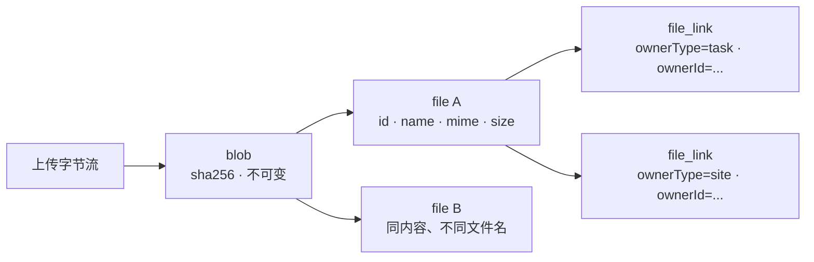
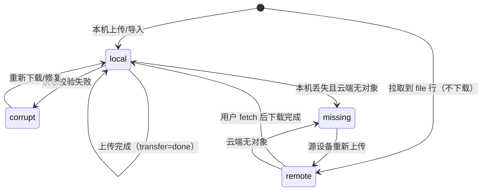

# 17 · 文件存储设计（上传 / 本地 / 云端 / 同步）

> 状态：**本地文件域为设计稿（target），云端文件字节面已实现**。宿主尚未落地 `file` / `file_link`；独立 Java 服务 `dsh-workbench-cloud` 已实现 `/v1/files/*`、S3/local BlobStore、`blob_refs` 与 GC。
> 关联：[05-本地存储设计](./05-本地存储设计.md)、[06-云端设计](./06-云端设计.md)、[07-同步与登录设计](./07-同步与登录设计.md)、[15-数据备份](./15-数据备份.md)、[16-数据同步方案](./16-数据同步方案.md)。
> 前提：云端字节存储已接入 S3（MinIO 兼容），同时保留 local 后端。本文把对象存储抽象成 **BlobStore**，服务端按 `WB_BLOB_BACKEND` 选择，切换不需要改业务代码。

## 0. 结论

| 问题 | 决策 |
| --- | --- |
| 字节存在哪（本地） | `~/.dsh/workbench/files/blobs/<aa>/<bb>/<sha256>`，不可变、内容寻址 |
| 元数据存在哪（本地） | `workbench.db` 的 `file` / `file_link` 两张平台表 |
| 逻辑身份 / 内容身份 | `file.id`（UUIDv7，可改名、可替换）/ `sha256`（内容，不可变） |
| 上传入口 | `POST /workbench/api/files`，请求体是裸字节流，边收边算哈希 |
| 云端元数据 | 走现有 protocol v2 行同步，由内置域 `wb-files` 声明 `file` / `file_link` |
| 云端字节 | `PUT /v1/files/blobs/:sha256`，云端落到 BlobStore（`local` 或 `s3`） |
| 同步顺序 | 元数据先、字节后；字节面独立于 sync 会话，不占会话锁 |
| 元数据同步 | pull 到 `file` / `file_link` 后只建 `file_blob(state='remote')`，不建下载任务、不请求 `content` |
| 下载 | 只同步元数据；列表/详情都不拉字节，用户在详情里点开某个附件时才 `POST /files/:id/fetch` 按需回源 |
| 去重 | 同一个用户内按 sha256 去重；不做跨用户去重（避免存在性侧信道） |
| 删除 | 软删元数据 + 宽限期 GC；被其他 `file` 引用的 blob 不删 |
| S3 | 通过 `blobs.backend` / `storage_key` 逐行切换；本地→S3 迁移脚本尚未实现 |
| 备份 | 一期只备份文件元数据，不含字节；字节随云端同步保留（见 §9） |

一次“上传并记录一个文件”的完整路径：

1. 浏览器把 `File` 以裸字节流 POST 给宿主，文件名/MIME 放请求头。
2. 宿主边读边算 SHA-256，写到 `files/staging/`；校验通过后原子 `rename` 到 `files/blobs/`。
3. 宿主在一个事务里写 `file`、`file_link`、`sync_change_log`、`file_transfer(up)`，返回文件记录。
4. 30s 数据同步循环把 `file` 行推到云端；云端据此建立 `blob_refs`。
5. 字节传输器 `POST /v1/files/check`，只上传云端缺的 blob；云端校验哈希后落盘/落 S3。
6. 另一台设备 `pull` 到 `file` 行，只显示元数据（“仅云端”）；用户进入记录详情并点开该附件时，才 `POST /files/:id/fetch` → `GET /v1/files/blobs/:sha256`。
7. 删除时先写墓碑；本地 blob 30 天后、云端 blob 7 天后被 GC（仍被引用则跳过）。

## 1. 目标与非目标

### 1.1 目标

- 用户从浏览器上传的文件可以被**记录**下来：有稳定的 id、名称、MIME、大小、哈希、创建时间，并能挂到任务/站点/标签等业务记录上。
- 同一份内容只存一份（本机、云端各自去重）。
- 上传/下载全程流式，内存占用与文件大小无关；支持 Range。
- 断网、崩溃、重试、响应丢失都不会产生半写文件或重复记录。
- 文件元数据随现有账号体系同步；**同步阶段不下载任何字节**，只有用户在记录详情里点开某个附件时才按需回源，不拖慢 30s 数据同步。
- 云端可以在**不改业务契约**的前提下从本地磁盘切到 S3，并支持在线迁移。
- 备份/导入、Agent 工具、业务插件都有明确契约。

### 1.2 非目标（一期）

- 目录树/多级文件夹：先用扁平列表 + 搜索 + 关联记录；需要时再加 B 类 `file_node`。
- 文件版本历史：替换文件只保留当前版本；需要时加 `file_version`（A 类行）。
- 分享链接、公开外链、跨用户协作与 ACL。
- 端到端加密（E2EE）：一期云端可读；E2EE 会影响哈希语义与去重，单独设计。
- 跨用户去重。
- 服务端缩略图/转码/在线预览（图片预览用浏览器 ``，不做服务端解码）。
- 移动端/第三方客户端 SDK；分片续传与 S3 直传放到 P4。
- 备份包含文件字节（现有 ZIP 实现限制，见 §9）。

## 2. 概念模型

### 2.1 Blob / File / Link



- **Blob**：一段不可变字节，身份就是 SHA-256。同一份内容无论叫几个名字、挂到几条记录，只存一份。
- **File**：用户看到的“文件记录”。有稳定的 `id`、文件名、MIME、大小、当前指向的 `sha256`、备注。改名/替换只改这一行。
- **FileLink**：文件与业务记录的关联边。一个文件可以挂到多条记录；删除关联不删文件。

### 2.2 不变量

1. 同一个 sha256 对应的字节永远相同；blob 写入后不再修改。
2. `file.sha256` 必须指向一个存在的 blob；替换文件 = 改指针，不原地改字节。
3. 字节永远不进入 `change_log`，也不进入任何同步行 payload。
4. 删除 `file` 是软删；blob 在宽限期后、且没有任何存活 `file` 引用时才回收。
5. 本地文件名只用于展示和下载头；**绝不参与磁盘路径**。
6. 云端每个用户一份命名空间；跨用户即使内容相同也不共享对象。

### 2.3 为什么用内容寻址

| 好处 | 说明 |
| --- | --- |
| 天然去重 | 同一文件重复上传、复制、备份恢复都只占一份 |
| 幂等重试 | 上传中断后重传，服务端按哈希识别，不会产生半份文件 |
| 完整性 | 传输结束重新计算哈希即可发现截断/损坏 |
| 路径安全 | 路径只由 64 位十六进制组成，用户文件名无法制造 `../` |
| 适合对象存储 | S3 key 稳定、可分片、可迁移；不依赖原始文件名 |
| GC 简单 | 有没有引用是数据库问题，不是文件系统问题 |

代价：文件名/MIME 不再由路径表达，必须放在 `file` 行里；同一个 blob 被两条记录用不同 MIME 引用时，以 `file.mime` 为准。SHA-256 而不是 BLAKE3：`node:crypto` 自带、S3 支持 `x-amz-checksum-sha256`、备份模块已经在用 SHA-256，不引入依赖。

## 3. 本地设计

### 3.1 目录布局

```text
~/.dsh/workbench/
├── workbench.db
├── workbench.db-wal / -shm
├── cloud-creds.json           # 0600
├── files/
│   ├── blobs/<aa>/<bb>/<sha256>   # aa=sha[0:2], bb=sha[2:4]
│   ├── staging/<uuid>.part        # 上传中的临时文件
│   └── quarantine/<sha256>.<ts>   # 校验失败的隔离区
└── cloud/
```

- `files/` 目录权限 0700，文件 0600；首次使用时惰性创建。
- 分两级目录（每级 256）避免单目录几万文件；一个用户几万个文件足够用。
- 同一文件系统内的 `rename` 是原子的；`staging` 和 `blobs` 必须在同一卷。
- 不建议把 `files/` 放进 `cloud/`（云端数据目录）或备份临时目录，避免误清理。

### 3.2 本地表

新增到 `packages/core/src/schema.ts` 的 `SCHEMA_SQL`（幂等 `CREATE TABLE IF NOT EXISTS`）：

```sql
-- 逻辑文件。可同步、可备份；文件名字不参与存储路径。
CREATE TABLE IF NOT EXISTS file (
  id          TEXT PRIMARY KEY,               -- UUIDv7；客户端可预生成以支持幂等
  name        TEXT NOT NULL,                  -- 原始文件名，仅展示/下载名
  mime        TEXT NOT NULL DEFAULT 'application/octet-stream',
  size        INTEGER NOT NULL,               -- 字节数
  sha256      TEXT NOT NULL,                  -- 小写十六进制，内容身份
  kind        TEXT NOT NULL DEFAULT 'upload', -- upload | import | generated
  note        TEXT NOT NULL DEFAULT '',
  created_at  INTEGER NOT NULL,
  updated_at  INTEGER NOT NULL,
  deleted_at  INTEGER,
  rev         INTEGER NOT NULL DEFAULT 1
);
CREATE INDEX IF NOT EXISTS idx_file_sha ON file(sha256);
CREATE INDEX IF NOT EXISTS idx_file_updated ON file(updated_at);

-- 附件关系。一个文件可以挂到多条记录。
CREATE TABLE IF NOT EXISTS file_link (
  id          TEXT PRIMARY KEY,
  file_id     TEXT NOT NULL,
  owner_type  TEXT NOT NULL,                  -- task | site | tag | ...
  owner_id    TEXT NOT NULL,
  created_at  INTEGER NOT NULL,
  updated_at  INTEGER NOT NULL,
  deleted_at  INTEGER,
  rev         INTEGER NOT NULL DEFAULT 1
);
CREATE UNIQUE INDEX IF NOT EXISTS uk_file_link
  ON file_link(file_id, owner_type, owner_id) WHERE deleted_at IS NULL;

-- 本机 blob 状态；不同步、不备份。
CREATE TABLE IF NOT EXISTS file_blob (
  sha256        TEXT PRIMARY KEY,
  size          INTEGER NOT NULL,
  state         TEXT NOT NULL,                -- local | remote | corrupt | missing
  verified_at   INTEGER,
  last_access_at INTEGER
);

-- 字节传输队列（上传/下载）；不同步、不备份。
CREATE TABLE IF NOT EXISTS file_transfer (
  sha256      TEXT NOT NULL,
  direction   TEXT NOT NULL,                  -- up | down
  size        INTEGER NOT NULL,
  state       TEXT NOT NULL,                  -- pending | active | done | failed | blocked
  attempts    INTEGER NOT NULL DEFAULT 0,
  next_at     INTEGER NOT NULL DEFAULT 0,
  priority    INTEGER NOT NULL DEFAULT 0,    -- 0=交互、10=预取
  last_error  TEXT,
  created_at  INTEGER NOT NULL,
  updated_at  INTEGER NOT NULL,
  PRIMARY KEY(sha256, direction)
);
CREATE INDEX IF NOT EXISTS idx_file_transfer_due
  ON file_transfer(state, priority, next_at);
```

状态说明：

| 表.列 | 值 | 含义 |
| --- | --- | --- |
| `file_blob.state` | `local` | 本机有可读字节，且已通过校验 |
| | `remote` | 本机没有字节，云端有（或应该有） |
| | `corrupt` | 本机字节校验失败，已移到 `quarantine/` |
| | `missing` | 本机和云端都没有，等待源设备重传 |
| `file_transfer.state` | `pending` | 等待传输 |
| | `active` | 正在传输（进程内） |
| | `done` | 完成，24h 后删除该行 |
| | `failed` | 可重试的失败，等 `next_at` |
| | `blocked` | 配额/权限/致命错误，需要用户处理 |

`file` 和 `file_link` 是**平台表**，由宿主内置域 `wb-files` 管理；业务插件不得建同名表（`registerDomain` 保留表名校验）。`file_blob` / `file_transfer` 只属于本机，不声明 `sync`，也不进备份。

### 3.3 写路径

上传被宿主接收后（§4）：

1. 流式读请求体：同时更新 `sha256`、累计字节数，写入 `files/staging/<uuid>.part`（0600）。
2. 超过 `WB_FILES_MAX_BYTES`（默认 200MB）立即中止并删除 staging；返回 `413 file_too_large`。
3. 读完：`fsync` 文件句柄，关闭。若客户端给了 `X-WB-Sha256`，与计算值比较；不一致 → 删除 staging，`422 hash_mismatch`。
4. 若 `files/blobs/<aa>/<bb>/<sha256>` 已存在：删除 staging，记为 dedupe；否则创建分片目录，`rename` 到目标路径。
5. `BEGIN IMMEDIATE`：
   - `INSERT/UPDATE file_blob(sha,size,state='local',verified_at=now)`；
   - 插入或校验 `file` 行（见幂等规则）；
   - 如有 owner，插入 `file_link`；
   - 为 `file` / `file_link` 各写一条 `sync_change_log`（`origin='local'`，payload 为完整行）；
   - 插入 `file_transfer(sha,'up','pending')`（已存在则重置为 pending）。
6. `COMMIT`；发 SSE `files-changed`；返回 `201`。

注意顺序：**先落字节、后写元数据**。这样数据库里不会出现“有记录但没有内容”的半成品；最坏情况只是多一个孤儿 blob，由 GC 回收。

### 3.4 崩溃恢复

| 崩溃点 | 结果 | 恢复 |
| --- | --- | --- |
| 写完 staging，未 rename | 只有 `.part` | 启动时/每小时清理 24h 前的 staging |
| rename 后、事务前 | 孤儿 blob | 重试会复用；GC 删无引用 blob |
| 事务提交后、响应前 | 记录已存在 | 客户端带同一 `X-WB-File-Id` 重试，返回 `200` 既有记录 |
| 事务中（SQLite） | 回滚 | 无记录；blob 成孤儿，GC |
| 传输器上传到一半 | 云端临时文件 | 云端请求结束即删除；断连由 `req.on('aborted')` 清理 |

### 3.5 幂等与并发

- **请求级幂等**：客户端可用 `X-WB-File-Id` 预生成 UUID（浏览器 `crypto.randomUUID()`）。同 id 再次到达：
  - 哈希/大小相同 → 返回已有 `file`（`200`，响应头 `x-wb-idempotent: 1`），不重复插 link；
  - 哈希不同 → `409 file_id_conflict`，不覆盖。
- **同内容并发**：两个上传写不同 staging，最终 `rename` 到同一路径；POSIX 下后一个覆盖前一个（内容相同，安全）。Windows 下 `rename` 覆盖可能报 `EEXIST/EPERM`：捕获后确认目标存在即视为成功，删除 staging。
- **云端上传单飞**：进程内按 sha 维护 `Map<sha, Promise>`，同一 blob 只发一个 PUT；第二个等待后返回 `deduped`。
- 所有时间用宿主 `clock.now()`（已校准、单调），与其他业务行一致。

### 3.6 配额与回收

- 本地配额 `WB_FILES_QUOTA_BYTES`，默认 10GB，`0` 表示不限。计算：`SUM(size) FROM file_blob WHERE state='local'`。
- 超配额在写 staging 前预检（已知 `Content-Length` 时）并在提交前复查；返回 `507 quota_exceeded`，不写元数据。
- 启动时和每天 04:00 执行一次 GC：
  1. 删除 24h 前的 `staging/*.part`；
  2. 删除 7 天前的 `quarantine/*`；
  3. 删除 `file_blob.state IN ('local','corrupt')` 且 30 天内没有任何存活 `file` 引用、也没有 `file_transfer` 待处理的 blob；
  4. 清理 `file_transfer.state='done'` 超过 24h 的行。
- 显式 `files.gc` action 支持 `dryRun`，返回将删除的数量/字节。

## 4. 客户端上传契约（浏览器 → 宿主）

### 4.1 为什么是裸字节流

- 不引入 multipart 解析依赖；`node:http` 直接 `for await (const chunk of req)`。
- 内存占用与文件大小无关；可以边收边哈希、边做配额限制。
- 元数据放请求头，正文只有字节，便于后续做分片/断点。
- 代价：浏览器不能用 `FormData` 一把梭；我们自己的客户端用 `fetch/XHR` 发裸流即可。第三方 multipart 客户端以后加适配层。

### 4.2 `POST /workbench/api/files`

请求头：

| 头 | 必填 | 说明 |
| --- | --- | --- |
| `Content-Type` | 是 | 固定 `application/octet-stream` |
| `Content-Length` | 是 | 缺少返回 `411 length_required` |
| `X-WB-File-Name` | 是 | `base64url(UTF-8)` 原始文件名，≤255 字节 |
| `X-WB-File-Mime` | 否 | 缺省 `application/octet-stream`；仅作为提示 |
| `X-WB-File-Id` | 否 | UUID；幂等键，缺省宿主生成 UUIDv7 |
| `X-WB-File-Kind` | 否 | `upload`（默认）/ `import` / `generated` |
| `X-WB-Sha256` | 否 | 客户端预计算；宿主仍会重算并比对 |
| `X-WB-Owner` | 否 | `<ownerType>:<ownerId>`，如 `task:01a...`；只允许一个 |
| `X-WB-Note` | 否 | `base64url(UTF-8)` 备注，≤1024 字节 |

响应 `201`：

```json
{
  "ok": true,
  "file": {
    "id": "01a...",
    "name": "需求.pdf",
    "mime": "application/pdf",
    "size": 123456,
    "sha256": "9f2c...64位",
    "kind": "upload",
    "note": "",
    "createdAt": 1762500000000,
    "updatedAt": 1762500000000,
    "deletedAt": null,
    "rev": 1,
    "local": true,
    "sync": "pending"
  },
  "blob": { "sha256": "9f2c...", "size": 123456, "deduped": false },
  "links": [{ "id": "01a...", "ownerType": "task", "ownerId": "01a..." }]
}
```

错误：

| 状态 | code | 场景 |
| --- | --- | --- |
| 400 | `bad_name` / `bad_file_id` / `bad_owner` | 头格式非法、文件名超长、owner 不含冒号 |
| 409 | `file_id_conflict` | 同 id 但内容不同 |
| 411 | `length_required` | 没有 `Content-Length` |
| 413 | `file_too_large` | 超过单文件上限 |
| 422 | `hash_mismatch` | 预计算哈希与实际不符 |
| 507 | `quota_exceeded` | 本地配额不足 |
| 500 | `io_error` | 磁盘写失败；staging 已清理 |

```bash
curl -X POST http://127.0.0.1:3080/workbench/api/files \
  -H 'content-type: application/octet-stream' \
  -H 'content-length: 123456' \
  -H 'x-wb-file-name: 6ZyA5rGC.pdf' \
  -H 'x-wb-file-mime: application/pdf' \
  -H 'x-wb-owner: task:01a...' \
  --data-binary @需求.pdf
```

### 4.3 其余本地路由

| 方法 | 路径 | 说明 |
| --- | --- | --- |
| GET | `/workbench/api/files` | 列表；`q`、`ownerType`、`ownerId`、`limit`（默认 50，最大 200）、`cursor`（`updated_at:id`） |
| GET | `/workbench/api/files/usage` | 会优先于 `/:id` 匹配；返回本地/云端用量、队列状态 |
| GET | `/workbench/api/files/:id` | 元数据 + blob 状态 + 传输进度（不含字节） |
| GET | `/workbench/api/files/:id/content` | 只读本机字节；支持 Range、`If-None-Match`；不存在时返回 `409 blob_not_local`，不隐式下载 |
| POST | `/workbench/api/files/:id/fetch` | 显式触发按需下载；已有字节 `200 {state:"local"}`，否则 `202 {state:"pending"}`；同 sha 合并 |
| DELETE | `/workbench/api/files/:id/fetch` | 取消尚未开始的下载；已开始的传输继续完成 |
| PATCH | `/workbench/api/files/:id` | `{name?, mime?, note?}`；只改元数据 |
| POST | `/workbench/api/files/:id/replace` | 裸字节流；校验后把 `sha256/size/mime` 指向新 blob，旧 blob 失引用后 GC |
| DELETE | `/workbench/api/files/:id` | 软删 `file` 及其 `file_link`，写墓碑 |
| POST | `/workbench/api/files/import` | 从宿主本机路径导入（Agent 用，见 §8） |

列表返回 `{files:[...], nextCursor?}`；默认不含 `deletedAt` 非空的行，`includeDeleted=1` 可查。排序 `updated_at DESC, id DESC`。

`POST /files/import` 的请求体是 JSON：`{ path, name?, mime?, note?, ownerType?, ownerId? }`；`path` 必须是宿主本机可读的绝对路径，导入后同样走“先落字节、再写元数据”。

### 4.4 内容响应与 Range

```http
GET /workbench/api/files/01a.../content
Range: bytes=0-1023

206 Partial Content
Content-Type: application/pdf
Content-Length: 1024
Content-Range: bytes 0-1023/123456
Accept-Ranges: bytes
ETag: "sha256:9f2c..."
Content-Disposition: attachment; filename*=UTF-8''%E9%9C%80%E6%B1%82.pdf
X-Content-Type-Options: nosniff
Content-Security-Policy: default-src 'none'; sandbox
```

- `ETag` 用 `"sha256:<hex>"`；`If-None-Match` 命中返回 `304`。
- 因为是同源接口，**默认强制下载**；只有 `?inline=1` 且 MIME 属于 `image/png|jpeg|webp|gif` 时才允许内联，避免 HTML/SVG 在本源执行（§10）。
- `GET content` 是**只读且无副作用**的：只服务本机已有的字节；没有字节返回 `409 {ok:false, code:"blob_not_local", fetch:"POST /workbench/api/files/<id>/fetch"}`，不会因为浏览器或页面请求而隐式触发下载。
- `POST /files/:id/fetch` 才建立 `file_transfer(down)`：
  - 已有本机字节 → `200 {state:"local"}`；
  - 云端可用 → 入队并立即唤醒传输器；`size ≤ WB_FILES_FETCH_INLINE_BYTES`（默认 32MB）且 `WB_FILES_FETCH_WAIT_MS`（默认 10s）内完成 → `200`，否则 `202 {state:"pending", retryAfterMs:1000}`；
  - 同一 sha 多个点击合并为一个任务，重复调用只更新 `priority` / `next_at`；
  - 云端也没有 → `409 blob_unavailable`。
- 下载完成由 `file_blob.state='local'` 触发 `files-changed`；前端这时才把占位符换成 `img` / `iframe` / 下载链接，列表和详情页本身从不请求 `content`。

### 4.5 分片与断点续传（P4）

超过 64MB 或弱网时启用；一期单请求即可：

```text
POST   /workbench/api/files/uploads          {name,mime,size,sha256?} -> {uploadId, chunkSize:8388608}
PUT    /workbench/api/files/uploads/:id?offset=N   裸字节流
GET    /workbench/api/files/uploads/:id      -> {received,size}
POST   /workbench/api/files/uploads/:id/complete -> file
DELETE /workbench/api/files/uploads/:id
```

规则：`offset` 必须等于当前 `received`（否则 `409 offset_mismatch`）；complete 时重算整文件哈希并走 §3.3 的提交逻辑；上传会话 24h 过期。宿主侧用 `staging/<uploadId>.part` 追加写。

### 4.6 浏览器端行为

- 选择/拖拽 → 读 `File` → `XMLHttpRequest` 上传（需要 `upload.onprogress`）；普通 `fetch` 无法给上传进度。
- 不要求浏览器预计算哈希：大文件全量读进内存做 `crypto.subtle.digest` 不划算；宿主会算。
- 取消 = `xhr.abort()`；宿主 `req` 触发 `aborted/close`，删除 staging。
- UI 状态：`uploading` → `deduped`（瞬时）→ `pending sync` → `synced` / `failed`。
- 上传成功后用返回的 `file` 立即渲染，不等云端。

## 5. 云端字节设计

### 5.1 BlobStore 抽象

```java
public interface BlobStore {
  void put(String key, Path file, long size, String contentType) throws IOException;
  BlobStat stat(String key) throws IOException;
  BlobStream open(String key, Long start, Long end) throws IOException;
  URI presignGet(String key, long ttlSeconds);
  void delete(String key) throws IOException;
  String backend();

  record BlobStat(long size, String contentType, String etag) {}
  record BlobStream(InputStream stream, long size, String contentType,
                    String etag, long start, long end) implements AutoCloseable {
    @Override public void close() throws IOException { stream.close(); }
  }
}
```

Spring 的 `BlobStoreConfig` 根据 `wb.blob.backend` 返回 `S3BlobStore` 或 `LocalBlobStore`。
路由层只依赖这个接口，不出现 S3 SDK 或文件系统细节。`LocalBlobStore` 拒绝路径穿越，
写入用临时文件 + 原子 rename；`S3BlobStore` 用 AWS SDK v2 的 `put/head/get(range)/delete`
与 `S3Presigner`。

### 5.2 Key 布局

统一 `storage_key` 公式：

```text
u/<userId>/<sha[0:2]>/<sha256>
```

- 本地：`<WB_BLOB_DIR>/<storage_key>`，默认 `./data/blobs/`（相对云端服务运行目录）。
- S3：`<WB_S3_PREFIX>/<storage_key>`。
- `storage_key` 存在 `blobs` 行里，所以迁移后旧行仍指向旧后端；读按行里的 `backend` 走。
- 每用户独立前缀：配额统计、账号删除、权限检查都简单；不做跨用户去重。

### 5.3 云端表

由独立云端仓库的 Flyway 迁移 `V1__cloud.sql` 创建（PostgreSQL 16）：

```sql
-- 每个用户一份内容命名空间。
CREATE TABLE blobs (
  user_id        text NOT NULL,
  sha256         text NOT NULL,
  size           bigint NOT NULL,
  mime           text,
  backend        text NOT NULL,                -- local | s3
  storage_key    text NOT NULL,                -- 后端内相对 key
  state          text NOT NULL DEFAULT 'ready',-- ready | missing | quarantined
  created_at     bigint NOT NULL,
  verified_at    bigint,
  last_access_at bigint,
  PRIMARY KEY(user_id, sha256)
);
CREATE INDEX idx_blobs_state_age ON blobs(state, created_at);

-- 由 file 表同步结果维护的引用索引；派生数据，可重建。
CREATE TABLE blob_refs (
  user_id     text NOT NULL,
  file_id     text NOT NULL,
  sha256      text NOT NULL,
  deleted     boolean NOT NULL DEFAULT false,
  updated_at  bigint NOT NULL,
  PRIMARY KEY(user_id, file_id)
);
CREATE INDEX idx_blob_refs_live ON blob_refs(user_id, sha256, deleted);
```

分片上传的 `upload_sessions` 属于 P4，当前尚未建表；单请求上传不需要它。

`blobs` 是“对象应该存在”的权威记录；`blob_refs` 是“哪些 `file` 还在用它”的派生索引。metadata 仍然只存在 `row_states` 的 `file` 行里，云端不复制一份业务文件表。

### 5.4 上传 `PUT /v1/files/blobs/:sha256`

请求头：`Authorization: Bearer`、`Content-Length`（必填）、`Content-Type`（可选，写入 `blobs.mime`）。正文是原始字节流。

流程：

1. 校验 `sha256` 为 `^[0-9a-f]{64}$`，否则 `400 invalid_sha256`；`Content-Length` 缺失 → `411 length_required`。
2. 边读边写临时文件（`java.io.tmpdir/wb-upload-*.part`，64KB 缓冲），同时算 SHA-256 和字节数；超过 `WB_FILES_MAX_BYTES`（默认 200MB）→ `413 file_too_large`。
3. 字节数与 `Content-Length` 不一致 → `422 size_mismatch`；哈希与路径参数不一致 → 删除临时文件，`422 sha256_mismatch`。
4. 已有同一 `(user, sha256)` 且 `state='ready'`、大小相同 → `200 {ok, sha256, size, deduped:true}`。注意：当前实现会先完整接收并校验请求体，再判断去重，不会在收流前丢弃正文。
5. 配额：`SUM(size) WHERE user_id=? AND state='ready'` + 本次大小超过 `WB_FILES_QUOTA_BYTES`（默认 20GB）→ `413 quota_exceeded`。
6. 调用 BlobStore 写入：
   - `local`：临时文件原子 rename 到 `<WB_BLOB_DIR>/<storage_key>`；
   - `s3`：用临时文件 `PUT` 到 S3。
   然后 upsert `blobs` 行为 `ready`、写 `verified_at`；首次写入返回 `201 {ok, sha256, size, deduped:false}`。
7. 删除临时文件。对象存储异常返回 `503 blob_store_unavailable`。

并发：当前**没有**进程内单飞。两个并发同 sha 上传都会完整校验并写同一个 key，内容相同，
最后一条 `blobs` upsert 胜出，结果幂等；单飞/等待是后续优化，`409 upload_in_progress` 尚未实现。

失败语义：对象写成功但数据库提交失败 → 孤儿对象，由 GC 清理。数据库行 `ready` 但对象
丢失（人为删桶/删本地文件）时下载会失败；当前不会自动把行改成 `missing`，需要重传或
运维修复。

### 5.5 检查、下载、配额

**检查**：

```http
POST /v1/files/check
{ "hashes": ["9f2c...", "..."] }

200 { "ok": true, "have": ["9f2c..."], "missing": ["..."] }
```

- 单批最多 200 个；`hashes` 缺失/不是数组/超 200 个 → `400 invalid_hashes`；
  单个值不是小写 64 位十六进制 → `400 invalid_sha256`。
- `have` 只表示数据库有 `state='ready'` 行，不逐个 `HEAD` 对象；对象丢失由下载失败暴露。
- 未登录 `401`。

**下载**：

```http
GET /v1/files/blobs/:sha256
```

- 必须有 `blobs(state='ready')` 行，且存在 `blob_refs(sha256, deleted=false)`；
  否则 `404 blob_not_found` / `404 blob_not_referenced`（防止按哈希探测）。
- `local`：流式返回，支持单段 `Range`（206 + `Content-Range`）。
- `s3`：默认 `302` 到 `presignGet(key, 300)`，带 `Cache-Control: no-store`；
  客户端（宿主）手动跟随并**去掉 `Authorization`**。带 `?proxy=1` 时云端代理流式返回。
- 响应头：`Content-Type`（取 blob 的 MIME，缺省 `application/octet-stream`）、
  `Content-Length`、`Accept-Ranges: bytes`、`X-Content-Type-Options: nosniff`。
  当前不设置 `Content-Disposition`；真实文件名/下载头由宿主按 `file` 行决定。
- 每次代理下载同步更新 `last_access_at`；302 分支不 touch。
- `HEAD` 同样要求 ready blob，但**不要求**存活引用；返回长度、类型与 `Accept-Ranges`。

**配额**：

```http
GET /v1/files/quota
200 { "ok": true, "used_bytes": 123, "quota_bytes": 21474836480, "blob_count": 9 }
```

### 5.6 引用与 GC

`blob_refs` 由云端在**接受 `file` 行的变更时**维护：`SyncService.push` 成功
upsert 后调用 `BlobRefIndex.apply(userId, table, op, payload, updatedAt)`。

- `file` 行 `deleted_at` 为空且 `sha256` 合法 → `upsert blob_refs(file_id, sha256, deleted=false)`；
- `file` 行是墓碑（`op=delete` 或 `deleted_at` 非空）且没有合法 sha → 把已有引用标为 `deleted=true`；
- `file` 行换了合法 `sha256` → 同一条 `blob_refs` 更新为新 sha；
- `file_link` 不参与 blob 引用（它不携带 sha）。

`blob_refs` 是派生数据，可从 `row_states WHERE table_name='file'` 全量重建；
当前还没有自动 reindex 命令。这与“云端不维护业务表白名单”不冲突：`file` 是平台保留表名。

GC 由 `BlobGc` 定时执行（`@Scheduled`，默认每 6 小时一次，首次延迟 6 小时；
`WB_FILES_GC_ENABLED=false` 可关闭）：

1. 候选：`created_at < now - 7d`，且不存在任何 `blob_refs(sha256, deleted=false)`；
   每批最多 200 条。
2. 先删对象，再删该 sha 的 `blob_refs` 行和 `blobs` 行；对象删除失败则保留行，
   下一轮再试。
3. 被引用的 blob 永不因时间删除；删除 `file` 后 7 天内恢复（重新推同一行）仍能命中对象。

孤儿对象扫描（`store.list` 对比 `blobs.storage_key`）尚未实现；当前 `BlobStore`
接口也没有 list 方法。

### 5.7 S3 后端

配置（环境变量，凭证只从环境/私有文件读，不入库、不打日志）：

| 变量 | 默认 | 说明 |
| --- | --- | --- |
| `WB_BLOB_BACKEND` | `s3` | `local` 或 `s3`；只影响**新写入** |
| `WB_BLOB_DIR` | `./data/blobs` | 本地后端根目录 |
| `WB_S3_ENDPOINT` | 空 | MinIO/R2/OSS 填兼容 endpoint |
| `WB_S3_REGION` | `us-east-1` | 签名区域 |
| `WB_S3_BUCKET` | `workbench` | 私有桶，启动时 `headBucket`，404 则创建 |
| `WB_S3_PREFIX` | 空 | key 前缀，自动补结尾 `/` |
| `WB_S3_ACCESS_KEY_ID` | — | 必填 |
| `WB_S3_SECRET_ACCESS_KEY` | — | 必填，0600 文件或环境 |
| `WB_S3_FORCE_PATH_STYLE` | `true` | MinIO 需要 |
| `WB_S3_SSE` | 空 | 配置项已预留；当前实现未发送 SSE 头 |
| `WB_S3_ALLOW_INSECURE` | `false` | 配置项已预留；当前直接使用 endpoint 的 scheme |

实现要点（Java 服务使用 AWS SDK for Java v2，不再手写 SigV4）：

- `S3Config` 构造 `S3Client` 与 `S3Presigner`：`endpointOverride`、`Region`、
  `StaticCredentialsProvider`、`S3Configuration.pathStyleAccessEnabled`。
- **必须**设置 `requestChecksumCalculation(WHEN_REQUIRED)` 与
  `responseChecksumValidation(WHEN_REQUIRED)`。AWS SDK 2.30 默认会给 PUT 加可选
  CRC32 校验和，旧版 MinIO（如 `RELEASE.2023-07-11`）会报
  `SignatureDoesNotMatch`。
- 写：`RequestBody.fromFile(temp)`；读：`GetObjectRequest.range("bytes=start-end")`；
  预签名：`GetObjectPresignRequest`，TTL 300 秒；删除：`deleteObject`。
- 服务端启动时 `headBucket`，404 则 `createBucket`；S3 不可达只 warn，服务仍启动，
  文件接口随后返回 503。
- 桶保持私有，禁止公共读；不需要版本控制（同 key 同内容）。
- 生命周期：中止 1 天未完成的 multipart；30 天后转 IA（可选）；**不要**配置自动过期删除，GC 由应用负责。
- 错误映射：对象存储异常统一 `503 blob_store_unavailable`；不要把 S3 的 XML 错误原样吐给浏览器。

### 5.8 本地 → S3 在线迁移

目标：切后端不长时间停机，旧对象仍可读。

1. 配置 S3 并设 `WB_BLOB_BACKEND=s3`：新上传直接写 S3；读仍按 `blobs.backend` 逐行选择。
2. 迁移任务（**当前尚未实现**，下面是目标行为）：
   - 扫 `blobs WHERE backend='local' AND state='ready'`；
   - 从本地读对象 → S3 `PUT` → `HEAD` 校验大小/内容；
   - `UPDATE blobs SET backend='s3', storage_key=?`；
   - 本地对象保留 7 天再删（回滚窗口）。
3. 全部迁完后，`GET` 走 S3；本地目录可清空。
4. 回滚：把 `WB_BLOB_BACKEND=local`，新写入回本地；已迁行仍读 S3。需要整体回迁时反向执行迁移逻辑。
5. 迁移幂等：以 `(user,sha)` 为单位，重复执行只会覆盖同内容对象。

## 6. 同步设计

### 6.1 数据面 vs 字节面

| | 数据面（已有） | 字节面（新增） |
| --- | --- | --- |
| 端点 | `/v1/sync/*` | `/v1/files/*` |
| 单位 | 行/变更 | blob |
| 认证 | Bearer + `x-sync-session` 会话锁 | 只要 Bearer，不占会话锁 |
| 冲突 | per-row LWW / 树表 full | 无冲突：内容不可变 |
| 大小 | 单行 payload 1MB，批 8MB | 单对象默认 200MB，流式 |
| 重试 | 30s 同步循环 | 独立传输队列，指数退避 |
| 失败影响 | 数据不一致 | 只影响文件可读性，不阻塞数据 |

### 6.2 内置域声明

`wb-files` 由宿主注册，不是独立 npm 包；`DomainDef` 增加 `builtin?: boolean`，`DomainSetupApi` / `WorkbenchHost` 增加 `files: WorkbenchFiles`。

```ts
ctx.workbench.registerDomain({
  id: "wb-files",
  title: "文件",
  description: "文件记录与附件关系",
  version: "1.0.0",
  builtin: true,
  tables: ["file", "file_link"],
  sync: {
    tables: [
      { name: "file", mode: "row" },
      {
        name: "file_link",
        mode: "row",
        uniqueKeys: [["file_id", "owner_type", "owner_id"]],
        uniquePolicy: "lww-tombstone",
      },
    ],
  },
  capability: {
    summary: "记录用户上传/导入的文件，并管理文件与业务记录的附件关系",
    records: [
      {
        kind: "file",
        title: "文件",
        description: "一份已保存的字节内容及其展示元数据",
        when: ["用户上传文件并要求保存", "任务/站点需要附件", "把生成的交付物归档"],
        notFor: ["临时缓存", "密钥/凭证", "超过单文件上限的内容"],
        primaryAction: "files.import",
        keyArgs: ["path", "name", "ownerType", "ownerId"],
        dedupe: "同一 sha256 只存一份内容；files.list 可按 sha256 查重",
        examples: [{ purpose: "把本机文件归档到任务", args: { path: "/tmp/a.pdf", ownerType: "task", ownerId: "..." } }],
      },
    ],
    notFor: ["目录树管理", "公开分享", "版本历史"],
  },
  setup() {
    // 表由宿主 SCHEMA_SQL 建好；files 能力随宿主启动注册
  },
});
```

`wb-files` 是内置域：`file` / `file_link` 的表结构、导出与导入都由宿主实现，不经过业务插件的 `setup` / `exportData` / `importData`。业务插件只用 `ctx.workbench.files`；导出格式见 §9。

### 6.3 `open` 能力协商

`POST /v1/sync/open` 响应增加可选字段（旧客户端忽略）：

```json
{
  "ok": true,
  "protocol": 2,
  "files": {
    "enabled": true,
    "max_bytes": 209715200,
    "quota_bytes": 21474836480,
    "used_bytes": 123456
  }
}
```

- 云端没实现 `/v1/files/*` 或 `WB_FILES_SYNC=0` → `enabled:false`（或字段缺失）。
- `enabled:false` 时宿主把 `wb-files` 从同步域集合里移除：文件**纯本地**，不推元数据，避免别的设备看到永远下载不到的文件。UI 显示“文件仅本机”。
- 宿主也可以主动探测 `GET /v1/files/quota` 的 404；两种方式等价。

### 6.4 一次同步循环

现有 30s 循环保持不变，在 `close` 之后追加字节面：

1. `open` → 读 `files.enabled`；
2. 数据 push/pull（现有逻辑）；
3. `close`；
4. 若启用：`drainTransfers({ upLimit: 5, downLimit: 5, deadlineMs: 5000 })`：
   - 先 up：批量 `check` → `PUT` 缺的 → 更新 `file_transfer`；
   - 再 down：只处理 `POST /files/:id/fetch` 建的行与显式启用的预取；sync/pull **不会**创建 down 行；交互式任务在请求到来时立即唤醒，不等 30s 循环；
5. 发 SSE 状态。

字节面不占 `sync_sessions` 锁，所以两台设备可以同时下载；上传也只需 Bearer。传输循环另有 60s 定时器，避免 30s 数据同步被大文件拖住。

### 6.5 状态机



UI 展示状态由 `file_blob.state` + `file_transfer.state` 派生：`local + done` = 已同步；`local + pending/failed` = 待上传/上传失败；`remote` = 仅云端；`missing` = 不可用。

### 6.6 顺序与一致性

- **元数据先于字节**：本地事务先写 `file` 行和 `file_transfer(up)`，所以云端可能先收到行、后收到字节。这是允许的：云端 `file` 行合法，`blob_refs` 指向一个暂时不存在的对象；下载方会得到 `404` 并显示“等待源设备上传”。
- **字节先于引用**（其他路径，如手动 `PUT`）：对象没有 `blob_refs`，7 天宽限后 GC；期间同 sha 的元数据到达即可复用。
- **删除**：先推墓碑 → `blob_refs.deleted=1` → 7 天后 GC；如果 7 天内恢复同一 `file` 行，引用复活，对象还在。
- **替换**：同一 `file.id` 改 `sha256` 是 LWW 行更新；旧 sha 失去引用后 GC；冲突落 `conflict_shadow`（现有引擎）。
- **去重与多记录**：两个 `file` 行共享同一 sha，任意一个删除都不影响另一个；GC 只看是否还有存活引用。

### 6.7 重试与退避

| 失败 | 处理 |
| --- | --- |
| 网络/S3 5xx/超时 | `pending`，`next_at` 按 1m → 5m → 30m → 2h → 6h 退避，最多 20 次 |
| 401 | `cloudFetch` 自动 refresh 后重试一次；仍失败 → `failed` |
| 413 配额 | `blocked`，UI 提示；用户删除文件/提高配额后手动重试 |
| 422 哈希不符 | `failed`，记录 `last_error`；不自动重试（本地 blob 可能损坏） |
| 下载 404 | 标记 `missing`，等源设备重传；不无限重试 |
| 进程重启 | `active` 重置为 `pending`；`done` 保留 24h |

### 6.8 按需下载：什么时机才拉字节

默认策略 `WB_FILES_DOWNLOAD_POLICY=on-demand`，含义是“只有用户对某个具体文件表达了使用意图才下载”，不是“打开列表/详情就下载”。

| 场景 | 行为 |
| --- | --- |
| 30s 同步 pull 到 `file` / `file_link` | 只写元数据，`file_blob.state='remote'`；**不创建** `file_transfer(down)`，不请求 `/v1/files/blobs` |
| 首页/文件列表/记录列表 | 只读元数据，展示名称、大小、MIME、云端/本机状态；缩略图用占位图标，禁止 `` |
| 打开记录详情 | 仍只读元数据；附件显示“仅云端 · 12.4MB”；不自动下载整个附件列表 |
| 在详情里点开/预览/下载某个附件 | 调 `POST /files/:id/fetch`；小文件可在 10s 内同步完成，大文件返回 202 并显示进度；完成后才发 `GET content` |
| 同一附件被再次打开 | 若 `local` 直接读，不再发 fetch；若正在下载，复用同一个任务 |
| 离线 | 显示“联网后可下载”；不自动重试到无限 |
| 可选 `detail` 预取 | 仅当用户显式开启：进入详情时预取该记录 ≤2MB 的附件，最多 3 个、总计 ≤6MB；超出或大文件仍点击下载；离开详情取消未开始任务 |
| 可选 `recent` / `all` | 仅作为后台低优先级预取，限并发 2、每轮 ≤200MB；不得阻塞交互式下载 |

交互式任务优先级高于预取：`file_transfer.priority` 0=交互、10=预取；`drainTransfers` 先按 priority、再按 next_at 取任务。

如果产品把“打开详情”本身视为需要，可在设置里把策略切到 `detail`；默认 `on-demand` 更保守，避免一个详情页挂 20 个大文件时一次拉几百 MB。

`ensureLocal(fileId)` 是 SDK 侧的同一入口：返回 `local | queued | missing | offline`，其内部就是 `POST fetch` + 等待；业务插件只有在用户 action 中调用它，不得在 list/detail 渲染时批量调用。

### 6.9 可观测性

- `GET /workbench/api/files/usage` 与 `/workbench/api/sync/status` 增加 `files` 段：
  `{localBytes, remoteBytes, quotaBytes, upPending, downPending, failed, blocked, lastError, lastSuccessAt}`。
- SSE：`files-changed {fileId, sha256, state}`、`files-progress {sha256, direction, sent, total}`（250ms 节流）、`files-error {sha256, code, message}`。
- 日志只打 sha 前 8 位、大小、方向、错误码；不打字节、不打预签名 URL（含签名）、不打 token。

## 7. 业务插件与 SDK 契约

### 7.1 SDK 新增

```ts
export type FileKind = "upload" | "import" | "generated";
export type FileSyncState = "local" | "pending" | "synced" | "remote" | "failed";

export interface WorkbenchFile {
  id: string;
  name: string;
  mime: string;
  size: number;
  sha256: string;
  kind: FileKind;
  note: string;
  createdAt: number;
  updatedAt: number;
  deletedAt: number | null;
  rev: number;
  /** 本机是否有可读字节 */
  local: boolean;
  /** 字节面派生状态，不入库 */
  sync: FileSyncState;
}

export interface FilePutOptions {
  name: string;
  mime?: string;
  kind?: FileKind;
  note?: string;
  /** buffer 与 stream 二选一 */
  buffer?: Uint8Array;
  stream?: AsyncIterable<Uint8Array>;
  /** 可选：同时挂到某条记录 */
  owner?: { type: string; id: string };
  /** 幂等键；缺省宿主生成 */
  id?: string;
}

export interface WorkbenchFiles {
  put(input: FilePutOptions): Promise<WorkbenchFile>;
  get(id: string): WorkbenchFile | null;
  list(query?: {
    ownerType?: string;
    ownerId?: string;
    q?: string;
    limit?: number;
    cursor?: string;
  }): { files: WorkbenchFile[]; nextCursor?: string };
  open(id: string): import("node:stream").Readable | null;
  path(id: string): string | null;
  link(fileId: string, ownerType: string, ownerId: string): void;
  unlink(fileId: string, ownerType: string, ownerId: string): void;
  unlinkOwner(ownerType: string, ownerId: string): number;
  ensureLocal(id: string, opts?: { timeoutMs?: number }): Promise<"local" | "queued" | "missing" | "offline">;
  /** 取消尚未开始的下载；已开始的任务继续完成 */
  cancelFetch(id: string): void;
  usage(): { count: number; bytes: number; quotaBytes: number };
}
```

- `DomainSetupApi` 和 `WorkbenchHost` 都增加 `readonly files: WorkbenchFiles`，插件在 `setup` 外也能用。
- `DomainDef` 增加 `builtin?: boolean`；内置域不出现在“可安装插件”列表，但出现在工作台视图、备份和同步域里。
- 宿主版本升到 0.6.0；业务插件不需要立刻升依赖，取不到 `files` 时按旧逻辑工作。

### 7.2 附件用法

```ts
// tasks 插件：给任务加附件（在 action handler 里）
const file = await ctx.workbench.files.put({
  name: "需求.pdf",
  mime: "application/pdf",
  stream: req,
  owner: { type: "task", id: taskId },
});

// 查任务附件
const { files } = ctx.workbench.files.list({ ownerType: "task", ownerId: taskId });

// 记录删除时清理关联（不删文件）
ctx.workbench.files.unlinkOwner("task", taskId);
```

规则：

- `file_link` 的 `owner_type` 必须匹配 `^[a-z][a-z0-9_-]{1,31}$`；宿主不校验 owner 是否存在（业务记录可能已被删）。
- `link` 幂等：同一 `(fileId, ownerType, ownerId)` 已存在且未删 → 直接返回，不报错。
- `unlink` 只软删边；文件还在“文件”视图里。
- 删除业务记录不自动删文件；插件应在删除路径调用 `unlinkOwner`。宿主的 GC 不清理孤儿 link（可能是有意保留），只提供 `files.cleanupLinks` 运维 action。
- 文件删除（`files.delete`）会软删 `file` 及其所有 `file_link`，并写墓碑。
- 单用户工作台，不做 ACL；任何插件都能 link 任何文件，靠约定和 UI 约束。

## 8. Agent 契约

### 8.1 Actions（内置域 `wb-files`）

| action | 输入 | 输出 | 说明 |
| --- | --- | --- | --- |
| `files.list` | `q?, ownerType?, ownerId?, limit?, cursor?` | `{files, nextCursor}` | 默认 50，最大 200 |
| `files.get` | `id` | `{file}` | 不存在返回 `ok:false, code:"not_found"` |
| `files.import` | `path, name?, mime?, note?, ownerType?, ownerId?` | `{file}` | 从宿主本机路径导入；Agent 的主要写入方式 |
| `files.attach` | `fileId, ownerType, ownerId` | `{link}` | 挂到任务/站点/标签 |
| `files.detach` | `fileId, ownerType, ownerId` | `{ok}` | 只删关联 |
| `files.delete` | `id` | `{ok}` | 软删文件及关联；不可恢复（除墓碑/备份） |
| `files.stats` | — | `{count, bytes, quotaBytes, byState, transfer}` | UI/诊断 |
| `files.sync` | `direction?: "up"\|"down"\|"both", limit?` | `{report}` | 手动催一次传输 |
| `files.gc` | `dryRun?: boolean` | `{report}` | 清理 staging/quarantine/无引用 blob |

`files.import` 的路径规则：

- 只接受绝对路径或当前进程工作目录下的相对路径；`realpath` 后必须是普通文件；
- 拒绝符号链接、目录、设备文件；大小 ≤ `WB_FILES_MAX_BYTES`；
- 文件名缺省取 `basename`，并做与上传相同的清洗；
- 导入是复制，不移动源文件；哈希去重；
- Agent 已有本机文件访问能力，因此这不是新增权限面，但仍记录 `path`（日志只记 basename）。

### 8.2 能力声明

`DomainCapability.records` 里 `kind:"file"`，`primaryAction:"files.import"`，`keyArgs:["path","name","ownerType","ownerId"]`，`dedupe:"同一 sha256 只有一份内容；用 files.list 查重"`。`when` 覆盖“用户要求保存/归档文件、任务需要附件、生成交付物”；`notFor` 明确“临时缓存、密钥、系统文件、超过上限的大文件”。

### 8.3 边界

- Agent 无法上传“浏览器里选中的字节”；这是 UI 的职责。Agent 只能 import 本机路径或 attach 已有文件。
- Agent 删除文件前应确认；`files.delete` 在 capability.notes 里标注“不可恢复”。
- 批量导入要逐个调用，单次不超过 20 个，避免一次工具调用过久。

## 9. 备份

### 9.1 一期：只备份元数据

`wb-files` 作为内置模块参与现有备份：

```json
{
  "schemaVersion": 1,
  "files": ["file 全行，含 deleted_at / rev"],
  "links": ["file_link 全行"]
}
```

manifest 的 `modules` 自动多一项 `wb-files`；`manifest.json` 增加可选段：

```json
{
  "files": { "included": false, "count": 12, "totalBytes": 3456789 }
}
```

为什么一期不含字节：现有 `packages/shell/src/infra/zip.ts` 是自写的最小 ZIP，明确拒绝 ZIP64/data descriptor，`maxEntryBytes=32MB`、`maxTotalBytes=64MB`、`maxEntries=200`，且 `zipCreate` 全内存。直接把文件塞进去会立刻撞上限，还会让“备份”变成几百 MB 的内存操作。正确做法是单独做流式 ZIP（P5），而不是偷偷放宽限制。

### 9.2 导入语义

- 导入模块时，`file` 行先入库；`file_blob` 按本机情况计算：本地已有同 sha → `local`；云端启用 → `remote`；否则 `missing`。
- `file_link` 按现有唯一键 + policy 处理；孤儿 link 允许。
- 报告 `missingBlobs` 数量，UI 提示“有 N 个文件只有元数据，需要从云端或原设备恢复”。
- 如果未来 manifest `files.included=true`，先在 `blobs/<aa>/<bb>/<sha256>` 恢复字节并校验，再导入模块；导入器要拒绝路径穿越、重复条目、哈希不符。

### 9.3 未来：流式 ZIP

P5 计划：新增 `zipCreateStream()`，用 data descriptor 或先写占位头再回填，支持 ZIP64；备份包总大小上限提到 `WB_BACKUP_MAX_BYTES`（默认 2GB）；内容按 store 存（已是压缩格式的文件不再 deflate）。这需要 `formatVersion: 2` 和新的导入校验，不与一期混用。

## 10. 安全与隐私

### 10.1 同源 XSS 是首要风险

工作台 API 和 DSH GUI 同源。如果直接把用户上传的 HTML/SVG 以 `text/html` 内联返回，等于给任意文件一个在本源执行脚本的机会。

强制规则：

- 内容响应默认 `Content-Disposition: attachment`；
- 只有 `?inline=1` 且 MIME ∈ `image/png|image/jpeg|image/webp|image/gif` 才内联；
- 所有内容响应带 `X-Content-Type-Options: nosniff`、`Content-Security-Policy: default-src 'none'; sandbox`、`Cross-Origin-Resource-Policy: same-origin`；
- `Content-Type` 只从安全 allowlist 取（图片、PDF、纯文本、octet-stream）；HTML/SVG/XML/JS 一律 `application/octet-stream` + attachment；
- 不用用户文件名拼路径；下载头用 RFC 5987 `filename*=UTF-8''...`，ASCII fallback 做转义。

### 10.2 输入与路径

- 文件名：去掉 `/`、`\`、控制字符、前后空白；拒绝 `.`/`..`；长度 ≤255 字节。只存 DB，不落路径。
- sha256：服务端只接受 `^[0-9a-f]{64}$`；云端 key 只用这个值 + 服务端生成的 `userId`。
- MIME：客户端声明只作提示；`file.mime` 可以保留，但响应类型走 allowlist。
- 上传大小：`Content-Length` 必须存在且 ≤上限；流式计数二次校验，防止头撒谎。
- 云端 `PUT` 的路径参数与头都要校验；不把用户输入拼进 SQL 标识符。

### 10.3 认证与授权

- 所有 `/v1/files/*` 需要 Bearer；`GET` 还要求存在存活 `blob_refs`，不能凭哈希遍历。
- 每用户命名空间；云端不提供跨用户 URL。
- S3 桶私有；预签名 URL TTL 300s；服务端凭证只从环境/0600 文件读，不打日志。
- 宿主跟随 302 时去掉 `Authorization`，避免把 Bearer 发给 S3。
- 账号删除（P4）：删除 `u/<userId>/` 前缀对象 + `blobs`/`blob_refs` 行 + `file` 行。

### 10.4 配额、DoS 与日志

- 单文件上限、每用户云端配额、本地配额；上传并发 ≤10、请求频率 ≤100/min，超限 `429`。
- 请求体空闲超时 30s；上传中断即清理临时文件。
- 云端 `GET` 限速；大文件下载走 Range，避免一次性占满内存。
- 日志：sha 前 8 位、大小、方向、错误码；不记录字节、文件名全量（可记 basename）、预签名 URL、token。

### 10.5 隐私

- 一期云端可读字节（服务端校验哈希需要）；不做 E2EE。E2EE 会改变“内容身份”的定义（密文哈希）、破坏跨设备去重之外的语义，需单独设计。
- 备份文件可能含敏感内容，由用户选择保存位置；不写入 `~/.dsh/workbench` 的云端凭证目录。
- 删除 `file` 后 7 天云端对象才删；文档和 UI 要如实说明，不能宣称“立即彻底删除”。

## 11. 限额与性能

| 项 | 默认 | 配置/说明 |
| --- | --- | --- |
| 单文件 | 200MB | `WB_FILES_MAX_BYTES` |
| 本地总配额 | 10GB | `WB_FILES_QUOTA_BYTES`，0=不限 |
| 云端每用户配额 | 20GB | 云端服务 `WB_FILES_QUOTA_BYTES` |
| 批量 check | 200 个/次 | 固定 |
| 传输并发 | 2 上 + 2 下 | `WB_FILES_CONCURRENCY` |
| 同步回源阈值 | 32MB | `WB_FILES_FETCH_INLINE_BYTES` |
| 文件名 | 255 字节 | 固定 |
| 分片大小 | 8MB（P4） | 固定 |
| 备份含字节 | 不支持（一期） | ZIP 64MB 上限；P5 流式 |
| 传输重试 | 1m/5m/30m/2h/6h，20 次 | 代码常量 |
| 按需下载 | 默认 `on-demand` | `WB_FILES_DOWNLOAD_POLICY=on-demand\|detail\|recent\|all`；`detail` 仅小附件（≤2MB、最多 3 个/6MB），`recent`/`all` 为后台预取 |
| 交互式回源等待 | 10s / 32MB | `WB_FILES_FETCH_WAIT_MS` / `WB_FILES_FETCH_INLINE_BYTES` |

性能要点：

- SHA-256 用 `crypto.createHash` 流式，吞吐通常几百 MB/s，瓶颈在网络/磁盘。
- 去重命中时云端不传字节，只传元数据；重复上传的第二个请求在本地就完成。
- 元数据行约几百字节；1 万个文件对 SQLite 是小表。
- 列表分页用 `(updated_at, id)` 游标，避免 `OFFSET` 越翻越慢。
- Range 流式返回，内存恒定；不要为了支持 Range 把整个文件读进内存。
- 云端配额查询走 `(user_id, size)` 索引；GC 用 NOT EXISTS + 时间条件，避免每请求全表扫。

## 12. 失败模式

| 场景 | 行为 | 用户可见 |
| --- | --- | --- |
| 上传中断/取消 | 删除 staging，不写 DB | “上传失败/已取消”，可重试 |
| 预计算哈希不符 | `422`，删除 staging | “文件校验失败” |
| 落盘后 DB 失败 | 孤儿 blob，GC 回收 | 请求报错；重试复用 blob |
| 响应丢失后重试 | 同 `fileId` 返回既有记录 | 不重复 |
| 元数据先到、字节未到 | 云端 `file` 行 + 缺对象 | 其他设备“等待源设备上传” |
| 源设备永不联网 | 云端一直没有对象 | “文件不可用”，建议备份 |
| 云端不可用 | 数据面重试；字节面 `pending` | 本地读写不受影响 |
| S3 5xx/超时 | 退避重试 | “稍后重试” |
| 配额满 | `413/507`，不写新行 | “空间不足” |
| 磁盘满 | `507`，清理 staging | “磁盘空间不足” |
| 本地字节损坏 | 移到 quarantine，尝试重下 | “文件已损坏/已修复” |
| 云端对象被手工删 | `GET/HEAD` 404；当前不自动回写状态 | 可重传修复 |
| 替换冲突 | LWW，旧 sha 失引用 | 冲突留档 `conflict_shadow` |
| 删除时正在上传 | 取消传输；云端孤儿 7 天后 GC | 文件消失 |
| 进程 `kill -9` | staging 清理；`active` 重置 `pending` | 重启后继续 |

## 13. 迁移与兼容

### 13.1 本地

- `file` / `file_link` / `file_blob` / `file_transfer` 用 `CREATE TABLE IF NOT EXISTS` 加入 `SCHEMA_SQL`；老库启动即建表，不需要 `ALTER`。
- `files/` 目录惰性创建；老版本没有它也能启动。
- 不修改现有业务表；`file` 是保留表名，`registerDomain` 拒绝业务插件声明 `file`/`file_link`。

### 13.2 云端

- 新表由 Flyway `V1__cloud.sql` 创建；后续结构变更追加 `V2__*.sql`，启动时自动迁移。
- `blob_refs` 是派生表：首次启用时可全量重建（扫 `row_states WHERE table_name='file'`）。
- 文件路由由 Spring MVC Controller 直接映射 `PUT/GET/HEAD /v1/files/blobs/{sha256}`，
  上传体是原始 `InputStream`，不经过 JSON 反序列化，因此不受 JSON 请求体大小限制；
  鉴权由 `AuthFilter` 统一前置，不依赖同步会话。
- 老客户端不调用 `/v1/files/*`，不受影响；老云端没有这些路由时，新宿主
  `GET /v1/files/quota` 得到 `404`，文件域退化为纯本地。
- protocol 仍是 2。`open` 的响应中预留了 `files` 字段，但当前 Java 云端尚未返回；
  宿主必须以“字段缺失”为正常分支，不能据此报错。

### 13.3 版本

- 宿主 0.6.0：文件域 + `ctx.workbench.files`。
- 云端 0.2.0：`/v1/files/*` + `blobs`/`blob_refs`。
- 业务插件依赖范围不需要强制升；取不到 `files` 时保持旧行为。
- 回滚：设 `WB_FILES_SYNC=0`，文件纯本地；已上传的 blob 不动，不丢数据。

## 14. 测试计划

### 14.1 单元

- 流式哈希、字节计数、超限中止、staging 清理；
- 去重（同内容两次只一个 blob）、幂等 id（同 id 同内容/不同内容）；
- 文件名清洗、MIME allowlist、Content-Disposition 编码；
- Range 解析（开区间/闭区间/非法）、ETag/304；
- 本地配额、GC 候选选择（有引用/无引用/宽限期）；
- `blob_refs` 维护（新增、改 sha、墓碑）；
- SigV4 规范请求/签名（用 AWS 文档已知向量）、预签名 URL；
- S3 key 生成、path-style/virtual-hosted。

### 14.2 集成

- 上传 → `file` 行 → `sync_change_log` → 重启后仍可读；
- 本机上传 → 本地云端 `PUT` → 第二台设备 `pull` + `GET`；
- 删除 → 墓碑 → `blob_refs.deleted=1` → GC（用可注入的时钟跳过 7 天）；
- 替换 → 新 sha → 旧 blob GC；冲突路径落 `conflict_shadow`；
- 云端不可用/401/413/422/404 的状态与重试；
- 备份导出/导入（元数据；缺失 blob 报告）；
- 云端 `files.enabled=false` 时文件不参与同步；
- 同步只建元数据：pull 后 `file_transfer` 无 down 行、无 `/v1/files/blobs` 请求；打开记录详情不触发 `/content`；
- 点击附件才建一条 down 任务；重复点击合并；取消后不发 GET；
- `detail` 预取上限生效，离开详情取消未开始任务；
- MinIO（或内存假 S3）跑通 `local→s3` 迁移、302 下载、回滚。

### 14.3 端到端

- 浏览器拖 3 个文件（其中一个重复）→ 任务附件 → 另一 profile 拉取并打开；
- 断网继续上传/查看本地，恢复后自动补齐；
- 配额边界、单文件上限、取消上传；
- HTML/SVG 附件不会在本源执行（检查响应头）；
- `kill -9` 后重启：无半写文件、`active` 恢复 `pending`、staging 可清理。

### 14.4 性能

- 1GB 上传，宿主 RSS 增长 <100MB；
- 1 万 `file` 行列表首屏 <200ms；
- 并发 2 上传 + 2 下载不互相阻塞；
- GC 1 万 blob 单次 <1s（不含对象存储删除延迟）。

## 15. 实施阶段

| 阶段 | 内容 | 退出条件 |
| --- | --- | --- |
| P0 | 本文设计确认 | 契约/表/边界评审通过 |
| P1 本地文件域 | 建表、BlobStore(local 直接 fs)、上传/下载/列表/Range、`files.*` actions、文件视图、GC、备份元数据 | 本机可用；重启不丢；幂等/去重/配额通过单测 |
| P2 云端字节面 | 云端 `blobs`/`blob_refs`、check/put/get/head/quota、GC、`wb-files` 同步、宿主传输队列、按需下载设置 | 两台设备元数据 30s 内可见；打开详情只读元数据，点开附件可下载 |
| P3 S3 | SigV4、S3 BlobStore、预签名 302、在线迁移、MinIO 测试 | 切后端不停机；旧文件可读；迁移可回滚 |
| P4 大文件/直传 | 分片续传、S3 直传 prepare/commit、账号删除清理 | 200MB+ 弱网可续传；直传校验通过 |
| P5 备份含字节 | 流式 ZIP/ZIP64、`formatVersion:2`、导入校验 | 2GB 备份可导出/导入；哈希校验通过 |

## 16. 验收标准

1. 同一内容上传两次，本地和云端都只占一份 blob；两个 `file` 行可以不同名。
2. 上传中途断开/取消，不产生 `file` 行，staging 在 24h 内清理。
3. 同 `X-WB-File-Id` 重试不产生重复记录；不同内容复用同 id 返回 `409`。
4. 两台设备：A 上传后 B 在 30s 内看到元数据；B 打开详情不下载；点开附件时才下载（小文件同步，大文件有进度）。
5. 断网：本地照常上传/查看；恢复后自动补齐，无需手动重传。
6. 删除后本地立即不可见；云端 7 天后对象删除；期间恢复行仍能找回对象。
7. 切换 S3 后，旧 `local` 文件仍可读；迁移完成的新对象在 S3；回滚不丢数据。
8. 超限、哈希不符、配额不足分别返回 `413/422/507`，且不写半成品。
9. HTML/SVG 附件不会在本源内联执行；内容响应带 `attachment/nosniff/CSP`。
10. 备份导出/导入元数据完整；缺失字节有明确报告。
11. 1 万文件列表 <200ms；1GB 上传宿主内存 <100MB。
12. `kill -9` 后重启：无半写 blob；`active` 传输恢复为 `pending`；孤儿可被 GC。

## 17. 待定问题

- 是否需要目录树/收藏/文件版本历史？如果要做，分别加 `file_node`（B 类树）与 `file_version`（A 类行），blob 语义不变。
- 是否接受跨用户去重（省成本 vs 存在性侧信道）；目前明确不做。
- E2EE 的哈希/去重/预览语义；如果做，需要独立的 `crypto_profile` 与客户端哈希。
- 分享链接/权限模型：需要短期 capability token，不能直接暴露 `sha256` URL。
- 移动端/桌面客户端的上传协议（multipart/分片/直传）与浏览器差异。
- S3 供应商差异（R2/OSS/MinIO 的签名、path-style、SSE、生命周期）与成本策略。
- 缩略图/预览：服务端解码要引入图像库，倾向浏览器端生成；PDF 预览是否允许 `<iframe>` 需单独评估。
- 云端配额是否计费/可调；账号删除的异步清理时限。
- 备份是否默认包含字节（P5 后），以及 2GB 上限是否够用。
