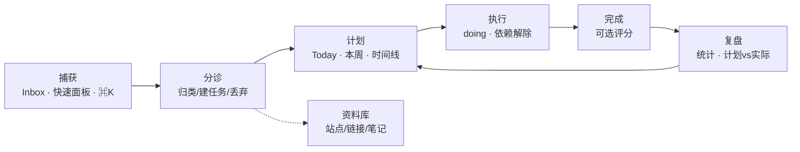

# 19 · 业务设计评审与重构建议

> 评审对象：v0.5 现状（宿主 `dsh-workbench` 0.5.2 + `tasks` 2.5.0 / `tags` 1.4.0 / `sites` 1.4.0）。
> 评审方法：直接读源码与 schema（行号见各条证据）、对照 docs/specs 01–18 的设计意图与 08 的路线图，
> 以「个人每天真的会用它做什么」为准绳，而不是以「功能是否都有」为准绳。
> 本文只谈业务模型与交互契约，不评价插件框架、同步协议实现质量。

## 1. 结论：功能不缺，缺的是业务主循环

现在的产品形态是**三个 CRUD 应用 + 一个统计页**，而不是个人工作台的日常循环：

```
捕获 → 分诊 → 计划 → 执行 → 复盘
```

证据不在某个 bug 上，而在三处结构性选择：

| 观察 | 证据 | 说明 |
| --- | --- | --- |
| 最短路径的入口没做 | `docs/specs/03-UI设计.md` 把「快速面板 `sidebar.right.pane.tab`」「命令浮层 ⌘K」列为未实现 | 日常使用发生在「想到一件事」的 3 秒内，而现在的入口是「打开设置 → 插件 → 个人工作台 → 选卡片 → 选 tab」 |
| 视图第一屏是统计 | 任务域 views 首项为 `stats`；首页是「域卡片」而不是「今天」 | 统计回答的是「我过去怎样」，用户每天要回答的是「我现在做什么」 |
| 记录默认关闭且按会话 | `packages/shell/src/index.ts:105-113`、`:691-705` | 核心卖点（AI 帮你记）变成需要用户记得手动打开的实验开关 |

据此归纳四条根因，后文的每一条建议都能回溯到其中之一：

- **R1 视图驱动领域**：UI 的 tab 直接成了领域 API 的参数，且带默认值（`tabCode` 缺省 = 0 = 紧急）。
- **R2 分类写死在代码里**：任务类型 4 个枚举 + 直接把类型做成导航，与已存在的标签体系职责重叠。
- **R3 采集数据的成本被前置**：完成前必选难度、站点必须先归目录、记录必须先开开关——把「整理」和「统计」的要求压在「捕获」这一刻。
- **R4 共享数据没有归属**：`tag_mapping` 被两个插件同时声明，备份/同步按 `item_type` 手工切分，插件之间靠「知道对方的表」耦合。

> **2026-11-08 进展**：T1 的「把分类交给标签」已落地——`task.type` 列删除，
> 工作/生活/学习/开发 迁成同名标签（多对多），左栏类型页签下线，筛选改为工具栏的标签下拉；
> T2 的 `patch.type` 分支随列删除而消失，`tasks.update` 的 `type` 现在只剩「更新模式」一种含义。
> 详见 `docs/specs/09-任务模块迁移方案.md` 8.4。

## 2. 不合理需求清单

### 2.1 任务域

| # | 现状需求 | 证据 | 为什么不合理 | 建议 |
| --- | --- | --- | --- | --- |
| T1 | 任务类型固定为 工作/生活/学习/开发，并直接做成 5 个导航 tab | `packages/addons/tasks/lib/tasks.js:25-33`（TASK_TYPES/TABS/TYPE_NAMES）、`packages/addons/tasks/client/client.src.cjs:74-90` | 分类是用户最易变的维度（加「副业」「健康」要发版）；与 tags 插件职责重叠；把导航当分类用，导致「分类不可扩展 + 视图不可组合」 | 类型降级为单一 `kind`（甚至删除），多维分类交给标签；tab 改由「保存的筛选视图」生成 |
| T2 | `tasks.update` 的 `type` 是「更新模式」，不是任务类型 | `packages/addons/tasks/lib/tasks.js:512`、`PUT_TYPES` `:28`；而 `bulkUpdate` 的 `patch.type` 才是类型 `:578-581` | 同名字段语义相反，是**会真实丢数据**的接口：`update({type:3})` 表示「改描述」，调用方理解为「把任务改成开发类」就会静默清空 description | 拆分动词化 action（`setStatus/setPriority/setTitle/setDescription`）或 `patch` 直接用字段名；模式位彻底移除 |
| T3 | `tasks.list` 无参默认 `tab=0` = 紧急 | `tasks.js:60-66`、紧急口径 `:879-882`（`priority>=6 OR target_date<=today+2`，且 `status='0'`） | 「危险的默认值」：agent 调 `list()` 以为拿全部，实际只拿到满足硬编码阈值的一小撮；阈值 6 与 2 天写死在代码里，用户无法定义「紧急」 | 无参应 fail loud（要求结构化 filter）或明确返回「未完成 + 全部」；紧急改为派生指标（到期/阻塞/手动置顶） |
| T4 | 分页语义按 tab 分裂：tab 5–8 分页，tab 0–4 硬上限 500 且 `total=records.length` | `tasks.js:902-912`、`:951-957` | 同一 API 两种语义，`total` 在 0–4 上是伪值（≤500），agent 与 UI 都据此翻页/计数，必然错 | 统一分页 + 真 `total`；视图差异只体现在 filter |
| T5 | 「重启」= 新建一条任务行，旧行先置关闭再置重启 | `tasks.js:473-492`、`source=2`（`SOURCES` `:25-33`）；`timeline_key=id`、`restart_key=id` `:439-446` | 破坏任务身份：同一件事尝试三次 → 三条任务，完成率被稀释、统计重复计数；「重新打开已关闭任务」没有入口，只能再造一条；父子关系只靠同 `restart_key` 隐式分组 | `reopen` 做成**事件**（保留 id、attempt+1、status 回 open）；若必须保留行链，加显式 `successor_of`，统计按根任务去重 |
| T6 | 完成前必须选难度 0.5–5 | `packages/addons/tasks/client/client.src.cjs:721`、i18n `"Pick a difficulty (0.5–5) before completing"` `:65`；DDL 中 `difficulty` 可空 `packages/addons/tasks/lib/db/db.js:10-43` | 把「给统计采集数据」的需求包装成用户需求：完成一件事的最爽时刻被一张评分表拦住，用户会绕过（直接关闭任务）而非评分；且与 DDL 可空规则不一致 | 难度可选、完成后可补；或并入「复盘」环节（计划 vs 实际），不进完成主路径 |
| T7 | 优先级 0–10（任意整数）+ 难度 0–5 两个数字维度 | `tasks.js:68-81` 校验范围；client 端 slider | 人无法稳定区分 7 和 8，精度是假的；priority 到底是「重要性」还是「紧急度」没有定义，却又被「紧急」阈值复用 | 收敛为 3–5 档并定义口径（如 impact/urgency 各一档）；紧急由到期与阻塞派生 |
| T8 | 依赖只表达「阻塞」，且上游 `status 0/1/3` 都算阻塞 | `tasks.js:355` | 已关闭（1）、已重启（3）的上游会**永久阻塞**下游；没有「相关/拆分/替代」关系 | 阻塞只算「未完成且未取消」；依赖边加类型（blocks/relates/duplicates） |
| T9 | 时间字段四个：`publish_date / target_date / done_date / shutdown_date` | `db.js:10-43` | `shutdown_date` 与 `closed` 事件重复；没有明确的 `start_at`（想做「本周计划」时缺少开始语义） | 收敛为 `start_at / due_at` + 事件时间戳（完成/关闭时间来自事件，不单独建列） |

### 2.2 站点域

| # | 现状需求 | 证据 | 为什么不合理 | 建议 |
| --- | --- | --- | --- | --- |
| S1 | 采集站点必须至少关联一个目录 | `packages/addons/sites/lib/domain/sites.js:214-223`（抛「站点至少需要关联一个目录」）、能力清单 `packages/addons/sites/lib/index.js:57-61,84` | 把「整理」的成本前置到「捕获」；用户看到好站点时不想先想它归哪 | 允许无目录（落到收件箱/未归类），`dirIds` 可空；分诊视图批量归档 |
| S2 | 多链接存在一个 JSON 列 `site_link` | `packages/addons/sites/lib/db/db.js:14-28`；元素 `{link, description, isDefault}` `sites.js:76` | 整列走行级 LWW：两台设备各加一条链接会**互相覆盖**（同步方案已明确不做字段级合并，见 `docs/specs/16-数据同步方案.md:89`） | 拆 `site_link` 行表（`id, site_id, url, label, is_default, sort`），天然按行合并 |
| S3 | `bindable` 字段 | `sites/lib/db.js:14-28`（默认 1）；客户端无任何渲染，仅统计出现 `sites/lib/stats.js:139-157,316-330` | 无业务动作、无 UI 的死字段，却有默认值参与统计，读者会误以为它有意义 | 删除，或赋予明确语义（如「可作为任务的挂载目标」）并接进交互 |
| S4 | 站点与任务彼此孤立 | 无 task↔site 关联；`sites.js:237-240` 的 `reviveOrInsertMapping` 还是 `return null` 死代码 | 真实场景是「在处理某任务时需要打开/引用某个站点」；两份资源无法互链 | 统一 resource 抽象（link/file/note）多态挂载到 task/site/tag |

### 2.3 标签域与跨域

| # | 现状需求 | 证据 | 为什么不合理 | 建议 |
| --- | --- | --- | --- | --- |
| G1 | `tag` 只有 `id/name/时间戳` | `packages/addons/tags/lib/db/db.js:16-23` | 无颜色/描述/排序/维度；标签只能「平铺」，无法承担替代 `type` 的重任（见 T1） | 加 `color/kind(维度)/sort/desc`；提供标签合并与重命名回填 |
| G2 ✅ 2026-11-08 已修 | 唯一性只在应用层（DB 唯一索引被删） | `tags/lib/db.js:36-46` 先 `DROP INDEX IF EXISTS uk_tag_name` 再建非唯一索引；`getTagByName` `tags.js:55-57` | 并发/导入/同步路径可造出同名标签；重名直接报错而非「合并/提示」 | 已恢复 `uk_tag_name(name) WHERE deleted_at IS NULL`；`tags.create` 同名幂等返回已有 id；升级时 `mergeDuplicateTagNames` 合并存量重名、备份导入 `canonicalizeTagNames` 按名合并 |
| G3 | `tag_mapping` 被 tags 与 sites 双方声明，宿主静默 first-wins | `tags/lib/index.js:37`、`tags/lib/sync.js:5-10`；`sites/lib/index.js:39`、`sites/lib/sync.js:118-123`；`packages/shell/src/sync.ts:217-233`；`registerDomain` 不查重 `shell/src/index.ts:188-198` | 同一张表两个「所有者」，谁的 `reconcile/唯一键` 生效取决于加载顺序；标签插件还必须知道 `'site'` 这个业务概念（级联删、备份排除 `tags/lib/backup.js:61,127`） | 关系表上收宿主：`entity_ref(owner_domain, entity_type, entity_id)`；插件注册 `taggable(type, resolver)`，跨域只走接口 |
| G4 | 备份按 `item_type='site'` 手工切分 | `tags/lib/backup.js:61,127`；`sites/lib/backup.js:111` | 插件卸载一半、或新增第三种 item_type 时，数据会变成孤儿或被两边都跳过 | 备份按「关系表 owner + 引用完整性」切分，宿主校验孤儿并报出 |
| G5 | 没有跨插件原子写 | `docs/插件功能清单.md` 第 9 节 | 「建站点 + 建标签映射」可能半成功，用户看到站点没标签却收到了成功回执 | 宿主提供 `withTransaction` 或 saga + 补偿回执 |

### 2.4 宿主 / 记录模式

| # | 现状需求 | 证据 | 为什么不合理 | 建议 |
| --- | --- | --- | --- | --- |
| H1 | 记录模式默认关闭、按会话 | `shell/src/index.ts:105-113`、`:691-705`、`session_mode` 表 | 核心能力不可发现；「按会话」意味着换个会话就失效，用户无法建立稳定预期 | 工作区级默认（可按会话覆盖），首次开启有一次可见的「已记录 N 条」回执 |
| H2 | 记录模式只「写库」，没有 dryRun / 撤销 / 收件箱 | 提示词只要求先查 capabilities/查重、失败不阻塞（`:115-140`） | 用户第一次被写入时无法预判差异，也无法整体撤销；「直接落进任务表/目录」意味着 AI 必须先决定分类——与 T1/S1 的「先捕获」冲突 | 写入先产生 `batchId` + 差量回执 + 一键撤销；默认目标改为收件箱草稿 |
| H3 | 没有跨域搜索/feed | 只有各域 `list` 与 `search`（tasks） | 用户记不清「那是任务还是站点」，入口却按域分裂 | 宿主提供统一 `search(q)` 与 `activity feed` |

## 3. 三条最要紧的深挖

### 3.1 分类与导航（T1 + R1 + R2）

现在 `TABS` 同时承担三种含义：分类（工作/生活/学习/开发）、状态筛选（关闭/活跃/完成）、报表（概览）。
于是只能「加 tab」来加需求，而 tab 影响 API 默认行为（T3），形成 UI ↔ 领域的循环依赖。

正确的分层：

```
filter（结构化查询）  →  saved_view（用户命名的筛选，就是 tab）
        ↑                        ↑
   领域 API 只认 filter       UI 只负责展示 saved_view
```

`saved_view` 表（`id, domain, name, filter_json, sort, pinned`）让「我的紧急」「本周开发」变成数据而非代码；
`type` 退化为可选 `kind`，多维分类全部交给标签（G1 补齐后），标签成为真正的分类系统。

### 3.2 身份 vs 尝试（T5）

「重启」被实现成新行，是因为 `status` 被当成「这一行的终身状态」，而业务上它是「这件事的当前阶段」。
正确模型是**事件溯源的最小版本**：

`task_event(id, task_id, kind, at, payload)`，`kind ∈ {created, started, completed, closed, reopened, deferred, rescheduled, rated}`；
`task.status` 只是事件的物化字段（便于索引/同步），`attempt` 与 `duration` 由事件派生。

收益：统计按任务 id 去重（T5 的重复计数消失）、`reopen` 成为一次点击、复盘能算出「这件事被打断过几次」，
而这些恰恰是「统计概览」（M4 规划）真正需要的数据源。

### 3.3 站点：采集 ≠ 归档（S1 + S2）

个人收藏失败的根本原因不是「没有目录」，而是「收藏时被迫整理」。把 `dirIds` 变成可空、默认进 inbox，
再用一个「分诊」视图（未归类 + 未打标签 + 长期未访问）批量处理，才符合真实行为。
同时把 `site_link` 行表化，多设备/多链接才不会被整列覆盖（S2 已由 16 号文档的取舍推出必然结论）。

## 4. 更合理的业务设计

### 4.1 主循环与信息架构



| 层 | 现在 | 建议 |
| --- | --- | --- |
| 入口 | 设置页 → 卡片 → 域 tab | 快速面板 + ⌘K + Today（首页默认域改为「今天」） |
| 捕获 | 直接建任务/站点（必须选目录/类型） | 统一草稿（`draft`）落 Inbox，无必填字段 |
| 分类 | 固定 type + tab | 标签（多维）+ saved_view |
| 计划 | 无（只有 list 筛选） | Today/本周视图 + 重复规则 |
| 复盘 | 独立 stats 视图 | 复盘页（统计 + 计划vs实际 + 中断次数） |

### 4.2 领域对象（建议）

- `Task`：身份 + 当前状态 + `attempt`（派生）；分类靠标签；计划靠 `start_at/due_at`。
- `TaskEvent`：状态变更的唯一事实源。
- `SavedView`：用户命名的筛选（就是今天的 tab）。
- `Resource`（新）：`{kind: link|file|note, url/path, title}`，多态挂载 task/site/tag。
- `Tag`：`{name, kind, color, sort}` + 跨域 `entity_ref` 关系。
- `Rule`（新）：RRULE 子集的重复规则，到期生成实例（`instance_of` 指向模板）。

### 4.3 action 契约原则

1. **动词命名、一个 action 一件事**：`capture / plan / start / complete / reopen / close / archive / reschedule / rate`，不再用「模式位」（T2）。
2. **默认值要保守**：无参查询 fail loud 或语义明确（T3/T4）；有副作用的默认值必须显式（如 `source=2` 不能隐式触发建行）。
3. **每个写操作返回 `{changed, before, after, batchId}`**：dryRun 与撤销都依赖它（H2）。
4. **filter 是唯一查询语言**：`{status:[], tags:[], dueBefore, priorityGte, source, q, page, pageSize}`；`saved_view` 存的就是它。

### 4.4 跨插件契约（宿主职责上收）

宿主应提供的通用能力，避免插件互相认识对方的表：

| 能力 | 替代现状 |
| --- | --- |
| `relation`（entity_ref） | `tag_mapping` 双所有权（G3） |
| `taggable(type, resolver)` / `attachable` | 标签里硬编码 `'site'`、站点里声明 `tag_mapping` |
| `withTransaction` | 无跨域原子写（G5） |
| `undo(batchId)` | 记录模式无法撤销（H2） |
| `search(q)` / `feed` | 按域分裂的入口（H3） |

### 4.5 统计口径（对齐 18 号文档）

- 完成率分母按**任务 id**去重，重启链不重复计（依赖 T5）。
- 「紧急」不再作为固定查询，而是派生指标：`dueSoon ∨ blocked ∨ pinned`。
- 新增两组最有价值的指标：`计划 vs 实际`（difficulty/预估 vs 事件时长）、`中断与重启次数`（事件派生）。
- 统计从「首屏」降为「复盘入口」，首页让位给 Today。

## 5. 落地优先级

### P0 · 正确性与数据风险（先修，均为向后兼容的增量改动）

| 项 | 动作 | 验收 |
| --- | --- | --- |
| P0-1 | T2：新增 `patch` 形态或动词 action，旧 `type` 模式位标记 deprecated 且禁止与新字段混用 | 单测：`update({title})` 不改 description；文档标注弃用 |
| P0-2 | T3/T4：无参 `list` 语义显式化；统一分页与真 `total` | 单测覆盖 0–8 全部 tab 的 `total` 与翻页 |
| P0-3 | T8：阻塞判定改为「未完成且未取消」 | 单测：已关闭/已重启上游不再阻塞下游 |
| P0-4 | G3/G4：宿主 `bindings()` 对同一表多域声明报错；备份孤儿校验 | e2e：同时装 tags+sites 时启动不再静默去重 |
| P0-5 | H1/H2：记录模式工作区默认 + 写入回执（batchId）+ 撤销 | 真实会话验证：一次记录可整体撤销且不留残行 |

### P1 · 主循环（M4 的真正内容）

| 项 | 动作 |
| --- | --- |
| P1-1 | Inbox（草稿）+ 分诊视图；站点 `dirIds` 可空（S1） |
| P1-2 | Today/本周视图 + 快速面板 + ⌘K（03 号文档的未实现项） |
| P1-3 | T5：`reopen` 事件化，统计按任务去重；老数据按 `restart_key` 归并 |
| P1-4 | S2：`site_link` 行表化 + 迁移；移除 `bindable` 与 `reviveOrInsertMapping` 死代码 |
| P1-5 | T6/T7：去掉完成门槛，优先级收敛并定义口径 |

### P2 · 扩展

| 项 | 动作 |
| --- | --- |
| P2-1 | T1：`saved_view` + 标签维度化（type 只剩 guard 语义） |
| P2-2 | 重复规则 `Rule` + 模板 |
| P2-3 | 统一 `Resource` 与 task↔site 互链（S4） |
| P2-4 | 复盘页：计划vs实际、中断次数（4.5） |

## 6. 兼容与迁移

- **T2**：只加不改——新 action/patch 先上线，旧形态保留一个版本并在 `actions.help` 标 deprecated；DB 不动。
- **T5**：`status=3` 的老行保留，新增 `closed_at` 与事件回填脚本（按 `shutdown_date` 生成 `closed` 事件）；
  统计切换为「按任务去重」需要一次对账，避免历史报表跳变。
- **S2**：`site_link` JSON → 行表的一次性幂等迁移（解析失败的行保留原 JSON 并记录告警），保留 `updated_at` 以维持 LWW。
- **G3**：关系表上收需要双读期（先建 `entity_ref` 回填，再切写路径，最后删旧映射表）——这是唯一需要跨版本协作的改动，建议单独排期。

## 7. 明确不建议做的（避免过度设计）

1. 完整项目管理能力（甘特、工时、资源池、多人协作）——与「个人」定位冲突，也会把同步/权限复杂度拉满。
2. 字段级 CRDT / Yjs——16 号文档已明确取舍；T5/S2 用「事件 + 行表」即可解决现实冲突，不必上 CRDT。
3. 自研日历视图——先做 Today/本周的列表视图，日历交给外部日历同步。
4. 把「统计」做成首屏——统计是复盘的输入，不是使用入口。

## 8. 需要产品决策的开放问题

1. 任务的「类型」到底保不保留？若保留，是 `kind`（单一维度）还是彻底交给标签？
2. 「关闭」与「取消」是否要区分（现在 `status=1` 只叫关闭，语义含混）？
3. 记录模式默认开是否可接受（涉及用户对「AI 自动写库」的信任）？若要默认开，回执与撤销必须先上。
4. 站点是否并入「资料库」成为通用资源（与 17 号文件存储设计合并）？这决定 P2-3 的成本。
5. 云端是否允许「仅同步部分域」（装置只装 tasks 时是否推送 tags 数据）？当前按域声明表，语义未定义。

---

附：本文所有行号基于 2026-11-08 的 `packages/addons/*` 与 `packages/shell` 源码；
若后续版本调整，请以 `docs/插件功能清单.md` 的 action 契约为准重新核对。
