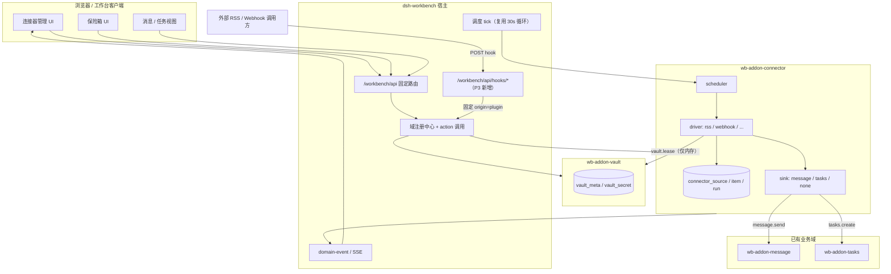

# 46 连接器与凭据保险箱插件方案

> 状态：设计稿（待评审）· 目标宿主 0.6.7 · 2026-11-12
>
> 本文一次性给出 P0–P6 全部阶段的方案，实施按阶段推进。第一阶段只做
> `wb-addon-vault` + `wb-addon-connector`（RSS / Webhook），但后续阶段的表、
> action、宿主扩展点先在设计上定死，避免后面返工改协议。
>
> 关联：[01-总体架构](./01-总体架构.md)、[04-子插件体系](./04-子插件体系.md)、
> [13-插件体系重构方案](./13-插件体系重构方案.md)、[45-消息插件设计](./45-消息插件设计.md)。

## 1. 一句话

把“外部世界”做成工作台的一等公民：`wb-addon-connector` 负责把 RSS、Webhook
以及后续的 IMAP/CalDAV/CardDAV 拉成统一条目，再通过 `message.send` /
`tasks.create` 落到已有业务域；`wb-addon-vault` 负责把这些连接器需要的密码、
token、应用专用密码加密存起来，agent 永远拿不到明文。

## 2. 目标与非目标

### 2.1 目标

1. 一个连接器包覆盖多种外部系统，新增一种来源只加 driver，不新增插件包。
2. 连接器只“取数 + 归一化 + 投递”，不直接写 message/tasks 的表，避免跨域耦合。
3. 凭据独立成域，UI 可管理，agent 可“使用”但不可“读取”。
4. 第一阶段就有完整管理 UI：列表、向导、详情、运行记录、配置、数据页。
5. 所有阶段共用一套表/action 命名和宿主扩展点，后续加自动化、搜索、业务域不推翻。
6. 默认本地优先：不配置云同步也能完整使用；连接器内容默认不上云、不进备份。

### 2.2 非目标

- 不做通用 iPaaS / 低代码编排平台；automation 只做“一个触发 + 一个动作”。
- 不替代原邮箱/原 RSS 阅读器；连接器是聚合与通知，不是全量邮件客户端。
- 不做 MTA、不代发外部邮件、不做反垃圾。
- 不在第一阶段做 IMAP/CalDAV/CardDAV 的完整实现；先把 driver 接口和 RSS/Webhook 跑通。
- 不做每协议一个 npm 包；driver 在同一包内按目录拆分。
- 不改现有 tasks/tags/sites/message 的表结构与 action 语义。

## 3. 已确认的四项取舍

| 决策点 | 结论 | 影响 |
| --- | --- | --- |
| 第一阶段范围 | 连接器优先：vault + connector（RSS/webhook） | 先打通“凭据 → 取数 → 投递 → 可观测”闭环 |
| 凭据保险箱 | 独立 `wb-addon-vault` 域 | 不依附 sites；sites 现有 vault 暂不迁移 |
| 第一阶段 UI | 完整管理 UI | 不留“先用 action 凑合”的债 |
| 同步与备份 | 先给数据形态，再定策略 | 本文 8.3/8.4 给出形态与三档建议，待拍板 |

## 4. 从 Cypht 借什么、不借什么

| Cypht 做法 | 判断 | 本方案对应 |
| --- | --- | --- |
| 40 个 module set，按协议/页面切 | 不借粒度 | 6 类插件；connector 一个包内按 driver 切 |
| handler（取数/写 session）+ output（渲染）分离 | 借思想 | driver 取数归一化；sink 负责投递；UI 只读 action |
| 每个模块自带 setup.php 注册页面 | 借思想 | 每个插件 `wb.addon.views` + setup 注册 action |
| 用户设置可加密存储 | 借思想，但升级 | 独立 vault 域，密钥不落库，agent 掩码 |
| 多邮箱/RSS 聚合到统一界面 | 借产品方向 | connector 条目 + message 收件箱 + 后续 mail 域 |
| 日历/过滤器/PGP 都塞进核心 | 不借 | 各自独立域，按需安装 |

核心判断：**按数据所有权切插件，不按协议切包**。RSS、Webhook、IMAP 的数据都归
connector 域，所以它们是 driver；邮件正文归 mail 域，所以 IMAP 的“读信”未来属于
mail driver，而不是 connector 再长一套邮件表。

## 5. 总体架构



边界三条：

1. connector 不 import 其他插件源码，只通过 `host.invoke(action, args)` 调 action。
2. connector 不直接写 `message` / `task` 表；写目标表是目标域的职责。
3. vault 不感知连接器；它只提供 `secret` 的存取与租约。

## 6. 包与域清单

| 阶段 | npm 包 | 域 id | 版本 | 依赖 | 说明 |
| --- | --- | --- | --- | --- | --- |
| P0 | `dsh-workbench-vault` | `wb-addon-vault` | 0.1.0 | host | 凭据保险箱 |
| P0 | `dsh-workbench-connector` | `wb-addon-connector` | 0.1.0 | host（vault 可选） | 连接器 |
| P4 | `dsh-workbench-automation` | `wb-addon-automation` | 0.1.0 | host | 规则与运行 |
| P5 | 宿主内置 | — | 0.7.0 | — | 跨域搜索 |
| P6 | `dsh-workbench-contacts` | `wb-addon-contacts` | 0.1.0 | host | 联系人（可选） |
| P6 | `dsh-workbench-calendar` | `wb-addon-calendar` | 0.1.0 | host | 日历（可选） |
| P6 | `dsh-workbench-mail` | `wb-addon-mail` | 0.1.0 | host + vault | 邮件（可选） |

`minShell` 统一 0.6.7（P3 hook、P4 event、P5 search 会抬到 0.7.0）。connector 对 vault
不做硬依赖：RSS 可以匿名抓取，只有配置了 secret 的来源才要求 vault 已安装并解锁。

## 7. 凭据保险箱 `wb-addon-vault`

### 7.1 威胁模型

| 威胁 | 是否防护 | 手段 |
| --- | --- | --- |
| 数据库文件被拷走 | 是 |  secret 以 DEK 加密；DEK 由口令派生 KEK 包裹 |
| 日志/审计/SSE 泄漏明文 | 是 | action 返回值字段名含 `secret`；审计键名脱敏；SSE 只发事件名 |
| agent 通过 action 读明文 | 是 | `secretReveal` / `lease` 按 origin 门禁；agent 只可见掩码 |
| 同机同用户读进程内存 | 部分 | JS 无法可靠清零；租约短、用完即弃；文档明示 |
| 同机同用户读 device key | 取决于开关 | 自动解锁默认关；开启时 device key 0600，等同“记住密码” |
| 暴力猜口令 | 是（有限） | scrypt N=2^15；5 次失败锁 5 分钟；解锁失败审计 |
| 跨站请求伪造 | 是 | 沿用宿主同源 + CSRF/权限模型；vault 不新增公网路由 |

明确不防：宿主进程被完全控制、root 读内存、用户自己把口令贴进聊天。方案只保证
“静态数据 + 正常接口 + agent 工具链”不泄明文。

### 7.2 密钥层级

```text
用户口令 passphrase
   │ scrypt(salt, N=2^15, r=8, p=1, 32B)
   ▼
KEK ──AES-256-GCM──► wrapped_dek（存 vault_meta）
   │
   ▼ 解包
DEK（32B 随机，只在内存）
   │ AES-256-GCM，AAD = "vault:<id>:<name>:<kind>"
   ▼
secret 密文（存 vault_secret.ciphertext）

可选自动解锁：
device_key（$WB_HOME/vault-device.key，0600，32B 随机）
   └──AES-256-GCM──► wrapped_dek_for_device（存 vault_meta）
```

- 口令校验不存口令哈希，而是用 KEK 解 `wrapped_dek`，GCM tag 校验失败即口令错。
- 改口令只重包 DEK，不重新加密所有 secret；改 name/kind 需要解密再加密（AAD 变更）。
- 密文格式与 sites 现有实现保持一致：`v1:<b64 iv>:<b64 tag>:<b64 ct>`，便于以后抽公共库。
- scrypt 参数存 `vault_meta.kdf`，为将来升级留余地；解锁时按存储参数派生。

### 7.3 表结构

```sql
CREATE TABLE vault_meta (
  key TEXT PRIMARY KEY,
  value TEXT NOT NULL,
  updated_at INTEGER NOT NULL
);
-- key: schema_version / salt / kdf / wrapped_dek / wrapped_dek_device /
--      auto_unlock / idle_timeout_sec / created_at / last_unlock_at

CREATE TABLE vault_secret (
  id TEXT PRIMARY KEY,
  name TEXT NOT NULL,
  kind TEXT NOT NULL,              -- password / token / app_password / api_key / other
  meta TEXT NOT NULL DEFAULT '{}', -- 非敏感备注：用户名、URL、过期提醒等
  ciphertext TEXT NOT NULL,
  created_at INTEGER NOT NULL,
  updated_at INTEGER NOT NULL,
  last_used_at INTEGER,
  deleted_at INTEGER,
  rev INTEGER NOT NULL DEFAULT 1
);
CREATE UNIQUE INDEX uk_vault_secret_name
  ON vault_secret(name) WHERE deleted_at IS NULL;
```

`meta` 明确禁止放密码/token；UI 保存前做键名检查，命中
`pass|pwd|token|secret|key|credential` 直接拒绝。

### 7.4 action 契约

所有 action 返回 `{ ok: true, ... }` 或抛错；错误码用稳定字符串，UI 做映射。

| action | origin | 入参 | 返回 | 说明 |
| --- | --- | --- | --- | --- |
| `vault.status` | ui/agent | — | `{initialized,locked,autoUnlock,idleTimeoutSec,secretCount,lastUnlockAt}` | 不含任何密文 |
| `vault.setup` | ui | `{passphrase,autoUnlock?}` | `{ok}` | 仅未初始化；口令 ≥10 字符 |
| `vault.unlock` | ui | `{passphrase}` | `{ok}` | 5 次失败锁 5 分钟 |
| `vault.lock` | ui/plugin | — | `{ok}` | 清内存 DEK |
| `vault.changePassphrase` | ui | `{oldPassphrase,newPassphrase}` | `{ok}` | 重包 DEK |
| `vault.secretList` | ui/agent | `{q?,kind?}` | `{items:[{id,name,kind,meta,lastUsedAt}]}` | 永不含 value |
| `vault.secretCreate` | ui | `{name,kind,value,meta?}` | `{id}` | value 不落审计 |
| `vault.secretUpdate` | ui | `{id,name?,kind?,value?,meta?}` | `{ok}` | 改 name/kind 会重加密 |
| `vault.secretDelete` | ui | `{id}` | `{ok}` | 软删除 |
| `vault.secretReveal` | ui | `{id}` | `{secret}` | 前端 60s 自动隐藏 |
| `vault.lease` | plugin | `{id,purpose,ttlSeconds}` | `{secret,expiresAt}` | ttl 30–300s；只给后台 |
| `vault.rotateDeviceKey` | ui | `{passphrase}` | `{ok}` | 重写自动解锁包裹 |
| `vault.actionSchema` | ui | — | 本域 action 清单 | 插件自证清单 |
| `vault.dataTables` | ui | — | `[vault_secret]` | 数据页 |
| `vault.dataQuery` | ui | `{table,limit,offset}` | 行（密文列掩码） | 只读 |

origin 矩阵：

| action | ui | agent | plugin |
| --- | --- | --- | --- |
| status/list | ✅ | ✅ | ✅ |
| setup/unlock/changePassphrase | ✅ | ❌ | ❌ |
| secretCreate/Update/Delete/Reveal | ✅ | ❌ | ❌ |
| lease | ❌ | ❌ | ✅ |
| lock | ✅ | ❌ | ✅ |

宿主需要把“插件后台调用”标成独立 origin `plugin`，不能复用 `sync`（云同步）语义。
改动点：`packages/sdk/src/index.ts:27` 的 `origin: "ui" | "agent" | "sync"` 联合类型、
`packages/shell/src/actions/actions.ts:301/337` 的 `invoke` / `invokeAction` 参数、审计 actor；
插件侧通过新增的 `host.invoke` 调用，origin 由宿主写死，插件不能传。

### 7.5 生命周期

1. `setup`：生成 salt、DEK，写 meta；可选写 device 包裹。
2. `unlock`：派生 KEK → 解 DEK → 内存持有；记录 last_unlock_at；失败计数 +1。
3. 空闲锁定：默认 15 分钟无 vault 调用自动清 DEK；`idle_timeout_sec` 可配 1–60 分钟。
4. `lock`：清 DEK、清租约；SSE 发 `vault.locked`。
5. 重启：进程内 DEK 必然丢失；有 device key 且 auto_unlock=1 才自动解，否则锁定。
6. `rekey`：改口令 → 重包 DEK → 重写 device 包裹（如果开启）。
7. 删除 secret：软删除；30 天后清理任务物理删除。

自动解锁的默认值与风险提示见 17 节 D2。

### 7.6 审计与日志

- 审计键名必须命中宿主 `SECRET_KEY` 正则才会脱敏；因此 `lease` 返回字段固定叫
  `secret`，`reveal` 也叫 `secret`，禁止叫 `value` / `data`。
- `purpose` 记录为 `connector:<sourceId>`，便于追“哪个连接器在什么时候取过哪个凭据”。
- 日志只打 secret id 与 name，不打 value；异常栈里若可能带 URL，先脱敏 query。
- SSE 事件只发 `vault.locked` / `vault.unlocked` / `vault.secret.changed`，不带值。

### 7.7 与 sites 现有 vault 的关系

sites 的 `sites.vault.*` 继续服务站点账号，不动。新 vault 表前缀 `vault_`，域独立。
未来若统一，做一次迁移：把 sites 的密文按同一 DEK 重加密后搬入 `vault_secret`，
sites 改为引用 secret id；不在本方案第一阶段做。

### 7.8 P1 验收

- 错误口令无法解出 DEK；连续 5 次失败锁定，锁定期间正确口令也拒绝。
- 数据库文件里搜不到明文口令/token；审计日志里 `secret` 字段为 `***`。
- agent 调 `vault.secretReveal` / `vault.lease` 被拒绝；调 `secretList` 只看到元数据。
- 锁定后连接器运行标记 `skipped`，不会把“vault locked”当成抓取失败重试。
- 重启后默认锁定；开启自动解锁后可恢复。

## 8. 连接器 `wb-addon-connector`

### 8.1 职责边界

| 做 | 不做 |
| --- | --- |
| 定义 source、调度、抓取、解析、去重 | 不直接写 message/task 表 |
| 保存条目快照与运行记录 | 不做全文邮件客户端 |
| 通过 action 投递到 message/tasks | 不做通用脚本执行 |
| 提供 webhook 接收与鉴权 | 不暴露公网管理接口 |

### 8.2 数据模型

四张表：一张来源、一张条目、一张运行、一张（可选）来源状态。第一版把状态并进
`connector_source`，避免多一张表。

```sql
CREATE TABLE connector_source (
  id TEXT PRIMARY KEY,
  name TEXT NOT NULL,
  driver TEXT NOT NULL,                 -- rss / webhook / imap / caldav / carddav
  config TEXT NOT NULL DEFAULT '{}',    -- 非敏感配置
  secret_id TEXT,                       -- vault_secret.id，可空
  enabled INTEGER NOT NULL DEFAULT 1,
  schedule TEXT NOT NULL DEFAULT 'manual', -- manual / 15m / 1h / 6h / 1d
  next_run_at INTEGER,
  last_run_at INTEGER,
  last_status TEXT NOT NULL DEFAULT 'never', -- never/ok/error/skipped
  last_error TEXT NOT NULL DEFAULT '',
  fail_count INTEGER NOT NULL DEFAULT 0,
  cursor TEXT NOT NULL DEFAULT '{}',    -- ETag / lastModified / lastSeenId
  mapping TEXT NOT NULL DEFAULT '{}',   -- {target,args}
  created_at INTEGER NOT NULL,
  updated_at INTEGER NOT NULL,
  deleted_at INTEGER,
  rev INTEGER NOT NULL DEFAULT 1
);
CREATE INDEX idx_conn_source_due
  ON connector_source(enabled, next_run_at) WHERE deleted_at IS NULL;

CREATE TABLE connector_item (
  id TEXT PRIMARY KEY,
  source_id TEXT NOT NULL,
  external_id TEXT NOT NULL,            -- guid / URL / webhook event id
  title TEXT NOT NULL DEFAULT '',
  url TEXT NOT NULL DEFAULT '',
  summary TEXT NOT NULL DEFAULT '',     -- 截断 8KB
  author TEXT NOT NULL DEFAULT '',
  published_at INTEGER,
  content_hash TEXT NOT NULL DEFAULT '',
  raw TEXT NOT NULL DEFAULT '',         -- 原始条目 JSON，截断 64KB
  status TEXT NOT NULL DEFAULT 'new',   -- new/processed/ignored/failed
  target TEXT NOT NULL DEFAULT '',      -- message/tasks/none
  target_ref TEXT NOT NULL DEFAULT '',  -- 目标域返回的 id
  error TEXT NOT NULL DEFAULT '',
  fetched_at INTEGER NOT NULL,
  processed_at INTEGER,
  deleted_at INTEGER,
  rev INTEGER NOT NULL DEFAULT 1
);
CREATE UNIQUE INDEX uk_conn_item_ext
  ON connector_item(source_id, external_id) WHERE deleted_at IS NULL;
CREATE INDEX idx_conn_item_list
  ON connector_item(source_id, published_at DESC) WHERE deleted_at IS NULL;
CREATE INDEX idx_conn_item_status
  ON connector_item(status, fetched_at) WHERE deleted_at IS NULL;

CREATE TABLE connector_run (
  id TEXT PRIMARY KEY,
  source_id TEXT NOT NULL,
  trigger TEXT NOT NULL,                -- manual/schedule/webhook/retry
  status TEXT NOT NULL,                 -- running/ok/error/skipped
  started_at INTEGER NOT NULL,
  finished_at INTEGER,
  fetched INTEGER NOT NULL DEFAULT 0,
  created INTEGER NOT NULL DEFAULT 0,
  duplicated INTEGER NOT NULL DEFAULT 0,
  mapped INTEGER NOT NULL DEFAULT 0,
  failed INTEGER NOT NULL DEFAULT 0,
  error TEXT NOT NULL DEFAULT '',
  cursor_before TEXT NOT NULL DEFAULT '',
  cursor_after TEXT NOT NULL DEFAULT ''
);
CREATE INDEX idx_conn_run_list ON connector_run(source_id, started_at DESC);
```

约束：

- `connector_source.config` 只放 URL、选择器、语言、是否全文等非敏感项；出现
  `password|token|secret|key|credential` 键名直接拒绝保存，提示改用 secret。
- `secret_id` 不做外键（跨域），删除 vault secret 时连接器不级联；运行时 lease 失败
  标记 `skipped` 并在来源详情提示“凭据已失效”。
- `external_id` 必填；driver 负责从 guid/link/event id 归一化。没有稳定 id 的源
  （部分 RSS）用 `sha256(link + published_at)` 兜底。
- `raw` 只作排障，UI 不默认展示；数据页可看但默认折叠。

### 8.3 数据形态：连接器的数据长什么样

一句话：**来源是“怎么取”，条目是“取到了什么”，运行是“这次取得怎么样”**。条目是
外部内容的本地快照，不是邮件副本，也不是任务副本；它记录“投递到哪”但不复制目标域字段。

来源（`connector_source`）：

```json
{
  "id": "src_01J8Z3K4",
  "name": "少数派",
  "driver": "rss",
  "config": {
    "url": "https://sspai.com/feed",
    "includeContent": false,
    "maxItems": 30
  },
  "secretId": null,
  "enabled": 1,
  "schedule": "1h",
  "nextRunAt": 1763000400000,
  "lastRunAt": 1762996800000,
  "lastStatus": "ok",
  "failCount": 0,
  "cursor": { "etag": "W/\"abc\"", "lastModified": "Tue, 11 Nov 2026 10:00:00 GMT" },
  "mapping": {
    "target": "message",
    "args": { "level": "info", "source": "rss" }
  }
}
```

条目（`connector_item`）：

```json
{
  "id": "itm_01J8Z4M2",
  "sourceId": "src_01J8Z3K4",
  "externalId": "https://sspai.com/post/91234",
  "title": "把工作台做成信息入口",
  "url": "https://sspai.com/post/91234",
  "summary": "连接器把 RSS 拉成条目，再投递到消息收件箱……",
  "author": "Matrix",
  "publishedAt": 1762995000000,
  "contentHash": "sha256:9f2c…",
  "status": "processed",
  "target": "message",
  "targetRef": "msg_01J8Z5A0",
  "fetchedAt": 1762996801000,
  "processedAt": 1762996802000,
  "error": ""
}
```

运行（`connector_run`）：

```json
{
  "id": "run_01J8Z5B1",
  "sourceId": "src_01J8Z3K4",
  "trigger": "schedule",
  "status": "ok",
  "startedAt": 1762996800000,
  "finishedAt": 1762996802500,
  "fetched": 20,
  "created": 3,
  "duplicated": 17,
  "mapped": 3,
  "failed": 0,
  "error": ""
}
```

UI 上的对应关系：

| 页面 | 读什么 | 用户看到 |
| --- | --- | --- |
| 来源列表 | source + 最近 run 聚合 | 名称、driver、频率、上次结果、新条目数 |
| 来源详情-条目 | item | 标题、时间、状态、投递目标、重投/忽略 |
| 来源详情-运行 | run | 每次抓了多少、新建多少、失败原因 |
| 条目页 | item 全量 | 跨来源筛选、搜索、批量操作 |
| 配置页 | 插件级 config | 默认频率、保留天数、超时、通知 |

### 8.4 同步与备份建议（待拍板）

三档，推荐 A：

| 档 | source | item | run | 效果 | 风险 |
| --- | --- | --- | --- | --- | --- |
| A（推荐，v1） | 不同步/不备份 | 不同步 | 不同步 | 完全本机；换机重建来源 | 换机成本；无跨设备一致 |
| B | 同步（脱敏） | 不同步 | 不同步 | 来源定义跟人走，内容各设备各拉 | secretId 悬空；URL 可能含隐私；多设备重复通知 |
| C | 同步 | 同步（可选） | 不同步 | 条目跟人走 | 体积大、隐私面大、重复投递难去重 |

推荐 A 的理由：

1. 连接器条目是“可再取的外部内容”，不是用户原创数据，丢了大不了重拉。
2. `raw` 可能包含隐私/大字段，进备份和云同步会把最脏的数据带到最贵的地方。
3. secret 永远不能同步；source 同步后 secretId 必然悬空，换机仍要重新授权，收益有限。
4. 多设备同时跑同一个 source 会重复 `message.send`；v1 不做跨设备租约，干脆不同步。

如果选 B，需要额外设计：source 导出时把 `secret_id` 换成 `secret_name` 提示重新绑定；
导入时按 name 找本地 secret，找不到则标记“待授权”；`sync: {tables:["connector_source"]}`
且 `uniqueKeys:["id"]`。如果选 C，还要给 item 加去重租约和每设备投递开关，工作量翻倍。

**建议 v1 统一 `sync: { tables: [] }`，不实现 exportData/importData**；等真实换机需求
出现再按 B 补。

### 8.5 driver 接口

driver 是纯逻辑，不碰数据库、不碰 UI、不直接调 action；由 runner 注入依赖。

```ts
type RawItem = {
  externalId: string;
  title: string;
  url?: string;
  summary?: string;
  author?: string;
  publishedAt?: number;
  raw?: unknown;
};

type DriverContext = {
  source: { id: string; name: string; config: unknown; cursor: unknown };
  secret: string | null;          // 已从 vault lease 解出，仅本次运行有效
  now: number;
  signal: AbortSignal;
  log: (msg: string, meta?: Record<string, unknown>) => void;
};

type Driver = {
  id: "rss" | "webhook" | "imap" | "caldav" | "carddav";
  title: string;
  configFields: FieldSchema[];    // UI 向导按此渲染
  secretKind?: "password" | "token" | "app_password";
  validate(input: { config: unknown; secret: string | null }): Promise<void>;
  fetch(ctx: DriverContext): Promise<{
    items: RawItem[];
    cursor?: unknown;
    notModified?: boolean;
  }>;
};
```

runner 统一负责：lease、超时、重试、去重、写 item/run、调 sink。driver 只做“给定配置
和游标，返回条目”。新增 RSS 变体（Atom、JSON Feed）在 rss driver 内部判断，不新增包。

### 8.6 RSS driver

- 配置：`url`（必填，http/https）、`includeContent`（默认 false）、`maxItems`（默认 30，上限 100）。
- 鉴权：可选 basic（用户名 + 密码，存一个 secret，JSON `{username,password}`）或
  header token（`{header:"Authorization",value:"Bearer …"}`）。
- 请求：`fetch`，`Accept: application/rss+xml, application/atom+xml, application/xml`，
  超时 20s，响应体上限 2MB，重定向最多 3 次且每次重新做 SSRF 校验。
- 条件请求：保存 `ETag` / `Last-Modified`；304 记 `notModified`，run 仍然记一条 ok。
- 解析：新增依赖 `fast-xml-parser`（纯 JS、无原生模块）；关闭外部实体处理，深度/节点数
  上限，解析失败只记 error，不落半截数据。
- 归一化：RSS 2.0 `item` / Atom `entry`；`guid`/`id` → externalId；`link` 兼容
  `href`；`pubDate`/`updated`/`published` 解析为毫秒；`description`/`content`/`summary`
  去标签后截断 8KB。
- 排序：按 `publishedAt` 倒序，缺时间用 `fetchedAt`；每次最多取 `maxItems`。
- 已知限制：不做全文抓取（P2 不做 Readability）；不做 OPML 批量导入（P2 后可选）。

### 8.7 Webhook driver

- 每个来源生成一个 URL：
  `POST /workbench/api/hooks/connector/<sourceId>/<token>`
- token：32 字节随机，base64url；只存 `sha256(token)` 到 source.config；创建/轮换时
  明文只显示一次，UI 提供复制。
- 鉴权：常量时间比较 hash；可选 HMAC-SHA256 签名头
  `X-Connector-Signature: sha256=<hex>`，密钥用 vault secret；时间戳头
  `X-Connector-Timestamp`，窗口 ±5 分钟防重放。
- 请求体：JSON，上限 256KB；支持单条对象或 `{items:[...]}` 批量（上限 50）。
- 幂等：优先 `X-Event-Id`；没有则 `sha256(body)`；与 `external_id` 去重同一套。
- 限流：每来源 60 次/分钟，超出 429；全局 10 次/秒。
- 响应：`{ok:true,accepted:n,duplicated:n}`；鉴权失败 401，限流 429，体过大 413。
- 宿主改动（P3）：
  - `packages/shell/src/infra/network.ts` 在固定路由分发前匹配 `/hooks/*`；
  - 新增 `host.registerHook({ id, method, path, handler })`，path 只允许
    `/hooks/<plugin>/...` 前缀，避免插件抢管理路由；
  - handler 入参限 `{method,headers,body,remoteAddress}`，body 由宿主读并限长；
  - hook 调用 action/插件函数时 origin 固定 `plugin`，不能由请求方指定。
- 默认不暴露公网：本机/局域网可用；要公网用反向代理 + HTTPS + 路径 token，必要时
  再加 IP allowlist。文档明确“token 在 URL 里，会进代理日志”，建议同时开 HMAC。

### 8.8 调度、去重、重试、限流

- 调度：复用宿主 30s tick（P2 先由 connector 自己 `setInterval(30s)`，`ctx.effect` 清理）；
  查 `enabled=1 AND next_run_at<=now`，按 `next_run_at` 升序，单轮最多 3 个。
- 单实例：进程内 `running: Set<sourceId>` 防重叠；重启后把 `status='running'` 且超过
  10 分钟的 run 标记 `error: "interrupted"`。多实例部署不在 v1 支持范围。
- 退避：失败后 `next_run_at = now + min(1h, 1m * 2^fail_count)`；成功清零。手动运行
  不受退避限制。
- 去重：`(source_id, external_id)` 唯一；同一条目 `content_hash` 变化时更新 summary/raw，
  不重复投递（除非 mapping 改成“内容更新也通知”，v1 不做）。
- 保留：item 默认 90 天或每来源 5000 条，先到先删；run 30 天或 1000 条；可在配置页调。
- 超时：单次 fetch 20s，整轮 run 60s；超时记 error，cursor 不前进。
- 并发：全局最多 3 个 run 同时执行；SQLite 写用事务 + 短事务，避免长事务锁库。

### 8.9 产出映射

`mapping = { target: "none" | "message" | "tasks", args: {...} }`

message：

```json
{ "target": "message", "args": { "level": "info", "source": "rss", "titleTemplate": "{{title}}", "bodyTemplate": "{{summary}}\n{{url}}" } }
```

- 固定 `dedupeKey = "connector:" + sourceId + ":" + itemId`，避免重试重复发。
- `audience` 默认 `user`；失败通知用 `level:"error"`，成功摘要默认不发（避免刷屏）。

tasks：

```json
{ "target": "tasks", "args": { "tableId": "tbl_inbox", "titleTemplate": "{{title}}", "notesTemplate": "{{summary}}\n{{url}}" } }
```

- 必须显式给 `tableId` 或 `tablePath`，不默认第一张表（遵守任务归属约定）。
- 模板只做字符串替换 `{{field}}`，字段白名单：title/url/summary/author/publishedAt；
  不执行表达式。
- sink 失败：item.status=`failed`，error 记目标域错误；UI 可“重投”。
- 投递成功：status=`processed`，target_ref=目标 id；`none` 则直接 `processed`。

### 8.10 安全清单

- SSRF：解析 DNS 后拒绝 loopback/RFC1918/link-local/ULA/`169.254.169.254`；每次重定向
  重新校验；禁止 `file:`/`gopher:`；只允许 http/https。
- TLS：不关闭证书校验；不提供“忽略证书错误”开关。
- XML：禁用外部实体；限制深度 64、节点数 10 万；解析异常不 panic。
- HTML：条目 summary 去标签后按纯文本渲染；链接 `rel="noopener noreferrer"`，
  只允许 http/https。
- Secret：config 键名检查；日志只打 id；审计靠字段名脱敏；不在 URL query 放 secret。
- 限流：webhook 每来源 60/min；RSS 单来源 1 次并发；全局 3 并发。
- 错误信息：对外只给“超时/401/解析失败”等归类，原始响应截断 500 字并脱敏 query。

### 8.11 action 契约

| action | 说明 |
| --- | --- |
| `connector.sourceList` | `{enabled?,driver?,q?}` → 来源 + 计数 |
| `connector.sourceGet` | `{id}` → 来源 + 最近 5 次 run |
| `connector.sourceCreate` | `{name,driver,config,secretId?,schedule?,enabled?,mapping?}` |
| `connector.sourceUpdate` | `{id,...}` 局部更新；改 config 时清 cursor |
| `connector.sourceDelete` | `{id,deleteItems?}` 默认软删来源并保留条目 30 天 |
| `connector.sourceTest` | `{id}` 或 `{driver,config,secretId?}` → 不发通知，返回样例 |
| `connector.sourceRun` | `{id}` → `{runId}` 异步；同一来源已在跑则返回现有 runId |
| `connector.sourcePause/Resume` | `{id}` 快捷开关 |
| `connector.itemList` | `{sourceId?,status?,q?,page?,pageSize?}` |
| `connector.itemGet` | `{id}` → 条目 + raw（默认折叠） |
| `connector.itemMark` | `{ids,status}` → 批量忽略/已处理 |
| `connector.itemRemap` | `{ids}` → 按当前 mapping 重投 |
| `connector.itemDelete` | `{ids}` 软删 |
| `connector.runList` | `{sourceId?,status?,page?}` |
| `connector.runGet` | `{id}` → run 详情 |
| `connector.runRetry` | `{id}` → 新 run |
| `connector.configGet/Set/Reset` | 插件级配置：默认频率、保留、超时、通知 |
| `connector.stats` | 首页卡片：来源数、启用数、今日新增、失败数 |
| `connector.actionSchema` | 自证 action 清单 |
| `connector.dataTables/dataQuery` | 数据页只读 |

事件：

- `connector.run.finished` `{sourceId,runId,status,fetched,created,failed}`
- `connector.item.created` `{sourceId,itemId,title,url,target}`
- `connector.error` `{sourceId,runId,message}`

事件只发摘要，不发 `raw`/`summary` 全文；automation 与 UI 都够用。

### 8.12 P2/P3 验收

- RSS：RSS 2.0 与 Atom 各 3 个 fixture；304 不重复建条目；坏 XML 只记 error。
- 去重：同一 guid 跑两次，第二次 created=0、duplicated=n。
- 投递：message 收到一条且 dedupeKey 不重复；tasks 落到指定表；目标失败可重投。
- 调度：假时钟推进 1h 恰好跑一次；失败退避 1m/2m/4m；重叠运行被拒绝。
- webhook：错 token 401；重放窗口外 401；同 event id 第二次 duplicated；大 body 413。
- 安全：私网 URL 被拒；重定向到私网被拒；审计无 secret。

## 9. 自动化 `wb-addon-automation`（P4）

### 9.1 定位

连接器解决“把外部东西拿进来”，automation 解决“拿进来之后自动做一件事”。只做
**单触发 + 单动作 + 可选简单条件**，不做可视化编排、不做循环/分支。

### 9.2 表结构

```sql
CREATE TABLE automation_rule (
  id TEXT PRIMARY KEY,
  name TEXT NOT NULL,
  enabled INTEGER NOT NULL DEFAULT 1,
  trigger_type TEXT NOT NULL,          -- schedule / event / manual
  trigger_config TEXT NOT NULL,        -- JSON
  condition TEXT NOT NULL DEFAULT '',  -- 可选，简单比较
  action_name TEXT NOT NULL,
  action_args TEXT NOT NULL DEFAULT '{}',
  next_run_at INTEGER,
  last_run_at INTEGER,
  last_status TEXT NOT NULL DEFAULT 'never',
  run_count INTEGER NOT NULL DEFAULT 0,
  error_count INTEGER NOT NULL DEFAULT 0,
  created_at INTEGER NOT NULL,
  updated_at INTEGER NOT NULL,
  deleted_at INTEGER,
  rev INTEGER NOT NULL DEFAULT 1
);

CREATE TABLE automation_run (
  id TEXT PRIMARY KEY,
  rule_id TEXT NOT NULL,
  trigger TEXT NOT NULL,
  status TEXT NOT NULL,                -- ok/error/skipped
  started_at INTEGER NOT NULL,
  finished_at INTEGER,
  result TEXT NOT NULL DEFAULT '',
  error TEXT NOT NULL DEFAULT ''
);
```

`trigger_config`：

- `{kind:"interval",everyMinutes:60}`
- `{kind:"dailyAt",time:"09:00",tz:"Asia/Shanghai",weekdays:[1,2,3,4,5]}`
- `{kind:"event",domainId:"wb-addon-connector",event:"item.created"}`
- `{kind:"manual"}`

v1 不做 cron 表达式；`dailyAt` 覆盖大多数场景。要 cron 再加依赖 `croner`，先不引入。

### 9.3 action 契约

| action | 说明 |
| --- | --- |
| `automation.ruleList` | 列表 + 最近运行 |
| `automation.ruleGet` | 详情 |
| `automation.ruleCreate` | `{name,triggerType,triggerConfig,condition?,actionName,actionArgs,enabled?}` |
| `automation.ruleUpdate` | 局部更新 |
| `automation.ruleDelete` | 软删 |
| `automation.ruleRun` | 立即跑一次（仍受 allowlist 约束） |
| `automation.runList` | 运行记录 |
| `automation.runGet` | 详情 |
| `automation.configGet/Set` | 最大规则数、每小时上限 |
| `automation.stats` | 首页卡片 |
| `automation.actionSchema/dataTables/dataQuery` | 自证/数据页 |

### 9.4 宿主事件订阅（P4 改动）

现状 `emit` 只写给 SSE 订阅者，插件拿不到。P4 增加：

```ts
// 插件侧
const off = host.on("connector.item.created", (payload) => { ... });
// 或统一入口
const off = host.on("domain-event", (e) => {
  if (e.domainId === "wb-addon-connector" && e.event === "item.created") ...
});
```

宿主实现：`emit` 里除 SSE 外遍历 `pluginListeners: Map<string, Set<fn>>`；`on` 返回
取消函数；`ctx.effect` 清理。事件名做白名单（只允许已注册域 emit 过的事件），payload
深拷贝/限长，监听器异常只记日志不影响其他监听器。SSE 行为不变。

### 9.5 安全与约束

- action allowlist：`message.send`、`tasks.create`、`connector.sourceRun`、
  `tags.create` 等显式白名单；**禁止** `vault.*`、`automation.*`、`audit.*`、
  `*.backup*`、`*.delete*`（删除类一律禁）。
- 参数模板：只允许 `{{event.field}}` / `{{item.field}}` 字符串替换，字段白名单，
  不 eval、不取原型链、深度上限 3。
- 频率：每规则每小时最多 60 次，全局并发 2；超限记 `skipped`。
- 条件：v1 只支持 `{field,op,value}`，op ∈ eq/neq/contains/gt/lt；字段白名单。
- 失败：动作抛错记 run.error，规则不自动禁用；连续 10 次失败在 UI 黄条提示。
- 审计：automation 调 action 时 actor 记 `plugin`，args 过宿主脱敏。

### 9.6 验收

- 定时规则在假时钟下按 interval/dailyAt 触发；时区用 Asia/Shanghai。
- 事件规则只在匹配 domainId+event 时触发；payload 过滤生效。
- 非白名单 action 保存时拒绝；`vault.*` 明确报错。
- 模板注入 `{{constructor}}` 不生效；超长 payload 被截断。

## 10. 跨域搜索（P5，宿主内置）

### 10.1 问题

现在每个域各自搜索（tasks.search、tags.search…），首页没有“搜全部”。连接器条目多了
以后，用户需要在一个框里搜任务、站点、条目、消息。

### 10.2 设计

宿主新增：

- `registerSearchProvider({ domainId, search(q, opts) })`：插件在 setup 注册；不注册就
  不参与。
- `search.query({ q, domains?, limit? })`：宿主并行调用各 provider，统一排序（域权重 +
  时间），返回 `{items:[{domainId,id,title,snippet,url?}], partial:true?}`。
- `search.providers`：列出可用域，UI 做筛选。
- 超时 500ms/域；单域失败不影响其他域，返回 `partial` 与错误域列表。
- 查询清洗：长度 1–100，转义 `% _ \`；不做 SQL 拼接；provider 自己用参数化查询。
- FTS5：v1 先用 `LIKE` + 现有索引；条目量大再给 connector_item 建 FTS5 虚表
  （`connector_item_fts`），由 connector 自己维护。
- UI：首页搜索框 + `Cmd/Ctrl+K` 面板；结果按域分组；回车打开对应视图。

### 10.3 插件契约

```ts
host.registerSearchProvider({
  domainId: "wb-addon-connector",
  search: async (q, { limit }) => db.query(
    "SELECT id,title,summary FROM connector_item WHERE deleted_at IS NULL AND (title LIKE ? OR summary LIKE ?) LIMIT ?",
    [`%${escapeLike(q)}%`, `%${escapeLike(q)}%`, limit]
  ).map(...)
});
```

不跨域读表；宿主只做聚合与排序。

### 10.4 验收

- 三域各 1 条命中，`search.query` 一次返回 3 条并带 domainId。
- 单域 provider 抛错，其他域结果仍返回，`partial=true`。
- 空查询/超长查询/特殊字符不报错、不注入。

## 11. 业务域扩展（P6，可选）

### 11.1 联系人 `wb-addon-contacts`

- 表：`contact`、`contact_group`、`contact_field`（email/phone/im/url）、
  `contact_group_member`。
- action：`contacts.list/get/create/update/delete/search/importVcf/exportVcf`。
- 来源：本地手动、vCard 导入；CardDAV 作为 connector driver 或 contacts 自己的
  同步源，二选一（建议 CardDAV 放 connector，contacts 只存本地）。
- 视图：列表、详情、分组、导入导出、配置、数据。

### 11.2 日历 `wb-addon-calendar`

- 表：`calendar`、`calendar_event`、`calendar_attendee`、`calendar_reminder`。
- action：`calendar.list/get/create/update/delete/eventsBetween/remind`。
- 时区：事件存 UTC 毫秒 + `tz` 字段；重复事件先存 RRULE 原文，展开由 UI/查询做。
- CalDAV 同步放 connector driver；calendar 只做本地模型与提醒。
- 提醒复用 message.send + automation 定时规则，不新建通知通道。

### 11.3 邮件 `wb-addon-mail`

- 表：`mail_account`、`mail_mailbox`、`mail_message`、`mail_attachment`。
- 协议：IMAP 收、SMTP 发；OAuth2 先不做，用应用专用密码（存 vault）。
- action：`mail.accountList/Create/Update/Delete/test`、
  `mail.mailboxList`、`mail.messageList/Get/send/markRead/move/delete`、
  `mail.search`。
- 与 connector 的边界：connector 的 IMAP driver 只做“通知类/未读摘要”轻量场景；
  完整读信、附件、会话线程归 mail 域。两者不共享表。
- 视图：账户、文件夹、列表、读信、写信、搜索、配置。
- 这一阶段工作量最大，等 P1–P5 稳定后再启动。

## 12. UI 设计（完整管理 UI）

### 12.1 首页卡片

| 插件 | 卡片内容 | 主操作 |
| --- | --- | --- |
| connector | 启用来源数、今日新增、最近失败 | 打开连接器 |
| vault | 已锁定/已解锁、secret 数 | 解锁/管理 |
| automation | 启用规则数、今日触发、失败 | 打开自动化 |

卡片走现有 `wb.addon.views` 的 `stats` 视图；不新增首页 slot 协议。

### 12.2 视图清单

connector（7）：

| view id | 标题 | 内容 |
| --- | --- | --- |
| `stats` | 概览 | 来源/条目/运行汇总、失败提示 |
| `sources` | 来源 | 列表 + 新建 + 启停 + 立即运行 |
| `items` | 条目 | 跨来源筛选、搜索、批量操作 |
| `runs` | 运行 | 运行记录、错误详情、重试 |
| `config` | 配置 | 默认频率、保留、超时、通知 |
| `data` | 数据 | 三张表只读浏览 |
| `actions` | Action | 自证清单 |

vault（5）：`status`、`secrets`、`config`、`data`、`actions`。

### 12.3 来源列表 / 详情

列表列：名称、driver、频率、上次运行（相对时间 + 状态点）、新条目数、开关、行操作
（运行/编辑/删除）。空态给“新建来源”与“从模板开始”（RSS 示例、Webhook 示例）。

详情头部：名称、driver、状态徽章、`立即运行`、`暂停`、`编辑`、`删除`。
Tab：条目（默认）、运行、配置。右栏可放“凭据状态”（vault 锁定/secret 缺失）。

### 12.4 新建向导（4 步）

1. 选类型：RSS / Webhook（P2）；IMAP/CalDAV/CardDAV 置灰“即将支持”。
2. 连接：RSS 填 URL、可选鉴权；Webhook 先创建后展示 URL + token（只显示一次）。
3. 频率与投递：manual/15m/1h/6h/1d；target none/message/tasks；tasks 必须选表。
4. 测试与保存：`sourceTest` 拉 3 条样例展示；失败给可操作错误；保存后跳详情。

校验：URL 必填、频率枚举、tasks 必须 tableId、secret 必须已解锁才能选。

### 12.5 条目 / 运行 / 配置

- 条目：状态筛选（new/processed/ignored/failed）、来源筛选、关键词；列表显示标题、
  来源、时间、状态、目标；点开侧栏看 summary/url/raw（折叠）；批量忽略/删除/重投。
- 运行：状态徽章、开始时间、耗时、fetched/created/duplicated/failed、error 展开；
  “重试”生成新 run。
- 配置：默认频率、每来源保留条数/天数、run 保留、请求超时、失败是否发消息、
  是否允许自动解锁（只读展示 vault 设置）。

### 12.6 保险箱 UI

- 未初始化：设置口令（≥10 位、两次确认、强度提示）、自动解锁开关（默认关，文案写明
  “开启后本机文件可解密”）。
- 已锁定：口令输入、解锁、忘记口令说明（无法恢复，只能重置并清空 secret）。
- 已解锁：secret 列表（名称/类型/最近使用/操作）、新建、编辑、删除、显示（60s 倒计时）、
  立即锁定、修改口令、轮换 device key。
- 任何列表页不显示密文；复制按钮只对 `secretReveal` 结果生效，复制后提示“已复制，
  60 秒后隐藏”。

### 12.7 空态、错误态、无障碍、i18n

- 空态：一句话说明 + 主操作 + 示例链接；不伪造数据。
- 错误态：错误码映射成人话；保留“重试”；vault 锁定给“去解锁”。
- 无障碍：所有输入有 label；状态用 `aria-live="polite"`；键盘可达；对比度达 AA；
  图标按钮有 `aria-label`。
- i18n：文案集中到 `client/i18n/zh-CN.js`，键名 `connector.*` / `vault.*`；先中文，
  预留 en 文件，不在组件里写死中文。

### 12.8 客户端文件拆分

`client.src.cjs` 单文件会很快超 600 行，按职责拆：

```text
packages/addons/connector/client/
  connector.src.cjs        # 入口：registerAddon + views 注册
  ui/sources.cjs           # 来源列表/详情
  ui/wizard.cjs            # 新建向导
  ui/items.cjs             # 条目
  ui/runs.cjs              # 运行
  ui/config.cjs            # 配置
  ui/shared.cjs            # 状态徽章、空态、错误、格式化
  i18n/zh-CN.js
```

入口只做注册与组合；每个文件 ≤600 行；构建仍由 `pnpm build:clients` 产出单个
`lib/client.js`。vault 同理拆 `status/secrets/config/shared`。

## 13. 分阶段路线图

方案一次给全，实施按依赖推进；每阶段独立可发布、可回滚。

| 阶段 | 内容 | 交付 | 工期 | 验收 |
| --- | --- | --- | --- | --- |
| P0 | 方案冻结 + 包骨架 | 本文、两个包目录、cordis.patch、版本号、空 action | 0.5–1d | `pnpm build`、audit 绿 |
| P1 | vault 域 | 表、加密、action、UI、测试 | 3–4d | 7.8 全过 |
| P2 | connector 核心 + RSS + UI | 表、driver、调度、sink、6 视图、测试 | 6–8d | 8.12 前四组 |
| P3 | Webhook + 宿主 hook | hook 路由、token、HMAC、UI、测试 | 3–4d | 8.12 webhook 组 |
| P4 | automation | 事件订阅、规则、UI、测试 | 5–7d | 9.6 |
| P5 | 宿主搜索 | provider、query、首页/Cmd+K | 3–4d | 10.4 |
| P6 | contacts/calendar/mail | 各自域；mail 最大 | 每个 5–8d | 各域验收 |

依赖：P1 不依赖 P2；P2 的 secret 路径依赖 P1；P3 依赖 P2；P4 依赖 P2/P3 的事件；
P5 依赖至少两个域有数据；P6 独立，可随时插队。

## 14. 测试矩阵

| 层 | 覆盖 | 方式 |
| --- | --- | --- |
| 单元 | 加密/解密、错误口令、锁定时、租约过期、origin 矩阵 | node:test，固定向量 |
| 单元 | RSS/Atom 解析、去重、模板、退避计算 | fixture + 假时钟 |
| 集成 | source→run→item→message/tasks 全链路 | 临时 SQLite + 假 vault |
| 集成 | webhook 鉴权/重放/限流/大 body | 直接调 hook handler |
| 集成 | automation 事件/定时/白名单 | 假 host action |
| 安全 | SSRF 表、XXE、审计脱敏、日志 grep | 用例表 + grep 断言 |
| UI | 向导、空态、锁定态、批量操作 | 现有 e2e/组件测试 |
| 性能 | 1 万条目列表分页、RSS 2MB | 基准脚本，P95 目标 <200ms |

回归命令：`pnpm test:native`、`pnpm test:message`、`pnpm test:action-schema`、
`node scripts/audit-actions.mjs`、`node scripts/audit-lines.mjs`。

## 15. 发布与版本

新增两个包，发布前同步：

1. `packages/addons/<name>/package.json` 的 `version` 与 `wb.addon.version`；
2. `client/*.src.cjs` 里 `registerAddon` 的 `version`；
3. `lib/index.js` 的 `registerAddon` 版本（如走该入口）；
4. `docs/插件功能清单.md` 版本表与 action 表；
5. `docs/specs/README.md` 导航加本文；
6. `minShell` 与宿主版本匹配；P3/P4/P5 抬宿主版本时同步。

流程：`pnpm build` → `pnpm build:clients` → `node scripts/dist-shell.mjs` →
`pnpm audit:profile` → 桌面 CLI 安装 → 重启 → `capabilities.list` 核对版本与
actionCount。两个新包要确认 `scripts/stage-release.mjs` 能动态收集（当前未见硬编码
包列表），否则补清单。

## 16. 风险与备选

| 风险 | 影响 | 缓解 | 备选 |
| --- | --- | --- | --- |
| 宿主 hook/event/search 改动破坏兼容 | 老插件/老客户端异常 | 新增 API 不改旧路径；抬 minShell；灰度 | 先只做轮询，webhook 延后 |
| 自动解锁削弱安全性 | 本机文件泄露即明文 | 默认关；UI 明示；device key 0600 | 只用口令，不提供自动解锁 |
| 新依赖 fast-xml-parser | 供应链/体积 | 锁版本、审 license、只用于 RSS | 自写最小解析器（工作量大） |
| webhook 公网暴露 | token 泄漏/被刷 | 路径 token + HMAC + 限流 + 反代 | 只允许本机/内网 |
| SQLite 并发写 | 锁库/慢 | 短事务、全局 3 并发、WAL | 单独队列串行写 |
| 多设备重复投递 | 重复消息/任务 | v1 不同步 source；投递去重键 | 跨设备租约（C 档） |
| 时区/DST | 定时错点 | 存 tz，按本地时间计算，测试 DST | 只支持 UTC |
| secret 在内存 | 无法清零 | 短租约、用完即弃、文档明示 | 子进程隔离（过重） |

## 17. 待你拍板的决策

| # | 问题 | 推荐 | 备选 |
| --- | --- | --- | --- |
| D1 | 连接器数据同步/备份档位 | A：全部仅本机 | B：只同步来源；C：来源+条目 |
| D2 | vault 自动解锁默认值 | 默认关，用户显式开启 | 默认开（体验好、风险高） |
| D3 | Webhook 暴露范围 | 默认仅本机/内网；公网靠反代 + HMAC | 直接监听公网 |
| D4 | 首批 driver | RSS + Webhook | 先 IMAP（工作量更大） |
| D5 | automation 时点 | P4，等事件稳定 | P2 提前（会和连接器抢改动） |
| D6 | RSS 解析依赖 | 引入 fast-xml-parser | 自写解析器 |
| D7 | sites 旧 vault | 暂不迁移，双轨 | P1 一起迁移（风险大） |

D1 直接影响表结构与是否实现 `exportData/importData`，建议先定；D2/D3 是安全默认值，
可以先用推荐值实现，后面改配置即可。

## 18. 附：命名与目录约定

```text
packages/addons/vault/
  package.json
  cordis.patch.yml
  lib/index.js
  lib/db/db.js
  lib/domain/vault.js
  lib/domain/crypto.js
  lib/infra/config.js
  lib/infra/data.js
  lib/client.js            # 生成物
  client/vault.src.cjs
  client/ui/*.cjs
  client/i18n/zh-CN.js

packages/addons/connector/
  package.json
  cordis.patch.yml
  lib/index.js
  lib/db/db.js
  lib/domain/sources.js
  lib/domain/items.js
  lib/domain/runs.js
  lib/domain/runner.js
  lib/domain/sink.js
  lib/drivers/rss.js
  lib/drivers/webhook.js
  lib/infra/scheduler.js
  lib/infra/config.js
  lib/infra/data.js
  lib/client.js
  client/connector.src.cjs
  client/ui/*.cjs
  client/i18n/zh-CN.js
```

每个目录 ≤12 文件、深度 ≤3；`lib/domain/*` 不 import React；`lib/db/*` 不 import
domain；driver 不 import 宿主之外的东西。版本号五处同步，`pnpm build:clients` 后
`lib/client.js` 不入手写行数统计。
