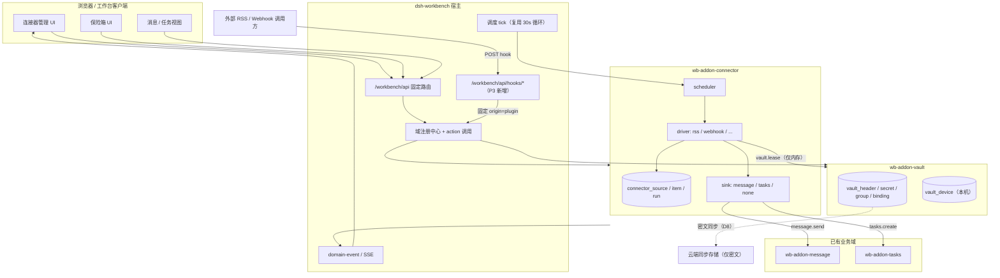
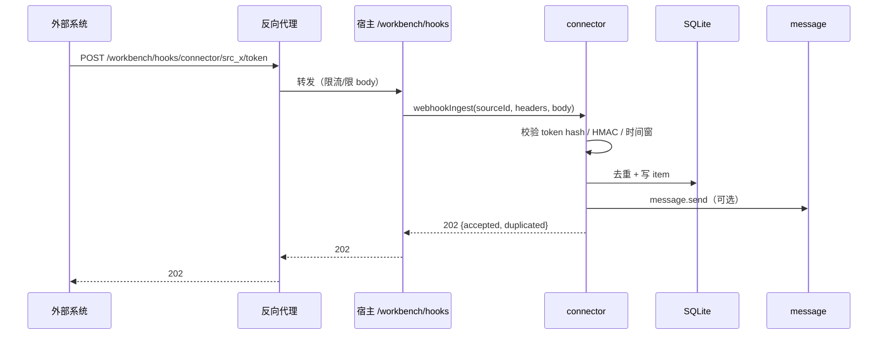

# 46 连接器与凭据保险箱插件方案

> 状态：设计稿 v2（已评审）· 目标宿主 0.6.7 · 2026-11-13
>
> v2 变更：凭据增加分组与关联（`vault_group` + `vault_binding`，引用由 vault 持有）；
> 保险箱密文参与云同步（`vault_header/secret/group/binding/subject_type`，设备态留本机）；
> 并发改口令采用 LWW；配套拆表与 0.1.0→0.2.0 迁移。见 7.9–7.11、D8–D11。
>
> 本文一次性给出 P0–P6 全部阶段的方案，实施按阶段推进。第一阶段只做
> `wb-addon-vault` + `wb-addon-connector`（RSS / Webhook），但后续阶段的表、
> action、宿主扩展点先在设计上定死，避免后面返工改协议。
>
> 关联：[01-总体架构](./01-总体架构.md)、[04-子插件体系](./04-子插件体系.md)、
> [13-插件体系重构方案](./13-插件体系重构方案.md)、[45-消息插件设计](./45-消息插件设计.md)。

## 1. 一句话

把“外部世界”做成工作台的一等公民：`wb-addon-connector` 负责把 RSS、Webhook
以及后续的 IMAP/CalDAV/CardDAV 拉成统一条目，再通过 `message.send` /
`tasks.create` 落到已有业务域；`wb-addon-vault` 负责把这些连接器需要的密码、
token、应用专用密码加密存起来，agent 永远拿不到明文。

## 2. 目标与非目标

### 2.1 目标

1. 一个连接器包覆盖多种外部系统，新增一种来源只加 driver，不新增插件包。
2. 连接器只“取数 + 归一化 + 投递”，不直接写 message/tasks 的表，避免跨域耦合。
3. 凭据独立成域，UI 可管理，agent 可“使用”但不可“读取”。
4. 第一阶段就有完整管理 UI：列表、向导、详情、运行记录、配置、数据页。
5. 所有阶段共用一套表/action 命名和宿主扩展点，后续加自动化、搜索、业务域不推翻。
6. 默认本地优先：不配置云同步也能完整使用；连接器内容默认不上云、不进备份。

### 2.2 非目标

- 不做通用 iPaaS / 低代码编排平台；automation 只做“一个触发 + 一个动作”。
- 不替代原邮箱/原 RSS 阅读器；连接器是聚合与通知，不是全量邮件客户端。
- 不做 MTA、不代发外部邮件、不做反垃圾。
- 不在第一阶段做 IMAP/CalDAV/CardDAV 的完整实现；先把 driver 接口和 RSS/Webhook 跑通。
- 不做每协议一个 npm 包；driver 在同一包内按目录拆分。
- 不改现有 tasks/tags/sites/message 的表结构与 action 语义。

## 3. 已确认的取舍

| 决策点 | 结论 | 影响 |
| --- | --- | --- |
| 第一阶段范围 | 连接器优先：vault + connector（RSS/webhook） | 先打通“凭据 → 取数 → 投递 → 可观测”闭环 |
| 凭据保险箱 | 独立 `wb-addon-vault` 域 | 不依附 sites；sites 现有 vault 暂不迁移 |
| 第一阶段 UI | 完整管理 UI | 不留“先用 action 凑合”的债 |
| 同步与备份（D1，connector） | **B：只同步来源定义**；状态/条目/运行留本机；vault 密文按 D8 单独同步；备份只导来源定义 | 来源定义跟人走；新设备要重新绑定凭据；多设备投递要按设备开关 |
| 解锁策略（D2） | **默认 A 全锁，支持配置成 B/C** | 默认最安全；需要夜间连接器时由用户显式开启自动解锁 |
| Webhook 暴露（D3） | **默认本机 only；每个来源默认关闭，显式开启；公网按 17.3 清单** | 不开公网就没有外部入口；开公网必须走独立 `/workbench/hooks` + 反代加固 |
| 凭据分组与关联（D10） | vault 维护 `vault_group` + `vault_binding`；业务模块只注册自身标识 | 业务表不加字段；sites 迁移后可整组授权；孤儿关联要有清理入口 |
| 保险箱云同步（D8） | 密文与结构参与云同步；设备态、使用记录、device key 留本机 | 云端只见密文；换机免重录；离线爆破面变大，口令与 KDF 同步加强 |
| 并发改口令（D9） | LWW：后写生效，另一台提示“口令已在其他设备修改” | 实现简单；存在白改一次口令的可能 |

## 4. 从 Cypht 借什么、不借什么

| Cypht 做法 | 判断 | 本方案对应 |
| --- | --- | --- |
| 40 个 module set，按协议/页面切 | 不借粒度 | 6 类插件；connector 一个包内按 driver 切 |
| handler（取数/写 session）+ output（渲染）分离 | 借思想 | driver 取数归一化；sink 负责投递；UI 只读 action |
| 每个模块自带 setup.php 注册页面 | 借思想 | 每个插件 `wb.addon.views` + setup 注册 action |
| 用户设置可加密存储 | 借思想，但升级 | 独立 vault 域，密钥不落库，agent 掩码 |
| 多邮箱/RSS 聚合到统一界面 | 借产品方向 | connector 条目 + message 收件箱 + 后续 mail 域 |
| 日历/过滤器/PGP 都塞进核心 | 不借 | 各自独立域，按需安装 |

核心判断：**按数据所有权切插件，不按协议切包**。RSS、Webhook、IMAP 的数据都归
connector 域，所以它们是 driver；邮件正文归 mail 域，所以 IMAP 的“读信”未来属于
mail driver，而不是 connector 再长一套邮件表。

## 5. 总体架构



边界四条：

1. connector 不 import 其他插件源码，只通过 `host.invoke(action, args)` 调 action。
2. connector 不直接写 `message` / `task` 表；写目标表是目标域的职责。
3. vault 不感知连接器；它只提供 `secret` 的存取、分组与租约。
4. vault 不校验 `subject_id` 是否真实存在；关联的登记与清理由业务模块负责。

## 6. 包与域清单

| 阶段 | npm 包 | 域 id | 版本 | 依赖 | 说明 |
| --- | --- | --- | --- | --- | --- |
| P0 | `dsh-workbench-vault` | `wb-addon-vault` | 0.2.2 | host | 凭据保险箱（含分组/关联/云同步） |
| P0 | `dsh-workbench-connector` | `wb-addon-connector` | 0.1.0 | host（vault 可选） | 连接器 |
| P4 | `dsh-workbench-automation` | `wb-addon-automation` | 0.1.0 | host | 规则与运行 |
| P5 | 宿主内置 | — | 0.7.0 | — | 跨域搜索 |
| P6 | `dsh-workbench-contacts` | `wb-addon-contacts` | 0.1.0 | host | 联系人（可选） |
| P6 | `dsh-workbench-calendar` | `wb-addon-calendar` | 0.1.0 | host | 日历（可选） |
| P6 | `dsh-workbench-mail` | `wb-addon-mail` | 0.1.0 | host + vault | 邮件（可选） |

`minShell` 统一 0.6.7（P3 hook、P4 event、P5 search 会抬到 0.7.0）。connector 对 vault
不做硬依赖：RSS 可以匿名抓取，只有配置了 secret 的来源才要求 vault 已安装并解锁。

## 7. 凭据保险箱 `wb-addon-vault`

### 7.1 威胁模型

| 威胁 | 是否防护 | 手段 |
| --- | --- | --- |
| 数据库文件被拷走 | 是 |  secret 以 DEK 加密；DEK 由口令派生 KEK 包裹 |
| 日志/审计/SSE 泄漏明文 | 是 | action 返回值字段名含 `secret`；审计键名脱敏；SSE 只发事件名 |
| agent 通过 action 读明文 | 是 | `secretReveal` / `lease` 按 origin 门禁；agent 只可见掩码 |
| 同机同用户读进程内存 | 部分 | JS 无法可靠清零；租约短、用完即弃；文档明示 |
| 同机同用户读 device key | 取决于开关 | 自动解锁默认关；开启时 device key 0600，等同“记住密码” |
| 暴力猜口令 | 是（有限） | scrypt N=2^16（新库；旧库保留原参数）；5 次失败锁 5 分钟；解锁失败审计 |
| 云端同步快照被拖走 | 部分 | 云端只有密文 + salt + KDF 参数；口令不上传；离线爆破成本由 KDF 与口令强度决定 |
| 同步通道被窃听/篡改 | 是 | 宿主同步走 TLS + 账号鉴权；行级 LWW，篡改拿不到 DEK |
| device key 被同步到云端 | 是 | `wrapped_dek_device` 只在本机 `vault_device`，device key 文件不出机器 |
| 跨站请求伪造 | 是 | 沿用宿主同源 + CSRF/权限模型；vault 不新增公网路由 |

明确不防：宿主进程被完全控制、root 读内存、用户自己把口令贴进聊天。方案只保证
“静态数据 + 正常接口 + agent 工具链”不泄明文。

### 7.2 密钥层级

```text
用户口令 passphrase
   │ scrypt(salt, N=2^16, r=8, p=1, 32B)   # 新库；旧库按 vault_header.kdf 存储值
   ▼
KEK ──AES-256-GCM──► wrapped_dek（存 vault_header，单行）
   │
   ▼ 解包
DEK（32B 随机，只在内存）
   │ AES-256-GCM，AAD = "vault:<id>:<name>:<kind>"
   ▼
secret 密文（存 vault_secret.ciphertext）

可选自动解锁：
device_key（$WB_HOME/vault-device.key，0600，32B 随机）
   └──AES-256-GCM──► wrapped_dek_for_device（存 vault_device，仅本机）
```

- 口令校验不存口令哈希，而是用 KEK 解 `wrapped_dek`，GCM tag 校验失败即口令错。
- 改口令只重包 DEK，不重新加密所有 secret；改 name/kind 需要解密再加密（AAD 变更）。
- 密文格式与 sites 现有实现保持一致：`v1:<b64 iv>:<b64 tag>:<b64 ct>`，便于以后抽公共库。
- scrypt 参数存 `vault_header.kdf`，为将来升级留余地；解锁时按存储参数派生。
- **header 是单行**：salt、kdf、wrapped_dek 必须整体替换，不能分列/分行同步，否则并发
  改口令会拼出互相矛盾的参数，导致整个保险箱打不开。
- 云端可见的是 `salt + kdf + wrapped_dek + secret 密文`；DEK 与口令永远不出设备。

### 7.3 表结构

```sql
-- 加密参数与包裹后的 DEK：单行，参与云同步（D8）
CREATE TABLE vault_header (
  id INTEGER PRIMARY KEY CHECK (id = 1),
  schema_version INTEGER NOT NULL DEFAULT 2,
  salt TEXT NOT NULL,
  kdf TEXT NOT NULL,                 -- {"algo":"scrypt","N":65536,"r":8,"p":1,"keylen":32}
  wrapped_dek TEXT NOT NULL,
  passphrase_rev INTEGER NOT NULL DEFAULT 1,
  created_at INTEGER NOT NULL,
  updated_at INTEGER NOT NULL,
  rev INTEGER NOT NULL DEFAULT 1
);

-- 设备态：解锁模式、自动解锁、device key 包裹；仅本机，不参与同步
CREATE TABLE vault_device (
  id TEXT PRIMARY KEY,               -- 固定 'local'
  wrapped_dek_device TEXT,
  unlock_mode TEXT NOT NULL DEFAULT 'A',      -- A|B|C
  auto_unlock INTEGER NOT NULL DEFAULT 0,
  reveal_policy TEXT NOT NULL DEFAULT 'session', -- session|passphrase
  idle_timeout_sec INTEGER NOT NULL DEFAULT 900,
  last_unlock_at INTEGER,
  passphrase_rev_seen INTEGER NOT NULL DEFAULT 0,
  created_at INTEGER NOT NULL,
  updated_at INTEGER NOT NULL,
  rev INTEGER NOT NULL DEFAULT 1
);

CREATE TABLE vault_group (
  id TEXT PRIMARY KEY,
  name TEXT NOT NULL,
  description TEXT NOT NULL DEFAULT '',
  color TEXT,
  created_at INTEGER NOT NULL,
  updated_at INTEGER NOT NULL,
  deleted_at INTEGER,
  rev INTEGER NOT NULL DEFAULT 1
);
CREATE UNIQUE INDEX uk_vault_group_name ON vault_group(name) WHERE deleted_at IS NULL;

CREATE TABLE vault_secret (
  id TEXT PRIMARY KEY,
  name TEXT NOT NULL,
  kind TEXT NOT NULL,              -- password / token / app_password / api_key / other
  group_id TEXT,                   -- 可空=未分组；不参与 AAD，改组不重加密
  meta TEXT NOT NULL DEFAULT '{}', -- 非敏感备注：用户名、URL、过期提醒等
  ciphertext TEXT NOT NULL,
  created_at INTEGER NOT NULL,
  updated_at INTEGER NOT NULL,
  deleted_at INTEGER,
  rev INTEGER NOT NULL DEFAULT 1
);
CREATE UNIQUE INDEX uk_vault_secret_name
  ON vault_secret(name) WHERE deleted_at IS NULL;
CREATE INDEX idx_vault_secret_kind ON vault_secret(deleted_at, kind);
CREATE INDEX idx_vault_secret_group ON vault_secret(group_id);

-- 业务对象 ↔ 组 的 N:N 引用；由 vault 持有，业务模块不新增字段
CREATE TABLE vault_binding (
  id TEXT PRIMARY KEY,
  subject_type TEXT NOT NULL,      -- 业务模块注册的类型：site / feed / mailbox ...
  subject_id TEXT NOT NULL,
  group_id TEXT NOT NULL,
  created_at INTEGER NOT NULL,
  updated_at INTEGER NOT NULL,
  deleted_at INTEGER,
  rev INTEGER NOT NULL DEFAULT 1
);
CREATE UNIQUE INDEX uk_vault_binding
  ON vault_binding(subject_type, subject_id, group_id) WHERE deleted_at IS NULL;
CREATE INDEX idx_vault_binding_subject ON vault_binding(subject_type, subject_id);
CREATE INDEX idx_vault_binding_group ON vault_binding(group_id);

-- 主体类型注册表：模块 setup 时登记，同步后类型名仍在
-- 同步协议按 id 对齐行，所以用 id 做主键、type 建唯一索引
CREATE TABLE vault_subject_type (
  id TEXT PRIMARY KEY,
  type TEXT NOT NULL,
  title TEXT NOT NULL,
  description TEXT NOT NULL DEFAULT '',
  updated_at INTEGER NOT NULL,
  rev INTEGER NOT NULL DEFAULT 1
);
CREATE UNIQUE INDEX uk_vault_subject_type ON vault_subject_type(type);

-- 本机使用记录：不参与同步（否则每次 lease 都会推整行）
CREATE TABLE vault_secret_usage (
  secret_id TEXT PRIMARY KEY,
  last_used_at INTEGER NOT NULL
);
```

`vault_meta` 在 0.2.0 迁移时改名 `vault_meta_legacy` 保留一个版本，不声明同步。

`meta` 明确禁止放密码/token；UI 保存前做键名检查，命中
`pass|pwd|token|secret|key|credential` 直接拒绝。

### 7.4 action 契约

所有 action 返回 `{ ok: true, ... }` 或抛错；错误码用稳定字符串，UI 做映射。

| action | origin | 入参 | 返回 | 说明 |
| --- | --- | --- | --- | --- |
| `vault.status` | ui/agent/plugin | — | `{initialized,locked,unlockMode,revealPolicy,idleTimeoutSec,secretCount,lastUnlockAt}` | 不含任何密文 |
| `vault.setup` | ui | `{passphrase,mode?}` | `{ok,syncNote}` | 仅未初始化；口令 ≥12 字符；mode 默认 A；返回同步提示 |
| `vault.setUnlockMode` | ui | `{mode,passphrase?}` | `{ok}` | A/B/C 切换；锁定状态改 B/C 需口令 |
| `vault.unlock` | ui | `{passphrase}` | `{ok}` | 5 次失败锁 5 分钟 |
| `vault.lock` | ui/plugin | — | `{ok}` | 清内存 DEK |
| `vault.changePassphrase` | ui | `{oldPassphrase,newPassphrase}` | `{ok}` | 重包 DEK |
| `vault.secretList` | ui/agent | `{q?,kind?,groupId?}` | `{items:[{id,name,kind,groupId,meta,lastUsedAt}]}` | 永不含 value |
| `vault.secretCreate` | ui | `{name,kind,secret,meta?,groupId?}` | `{id}` | secret 不落审计 |
| `vault.secretUpdate` | ui | `{id,name?,kind?,secret?,meta?,groupId?}` | `{ok}` | 改 name/kind 会重加密；改组不会 |
| `vault.secretDelete` | ui | `{id}` | `{ok}` | 软删除 |
| `vault.secretReveal` | ui | `{id,passphrase?}` | `{secret}` | B 模式必须带口令；前端 60s 自动隐藏 |
| `vault.lease` | plugin | `{id,purpose,ttlSeconds,subjectType?,subjectId?}` | `{secret,expiresAt}` | ttl 30–300s；传 subject 时校验 binding |
| `vault.rotateDeviceKey` | ui | `{passphrase}` | `{ok}` | 重写自动解锁包裹 |
| `vault.actionSchema` | ui | — | 本域 action 清单 | 插件自证清单 |
| `vault.dataTables` | ui | — | `[vault_secret, vault_group, vault_binding]` | 数据页 |
| `vault.groupList` | ui/agent/plugin | — | `{items:[{id,name,secretCount}]}` | 组列表；不含密文 |
| `vault.groupCreate` | ui | `{name,description?,color?}` | `{id}` | 组名唯一 |
| `vault.groupUpdate` | ui | `{id,name?,description?,color?}` | `{ok}` | 不改密文 |
| `vault.groupDelete` | ui | `{id,moveTo?}` | `{ok}` | 组内凭据移到 moveTo，否则置空 |
| `vault.subjectRegister` | plugin | `{type,title,description?}` | `{ok}` | 幂等；落 vault_subject_type |
| `vault.bind` | ui/plugin | `{subjectType,subjectId,groupId}` | `{id}` | 重复绑定返回已有 id；界面也可直接关联 |
| `vault.unbind` | ui/plugin | `{subjectType,subjectId,groupId}` | `{ok}` | 软删 |
| `vault.bindingsOf` | ui/agent/plugin | `{subjectType,subjectId}` | `{items:[{groupId,name}]}` | 业务详情页用 |
| `vault.subjectsOf` | ui/agent | `{groupId,limit?,offset?}` | `{items:[{subjectType,subjectId,title}]}` | 组详情页用 |
| `vault.subjectSecrets` | plugin | `{subjectType,subjectId}` | `{items:[{id,name,kind}]}` | 按组可见的凭据清单，不含明文；拿到 id 再 lease |
| `vault.bindingPurge` | plugin | `{subjectType}` | `{removed}` | 插件卸载时清理自己的引用 |
| `vault.syncStatus` | ui/agent | — | `{schemaVersion,passphraseRev,pending,conflicts}` | 不含密文 |
| `vault.dataQuery` | ui | `{table,limit,offset}` | 行（密文列掩码） | 只读 |

origin 矩阵：

| action | ui | agent | plugin |
| --- | --- | --- | --- |
| status/list | ✅ | ✅ | ✅ |
| setup/unlock/changePassphrase | ✅ | ❌ | ❌ |
| secretCreate/Update/Delete/Reveal | ✅ | ❌ | ❌ |
| lease | ❌ | ❌ | ✅ |
| lock | ✅ | ❌ | ✅ |
| groupList / bindingsOf | ✅ | ✅ | ✅ |
| groupCreate/Update/Delete | ✅ | ❌ | ❌ |
| subjectsOf / syncStatus | ✅ | ✅ | ❌ |
| subjectSecrets | ❌ | ❌ | ✅ |
| subjectRegister / bind / unbind / bindingPurge | ❌ | ❌ | ✅ |

宿主需要把“插件后台调用”标成独立 origin `plugin`，不能复用 `sync`（云同步）语义。

**实现前置（重要）**：`WorkbenchHost.invoke` 目前签名是 `(action,args,origin)`，且通过
`ctx.provide("workbench", host)` 直接暴露给插件（`packages/sdk/src/index.ts:236`、
`packages/shell/src/index.ts:252`）。插件可以传 `"ui"`——`packages/addons/message/lib/index.js:118`
的调用示例就是 `host.invoke("message.send", args, "ui")`。因此 origin 门禁对“恶意或写错的
插件”不成立。P1 必须先收紧：新增 `host.call(action,args)` 固定 `origin:"plugin"`，或让
`invoke` 忽略第三参；UI/agent 路由继续走宿主内部的 `invoke`。否则 `secretReveal` 的
ui-only 只是约定，不是安全边界。

### 7.5 生命周期

1. `setup`：生成 salt、DEK，写 `vault_header` 单行与 `vault_device`；可选写 device 包裹。
   开同步时先 pull 一次，远端已有 header 则转为“用远端口令解锁”，不新建。
2. `unlock`：派生 KEK → 解 DEK → 内存持有；记录 `last_unlock_at`；失败计数 +1。
   失败且远端 `passphrase_rev` 更大时，提示“口令已在其他设备修改”。
3. 空闲锁定：默认 15 分钟无 vault 调用自动清 DEK；`idle_timeout_sec` 可配 1–60 分钟。
4. `lock`：清 DEK、清租约；SSE 发 `vault.locked`。
5. 重启：进程内 DEK 必然丢失；有 device key 且 auto_unlock=1 才自动解，否则锁定。
6. `rekey`：改口令 → 用新 KEK 重包同一个 DEK → 重写 `vault_header` 整行（`rev+1`、
   `passphrase_rev+1`）→ 重写 device 包裹（如果开启）。DEK 不变，密文不重加密。
7. 删除 secret：软删除；30 天后清理任务物理删除。
8. 同步合并：header 取 `rev` 较大者整体替换；secret/group/binding 按行 LWW，同名同键
   走 `lww-tombstone`（软删较旧一条并留冲突记录）；`last_used_at` 只写本机。
9. 并发约束：两台设备同时改口令时后写生效，先写的那次“白改”；不做跨设备加锁。

自动解锁的默认值与风险提示见 17 节 D2。

### 7.6 审计与日志

- 审计键名必须命中宿主 `SECRET_KEY` 正则才会脱敏；因此 `lease` 返回字段固定叫
  `secret`，`reveal` 也叫 `secret`，禁止叫 `value` / `data`。
- `purpose` 记录为 `connector:<sourceId>`，便于追“哪个连接器在什么时候取过哪个凭据”。
- 日志只打 secret id 与 name，不打 value；异常栈里若可能带 URL，先脱敏 query。
- SSE 事件只发 `vault.locked` / `vault.unlocked` / `vault.secret.changed`，不带值。

### 7.7 与 sites 现有 vault 的关系

sites 的 `sites.vault.*` 继续服务站点账号，不动。新 vault 表前缀 `vault_`，域独立。
未来若统一，做一次迁移：把 sites 的密文按同一 DEK 重加密后搬入 `vault_secret`，
sites 改为引用 secret id；不在本方案第一阶段做。

D7 迁移时的新形态：`sites.accounts` 不存 `secret_id` 单条引用，而是由 vault 的
`vault_binding(site, accountId, groupId)` 表达“这个账号可用哪组凭据”，与 7.9 一致；
这样站点侧按组授权，不必逐条绑定。一期仍保持 sites 现有内联密文不动。

### 7.8 P1 验收

- 错误口令无法解出 DEK；连续 5 次失败锁定，锁定期间正确口令也拒绝。
- 数据库文件里搜不到明文口令/token；审计日志里 `secret` 字段为 `***`。
- agent 调 `vault.secretReveal` / `vault.lease` 被拒绝；调 `secretList` 只看到元数据。
- 锁定后连接器运行标记 `skipped`，不会把“vault locked”当成抓取失败重试。
- 重启后默认锁定；B/C 可自动恢复；A→B 生成 device key，B/C→A 删除 device key。
- 模式切换失败（口令错/文件写失败）保持原模式；B 的 `secretReveal` 缺口令被拒，
  C 在解锁期间可显示，锁定后拒绝。
- 两个 `WB_HOME` 同步后，另一台用同一口令能解开同一批 secret；device key 不跨设备。
- 并发改口令后，持旧口令的设备提示“口令已在其他设备修改”，新口令可用，密文可解。
- 两台设备各建同名 secret：同步后只保留较新一条，较旧一条进入“最近删除”且冲突可见。
- `vault.lease` 不带 subject 仍可用；带 subject 但没有 binding 时被拒。

### 7.9 分组与关联

**模型**：组是凭据的归属（`vault_secret.group_id`，N:1）；业务对象与组是多对多
（`vault_binding`）；`vault_subject_type` 让组详情页知道“被哪些对象引用”。

**为什么引用由 vault 持有**：

1. 业务表若存 `group_id`，它会随业务表同步/备份，而 vault 的同步边界由 vault 自己定
   （D8），两套策略一改就错位。
2. 业务插件不必为关联改 schema，也不必读 vault 的表。
3. “一个组被谁用过”集中在 vault 一处，审计、清理、卸载都只有一条路径。

代价：vault 不校验 `subject_id` 是否存在（跨域不读表），所以删除业务对象时必须显式
`unbind`，UI 对失效关联给清理入口。

**接口**：

```js
// 业务插件 setup 时注册一次（幂等）
await host.call("vault.subjectRegister", { type: "site", title: "站点" });

// 业务对象创建/编辑时绑定；重复调用返回已有 id
await host.call("vault.bind", { subjectType: "site", subjectId, groupId });
await host.call("vault.unbind", { subjectType: "site", subjectId, groupId });

// 详情页读取
await host.call("vault.bindingsOf", { subjectType: "site", subjectId });
```

- `subjectsOf(groupId)` 只给 ui/agent；`bindingPurge(subjectType)` 由插件卸载时调用。
- **授权**：`vault.lease` 带 `subjectType/subjectId` 时要求存在未删除的 binding，
  否则拒绝。租约永远一次一条，不提供 `leaseGroup`（一次泄露一组密码）。
- **备份归属**：`vault_binding` 整表由 vault 备份，业务模块不管；备份仍不含密文。
  这比 `tag_mapping` 干净（后者 site/storage 行要各业务模块自己导）。
- **孤儿**：不做自动级联删除——同步延迟下会误删有效关联；只做提示与手工清理。

### 7.10 云同步

**同步矩阵**：

| 表 | 同步 | 理由 |
| --- | --- | --- |
| `vault_header` | 是 | 换机后必须拿到 salt / KDF / 包裹的 DEK |
| `vault_secret` | 是 | 密文本体 |
| `vault_group` | 是 | 组织结构跟人走 |
| `vault_binding` | 是 | 关联跟人走 |
| `vault_subject_type` | 是 | 类型显示名要能恢复 |
| `vault_device` | 否 | 设备 key、解锁模式是设备能力，跨设备会撒谎 |
| `vault_secret_usage` | 否 | 每次 lease 都写，同步会变成风暴 |
| `$WB_HOME/vault-device.key` | 否 | 只在本机文件系统 |

声明（`packages/addons/vault/lib/index.js`）：

```js
sync: { tables: [
  { name: "vault_header",       mode: "row", uniqueKeys: [["id"]], uniquePolicy: "lww" },
  { name: "vault_group",        mode: "row", uniqueKeys: [["name"]], uniquePolicy: "lww-tombstone" },
  { name: "vault_secret",       mode: "row", uniqueKeys: [["name"]], uniquePolicy: "lww-tombstone" },
  { name: "vault_binding",      mode: "row",
    uniqueKeys: [["subject_type", "subject_id", "group_id"]], uniquePolicy: "lww-tombstone" },
  { name: "vault_subject_type", mode: "row", uniqueKeys: [["id"], ["type"]], uniquePolicy: "lww-tombstone" },
] }
```

**四条不变量**：

1. **header 单行**：salt / kdf / wrapped_dek 同生共死，任何改写整行替换 + `rev+1`。
   绝不允许拆行同步——两台设备同时改口令会拼出解不开的 header。
2. **DEK 永不更换**：改口令只重包 DEK，所以“后写生效、先写失效”不会丢数据；
   DEK 轮换（全量重加密）必须单设备，本版不做。
3. **先拉后写**：`unlock` 失败且远端 `passphrase_rev` 大于本机
   `vault_device.passphrase_rev_seen` 时，提示“口令已在其他设备修改，请用新口令”；
   解锁成功后回写 seen，避免每次都误报。
4. **本机痕迹不同步**：`last_used_at` 只写 `vault_secret_usage`，否则每次取密码都会
   推一次整行、两台设备互相打架。

**冲突处理**：

- 同名凭据/同名组：`lww-tombstone` 软删较旧那条并留 `conflict_shadow`；凭据页提供
  “最近删除（30 天）”，冲突列表沿用宿主 `sync-conflicts.ts` 的 keep_local/keep_server。
- `vault_binding` 的唯一键是三元组，双端各绑不同组会合成两条，符合预期。
- 双端首次 setup：`vault.setup` 先查本地 header，同步已登录再 pull 一次；远端有 header
  就转“用远端口令解锁”，避免两台各自生成 DEK 后互相覆盖。
- 本地密文解不开时明示“本机凭据来自旧口令，无法解密”，不静默清空。

**安全边界变化**：

- 云端现在有 `salt + kdf + wrapped_dek + 密文`，等于把离线爆破原料放进云存储。
  缓解：口令 ≥12、常见口令黑名单、新库 scrypt N=2^16（旧库可在设置页升级，重包 DEK
  即可，不重加密密文）、5 次失败锁 5 分钟。
- 同步通道仍由宿主负责（TLS + 账号鉴权）；vault 不新增网络入口，也不上传口令。
- **同步不是备份**：云端只有密文，口令丢失仍不可恢复；zip 备份继续只导组/关联/名称。

**开关（现状）**：SDK 的 `DomainSyncDef` 只有 `tables`，没有 enabled，域一旦声明就同步。
因此 v2 **没有运行时开关**，要关闭只能卸载域或等宿主提供 `sync.enabled`；首次 setup
必须如实写“凭据密文会同步到云端”，不能只写“端到端加密”。

### 7.11 0.1.0 → 0.2.0 迁移

1. 事务内建新表，给 `vault_secret` 加 `group_id`。
2. 搬迁：`vault_meta` 的 `salt/kdf/wrapped_dek` 写 `vault_header`（id=1）；
   `unlock_mode`、`auto_unlock`、`reveal_policy`、`idle_timeout_sec`、
   `wrapped_dek_device`、`last_unlock_at` 写 `vault_device`；
   `vault_secret.last_used_at` 写 `vault_secret_usage`。
3. `vault_meta` 改名 `vault_meta_legacy` 保留一个版本，不声明同步；0.3.0 删除。
4. 写 `schema_version=2`；迁移幂等，重跑直接跳过。
5. 迁移不触碰密文本体，不需要 DEK，解锁前也能执行。
6. 回滚：0.1.0 不认新表会当作未初始化，所以发布前必须在旧库 fixture 上演练；
   失败即整事务回滚，不写版本号。
7. 客户端用 `vault.status.schemaVersion` 判断，旧客户端提示“请升级 vault 插件”。

## 8. 连接器 `wb-addon-connector`

### 8.1 职责边界

| 做 | 不做 |
| --- | --- |
| 定义 source、调度、抓取、解析、去重 | 不直接写 message/task 表 |
| 保存条目快照与运行记录 | 不做全文邮件客户端 |
| 通过 action 投递到 message/tasks | 不做通用脚本执行 |
| 提供 webhook 接收与鉴权 | 不暴露公网管理接口 |

### 8.2 数据模型

四张表，按“能不能上云”拆开：

| 表 | 内容 | 云同步 | 备份 |
| --- | --- | --- | --- |
| `connector_source` | 来源定义：名称、URL、频率、映射 | ✅ 整行 | ✅ 脱敏导出 |
| `connector_source_state` | 凭据绑定、cursor、下次运行、失败计数、本机投递开关 | ❌ | ❌ |
| `connector_item` | 取到的条目（内容 + 本机处理状态） | ❌ | ❌ |
| `connector_run` | 每次运行记录 | ❌ | ❌ |

B 档必须把运行状态从来源里拆出来：云同步是整行 payload，如果 `secret_id`、`cursor`、
`next_run_at` 还留在 `connector_source` 里，它们会跟着定义一起到另一台设备，造成
“来源在、凭据悬空、cursor 跳过未读、两台互相覆盖运行状态”。

```sql
-- 同步：只放“用户意图”
CREATE TABLE connector_source (
  id TEXT PRIMARY KEY,
  name TEXT NOT NULL,
  driver TEXT NOT NULL,                 -- rss / webhook / imap / caldav / carddav
  config TEXT NOT NULL DEFAULT '{}',    -- 非敏感配置；webhook 只存 tokenHash
  enabled INTEGER NOT NULL DEFAULT 1,
  schedule TEXT NOT NULL DEFAULT 'manual', -- manual / 15m / 1h / 6h / 1d
  mapping TEXT NOT NULL DEFAULT '{}',   -- {target,args}
  created_at INTEGER NOT NULL,
  updated_at INTEGER NOT NULL,          -- LWW 必须
  deleted_at INTEGER,
  rev INTEGER NOT NULL DEFAULT 1
);

-- 本机：运行状态 + 凭据绑定，不参与云同步
CREATE TABLE connector_source_state (
  source_id TEXT PRIMARY KEY,
  secret_id TEXT,                       -- vault_secret.id，可空
  cursor TEXT NOT NULL DEFAULT '{}',    -- ETag / lastModified / lastSeenId
  next_run_at INTEGER,
  last_run_at INTEGER,
  last_status TEXT NOT NULL DEFAULT 'never', -- never/ok/error/skipped
  last_error TEXT NOT NULL DEFAULT '',
  fail_count INTEGER NOT NULL DEFAULT 0,
  delivery_enabled INTEGER NOT NULL DEFAULT 0, -- 本机是否投递；创建来源的设备显式置 1
  created_at INTEGER NOT NULL
);
CREATE INDEX idx_conn_state_due
  ON connector_source_state(next_run_at);

CREATE TABLE connector_item (
  id TEXT PRIMARY KEY,
  source_id TEXT NOT NULL,
  external_id TEXT NOT NULL,            -- guid / URL / webhook event id
  title TEXT NOT NULL DEFAULT '',
  url TEXT NOT NULL DEFAULT '',
  summary TEXT NOT NULL DEFAULT '',     -- 截断 8KB
  author TEXT NOT NULL DEFAULT '',
  published_at INTEGER,
  content_hash TEXT NOT NULL DEFAULT '',
  raw TEXT NOT NULL DEFAULT '',         -- 原始条目 JSON，截断 64KB
  status TEXT NOT NULL DEFAULT 'new',   -- new/processed/ignored/failed
  target TEXT NOT NULL DEFAULT '',      -- message/tasks/none
  target_ref TEXT NOT NULL DEFAULT '',  -- 目标域返回的 id
  error TEXT NOT NULL DEFAULT '',
  fetched_at INTEGER NOT NULL,
  processed_at INTEGER,
  deleted_at INTEGER,
  rev INTEGER NOT NULL DEFAULT 1
);
CREATE UNIQUE INDEX uk_conn_item_ext
  ON connector_item(source_id, external_id) WHERE deleted_at IS NULL;
CREATE INDEX idx_conn_item_list
  ON connector_item(source_id, published_at DESC) WHERE deleted_at IS NULL;
CREATE INDEX idx_conn_item_status
  ON connector_item(status, fetched_at) WHERE deleted_at IS NULL;

CREATE TABLE connector_run (
  id TEXT PRIMARY KEY,
  source_id TEXT NOT NULL,
  trigger TEXT NOT NULL,                -- manual/schedule/webhook/retry
  status TEXT NOT NULL,                 -- running/ok/error/skipped
  started_at INTEGER NOT NULL,
  finished_at INTEGER,
  fetched INTEGER NOT NULL DEFAULT 0,
  created INTEGER NOT NULL DEFAULT 0,
  duplicated INTEGER NOT NULL DEFAULT 0,
  mapped INTEGER NOT NULL DEFAULT 0,
  failed INTEGER NOT NULL DEFAULT 0,
  error TEXT NOT NULL DEFAULT '',
  cursor_before TEXT NOT NULL DEFAULT '',
  cursor_after TEXT NOT NULL DEFAULT ''
);
CREATE INDEX idx_conn_run_list ON connector_run(source_id, started_at DESC);
```

约束：

- `connector_source.config` 只放 URL、选择器、语言、是否全文等非敏感项；出现
  `password|passwd|pwd|token|secret|api_key|credential` 等**明文**键名直接拒绝保存，
  提示改用 vault secret。例外：webhook 的 `tokenHash`（哈希）、`tokenPrefix`（前缀）、
  `hmacSecretId`（指向 vault 的 id）不是明文，允许保存。
- `connector_source_state.secret_id` 不做外键（跨域），删除 vault secret 时连接器不级联；
  运行时 lease 失败标记 `skipped` 并在来源详情提示“凭据已失效”。
- `connector_source_state` 不进云同步；新设备拿到 `connector_source` 后没有 state 行，
  UI 显示“待绑定凭据”，`sourceRun` 先 `INSERT OR IGNORE` state 再检查 secret。
- `external_id` 必填；driver 负责从 guid/link/event id 归一化。没有稳定 id 的源
  （部分 RSS）用 `sha256(link + published_at)` 兜底。
- `raw` 只作排障，UI 不默认展示；数据页可看但默认折叠。

### 8.3 数据形态：连接器的数据长什么样

一句话：**来源是“怎么取”，条目是“取到了什么”，运行是“这次取得怎么样”**。条目是
外部内容的本地快照，不是邮件副本，也不是任务副本；它记录“投递到哪”但不复制目标域字段。

来源定义（`connector_source`，会同步）：

```json
{
  "id": "src_01J8Z3K4",
  "name": "少数派",
  "driver": "rss",
  "config": {
    "url": "https://sspai.com/feed",
    "includeContent": false,
    "maxItems": 30
  },
  "enabled": 1,
  "schedule": "1h",
  "mapping": {
    "target": "message",
    "args": { "level": "info", "source": "rss" }
  }
}
```

来源状态（`connector_source_state`，仅本机；API 返回时与定义合并）：

```json
{
  "sourceId": "src_01J8Z3K4",
  "secretId": null,
  "cursor": { "etag": "W/\"abc\"", "lastModified": "Tue, 11 Nov 2026 10:00:00 GMT" },
  "nextRunAt": 1763000400000,
  "lastRunAt": 1762996800000,
  "lastStatus": "ok",
  "lastError": "",
  "failCount": 0,
  "deliveryEnabled": 1
}
```

`connector.sourceList/get` 返回合并后的视图，但只把定义部分交给同步引擎；`secretId`、
`cursor`、运行字段、`deliveryEnabled` 永远不进入同步 payload。

条目（`connector_item`）：

```json
{
  "id": "itm_01J8Z4M2",
  "sourceId": "src_01J8Z3K4",
  "externalId": "https://sspai.com/post/91234",
  "title": "把工作台做成信息入口",
  "url": "https://sspai.com/post/91234",
  "summary": "连接器把 RSS 拉成条目，再投递到消息收件箱……",
  "author": "Matrix",
  "publishedAt": 1762995000000,
  "contentHash": "sha256:9f2c…",
  "status": "processed",
  "target": "message",
  "targetRef": "msg_01J8Z5A0",
  "fetchedAt": 1762996801000,
  "processedAt": 1762996802000,
  "error": ""
}
```

运行（`connector_run`）：

```json
{
  "id": "run_01J8Z5B1",
  "sourceId": "src_01J8Z3K4",
  "trigger": "schedule",
  "status": "ok",
  "startedAt": 1762996800000,
  "finishedAt": 1762996802500,
  "fetched": 20,
  "created": 3,
  "duplicated": 17,
  "mapped": 3,
  "failed": 0,
  "error": ""
}
```

UI 上的对应关系：

| 页面 | 读什么 | 用户看到 |
| --- | --- | --- |
| 来源列表 | source + 最近 run 聚合 | 名称、driver、频率、上次结果、新条目数 |
| 来源详情-条目 | item | 标题、时间、状态、投递目标、重投/忽略 |
| 来源详情-运行 | run | 每次抓了多少、新建多少、失败原因 |
| 条目页 | item 全量 | 跨来源筛选、搜索、批量操作 |
| 配置页 | 插件级 config | 默认频率、保留天数、超时、通知 |

### 8.4 同步与备份（已定 B 档）

**结论：来源定义同步，运行状态/凭据/条目/运行全部本机；备份只导来源定义。**
三档的差异与完整论证见 17.1。

| 档 | `connector_source` | `connector_source_state` | item/run | 结论 |
| --- | --- | --- | --- | --- |
| A | 不同步 | 不同步 | 不同步 | 更保守；换机全重建 |
| **B（已选）** | **同步整行** | **本机** | **本机** | 来源跟人走，内容各设备各拉 |
| C | 同步 | 本机 | 同步内容、处理状态本机 | 条目跨设备；v1 不做 |

同步实现：

- `sync: { tables: [{ name: "connector_source", mode: "row" }], uniqueKeys: ["id"] }`。
- `connector_source` 只保留定义字段，`updated_at` 由每次写入更新；删除走软删，
  否则另一台设备无法收到删除。
- `connector_source_state` 不进 `sync.tables`；`connector_item`、`connector_run` 也不进。
- 同步引擎按整行 LWW，不做字段合并；两台同时改来源时最后写入的赢，UI 不提示冲突，
  只保证不报错。

新设备绑定流程：

1. 同步把 `connector_source` 拉下来，本机没有对应 state 行；
2. 来源列表显示“待绑定凭据”，`enabled` 仍按定义显示，但运行前检查 state/secret；
3. 用户点“绑定凭据”选一个本地 vault secret，写 state，`secretId` 只在本地；
4. 绑定后默认 `deliveryEnabled=0`（避免新设备立刻重复通知），用户显式勾选
   “在本机投递”才置 1；创建来源的原设备初始为 1。

重复投递的处理：

- 每台设备都有 `deliveryEnabled`，只影响“取到条目后要不要调 sink”，不影响取数；
- 关掉投递的设备仍然更新 cursor、保留条目，可以当只读副本；
- v1 不做跨设备投递租约（C 档才需要），因此默认策略是“新设备不投递，用户显式开”。

备份：

- 只实现 `exportData` 的“来源定义”部分：`{formatVersion, sources:[...]}`，
  每项含 `name/driver/config/enabled/schedule/mapping/secretName`；
- `secretName` 由 `vault.secretList` 按 `secret_id` 反查，导出时替换；找不到就留空；
- 不导 `secret_id`、cursor、运行状态、item、run；
- `importData` 按 `secretName` 找本地 secret，找不到则 `enabled=0` 并提示“待绑定”，
  其余来源照常导入；
- vault 密文不进备份（弱口令可离线爆破），换机重录 secret。

成本：相比 A，多一张 state 表、来源列表 LEFT JOIN 状态、绑定/投递开关 UI、导出脱敏，
约 +2–3 天；P2 工期按 6–8 天含这部分。C 档不做；将来要做，再按 17.1 拆 item 内容/
状态/raw 并加投递租约。

### 8.5 driver 接口

driver 是纯逻辑，不碰数据库、不碰 UI、不直接调 action；由 runner 注入依赖。

```ts
type RawItem = {
  externalId: string;
  title: string;
  url?: string;
  summary?: string;
  author?: string;
  publishedAt?: number;
  raw?: unknown;
};

type DriverContext = {
  source: { id: string; name: string; config: unknown; cursor: unknown };
  secret: string | null;          // 已从 vault lease 解出，仅本次运行有效
  now: number;
  signal: AbortSignal;
  log: (msg: string, meta?: Record<string, unknown>) => void;
};

type Driver = {
  id: "rss" | "webhook" | "imap" | "caldav" | "carddav";
  title: string;
  configFields: FieldSchema[];    // UI 向导按此渲染
  secretKind?: "password" | "token" | "app_password";
  validate(input: { config: unknown; secret: string | null }): Promise<void>;
  fetch(ctx: DriverContext): Promise<{
    items: RawItem[];
    cursor?: unknown;
    notModified?: boolean;
  }>;
};
```

runner 统一负责：lease、超时、重试、去重、写 item/run、调 sink。driver 只做“给定配置
和游标，返回条目”。新增 RSS 变体（Atom、JSON Feed）在 rss driver 内部判断，不新增包。

### 8.6 RSS driver

- 配置：`url`（必填，http/https）、`includeContent`（默认 false）、`maxItems`（默认 30，上限 100）。
- 鉴权：可选 basic（用户名 + 密码，存一个 secret，JSON `{username,password}`）或
  header token（`{header:"Authorization",value:"Bearer …"}`）。
- 请求：`fetch`，`Accept: application/rss+xml, application/atom+xml, application/xml`，
  超时 20s，响应体上限 2MB，重定向最多 3 次且每次重新做 SSRF 校验。
- 条件请求：保存 `ETag` / `Last-Modified`；304 记 `notModified`，run 仍然记一条 ok。
- 解析：新增依赖 `fast-xml-parser`（纯 JS、无原生模块）；关闭外部实体处理，深度/节点数
  上限，解析失败只记 error，不落半截数据。
- 归一化：RSS 2.0 `item` / Atom `entry`；`guid`/`id` → externalId；`link` 兼容
  `href`；`pubDate`/`updated`/`published` 解析为毫秒；`description`/`content`/`summary`
  去标签后截断 8KB。
- 排序：按 `publishedAt` 倒序，缺时间用 `fetchedAt`；每次最多取 `maxItems`。
- 已知限制：不做全文抓取（P2 不做 Readability）；不做 OPML 批量导入（P2 后可选）。

### 8.7 Webhook driver

- 每个来源生成一个 URL：
  `POST /workbench/api/hooks/connector/<sourceId>/<token>`
- token：32 字节随机，base64url；只存 `sha256(token)` 到 source.config；创建/轮换时
  明文只显示一次，UI 提供复制。
- 鉴权：常量时间比较 hash；可选 HMAC-SHA256 签名头
  `X-Connector-Signature: sha256=<hex>`，密钥用 vault secret；时间戳头
  `X-Connector-Timestamp`，窗口 ±5 分钟防重放。
- 请求体：JSON，上限 256KB；支持单条对象或 `{items:[...]}` 批量（上限 50）。
- 幂等：优先 `X-Event-Id`；没有则 `sha256(body)`；与 `external_id` 去重同一套。
- 限流：每来源 60 次/分钟，超出 429；全局 10 次/秒。
- 响应：`{ok:true,accepted:n,duplicated:n}`；鉴权失败 401，限流 429，体过大 413。
- 宿主改动（P3）：**不能直接挂在 `/workbench/api` 下**。该前缀在
  `packages/shell/src/infra/network.ts:147` 先过 `ctx.connection.requestRejection`，
  外部 webhook 没有 DSH 会话，会在路由前被 401。应新开 `/workbench/hooks` 前缀
  （独立 `webServer.register`，不经过 connection gate），只注册 connector 的 hook 路径，
  并明确“此前缀靠 token/HMAC 自鉴权”。
  - 新增 `packages/shell/src/infra/hooks.ts` 统一注册/分发，拒绝 `..`、编码斜杠和管理路径；
  - 新增 `host.registerHook({ id, method, path, handler })`，path 只允许
    `/hooks/<plugin>/...`；
  - handler 入参限 `{method,headers,body,remoteAddress}`，body 宿主限 256KB；
  - hook 调用插件函数时 origin 固定 `plugin`。
- 默认不暴露公网：本机/局域网可用；要公网用反向代理 + HTTPS + 路径 token，必要时
  再加 IP allowlist。文档明确“token 在 URL 里，会进代理日志”，建议同时开 HMAC。
  拓扑与后果见 17.3。

### 8.8 调度、去重、重试、限流

- 调度：宿主暂无通用调度器，P2 由 connector 自己 `setInterval(30s)`（`ctx.effect` 清理）；
  P5 后再评估是否改宿主统一 tick；
  `connector_source JOIN connector_source_state`，查
  `enabled=1 AND state.next_run_at<=now`，按 `next_run_at` 升序，单轮最多 3 个；
  没有 state 行的来源跳过（等用户绑定凭据）。
- 单实例：进程内 `running: Set<sourceId>` 防重叠；重启后把 `status='running'` 且超过
  10 分钟的 run 标记 `error: "interrupted"`。多实例部署不在 v1 支持范围。
- 退避：失败后 `state.next_run_at = now + min(1h, 1m * 2^state.fail_count)`；成功清零。手动运行
  不受退避限制。
- 去重：`(source_id, external_id)` 唯一；同一条目 `content_hash` 变化时更新 summary/raw，
  不重复投递（除非 mapping 改成“内容更新也通知”，v1 不做）。
- 保留：item 默认 90 天或每来源 5000 条，先到先删；run 30 天或 1000 条；可在配置页调。
- 超时：单次 fetch 20s，整轮 run 60s；超时记 error，cursor 不前进。
- 并发：全局最多 3 个 run 同时执行；SQLite 写用事务 + 短事务，避免长事务锁库。

### 8.9 产出映射

`mapping = { target: "none" | "message" | "tasks", args: {...} }`

message：

```json
{ "target": "message", "args": { "level": "info", "source": "rss", "titleTemplate": "{{title}}", "bodyTemplate": "{{summary}}\n{{url}}" } }
```

- 固定 `dedupeKey = "connector:" + sourceId + ":" + itemId`，避免重试重复发。
- `audience` 默认 `user`；失败通知用 `level:"error"`，成功摘要默认不发（避免刷屏）。

tasks：

```json
{ "target": "tasks", "args": { "tableId": "tbl_inbox", "titleTemplate": "{{title}}", "notesTemplate": "{{summary}}\n{{url}}" } }
```

- 必须显式给 `tableId` 或 `tablePath`，不默认第一张表（遵守任务归属约定）。
- 模板只做字符串替换 `{{field}}`，字段白名单：title/url/summary/author/publishedAt；
  不执行表达式。
- sink 失败：item.status=`failed`，error 记目标域错误；UI 可“重投”。
- 投递成功：status=`processed`，target_ref=目标 id；`none` 则直接 `processed`。

### 8.10 安全清单

- SSRF：解析 DNS 后拒绝 loopback/RFC1918/link-local/ULA/`169.254.169.254`；每次重定向
  重新校验；禁止 `file:`/`gopher:`；只允许 http/https。
- TLS：不关闭证书校验；不提供“忽略证书错误”开关。
- XML：禁用外部实体；限制深度 64、节点数 10 万；解析异常不 panic。
- HTML：条目 summary 去标签后按纯文本渲染；链接 `rel="noopener noreferrer"`，
  只允许 http/https。
- Secret：config 键名检查；日志只打 id；审计靠字段名脱敏；不在 URL query 放 secret。
- 限流：webhook 每来源 60/min；RSS 单来源 1 次并发；全局 3 并发。
- 错误信息：对外只给“超时/401/解析失败”等归类，原始响应截断 500 字并脱敏 query。

### 8.11 action 契约

| action | 说明 |
| --- | --- |
| `connector.sourceList` | `{enabled?,driver?,q?}` → 来源 + 计数 |
| `connector.sourceGet` | `{id}` → 来源 + 最近 5 次 run |
| `connector.sourceCreate` | `{name,driver,config,secretId?,schedule?,enabled?,mapping?}` |
| `connector.sourceUpdate` | `{id,...}` 局部更新；改 config 时清 `connector_source_state.cursor` |
| `connector.sourceBind` | `{id,secretId?,deliveryEnabled?}` 写本机 state；新设备绑定/解绑 |
| `connector.sourceDelivery` | `{id,enabled}` 只改本机 `deliveryEnabled` |
| `connector.sourceDelete` | `{id,deleteItems?}` 默认软删来源并保留条目 30 天 |
| `connector.sourceTest` | `{id}` 或 `{driver,config,secretId?}` → 不发通知，返回样例 |
| `connector.sourceRun` | `{id}` → `{runId}` 异步；同一来源已在跑则返回现有 runId |
| `connector.sourcePause/Resume` | `{id}` 快捷开关 |
| `connector.itemList` | `{sourceId?,status?,q?,page?,pageSize?}` |
| `connector.itemGet` | `{id}` → 条目 + raw（默认折叠） |
| `connector.itemMark` | `{ids,status}` → 批量忽略/已处理 |
| `connector.itemRemap` | `{ids}` → 按当前 mapping 重投 |
| `connector.itemDelete` | `{ids}` 软删 |
| `connector.runList` | `{sourceId?,status?,page?}` |
| `connector.runGet` | `{id}` → run 详情 |
| `connector.runRetry` | `{id}` → 新 run |
| `connector.configGet/Set/Reset` | 插件级配置：默认频率、保留、超时、通知 |
| `connector.stats` | 首页卡片：来源数、启用数、今日新增、失败数 |
| `connector.actionSchema` | 自证 action 清单 |
| `connector.dataTables/dataQuery` | 数据页只读 |

写路径：`sourceCreate` 在同一事务写 `connector_source` + `connector_source_state`
（`delivery_enabled=1`）；`sourceUpdate` 只更新定义，改 config 时顺带清 state.cursor；
`sourceBind` 只写 state（新设备默认 `delivery_enabled=0`）。同步引擎只读
`connector_source`，永远不碰 state。

事件：

- `connector.run.finished` `{sourceId,runId,status,fetched,created,failed}`
- `connector.item.created` `{sourceId,itemId,title,url,target}`
- `connector.error` `{sourceId,runId,message}`

事件只发摘要，不发 `raw`/`summary` 全文；automation 与 UI 都够用。

### 8.12 P2/P3 验收

- RSS：RSS 2.0 与 Atom 各 3 个 fixture；304 不重复建条目；坏 XML 只记 error。
- 去重：同一 guid 跑两次，第二次 created=0、duplicated=n。
- 投递：message 收到一条且 dedupeKey 不重复；tasks 落到指定表；目标失败可重投。
- 调度：假时钟推进 1h 恰好跑一次；失败退避 1m/2m/4m；重叠运行被拒绝。
- webhook：错 token 401；重放窗口外 401；同 event id 第二次 duplicated；大 body 413。
- 安全：私网 URL 被拒；重定向到私网被拒；审计无 secret。

## 9. 自动化 `wb-addon-automation`（P4）

### 9.1 定位

连接器解决“把外部东西拿进来”，automation 解决“拿进来之后自动做一件事”。只做
**单触发 + 单动作 + 可选简单条件**，不做可视化编排、不做循环/分支。

### 9.2 表结构

```sql
CREATE TABLE automation_rule (
  id TEXT PRIMARY KEY,
  name TEXT NOT NULL,
  enabled INTEGER NOT NULL DEFAULT 1,
  trigger_type TEXT NOT NULL,          -- schedule / event / manual
  trigger_config TEXT NOT NULL,        -- JSON
  condition TEXT NOT NULL DEFAULT '',  -- 可选，简单比较
  action_name TEXT NOT NULL,
  action_args TEXT NOT NULL DEFAULT '{}',
  next_run_at INTEGER,
  last_run_at INTEGER,
  last_status TEXT NOT NULL DEFAULT 'never',
  run_count INTEGER NOT NULL DEFAULT 0,
  error_count INTEGER NOT NULL DEFAULT 0,
  created_at INTEGER NOT NULL,
  updated_at INTEGER NOT NULL,
  deleted_at INTEGER,
  rev INTEGER NOT NULL DEFAULT 1
);

CREATE TABLE automation_run (
  id TEXT PRIMARY KEY,
  rule_id TEXT NOT NULL,
  trigger TEXT NOT NULL,
  status TEXT NOT NULL,                -- ok/error/skipped
  started_at INTEGER NOT NULL,
  finished_at INTEGER,
  result TEXT NOT NULL DEFAULT '',
  error TEXT NOT NULL DEFAULT ''
);
```

`trigger_config`：

- `{kind:"interval",everyMinutes:60}`
- `{kind:"dailyAt",time:"09:00",tz:"Asia/Shanghai",weekdays:[1,2,3,4,5]}`
- `{kind:"event",domainId:"wb-addon-connector",event:"item.created"}`
- `{kind:"manual"}`

v1 不做 cron 表达式；`dailyAt` 覆盖大多数场景。要 cron 再加依赖 `croner`，先不引入。

### 9.3 action 契约

| action | 说明 |
| --- | --- |
| `automation.ruleList` | 列表 + 最近运行 |
| `automation.ruleGet` | 详情 |
| `automation.ruleCreate` | `{name,triggerType,triggerConfig,condition?,actionName,actionArgs,enabled?}` |
| `automation.ruleUpdate` | 局部更新 |
| `automation.ruleDelete` | 软删 |
| `automation.ruleRun` | 立即跑一次（仍受 allowlist 约束） |
| `automation.runList` | 运行记录 |
| `automation.runGet` | 详情 |
| `automation.configGet/Set` | 最大规则数、每小时上限 |
| `automation.stats` | 首页卡片 |
| `automation.actionSchema/dataTables/dataQuery` | 自证/数据页 |

### 9.4 宿主事件订阅（P4 改动）

现状 `emit` 只写给 SSE 订阅者，插件拿不到。P4 增加：

```ts
// 插件侧
const off = host.on("connector.item.created", (payload) => { ... });
// 或统一入口
const off = host.on("domain-event", (e) => {
  if (e.domainId === "wb-addon-connector" && e.event === "item.created") ...
});
```

宿主实现：`emit` 里除 SSE 外遍历 `pluginListeners: Map<string, Set<fn>>`；`on` 返回
取消函数；`ctx.effect` 清理。事件名做白名单（只允许已注册域 emit 过的事件），payload
深拷贝/限长，监听器异常只记日志不影响其他监听器。SSE 行为不变。

### 9.5 安全与约束

- action allowlist：`message.send`、`tasks.create`、`connector.sourceRun`、
  `tags.create` 等显式白名单；**禁止** `vault.*`、`automation.*`、`audit.*`、
  `*.backup*`、`*.delete*`（删除类一律禁）。
- 参数模板：只允许 `{{event.field}}` / `{{item.field}}` 字符串替换，字段白名单，
  不 eval、不取原型链、深度上限 3。
- 频率：每规则每小时最多 60 次，全局并发 2；超限记 `skipped`。
- 条件：v1 只支持 `{field,op,value}`，op ∈ eq/neq/contains/gt/lt；字段白名单。
- 失败：动作抛错记 run.error，规则不自动禁用；连续 10 次失败在 UI 黄条提示。
- 审计：automation 调 action 时 actor 记 `plugin`，args 过宿主脱敏。

### 9.6 验收

- 定时规则在假时钟下按 interval/dailyAt 触发；时区用 Asia/Shanghai。
- 事件规则只在匹配 domainId+event 时触发；payload 过滤生效。
- 非白名单 action 保存时拒绝；`vault.*` 明确报错。
- 模板注入 `{{constructor}}` 不生效；超长 payload 被截断。

## 10. 跨域搜索（P5，宿主内置）

### 10.1 问题

现在每个域各自搜索（tasks.search、tags.search…），首页没有“搜全部”。连接器条目多了
以后，用户需要在一个框里搜任务、站点、条目、消息。

### 10.2 设计

宿主新增：

- `registerSearchProvider({ domainId, search(q, opts) })`：插件在 setup 注册；不注册就
  不参与。
- `search.query({ q, domains?, limit? })`：宿主并行调用各 provider，统一排序（域权重 +
  时间），返回 `{items:[{domainId,id,title,snippet,url?}], partial:true?}`。
- `search.providers`：列出可用域，UI 做筛选。
- 超时 500ms/域；单域失败不影响其他域，返回 `partial` 与错误域列表。
- 查询清洗：长度 1–100，转义 `% _ \`；不做 SQL 拼接；provider 自己用参数化查询。
- FTS5：v1 先用 `LIKE` + 现有索引；条目量大再给 connector_item 建 FTS5 虚表
  （`connector_item_fts`），由 connector 自己维护。
- UI：首页搜索框 + `Cmd/Ctrl+K` 面板；结果按域分组；回车打开对应视图。

### 10.3 插件契约

```ts
host.registerSearchProvider({
  domainId: "wb-addon-connector",
  search: async (q, { limit }) => db.query(
    "SELECT id,title,summary FROM connector_item WHERE deleted_at IS NULL AND (title LIKE ? OR summary LIKE ?) LIMIT ?",
    [`%${escapeLike(q)}%`, `%${escapeLike(q)}%`, limit]
  ).map(...)
});
```

不跨域读表；宿主只做聚合与排序。

### 10.4 验收

- 三域各 1 条命中，`search.query` 一次返回 3 条并带 domainId。
- 单域 provider 抛错，其他域结果仍返回，`partial=true`。
- 空查询/超长查询/特殊字符不报错、不注入。

### 10.5 落地记录（宿主 0.7.0）

- 宿主新增 `packages/shell/src/infra/search.ts`：`createSearch(providers)`，超时 500ms/域，单域失败只记 `failed`，结果按「标题精确/前缀/包含 + 摘要包含」打分，再按 `at` 倒序；空查询不调用 provider。
- SDK 新增 `SearchHit` / `SearchProvider` / `SearchQueryResult`，`WorkbenchHost.registerSearchProvider` 与 `DomainSetupApi.registerSearchProvider`。
- 宿主 meta action：`search.query {q,domains?,limit?}`、`search.providers`；归 `wb-shell`，agent 可直接调。
- provider：`tasks`（task.title/description）、`tags`（tag.name）、`sites`（site_name/description/site_link）、`connector`（connector_item.title/summary）；均参数化 + `LIKE ... ESCAPE '\\'` 转义 `% _ \`，不跨域读表。
- 客户端首页新增搜索框与结果面板，`Cmd/Ctrl+K` 聚焦；结果按域分组，点内部命中进入对应插件视图，`url` 命中新窗口打开。
- 验收：单域抛错时其他域仍返回且 `partial=true`；空查询返回空 items；三域 provider 冒烟通过。

## 11. 业务域扩展（P6，可选）

### 11.1 联系人 `wb-addon-contacts`

- 表：`contact`、`contact_group`、`contact_field`（email/phone/im/url）、
  `contact_group_member`。
- action：`contacts.list/get/create/update/delete/search/importVcf/exportVcf`。
- 来源：本地手动、vCard 导入；CardDAV 作为 connector driver 或 contacts 自己的
  同步源，二选一（建议 CardDAV 放 connector，contacts 只存本地）。
- 视图：列表、详情、分组、导入导出、配置、数据。

### 11.2 日历 `wb-addon-calendar`

- 表：`calendar`、`calendar_event`、`calendar_attendee`、`calendar_reminder`。
- action：`calendar.list/get/create/update/delete/eventsBetween/remind`。
- 时区：事件存 UTC 毫秒 + `tz` 字段；重复事件先存 RRULE 原文，展开由 UI/查询做。
- CalDAV 同步放 connector driver；calendar 只做本地模型与提醒。
- 提醒复用 message.send + automation 定时规则，不新建通知通道。

### 11.3 邮件 `wb-addon-mail`

- 表：`mail_account`、`mail_mailbox`、`mail_message`、`mail_attachment`。
- 协议：IMAP 收、SMTP 发；OAuth2 先不做，用应用专用密码（存 vault）。
- action：`mail.accountList/Create/Update/Delete/test`、
  `mail.mailboxList`、`mail.messageList/Get/send/markRead/move/delete`、
  `mail.search`。
- 与 connector 的边界：connector 的 IMAP driver 只做“通知类/未读摘要”轻量场景；
  完整读信、附件、会话线程归 mail 域。两者不共享表。
- 视图：账户、文件夹、列表、读信、写信、搜索、配置。
- 这一阶段工作量最大，等 P1–P5 稳定后再启动。

### 11.4 落地记录（P6）

- contacts：`wb-addon-contacts` 0.1.0，四表、15 action、6 视图；vCard 3.0 导入最多 500 条、导出默认 200 条；本地存储（`sync:{tables:[]}`），注册跨域搜索。
- calendar：`wb-addon-calendar` 0.1.0，四表、15 action、5 视图；事件存 UTC 毫秒 + `tz`，RRULE 只存原文；`calendar.eventRemind` 走 `message.send`；本地存储，注册跨域搜索。
- mail：`wb-addon-mail` 0.1.0，四表、18 action、5 视图；账户只存 `secretId`，密码经 `vault.lease` 取用；IMAP 只抓最近 20–50 封邮件头，SMTP 只发纯文本；不下载正文/附件、不做 OAuth2；本地存储。
- 三域均只在本机保存，备份走 `exportData/importData`；`docs/插件功能清单.md` 版本表合计 257 个 action（业务 247 + 宿主 10）。

## 12. UI 设计（完整管理 UI）

### 12.1 首页卡片

| 插件 | 卡片内容 | 主操作 |
| --- | --- | --- |
| connector | 启用来源数、今日新增、最近失败 | 打开连接器 |
| vault | 已锁定/已解锁、secret 数 | 解锁/管理 |
| automation | 启用规则数、今日触发、失败 | 打开自动化 |

卡片走现有 `wb.addon.views` 的 `stats` 视图；不新增首页 slot 协议。

### 12.2 视图清单

connector（7）：

| view id | 标题 | 内容 |
| --- | --- | --- |
| `stats` | 概览 | 来源/条目/运行汇总、失败提示 |
| `sources` | 来源 | 列表 + 新建 + 启停 + 立即运行 |
| `items` | 条目 | 跨来源筛选、搜索、批量操作 |
| `runs` | 运行 | 运行记录、错误详情、重试 |
| `config` | 配置 | 默认频率、保留、超时、通知 |
| `data` | 数据 | 四张表只读浏览（state 也展示） |
| `actions` | Action | 自证清单 |

vault（5）：`status`、`secrets`、`config`、`data`、`actions`。

### 12.3 来源列表 / 详情

列表列：名称、driver、频率、上次运行（相对时间 + 状态点）、新条目数、开关、行操作
（运行/编辑/删除）。空态给“新建来源”与“从模板开始”（RSS 示例、Webhook 示例）。

详情头部：名称、driver、状态徽章、`立即运行`、`暂停`、`编辑`、`删除`。
Tab：条目（默认）、运行、配置。右栏可放“凭据状态”（vault 锁定/secret 缺失）。

### 12.4 新建向导（4 步）

1. 选类型：RSS / Webhook（P2）；IMAP/CalDAV/CardDAV 置灰“即将支持”。
2. 连接：RSS 填 URL、可选鉴权；Webhook 先创建后展示 URL + token（只显示一次）。
3. 频率与投递：manual/15m/1h/6h/1d；target none/message/tasks；tasks 必须选表。
4. 测试与保存：`sourceTest` 拉 3 条样例展示；失败给可操作错误；保存后跳详情。

校验：URL 必填、频率枚举、tasks 必须 tableId、secret 必须已解锁才能选。

### 12.5 条目 / 运行 / 配置

- 条目：状态筛选（new/processed/ignored/failed）、来源筛选、关键词；列表显示标题、
  来源、时间、状态、目标；点开侧栏看 summary/url/raw（折叠）；批量忽略/删除/重投。
- 运行：状态徽章、开始时间、耗时、fetched/created/duplicated/failed、error 展开；
  “重试”生成新 run。
- 配置：默认频率、每来源保留条数/天数、run 保留、请求超时、失败是否发消息、
  解锁模式 A/B/C（只读展示 vault 设置）。

### 12.6 保险箱 UI

- 未初始化：设置口令（≥10 位、两次确认、强度提示）、解锁模式选择（默认 A；
  B 文案写明“后台可运行，但查看密码仍需口令”，C 写明“查看密码免口令”并二次确认）。
- 已锁定：口令输入、解锁、忘记口令说明（无法恢复，只能重置并清空 secret）。
- 已解锁：secret 列表（名称/类型/最近使用/操作）、新建、编辑、删除、显示（60s 倒计时）、
  立即锁定、修改口令、轮换 device key。
- 任何列表页不显示密文；复制按钮只对 `secretReveal` 结果生效，复制后提示“已复制，
  60 秒后隐藏”。
- 分组：组列表（名称/凭据数/被引用数）、组详情（组内凭据、引用对象）、新建/改名/删除；
  删除组时选择“把凭据移到另一组”或“置为未分组”。
- 关联：业务详情页显示“可用凭据组”，可增删绑定；组详情页显示引用对象，失效对象标灰
  并提供“清理失效关联”。
- 同步状态：显示 schemaVersion、最近推送/拉取、待推条数、冲突数；冲突跳宿主冲突页。
- 同步首次 setup 的确认文案必须写“密文会同步到云端”，并给出“同步不是备份”的说明。

### 12.7 空态、错误态、无障碍、i18n

- 空态：一句话说明 + 主操作 + 示例链接；不伪造数据。
- 错误态：错误码映射成人话；保留“重试”；vault 锁定给“去解锁”。
- 无障碍：所有输入有 label；状态用 `aria-live="polite"`；键盘可达；对比度达 AA；
  图标按钮有 `aria-label`。
- i18n：文案集中到 `client/i18n/zh-CN.js`，键名 `connector.*` / `vault.*`；先中文，
  预留 en 文件，不在组件里写死中文。

### 12.8 客户端文件拆分

`client.src.cjs` 单文件会很快超 600 行，按职责拆：

```text
packages/addons/connector/client/
  connector.src.cjs        # 入口：registerAddon + views 注册
  ui/sources.cjs           # 来源列表/详情
  ui/wizard.cjs            # 新建向导
  ui/items.cjs             # 条目
  ui/runs.cjs              # 运行
  ui/config.cjs            # 配置
  ui/shared.cjs            # 状态徽章、空态、错误、格式化
  i18n/zh-CN.js
```

入口只做注册与组合；每个文件 ≤600 行；构建仍由 `pnpm build:clients` 产出单个
`lib/client.js`。vault 同理拆 `status/secrets/config/shared`。

## 13. 分阶段路线图

方案一次给全，实施按依赖推进；每阶段独立可发布、可回滚。

| 阶段 | 内容 | 交付 | 工期 | 验收 |
| --- | --- | --- | --- | --- |
| P0 | 方案冻结 + 包骨架 | 本文、两个包目录、cordis.patch、版本号、空 action | 0.5–1d | `pnpm build`、audit 绿 |
| P1a | vault 拆表 + 云同步 | `vault_header/vault_device/usage`、sync.tables、1→2 迁移、两库测试 | 2–3d | 7.10/7.11 验收 |
| P1b | 分组与关联 | `vault_group/vault_binding/subject_type`、bind/unbind、action 门禁 | 2d | 7.9 验收 |
| P1c | vault UI 补齐 | 组列表/组详情/关联管理/同步状态 | 1d | 12.6 新增项 |
| P2 | connector 核心 + RSS + UI | 表、driver、调度、sink、6 视图、测试 | 6–8d | 8.12 前四组 |
| P3 | Webhook + 宿主 hook | hook 路由、token、HMAC、UI、测试 | 3–4d | 8.12 webhook 组 |
| P4 | automation | 事件订阅、规则、UI、测试 | 5–7d | 9.6 |
| P5 | 宿主搜索 | provider、query、首页/Cmd+K | 3–4d | 10.4 |
| P6 | contacts/calendar/mail | 各自域；mail 最大 | 每个 5–8d | 各域验收 |

依赖：P1a→P1b→P1c 顺序推进，P1 不依赖 P2；P2 的 secret 路径依赖 P1；P3 依赖 P2；P4 依赖 P2/P3 的事件；
P5 依赖至少两个域有数据；P6 独立，可随时插队。

## 14. 测试矩阵

| 层 | 覆盖 | 方式 |
| --- | --- | --- |
| 单元 | 加密/解密、错误口令、锁定时、租约过期、origin 矩阵 | node:test，固定向量 |
| 单元 | RSS/Atom 解析、去重、模板、退避计算 | fixture + 假时钟 |
| 集成 | source→run→item→message/tasks 全链路 | 临时 SQLite + 假 vault |
| 集成 | webhook 鉴权/重放/限流/大 body | 直接调 hook handler |
| 集成 | automation 事件/定时/白名单 | 假 host action |
| 安全 | SSRF 表、XXE、审计脱敏、日志 grep | 用例表 + grep 断言 |
| UI | 向导、空态、锁定态、批量操作 | 现有 e2e/组件测试 |
| 性能 | 1 万条目列表分页、RSS 2MB | 基准脚本，P95 目标 <200ms |

| 集成 | 两库同步：并发改口令（LWW）、同名凭据（tombstone）、锁定态拉取 | 两个临时 SQLite + 假同步端 |
| 集成 | header 单行不变量：写失败不产生半更新 | 注入失败的事务测试 |
| 集成 | 分组/关联：bind/unbind、孤儿清理、lease 带 subject 校验 | 临时库 + 假业务插件 |
| 单元 | 0.1.0 → 0.2.0 迁移 | fixture 旧库文件 |

回归命令：`pnpm test:native`、`pnpm test:message`、`pnpm test:action-schema`、
`node scripts/audit-actions.mjs`、`node scripts/audit-lines.mjs`。

## 15. 发布与版本

新增两个包，发布前同步：

1. `packages/addons/<name>/package.json` 的 `version` 与 `wb.addon.version`；
2. `client/*.src.cjs` 里 `registerAddon` 的 `version`；
3. `lib/index.js` 的 `registerAddon` 版本（如走该入口）；
4. `docs/插件功能清单.md` 版本表与 action 表；
5. `docs/specs/README.md` 导航加本文；
6. `minShell` 与宿主版本匹配；P3/P4/P5 抬宿主版本时同步；
7. vault 0.2.0 起 `schema_version=2`：发版前在旧库 fixture 上跑迁移演练，
   `docs/插件功能清单.md` 8.3 同步改表结构、action 数与版本。

流程：`pnpm build` → `pnpm build:clients` → `node scripts/dist-shell.mjs` →
`pnpm audit:profile` → 桌面 CLI 安装 → 重启 → `capabilities.list` 核对版本与
actionCount。两个新包要确认 `scripts/stage-release.mjs` 能动态收集（当前未见硬编码
包列表），否则补清单。

## 16. 风险与备选

| 风险 | 影响 | 缓解 | 备选 |
| --- | --- | --- | --- |
| 云端密文可离线爆破 | 弱口令等于泄露 | 口令 ≥12、KDF N=2^16、黑名单、失败锁定 | 不同步（与需求冲突） |
| 并发改口令写坏 header | 整个保险箱打不开 | header 单行 + 整行替换；DEK 不变 | `passphrase_rev` 冲突提示 |
| 同名凭据 tombstone | 用户以为丢数据 | 唯一键 + “最近删除” + 冲突列表 | 允许重名（查询歧义） |
| lease 刷 last_used 触发同步风暴 | 同步流量与冲突 | `last_used_at` 落本机 `vault_secret_usage` | 关闭同步 |
| 宿主 hook/event/search 改动破坏兼容 | 老插件/老客户端异常 | 新增 API 不改旧路径；抬 minShell；灰度 | 先只做轮询，webhook 延后 |
| 自动解锁削弱安全性 | 本机文件泄露即明文 | 默认 A；B 的显示仍需口令；C 二次确认；device key 0600 | 只用口令，不提供自动解锁 |
| 新依赖 fast-xml-parser | 供应链/体积 | 锁版本、审 license、只用于 RSS | 自写最小解析器（工作量大） |
| webhook 公网暴露 | token 泄漏/被刷 | 路径 token + HMAC + 限流 + 反代 | 只允许本机/内网 |
| SQLite 并发写 | 锁库/慢 | 短事务、全局 3 并发、WAL | 单独队列串行写 |
| 多设备重复投递 | 重复消息/任务 | v1 不同步 source；投递去重键 | 跨设备租约（C 档） |
| 时区/DST | 定时错点 | 存 tz，按本地时间计算，测试 DST | 只支持 UTC |
| secret 在内存 | 无法清零 | 短租约、用完即弃、文档明示 | 子进程隔离（过重） |

## 17. 三项决策的详细说明

这一节把 D1/D2/D3 拆开讲清楚：每种选择的**数据结构**、**具体场景后果**、**实现成本**。
看完再拍板；拍板后我会把第 3 节和第 8.4 节的结论同步改掉。

### 17.1 D1：连接器的数据怎么同步、怎么备份

#### 先分清四件事

很多人把“同步”和“备份”混成一件事，实际是四个独立机制：

| 机制 | 触发 | 数据去哪 | 失败/换机后果 | 本文开关 |
| --- | --- | --- | --- | --- |
| 本机 SQLite | 每次写入 | `$WB_HOME/workbench.db` | 文件丢就全丢 | 必有 |
| 云同步 | 登录云端后每 30s | 云端 PostgreSQL | 换机可恢复 | `sync.tables` |
| 备份 zip | 用户手动导出 | 用户选的目录 | 可导入恢复 | `exportData/importData` |
| 多设备并行 | 每台设备各自跑 | 各自 SQLite | 重复通知/重复任务 | 无开关，靠设计 |

关键事实：云同步是**整行 payload + 行级 LWW**，不是字段级 diff。
`packages/shell/src/sync/sync.ts:132` 的 `readRows` 是 `SELECT *`，`:429` 把整行作为
payload 推走，`PUSH_BATCH = 200`（`:46`）。所以“只同步 source 的某些列”做不到；要排除
`secret_id`、`cursor` 这类列，只能把表拆开。备份则相反：`exportData` 由插件自己决定
JSON 形状，可以精细排除字段。

#### 三档的数据结构差异

| 档 | `sync` 声明 | 表结构 | 额外字段/表 | 备份 |
| --- | --- | --- | --- | --- |
| A 全本机 | `{ tables: [] }` | 8.2 的四张表，原样 | 无 | 可选“只导来源” |
| B 只同步来源 | `{ tables: [{name:"connector_source",mode:"row"}] }` | 来源拆成“定义 / 运行状态 / 凭据绑定” | +1~2 张本地表 | 来源定义（脱敏） |
| C 来源+条目 | B 再加快 `connector_item` | 条目再拆“内容 / 本机处理状态 / raw” | +2 张本地表 | 来源 + 可选条目 |

#### A 档：全部仅本机

声明：

```ts
sync: { tables: [] }   // 注意：空数组表示“本域不参与同步”
```

表结构就是 8.2 的四张表，不需要额外的同步字段。`DomainDef.tables`
仍然列出四张表，供备份清单、文档和诊断使用；`sync.tables` 为空只影响云同步。

场景后果：

| 场景 | 后果 | 是否可接受 |
| --- | --- | --- |
| 单机日常 | 最简单；无网络依赖；隐私最好 | ✅ |
| 换新电脑 | 来源要重建；secret 要重录；条目重新拉 | 可接受（配来源备份后只重录 secret） |
| 重装系统 | 同上；若 DB 文件还在可直接拷回 | 可接受 |
| 两台设备 | 各自维护来源；同一 feed 两边都通知 | 可接受（用户自己决定哪台订阅） |
| 误删来源 | 条目 30 天后清理；重新加来源会重新拉最近条目 | 可接受 |
| 云服务故障 | 完全不受影响 | ✅ |
| 隐私 | 外部内容、URL、webhook 负载都不出本机 | ✅ |
| 实现成本 | 最低；无同步字段、无冲突处理 | ✅ |

数据量：5000 条条目、平均 summary 2KB、raw 5KB，约 35MB SQLite；不传云，无所谓。

#### B 档：只同步来源定义

如果直接把 `connector_source` 整行同步，会带走过这些列：

- `secret_id`：到另一台设备指向不存在的 secret，来源“看起来在、实际不能用”。
- `cursor`：A 设备已经拉到第 100 条，B 设备拿到 cursor 后跳过 1–100 条。
- `next_run_at` / `last_run_at` / `last_status` / `last_error` / `fail_count`：两台设备
  互相覆盖运行状态，调度直接乱。

所以 B 档不是加一行 `sync` 声明，而是把来源拆成“定义 / 状态”两张表（连同 item/run 共四张）：

```sql
-- 同步：只放“用户意图”
CREATE TABLE connector_source (
  id TEXT PRIMARY KEY,
  name TEXT NOT NULL,
  driver TEXT NOT NULL,
  config TEXT NOT NULL DEFAULT '{}',
  enabled INTEGER NOT NULL DEFAULT 1,
  schedule TEXT NOT NULL DEFAULT 'manual',
  mapping TEXT NOT NULL DEFAULT '{}',
  created_at INTEGER NOT NULL,
  updated_at INTEGER NOT NULL,   -- LWW 需要
  deleted_at INTEGER,
  rev INTEGER NOT NULL DEFAULT 1
);

-- 本机：运行状态，不参与同步
CREATE TABLE connector_source_state (
  source_id TEXT PRIMARY KEY,
  secret_id TEXT,
  cursor TEXT NOT NULL DEFAULT '{}',
  next_run_at INTEGER,
  last_run_at INTEGER,
  last_status TEXT NOT NULL DEFAULT 'never',
  last_error TEXT NOT NULL DEFAULT '',
  fail_count INTEGER NOT NULL DEFAULT 0,
  delivery_enabled INTEGER NOT NULL DEFAULT 0, -- 新设备默认不投递
  created_at INTEGER NOT NULL
);
```

凭据绑定也放 `connector_source_state.secret_id`，不同步；换机后没有 state 行，来源详情
显示“待绑定凭据”，`enabled` 可以先同步过来但运行前检查并跳过。这样既不会把
`secret_id` 带到云端，也不会让 cursor 互相踩。

场景后果：

| 场景 | 后果 |
| --- | --- |
| 换机 | 来源名称/URL/频率/映射自动出现；secret 重录一次即可 |
| 两台设备 | 来源定义一致；但两台都会跑、都会 `message.send` → **重复通知** |
| 两台设备同时改来源 | LWW：最后写入的赢；不会报错，但可能丢一次编辑 |
| 一台暂停、一台启用 | `enabled` 同步，最后操作的赢；另一台下一轮停止 |
| 云端泄露 | 泄露的是 URL、名称、映射、webhook token 的哈希；没有密码明文 |
| 实现成本 | 比 A 多 2–3 天：拆表、迁移、导出脱敏、UI 显示“待绑定” |

重复通知是 B 的隐藏成本：`connector_item.status`/`target_ref` 是每台设备本地的，
A 设备发过的消息不会让 B 设备知道。要彻底解决，得再加“投递租约/设备归属”，
那就是 C 的复杂度了。折中方案：每台设备在连接器配置里加“只允许这台设备投递”，
默认只有第一台；同步一个 `delivery_device` 字段。这个字段放哪张表又是一个设计点。

#### C 档：来源 + 条目都同步

C 档要让条目跨设备一致，但条目里有两类完全不同的数据：

- **内容**：title/url/summary/author/publishedAt/contentHash —— 可以同步。
- **本机处理状态**：status/target/target_ref/error/processed_at/fetched_at —— 不该同步，
  否则 A 设备标记 processed，B 设备就永远不会再处理。
- **原始负载**：raw 最大 64KB —— 同步会让 payload 爆炸，且最容易含隐私。

所以 C 档也要拆：

```sql
-- 同步：内容
CREATE TABLE connector_item (
  id TEXT PRIMARY KEY,
  source_id TEXT NOT NULL,
  external_id TEXT NOT NULL,
  title TEXT NOT NULL DEFAULT '',
  url TEXT NOT NULL DEFAULT '',
  summary TEXT NOT NULL DEFAULT '',
  author TEXT NOT NULL DEFAULT '',
  published_at INTEGER,
  content_hash TEXT NOT NULL DEFAULT '',
  updated_at INTEGER NOT NULL,   -- LWW 新增
  deleted_at INTEGER,
  rev INTEGER NOT NULL DEFAULT 1
);

-- 本机：处理状态
CREATE TABLE connector_item_state (
  item_id TEXT PRIMARY KEY,
  status TEXT NOT NULL DEFAULT 'new',
  target TEXT NOT NULL DEFAULT '',
  target_ref TEXT NOT NULL DEFAULT '',
  error TEXT NOT NULL DEFAULT '',
  fetched_at INTEGER NOT NULL,
  processed_at INTEGER
);

-- 本机：原始负载
CREATE TABLE connector_item_raw (
  item_id TEXT PRIMARY KEY,
  raw TEXT NOT NULL DEFAULT ''
);
```

同步量：5000 条 × 平均 2KB summary ≈ 10MB；`PUSH_BATCH=200` 时单批约 400KB–2MB，
协议能承受，但云端存储和拉取时间都上去了。隐私面也最大：私有 feed、webhook 负载、
带 token 的 URL 都会上云。

重复投递仍然存在，而且更麻烦：两台设备都收到同一条 item，都触发 `message.send`；
message 域是 `sync: {tables: []}`（45 号文档），没有跨设备去重。要解决只能：

- 加一张同步的 `connector_delivery_claim(item_id, device_id, claimed_at)`，先抢到租约的
  设备才投递；或
- 只允许一台“投递主设备”，其他设备只读；或
- 接受重复，UI 提示“多设备可能重复通知”。

场景后果：

| 场景 | 后果 |
| --- | --- |
| 换机 | 条目历史还在；但处理状态/raw 不在，需要重新拉 raw |
| 离线阅读 | 另一台设备不联网也能看已同步条目（C 的主要收益） |
| 云泄露 | 条目内容、URL、作者都泄露；私有 feed 风险最大 |
| 多设备投递 | 默认重复；要额外租约表/主设备开关 |
| 冲突 | 两台都改 status 时 LWW；可能“已读又变未读” |
| 实现成本 | 比 B 多 4–6 天：拆表、raw 排除、租约、隐私评审、迁移 |

#### 备份是独立维度

B 档的云同步只解决“来源定义跟人走”，不解决“误删/重装恢复”。备份仍然建议做
“只导来源定义”，和云同步互不替代：

```json
{
  "formatVersion": 1,
  "sources": [
    {
      "id": "src_01J8Z3K4",
      "name": "少数派",
      "driver": "rss",
      "config": { "url": "https://sspai.com/feed", "maxItems": 30 },
      "secretName": "sspai-basic",
      "enabled": 1,
      "schedule": "1h",
      "mapping": { "target": "message", "args": { "level": "info" } }
    }
  ]
}
```

规则：

- 不导 `secret_id`，只导 `secretName`（vault 里的名称，不是明文）。
- 不导 cursor/运行状态；导入后首次运行把 `next_run_at` 置为 now，按最近条目拉。
- 导入时按 `secretName` 找本地 secret；找不到就把来源设为 `enabled=0`，详情提示
  “凭据待绑定”，不阻塞其他来源。
- 默认不导 item/run；vault 密文也不导（弱口令可离线爆破）。
- 备份文件里可以有 URL、webhook token 的哈希；仍然建议放加密盘/密码管理器。

#### 已选 B：得到什么、还要接受什么

用户已选 **B：只同步来源定义**。它解决的是“换设备/多设备时不用重建一堆来源”，
不解决“条目跟人走”。

得到：

- 来源名称、URL、频率、映射、启停状态自动出现在另一台设备；
- 凭据仍需在新设备重新绑定一次，但绑定的是本地 vault，不经过云；
- 条目/运行记录各设备独立，隐私面比 C 小得多；
- 云同步 payload 里没有 secret、cursor、运行状态。

还要接受：

- 新设备默认 `deliveryEnabled=0`，不会立刻重复通知；要手动开“在本机投递”；
- 两台都开投递时会重复 `message.send`，v1 不做跨设备租约；
- 来源编辑是整行 LWW，两台同时改会丢一次编辑，不报冲突；
- `connector_source_state` 是本地表，换机不迁移；重装后 cursor 丢失，会按最近条目重拉。

成本：比 A 多一张 `connector_source_state`、列表 LEFT JOIN、绑定/投递开关 UI、
`exportData` 脱敏，约 +2–3 天；P2 的 6–8 天已含这部分。

#### 什么时候再升 C

只有出现“条目必须跨设备一致/离线阅读”的硬需求时才考虑 C。C 要在 B 之上再拆：

- `connector_item` 只留内容并加 `updated_at`；
- `connector_item_state` 放 status/target/target_ref/error/fetched_at/processed_at；
- `connector_item_raw` 放 raw，且不参与同步；
- 加投递租约/主设备，避免两台重复 `message.send`。

成本 +4–6 天，且要做私有 feed/webhook 负载上云的隐私评审。v1 不做。

### 17.2 D2：保险箱要不要自动解锁

先把两个动作分开：**启动时解 DEK**（决定后台连接器能不能跑）和**显示明文**（决定 UI
能不能看 secret）。自动解锁只影响前者，不应该自动放开后者。

#### 三种运行模式

| 模式 | 启动时 | 定时连接器 | UI 显示明文 | 适合 |
| --- | --- | --- | --- | --- |
| A 全锁（默认） | 锁定 | 跳过，等用户解锁 | 解锁后可看 | 安全优先、手动使用 |
| B 自动解锁 + 显示仍需口令（推荐给后台场景） | 自动解 DEK | 可跑 | 每次显示要再输口令 | 要夜间 RSS，又不想明文随手可得 |
| C 自动解锁 + 显示免口令 | 自动解 DEK | 可跑 | 解锁期间直接看 | 体验优先、机器物理安全 |

B 的关键：`auto_unlock=1` 只让后台拿到 DEK；`reveal_policy=passphrase` 让
`vault.secretReveal` 每次要求口令（或 5 分钟内刚输过）。连接器用 `vault.lease` 拿不到
“显示”权限，只能拿短租约。

#### 数据结构

三种模式共用同一套表，差异只在 `vault_meta` 的值和是否写 device 包裹：

```json
// 模式 A：不写 wrapped_dek_device
{ "unlock_mode": "A", "auto_unlock": "0", "reveal_policy": "session", "idle_timeout_sec": "900" }

// 模式 B：写 device 包裹，但显示仍要口令
{ "unlock_mode": "B", "auto_unlock": "1", "wrapped_dek_device": "v1:...", "reveal_policy": "passphrase" }

// 模式 C：写 device 包裹，显示免口令
{ "unlock_mode": "C", "auto_unlock": "1", "wrapped_dek_device": "v1:...", "reveal_policy": "session" }
```

device key 文件：`$WB_HOME/vault-device.key`，32 字节随机，权限 0600；只包裹 DEK，
不包含任何 secret。删除该文件等价于关闭自动解锁（下次启动锁定）。

`vault.status` 返回 `unlockMode` 与 `revealPolicy`，UI 据此决定是否弹口令框。

#### 场景推演

| 场景 | A 全锁 | B 自动解锁 + 显示口令 | C 自动解锁 + 显示免口令 |
| --- | --- | --- | --- |
| 重启后 | 锁定 | 自动解锁 | 自动解锁 |
| 夜间 3 点 RSS | 跳过，早上手动补 | 正常跑 | 正常跑 |
| 笔记本丢失、无全盘加密 | 只丢密文 | 丢密文 + device key → 可解 | 同 B，且 UI 直接可看 |
| Time Machine 备份 | 只备份密文 | 备份里可能同时有 DB 和 device key | 同 B |
| 同用户恶意软件 | 要等用户解锁；解锁后可偷 | 可直接解 DB；显示仍要口令 | 可直接解 + 直接显示 |
| 本机进程直接 POST `vault.secretReveal` | 锁定期间失败 | 还要口令，失败 | 解锁期间成功 |
| 忘口令 | 无法恢复 | 无法恢复 | 无法恢复 |
| agent 调 reveal | 拒绝 | 拒绝 | 拒绝（但插件可伪造 origin，见下） |
| 实现成本 | 最低 | +1 个口令弹窗/校验 + device 包裹 | 最低（少弹窗） |

#### 三个必须知道的安全事实

1. **origin 目前可被插件伪造**。`ctx.workbench.invoke(action,args,origin)` 把 origin
   交给调用方，插件可以传 `"ui"`。所以“agent 拿不到明文”只对 agent 工具链成立；
   要防“写错的插件/被供应链污染的插件”，P1 必须先收紧 `host.invoke`（见 7.4）。
   在收紧之前，B 的 `reveal_policy=passphrase` 是唯一可靠的第二道门。
2. **本机 HTTP 的 ui 路由不是用户本人**。`/domains/:id/actions/:action` 以 `"ui"` 调用
   （`packages/shell/src/infra/network.ts:314`），只要请求过了 DSH 连接门，就能调
   `secretReveal`。A 在锁定期间挡住；B 还要口令；C 解锁期间挡不住。连接门的强度取决
   于 DSH 会话 token 的保护，本方案不假设“本机进程一定可信”。
3. **全盘加密是底线**。B/C 的 device key 和 DB 在同一块盘上；没有 FileVault/BitLocker，
   丢机器就等于丢明文。UI 开启自动解锁时必须显示这句话。

#### 已确认：默认 A，可配置 B/C

用户已定：**默认 A（全锁），但设置里可以切换成 B 或 C**。因此实现不是三选一，
而是一个 `unlock_mode` 状态机：

| 模式 | `auto_unlock` | `wrapped_dek_device` | `reveal_policy` | 行为 |
| --- | --- | --- | --- | --- |
| A（默认） | 0 | 无 | session | 每次启动锁定；解锁后看密码 |
| B | 1 | 有 | passphrase | 启动自动解 DEK；看密码每次要口令 |
| C | 1 | 有 | session | 启动自动解 DEK；解锁期间看密码免口令 |

切换规则：

- A → B/C：要求 vault 已解锁（或带口令）；生成/重写 device key，写
  `wrapped_dek_device`，再改 `auto_unlock/reveal_policy`；三步在一个事务里。
- B ↔ C：只改 `reveal_policy`，不动 device key。
- B/C → A：删除 `wrapped_dek_device` 与 `$WB_HOME/vault-device.key`，改 `auto_unlock=0`；
  下次启动锁定。
- 切换失败（口令错/文件写失败）保持原模式，UI 明确报错，不要“半开”。

UI 文案：

- 模式选择器放在“安全设置”，默认选中 A；B 的说明写“后台连接器可运行，但查看密码
  仍需口令”；C 的说明写“查看密码不再要求口令，设备丢失/本机进程被控时风险最高”，
  选中 C 需二次确认。
- 无论哪种模式，`secretReveal` 默认限 10 次/分钟并记审计；空闲 15 分钟锁定。
- B/C 开启时必须显示“请确认已开启 FileVault/BitLocker”；没有全盘加密时建议留在 A。

实现前置仍是 7.4 的 origin 收紧：否则插件可以伪造成 `"ui"` 调 `secretReveal`，
B 的 passphrase 是唯一剩下的门，C 则完全挡不住。

#### 实现选项（已定：默认 A，可配置 B/C）

| 选项 | 结果 |
| --- | --- |
| A（默认） | 最安全；每次重启后连接器要等人解锁 |
| B | 夜间可跑；查看密码仍要口令 |
| C | 体验最好；丢机器/本机进程风险最大 |

### 17.3 D3：Webhook 要不要暴露公网

#### 现状约束（这条决定实现方式）

`/workbench/api` 的所有请求在路由前先过 `ctx.connection.requestRejection`
（`packages/shell/src/infra/network.ts:147`）。外部 webhook 调用方没有 DSH 会话/连接
token，会被 401，根本到不了业务路由。因此 webhook **不能**直接加在 `/workbench/api/hooks`。

可行做法是另开一个前缀 `/workbench/hooks`，由宿主单独 `webServer.register`，不经过
connection gate，用自己的 token/HMAC 鉴权；管理接口仍然留在 `/workbench/api` 后面。
这是有意的“第二入口”，必须把路径、鉴权、限流写死，不能让它碰到管理路由。

#### 三种拓扑

| 拓扑 | 谁能访问 | 需要 | 风险 |
| --- | --- | --- | --- |
| 本机 only（推荐默认） | 本机进程 | 无 | 最低；只能本机脚本触发 |
| 局域网 | 同一 LAN 设备 | 防火墙/绑定地址 + token | 中；同网段可扫 |
| 公网反代 | Internet | 域名 + TLS + 反代 + token/HMAC + 限流 | 高；暴露面最大 |
| 不做 HTTP | 无 | 只用 RSS/手动导入 | 最低；但失去 webhook |

推荐默认“本机 only”，用户明确需要外部触发时才开公网，并且只暴露
`/workbench/hooks/connector/...`，反代层把 `/workbench/api` 直接 404。

#### 数据流



处理要快：鉴权、去重、落库后立即 202；投递可以异步，避免外部系统超时重试放大。

#### 来源里的鉴权配置

```json
{
  "enabled": false,
  "tokenHash": "sha256:9f2c...",
  "tokenPrefix": "ab12",
  "hmacSecretId": "sec_01J8...",
  "allowedIps": ["203.0.113.10"],
  "maxBodyBytes": 262144
}
```

- `tokenHash` 只存哈希，明文只在创建/轮换时显示一次。
- `tokenPrefix` 给 UI 显示“ab12…”，便于识别是哪一条。
- `hmacSecretId` 指向 vault；签名 `sha256=<hex>`，时间戳头 ±5 分钟。
- `allowedIps` 可选；反代已做 IP 限制时可不填。
- 不需要额外的 nonce 表：`external_id`（优先 `X-Event-Id`，否则 body hash）唯一索引
  已经能防重放重复落库；时间窗只防“旧请求被重发”。

#### 暴露后的具体后果

| 事件 | 本机 | 局域网 | 公网反代 |
| --- | --- | --- | --- |
| token 进代理日志 | 不进 | 可能 | 很可能；路径 token 会被 access log 记录 |
| token 泄漏 | 本机进程本来就能读 | 同网段可伪造 | 可伪造请求；加 HMAC 可挡住无密钥者 |
| 重放 | 本机可重放 | 可重放 | 时间窗 + event id 去重 |
| 刷量/DoS | 低 | 中 | 高；必须反代限流 + body 限制 |
| 路径扫描 | 低 | 中 | 高；未知路径统一 404，不返回细节 |
| DSH 升级改路由 | 低 | 中 | 高；hook 前缀要纳入兼容测试 |
| 证书/域名 | 不需要 | 不需要 | 需要；证书过期会静默丢事件 |

#### 反代示例（只暴露 hooks）

```nginx
server {
  listen 443 ssl;
  server_name hooks.example.com;

  client_max_body_size 256k;
  limit_req_zone $binary_remote_addr zone=connector:10m rate=30r/m;

  location /workbench/hooks/ {
    limit_req zone=connector burst=20 nodelay;
    proxy_pass http://127.0.0.1:3080;
    proxy_set_header X-Real-IP $remote_addr;
    proxy_set_header X-Forwarded-Proto https;
  }

  location / { return 404; }
}
```

注意：不要把整个 `/workbench/` 反代出去；`/workbench/api` 有管理 action。

#### 已定：默认本机 only

- 每个来源创建后 `webhook.enabled` 默认 false，用户显式开启；不开启就没有外部入口。
- 需要公网时：独立 `/workbench/hooks` 前缀 + 反代只暴露该前缀 + HMAC + 时间窗 +
  IP allowlist + 限流；token 优先放 header（`Authorization: Bearer`），只有 provider
  不支持 header 时才用路径 token，并限制反代日志访问。
- 公网入口必须监控 401/429 比例；token 泄漏时一键轮换，旧 token 立即失效。

#### 拓扑选项（已定：本机 only）

| 选项 | 结果 |
| --- | --- |
| 本机 only（默认） | 最安全；外部系统无法直接触发 |
| 局域网 | 同网段可触发；token 必须够长 |
| 公网反代 | 需要域名/TLS/反代；按上面的清单加固 |

### 17.4 决策表（已定）

| # | 问题 | 结论 | 影响/代价 |
| --- | --- | --- | --- |
| D1 | 同步/备份 | **B：只同步来源定义**；备份只导来源定义 | +2–3 天；新设备重绑凭据；多设备靠 `deliveryEnabled` 防重复 |
| D2 | 自动解锁 | **默认 A；支持配置 B/C** | 多一个模式状态机与切换 UI；C 需二次确认 |
| D3 | Webhook 暴露 | **默认本机 only；每来源默认关闭；公网按 17.3** | 公网需独立 `/workbench/hooks` + 反代加固 |
| D4 | 首批 driver | RSS + Webhook | 先 IMAP 会拖长 P2，且要先做 vault |
| D5 | automation 时点 | P4 | 提前会和 connector 抢宿主改动 |
| D6 | RSS 解析依赖 | fast-xml-parser | 自写解析器多 2–3 天且更容易出 XXE |
| D7 | sites 旧 vault | 暂不迁移 | 一起迁移要多做一次密文搬迁/回归 |
| D8 | 保险箱云同步 | **是**：header/secret/group/binding/subject_type 同步；device/usage/device key 不同步 | 云端只见密文；换机免重录；需加强口令与 KDF；v1 无运行时开关 |
| D9 | 并发改口令 | **LWW**：后写生效，另一台提示“口令已在其他设备修改” | 可能白改一次；不做 DEK 轮换 |
| D10 | 分组引用归属 | **vault 持有** `vault_binding`；模块注册 subject 类型 | 业务表零字段；需清理孤儿 |
| D11 | 口令强度与 KDF | 口令 ≥12；新库 scrypt N=2^16 | 旧库保留 N=2^15，设置页可升级（重包 DEK） |

### 17.5 按已定方案执行，接下来做什么

1. **P1 先修 origin**：把 `host.invoke` 的 origin 从插件手里拿走；否则 vault 的显示
   门禁不成立。这是 P1 的第一个 commit，不随 UI 一起做。
2. **P1 vault 做 `unlock_mode` 状态机**：默认 A；B/C 在同一套表上切换，
   `vault.setup` 接受 `mode`，新增 `vault.setUnlockMode`；切换失败保持原模式。
3. **P2 connector 按 B 档实现**：`connector_source` 同步、`connector_source_state`
   本机；来源列表 LEFT JOIN 状态；新增 `sourceBind/sourceDelivery`；备份只导定义。
4. **P3 webhook 用独立 `/workbench/hooks` 前缀**：不改 `/workbench/api` 的连接门；
   默认只监听本机，每个来源 `webhook.enabled=false`，用户显式开启；公网由反代暴露。
5. **验收补一条**：两台设备（或两个 `WB_HOME`）同步后，来源出现但显示“待绑定”，
   绑定后默认不投递；开投递只影响本机，条目/运行不跨设备。
6. 表结构按 8.2 落库；如果之后要升 C，再按 17.1 拆 item 内容/状态/raw 并写迁移。
7. **vault 0.2.0 先拆表再开同步**：header 单行、`last_used_at` 落本机、同名冲突走
   tombstone；迁移先在旧库 fixture 演练，失败即回滚且不写 `schema_version`。
8. **分组与关联**：业务模块只调 `subjectRegister/bind/unbind`；删除业务对象时同步
   `unbind`；UI 提供“关联已失效”清理入口，不做自动级联。

### 17.6 P2/P3 落地记录（2026-11-12）

- connector 四表按 B 档落库：`connector_source` 同步，`connector_source_state/item/run` 本机；`sourceCreate` 同事务写 source+state，`delivery_enabled=1`。
- 调度在插件内：15 秒检查一次、单次最多 3 个到期来源；失败 60/120/240…秒退避，上限 6 小时。
- 投递统一 `host.call("message.send", …, "plugin")`，不直写消息表；`dedupeKey=connector:<sourceId>:<externalId>`。
- Webhook 独立 `/workbench/hooks` 入口：宿主先做回环限制与 1MB body 上限，driver 再做 token/HMAC、时间窗、重放、IP allowlist、按来源限流；短域名 `/hooks/connector/inbound` 由宿主补 `wb-addon-` 前缀解析。
- 公网只允许反代到回环，不做宿主层公网直连；`allowPublic` 仅作来源意愿标记，实际边界仍由宿主与反代决定。

## 18. 附：命名与目录约定

```text
packages/addons/vault/
  package.json
  cordis.patch.yml
  lib/index.js
  lib/db/db.js
  lib/domain/vault.js
  lib/domain/crypto.js
  lib/infra/config.js
  lib/infra/data.js
  lib/client.js            # 生成物
  client/vault.src.cjs
  client/ui/*.cjs
  client/i18n/zh-CN.js

packages/addons/connector/
  package.json
  cordis.patch.yml
  lib/index.js
  lib/db/db.js
  lib/domain/sources.js
  lib/domain/items.js
  lib/domain/runs.js
  lib/domain/runner.js
  lib/domain/sink.js
  lib/drivers/rss.js
  lib/drivers/webhook.js
  lib/infra/scheduler.js
  lib/infra/config.js
  lib/infra/data.js
  lib/client.js
  client/connector.src.cjs
  client/ui/*.cjs
  client/i18n/zh-CN.js
```

每个目录 ≤12 文件、深度 ≤3；`lib/domain/*` 不 import React；`lib/db/*` 不 import
domain；driver 不 import 宿主之外的东西。版本号五处同步，`pnpm build:clients` 后
`lib/client.js` 不入手写行数统计。
