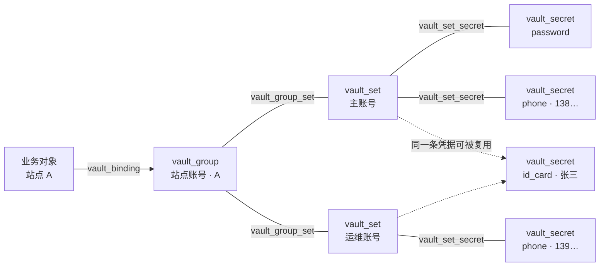

# 凭据保险箱集合层与通用凭据类型方案（v2）

- 状态：**待评审**（按约定先出方案，评审通过后再发布实现任务）
- 目标宿主：0.7.0+
- 涉及：`wb-addon-vault` 0.3.0、`wb-addon-sites` 1.12.0
- 更新：2026-11-15

## 0. 摘要与拍板记录

站点账号真正复用的是一种模式：**一条业务记录（账号）下面挂多条凭据**。本方案在「分组」与「凭据」之间补一层**集合（set）**承载这个模式，并让三者互相**多对多复用**：

- **凭据**是独立实体，可以被多个集合选用（建一条「身份证 · 张三」，多处集合都能加它）；
- **集合**是独立实体，可以被多个分组选用；
- **分组**绑定业务对象，是授权边界。

vault 核心从此不再认识任何业务名词。

| 编号 | 结论 | 来源 |
| --- | --- | --- |
| S1 | 分组与凭据之间新增「集合」层：分组 1:N 集合 1:N 凭据；**一个集合 = 一个账号** | 用户 2026-11-15 |
| S2 | 凭据、集合、分组都是**可复用实体**，关系是**多对多**，用关联表表达（同 `tag_mapping` 的思路），不用外键列 | 用户 2026-11-15 |
| S3 | 集合内同类型可以有多条凭据（两条手机号合法）；只是同一条凭据不能重复加入同一集合 | 用户 2026-11-15 |
| S4 | 删除业务专属 kind `site-account`；新增 `phone`（手机号）、`id_card`（身份证号）；`password` 即「账号密码」 | 用户 2026-11-15 |
| S5 | **不做** `external_ref`：业务标识（如站点账号 id）留在业务模块自己的表里，vault 只存关联 | 用户 2026-11-15 |
| S6 | 站点旧数据是测试数据，**清空即可**，不写站点侧迁移分支；vault 的通用迁移仍要能跑真实凭据 | 用户 2026-11-15 |
| S7 | 第 14 节四点（全局唯一名、删层只删关联、集合带 color/description、plugin 以 accountId 作集合名）按本方案设计执行 | 用户 2026-11-15「就按你的设计来」 |

术语：**分组 group ⊃（多对多）集合 set ⊃（多对多）凭据 secret**。

### 0.1 实施基线

以 `wb-addon-vault 0.2.3` 为起点（该版本已把界面标签、能力清单与 schema 描述统一到六种 kind，见提交 `0b53b3d`），在此基础上做集合层与类型收口。

### 0.2 v2 相对 v1 的变更

| 项 | v1 | v2 |
| --- | --- | --- |
| 归属方式 | `vault_secret.set_id`、`vault_set.group_id` 外键列 | 改为两张关联表 `vault_set_secret`、`vault_group_set` |
| 复用性 | 一条凭据只能属于一个集合 | 一条凭据可被多个集合选用；一个集合可加入多个分组 |
| 业务标识 | 集合带 `external_ref` | 去掉；业务模块自己存 `setId` |
| 唯一性 | 凭据集合内唯一 | 凭据名**全局唯一**（可复用实体必须能被全局检索） |
| 站点迁移 | R1/R2 二选一 | 直接清空重录，不写站点迁移分支 |

## 1. 要解决的问题

### 1.1 现状只有两层，账号结构只能硬拼

当前是 `vault_group` → `vault_secret` 两层（`packages/addons/vault/lib/db/db.js` 的 `VAULT_DDL`），且 `vault_secret` 用 `group_id` 单列归属。站点要表达「一个账号挂密码/手机号/证件号」，只能同时依赖三套约定：

1. `name` 长串：`site.<siteId>.<accountId>.<field>`（`packages/addons/sites/lib/infra/vault-link.js:67`）；
2. `meta` 里塞 `{siteId, accountId, field}`；
3. 业务专属 kind：`site-account`。

结果 vault 核心认识了「站点」，且**凭据天然不可复用**——每条凭据被 `group_id` 焊死在一个组里。

### 1.2 站点专属硬编码清单

| 位置 | 现状 | 处理 |
| --- | --- | --- |
| `packages/addons/vault/lib/domain/vault.js:30` | `KINDS` 含 `"site-account"` | 删除该值 |
| `packages/addons/vault/lib/domain/vault.js:74` | 报错文案列 `site-account` | 同步为七种通用类型 |
| `packages/addons/vault/lib/domain/actions.js:5` | 第二份 `KINDS` 数组 | 同步 |
| `packages/addons/vault/lib/domain/actions.js:410-411` | `/^site\.[^.]+(\.[^.]+){2,}$/` 与站点专属报错 | 整段删除 |
| `packages/addons/sites/lib/infra/vault-link.js:67,83` | 拼长名、`kind: "site-account"` | 改为集合接口 |

### 1.3 现有约束

- `vault_secret.name` 目前是**全局**唯一索引（`uk_vault_secret_name`）。v2 保留这个语义（可复用实体必须全局可检索），但要去掉 `group_id` 单列；
- 同步声明 `uniqueKeys: [["id"], ["name"]]`（`packages/addons/vault/lib/index.js:42`）保持不变，新增两张关联表各需自己的复合键。

## 2. 目标与非目标

**目标**

1. 新增集合层与两张关联表，凭据/集合/分组三者多对多复用；
2. vault 核心不再出现业务专属 kind 与业务专属命名规则；
3. 添加/移除关联**不触发重加密**（关联不进 AAD）；
4. 旧数据（含 `site-account`）可重入迁移，迁移前后都不丢凭据；
5. 站点改为「站点绑定分组；账号 = 集合（id 存在站点表）；字段 = 凭据」。

**非目标**

- 不改 KDF、口令、解锁模式与 DEK 包裹逻辑；
- 不做集合级或凭据级独立授权（授权边界仍在分组）；
- 不引入「每模块自定义 kind」；
- 不写站点侧数据迁移（测试数据清空）。

## 3. 数据模型

### 3.1 实体与关系



- **分组**负责授权：业务对象通过 `vault_binding` 绑组；
- **集合**负责组织：从凭据库里挑选凭据加入；
- **凭据**负责存储：独立实体、独立密文、独立显形与轮换。

### 3.2 新表 `vault_set`

```sql
CREATE TABLE IF NOT EXISTS vault_set (
  id          TEXT PRIMARY KEY,
  name        TEXT NOT NULL,
  description TEXT NOT NULL DEFAULT '',
  color       TEXT,
  created_at  INTEGER NOT NULL,
  updated_at  INTEGER NOT NULL,
  deleted_at  INTEGER,
  rev         INTEGER NOT NULL DEFAULT 1
);
CREATE UNIQUE INDEX IF NOT EXISTS uk_vault_set_name ON vault_set(name) WHERE deleted_at IS NULL;
```

集合不带 `group_id`，归属完全由 `vault_group_set` 表达——同一个集合可以同时出现在多个分组里。

### 3.3 两张关联表

```sql
-- 集合 ↔ 分组
CREATE TABLE IF NOT EXISTS vault_group_set (
  id         TEXT PRIMARY KEY,
  group_id   TEXT NOT NULL,
  set_id     TEXT NOT NULL,
  created_at INTEGER NOT NULL,
  updated_at INTEGER NOT NULL,
  deleted_at INTEGER,
  rev        INTEGER NOT NULL DEFAULT 1
);
CREATE UNIQUE INDEX IF NOT EXISTS uk_vault_group_set
  ON vault_group_set(group_id, set_id) WHERE deleted_at IS NULL;
CREATE INDEX IF NOT EXISTS idx_vault_group_set_group ON vault_group_set(group_id);
CREATE INDEX IF NOT EXISTS idx_vault_group_set_set ON vault_group_set(set_id);

-- 集合 ↔ 凭据
CREATE TABLE IF NOT EXISTS vault_set_secret (
  id         TEXT PRIMARY KEY,
  set_id     TEXT NOT NULL,
  secret_id  TEXT NOT NULL,
  created_at INTEGER NOT NULL,
  updated_at INTEGER NOT NULL,
  deleted_at INTEGER,
  rev        INTEGER NOT NULL DEFAULT 1
);
CREATE UNIQUE INDEX IF NOT EXISTS uk_vault_set_secret
  ON vault_set_secret(set_id, secret_id) WHERE deleted_at IS NULL;
CREATE INDEX IF NOT EXISTS idx_vault_set_secret_set ON vault_set_secret(set_id);
CREATE INDEX IF NOT EXISTS idx_vault_set_secret_secret ON vault_set_secret(secret_id);
```

两张表都用软删除（`deleted_at`），与 `vault_binding` 一致，便于同步层的 tombstone 语义。

### 3.4 `vault_secret` 改造

```sql
-- 去掉单列归属：凭据不再属于某个组
-- SQLite 不支持 DROP COLUMN 的旧版本用重建表；宿主内置 SQLite 版本支持 ALTER TABLE DROP COLUMN
ALTER TABLE vault_secret DROP COLUMN group_id;
```

- 保留全局唯一索引 `uk_vault_secret_name`；
- 去掉 `idx_vault_secret_group`；
- `set_id` 不再引入（v1 的字段方案废弃）。

### 3.5 唯一性与删除语义

| 实体 | 唯一性 | 删除时的级联 |
| --- | --- | --- |
| `vault_secret.name` | 全局唯一（软删不占位） | 软删凭据 → 软删它在所有 `vault_set_secret` 中的关联；挂着的集合不会被删 |
| `vault_set.name` | 全局唯一（软删不占位） | 软删集合 → 软删所有 `vault_group_set` 与 `vault_set_secret` 关联；凭据保留 |
| `vault_group.name` | 全局唯一（现状不变） | 软删分组 → 软删 `vault_binding` 与 `vault_group_set`；集合与凭据保留 |
| 关联行 | 复合唯一（软删不占位） | 删关联不影响两端实体 |

**关键不变量**：删除任何一层都不会删除下层实体，只删关联。这是「可复用」的前提。

## 4. 凭据类型（kind）

| kind | 界面标签 | 说明 |
| --- | --- | --- |
| `password` | 密码 | 账号密码 |
| `phone` | 手机号 | **新增** |
| `id_card` | 身份证号 | **新增** |
| `token` | Token | 访问令牌 |
| `app_password` | 应用专用密码 | 授权码一类 |
| `api_key` | API Key | 接口密钥 |
| `other` | 其它 | 兜底 |
| ~~`site-account`~~ | — | **删除** |

同一集合内允许存在多条同类型凭据（例如两个手机号），因为集合里装的是**引用**，而每条凭据本身在全局是唯一实体。

## 5. 命名与 AAD

- **命名**：凭据名由用户或调用方给定，全局唯一，例如「身份证 · 张三」「公司邮局授权码」；
- **AAD 不变**：`secretAad(id, name, kind)` = `"vault:" + id + ":" + name + ":" + kind`（`packages/addons/vault/lib/infra/crypto.js:50-52`）；
- **推论**：`name`/`kind` 改动要重加密；**建/拆集合关系、加/移分组关系都不在 AAD 里，不触发重加密**——这正是用关联表而不是外键列的核心收益。

## 6. 迁移（0.2.x → 0.3.0）

### 6.1 触发时机

迁移需要 DEK，只能**在解锁之后**执行：`unlock()` 成功后检查 `vault_header.schema_version < 3`，是则同步执行迁移，完成后写 `schema_version = 3`。

迁移完成前：读正常（`secretReveal` 用行上 `name`/`kind` 组 AAD）；写一律走新规则，`site-account` 不再被 `assertKind` 接受。

### 6.2 步骤（可重入、幂等）

1. 建 `vault_set`、`vault_group_set`、`vault_set_secret` 三张表与索引；
2. 对每个**仍有直属凭据**的旧分组（`SELECT DISTINCT group_id FROM vault_secret WHERE group_id IS NOT NULL`）：
   - 建一个集合 `name = 分组名 + " · 默认"`（若已存在则复用）；
   - `vault_group_set` 关联该集合与该分组；
   - 把该组直属凭据逐条 `vault_set_secret` 关联进这个集合；
3. 处理 `kind = 'site-account'` 的行：按 `name` 的 `site.<siteId>.<accountId>.<field>` 解析出 accountId 与 field，同一 accountId 收进同一个集合（`name = accountId`），并**重加密**：
   - `field` 映射 kind：`password → password`、`phone → phone`、`identity → id_card`；
   - `plain = open(dek, ct, secretAad(id, oldName, 'site-account'))`；
   - `newCt = seal(dek, plain, secretAad(id, newName, newKind))`；
   - 解析失败的归入该组「默认」集合，kind 置 `other`，记日志；
4. 全部完成后 `ALTER TABLE vault_secret DROP COLUMN group_id` 并写 `schema_version = 3`。

整批在一个事务内；任一步失败整批回滚、`schema_version` 保持 2，下次解锁重试。

### 6.3 站点侧

用户确认站点数据是测试数据：**不写站点迁移分支**。升级后站点账号到集合的映射为空，重新填写即可。vault 的通用迁移（6.2 第 1–4 步）仍然实现，因为生产库里可能有真实凭据（token/api_key 等非站点数据）。

## 7. Action 变更

### 7.1 新增

| action | origin | 说明 |
| --- | --- | --- |
| `vault.setList` | ui/agent/plugin | `{q?, groupId?}` 集合清单（含凭据数，不含明文） |
| `vault.setGet` | ui/agent/plugin | `{id}` 单个集合 + 内含凭据摘要 |
| `vault.setCreate` | ui | `{name, description?, color?}` |
| `vault.setUpdate` | ui | `{id, name?, description?, color?}` |
| `vault.setDelete` | ui | `{id}` 软删集合及其关联，不删凭据 |
| `vault.setAttachSecret` | ui/plugin | `{setId, secretId}` 幂等加入 |
| `vault.setDetachSecret` | ui/plugin | `{setId, secretId}` 幂等移出 |
| `vault.groupAttachSet` | ui | `{groupId, setId}` 幂等加入 |
| `vault.groupDetachSet` | ui | `{groupId, setId}` 幂等移出 |

### 7.2 改造

| action | 变更 |
| --- | --- |
| `vault.secretList` | 增加 `setId?`、`groupId?` 过滤（走关联表 join） |
| `vault.pluginSecretUpsert` | 参数改为 `{subjectType, subjectId, setName, name, kind, secret, meta?}`：按 `setName`（业务侧账号 id）在该 subject 已绑定组内幂等建/取集合，再全局按 `name` 幂等写入凭据并加入集合 |
| `vault.pluginSecretDelete` | 改为 `{subjectType, subjectId, setName, name}`：只解除关联并软删由该 subject 写入的凭据 |
| `vault.pluginSetGet` | **新增（plugin）**：`{subjectType, subjectId, setName}` 取业务侧对应的集合 id |

`assertPluginSecretName`（`packages/addons/vault/lib/domain/actions.js:410-411`）整段删除。

### 7.3 权限矩阵（新增部分）

- 集合增删改、分组↔集合关联：仅 `ui`；
- 集读取、集合内凭据清单：`ui`/`agent`/`plugin`；
- `pluginSecretUpsert/Delete`、`pluginSetGet`：仅 `plugin`，且只能操作自己 subject 已绑定组内的集合。

## 8. 同步

`packages/addons/vault/lib/index.js` 的 `sync.tables` 增加三张：

```js
{ name: "vault_set", mode: "row", uniqueKeys: [["id"], ["name"]], uniquePolicy: "lww-tombstone" },
{ name: "vault_group_set", mode: "row", uniqueKeys: [["id"], ["group_id", "set_id"]], uniquePolicy: "lww-tombstone" },
{ name: "vault_set_secret", mode: "row", uniqueKeys: [["id"], ["set_id", "secret_id"]], uniquePolicy: "lww-tombstone" }
```

三张表都只存结构与引用、不含密文，随云同步不会泄露明文。

## 9. 站点改造（`wb-addon-sites` 1.12.0）

| 现在 | 改为 |
| --- | --- |
| 站点绑定一个分组 | 不变 |
| 一条账号 = 三条 `site.<id>.<acc>.<field>` 凭据 | 一条账号 = 一个集合；`site_account` 新增 `vault_set_id` 存集合 id |
| `vault-link.js:67` 拼长名 | 改为 `pluginSecretUpsert({setName: accountId, ...})` |
| `vault-link.js:83` `kind: "site-account"` | 分别传 `password`/`phone`/`id_card` |
| `flagsOfSite` 按 `meta.accountId` 聚合 | 改为按账号行的 `vault_set_id` → `setGet` 取凭据摘要 |
| 账号详情显形逐个 `secretReveal` | 不变 |

`site_account.vault_set_id` 是业务侧字段，与 `vault` 表无外键；集合被删时站点侧只显示「凭据集合已失效」。

## 10. 界面

- **凭据库**：全局凭据列表（不再按组过滤），可搜索、可显形、可轮换；
- **集合页**：集合列表 → 进入集合 → 「添加凭据」从凭据库里多选加入、可移出；
- **分组页**：分组列表 → 「添加集合」从集合库里多选加入、可移出；分组仍展示绑定的业务对象；
- **类型下拉**：7 项，含「手机号」「身份证号」，不再出现 `site-account`。

## 11. 分期

| 阶段 | 内容 | 预估 |
| --- | --- | --- |
| P1 | vault 建表（集合 + 两张关联表）+ kind 收口 + 迁移框架 | 1d |
| P2 | set/attach 系列 action + plugin 写接口改造 + 单测 | 1d |
| P3 | sites 1.12.0 切换到集合（`vault_set_id`） | 0.5d |
| P4 | UI：凭据库 / 集合页 / 分组页三层 + 多选关联 | 1d |
| P5 | 文档同步、构建安装、profile 验收 | 0.5d |

## 12. 验收

1. 建一条「身份证 · 张三」凭据，可同时加入两个不同集合，两个集合都能显形出同一明文；
2. 一个集合可同时挂在两个分组下，两个分组都能读到其中的凭据；
3. 集合内可放两条 `phone` 凭据，互不冲突；同一条凭据重复加入同一集合幂等（不产生第二行关联）；
4. 删除分组/集合不删除凭据；删除凭据后所有集合都不再显示它；
5. 凭据列表里不再出现 `site-account`，也不出现 `site.xxx.yyy.password` 长名；
6. 旧 `site-account` 数据迁移后仍可显形；
7. `schema_version` 迁移到 3 后重复解锁不重复迁移；
8. `pnpm test:vault`、`pnpm test:sites`、`build:clients`、`audit:structure`、`audit:lines` 通过；
9. 两设备同步后集合、关联与凭据一致。

## 13. 风险与回滚

| 风险 | 影响 | 对策 |
| --- | --- | --- |
| 迁移需 DEK，用户长期不解锁 | 旧行不可写 | 读路径不依赖迁移；界面提示「请先解锁以完成升级」 |
| `site-account` 改名 + 改 kind 需重加密 | 一次写放大 | 事务分批，失败整批回滚 |
| 多对多关联使「谁能看到这条凭据」变复杂 | 授权推理成本 | 显形与 lease 一律沿 `subject → group → set → secret` 路径校验，不提供跨路径捷径 |
| 全局唯一名限制 | 用户不能建两条同名凭据 | 显式提示并给建议名；这是可复用实体的必然代价 |
| 回滚到 0.2.3 | 新表仍在、`group_id` 已删 | 不提供反向迁移；回滚需从备份恢复 |

## 14. 已确认（2026-11-15）

用户回复「就按你的设计来」，下列四点按本方案执行：

1. 凭据名与集合名**全局唯一**（软删不占位）—— 接受；界面给冲突提示并建议带语境的名字。
2. 删除任一层只删关联、不删下层实体 —— 接受；这是可复用的前提。
3. 集合带 `color`、`description` —— 按本方案设计。
4. `pluginSecretUpsert` 以业务侧账号 id 作为集合名幂等 —— 接受；界面允许用户改名，后改名不影响幂等键。
