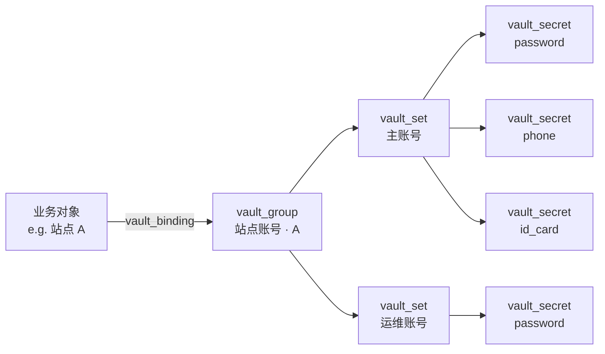

# 凭据保险箱集合层与通用凭据类型方案（v1）

- 状态：**待评审**（按约定先出方案，评审通过后再发布实现任务）
- 目标宿主：0.7.0+
- 涉及：`wb-addon-vault` 0.3.0、`wb-addon-sites` 1.12.0
- 更新：2026-11-15

## 0. 摘要与拍板记录

站点账号真正用到的不是「站点」这个业务概念，而是一种模式：**一条业务记录（一个账号）下面挂多个命名敏感字段**，每个字段单独加密、单独显形，但同属一个账号。邮箱账号（登录密码 + 授权码）、服务器（密码 + 私钥口令）、数据库连接（密码 + 连接串）都是同一个形状。

本方案在「分组」与「凭据」之间补一层**集合（set）**承载这个模式，并删掉业务专属的 `site-account` 类型，让 vault 核心不再认识任何业务名词。

| 编号 | 结论 | 来源 |
| --- | --- | --- |
| S1 | 分组与凭据之间新增「集合」层：分组 1:N 集合 1:N 凭据；**一个集合 = 一个账号** | 用户 2026-11-15 |
| S2 | 删除业务专属 kind `site-account`；新增 `phone`（手机号）、`id_card`（身份证号）；`password` 即「账号密码」，不再另加 `account_password` | 用户 2026-11-15 |
| S3 | 凭据名在**集合内**唯一（退化为 `password`/`phone`/`id_card`）；未入集合的凭据维持原全局唯一 | 建议，**待确认** |
| S4 | `vault_set.external_ref` 存业务侧 id（如站点账号 id），组内唯一 | 建议，**待确认** |
| S5 | 迁移在解锁后触发，可重入幂等；迁移完成前旧行仍可读、但新写入一律用新类型 | 建议，**待确认** |

术语：**分组 group ⊃ 集合 set ⊃ 凭据 secret**。

### 0.1 实施基线

本方案以 `wb-addon-vault 0.2.3` 为起点（该版本已把界面标签、能力清单与 schema 的描述统一到六种 kind，见提交 `0b53b3d`），在此基础上做集合层与类型收口。

## 1. 要解决的问题

### 1.1 现状只有两层，账号结构只能硬拼

当前是 `vault_group` → `vault_secret` 两层（`packages/addons/vault/lib/db/db.js` 的 `VAULT_DDL`）。站点要表达「一个账号挂密码/手机号/证件号」，只能同时依赖三套约定：

1. `name` 长串：`site.<siteId>.<accountId>.<field>`（`packages/addons/sites/lib/infra/vault-link.js:67`）；
2. `meta` 里塞 `{siteId, accountId, field}`；
3. 业务专属 kind：`site-account`。

结果是：**vault 核心认识了「站点」**；换个模块想复用账号模式，只能照抄这套字符串约定，或者再加一种专属 kind。

### 1.2 站点专属硬编码清单

| 位置 | 现状 | 处理 |
| --- | --- | --- |
| `packages/addons/vault/lib/domain/vault.js:30` | `KINDS` 含 `"site-account"` | 删除该值 |
| `packages/addons/vault/lib/domain/vault.js:74` | 报错文案列 `site-account` | 同步为七种通用类型 |
| `packages/addons/vault/lib/domain/actions.js:5` | 第二份 `KINDS` 数组 | 同步 |
| `packages/addons/vault/lib/domain/actions.js:410-411` | `/^site\.[^.]+(\.[^.]+){2,}$/` 与「名称需为 site.&lt;siteId&gt;.&lt;accountId&gt;.&lt;field&gt;」 | 整段删除 |
| `packages/addons/sites/lib/infra/vault-link.js:67,83` | `"site." + siteId + ...`、`kind: "site-account"` | 改为调集合接口 |

### 1.3 两个现有约束会挡住新设计

- **全局唯一名**：`vault_secret` 上有 `uk_vault_secret_name ON vault_secret(name) WHERE deleted_at IS NULL`（全局），三条凭据都叫 `password` 会直接冲突，必须改为按集合唯一。
- **同步唯一键**：`packages/addons/vault/lib/index.js:42` 声明 `uniqueKeys: [["id"], ["name"]]`；命名规则变短后该键会跨集合撞车，必须改成 `["set_id", "name"]`。

## 2. 目标与非目标

**目标**

1. 新增集合层，一个集合承载一个账号的多条字段凭据；
2. vault 核心不再出现任何业务专属 kind 与业务专属命名规则；
3. 凭据名退化为字段名，业务标识全部落在集合上（`external_ref`）；
4. 旧数据（含 `site-account`）可重入迁移，迁移前后都不丢凭据；
5. 站点改为「站点 → 分组，账号 → 集合，字段 → 凭据」，行为对用户保持连续。

**非目标**

- 不改 KDF、口令、解锁模式与 DEK 包裹逻辑；
- 不做「集合级授权」（授权粒度仍在分组，`vault_binding` 只绑组）；
- 不引入「每个模块自定义 kind」或「自定义字段清单」——本次先把类型收口成通用集合，字段仍由 kind 表达；
- 不动 `vault_subject_type` 表结构（本次不需要声明字段清单）。

## 3. 数据模型

### 3.1 三层结构



- **分组**：一类凭据一组，绑定业务对象（`vault_binding`），负责授权边界；
- **集合**：组内的一个账号/一套凭据包，负责「哪几条凭据属于同一个东西」；
- **凭据**：集合内的单条字段，独立加密、独立显形、独立轮换。

### 3.2 新表 `vault_set`

```sql
CREATE TABLE IF NOT EXISTS vault_set (
  id           TEXT PRIMARY KEY,
  group_id     TEXT NOT NULL,
  name         TEXT NOT NULL,
  external_ref TEXT,
  meta         TEXT NOT NULL DEFAULT '{}',
  sort_order   INTEGER NOT NULL DEFAULT 0,
  created_at   INTEGER NOT NULL,
  updated_at   INTEGER NOT NULL,
  deleted_at   INTEGER,
  rev          INTEGER NOT NULL DEFAULT 1
);
CREATE UNIQUE INDEX IF NOT EXISTS uk_vault_set_name
  ON vault_set(group_id, name) WHERE deleted_at IS NULL;
CREATE UNIQUE INDEX IF NOT EXISTS uk_vault_set_ref
  ON vault_set(group_id, external_ref) WHERE deleted_at IS NULL AND external_ref IS NOT NULL;
CREATE INDEX IF NOT EXISTS idx_vault_set_group ON vault_set(group_id, deleted_at);
```

字段说明：

| 列 | 用途 |
| --- | --- |
| `group_id` | 所属分组；集合不能跨组 |
| `name` | 集合名，组内唯一（如「主账号」） |
| `external_ref` | 业务侧对象 id（如站点账号 id）；组内唯一、可空 |
| `meta` | 非敏感备注；准入规则与 `vault_secret.meta` 一致（禁止 `pass/pwd/token/secret/api_key/credential` 键名） |
| `sort_order` | 界面排序 |

### 3.3 `vault_secret` 改造

```sql
ALTER TABLE vault_secret ADD COLUMN set_id TEXT;
CREATE INDEX IF NOT EXISTS idx_vault_secret_set ON vault_secret(set_id, deleted_at);

-- 旧：CREATE UNIQUE INDEX uk_vault_secret_name ON vault_secret(name) WHERE deleted_at IS NULL
DROP INDEX IF EXISTS uk_vault_secret_name;
-- 入集合的凭据：集合内唯一
CREATE UNIQUE INDEX IF NOT EXISTS uk_vault_secret_in_set
  ON vault_secret(set_id, name) WHERE deleted_at IS NULL AND set_id IS NOT NULL;
-- 未入集合的凭据：保持原全局唯一（兼容 token/api_key 这类独立凭据）
CREATE UNIQUE INDEX IF NOT EXISTS uk_vault_secret_loose
  ON vault_secret(name) WHERE deleted_at IS NULL AND set_id IS NULL;
```

- `group_id` **保留**：一是按组查询与同步冲突判定不变，二是集合被删时凭据可回落到组；写入时必须与所属集合的 `group_id` 一致，集合改组时级联更新。
- `set_id` 可空：单独存的 token/api_key 不必强行归入集合。

### 3.4 与绑定、注册表的关系

`vault_binding` 仍然只绑**分组**，不新增集合级绑定：授权边界保持在「一类凭据一组」，集合只是组内的组织方式。`vault_subject_type` 本次不改。

## 4. 凭据类型（kind）

| kind | 界面标签 | 说明 |
| --- | --- | --- |
| `password` | 密码 | 账号密码（登录密码） |
| `phone` | 手机号 | **新增** |
| `id_card` | 身份证号 | **新增** |
| `token` | Token | 访问令牌 |
| `app_password` | 应用专用密码 | 授权码一类 |
| `api_key` | API Key | 接口密钥 |
| `other` | 其它 | 兜底 |
| ~~`site-account`~~ | — | **删除**（改由「集合 + 上述类型」表达） |

变更点：`packages/addons/vault/lib/domain/vault.js:30`、`packages/addons/vault/lib/domain/vault.js:74`、`packages/addons/vault/lib/domain/actions.js:5` 三处同步；客户端 `KIND_LABEL`（0.2.3 起在共享模块里）增加「手机号」「身份证号」。

## 5. 命名与 AAD

- **命名**：集合内凭据的 `name` 直接是字段名（`password`/`phone`/`id_card`），由 vault 生成，调用方不再拼字符串；未入集合的凭据沿用旧名。
- **AAD 不变**：`secretAad(id, name, kind)` = `"vault:" + id + ":" + name + ":" + kind`（`packages/addons/vault/lib/infra/crypto.js:50-52`）。
- **推论**：`name` 与 `kind` 都在 AAD 里，**只要改这两者就必须用 DEK 重新 seal**。因此：新建时天然正确；迁移时必须先解锁。`set_id` 不在 AAD 里，挂集合/换集合**不需要重加密**——这是选它当分组维度而不是把集合写进 AAD 的原因。

## 6. 迁移（0.2.x → 0.3.0）

### 6.1 触发时机

迁移需要 DEK，所以**只能在解锁之后执行**。设计为 `unlock()` 成功后检查 `vault_header.schema_version`：小于 3 则同步执行迁移，成功后写 `schema_version = 3`。

在迁移完成前：

- **读**：正常。`secretList` 不解密；`secretReveal` 用行上存储的 `name`/`kind` 组 AAD，旧行照样解得开。
- **写**：一律走新规则，`site-account` 不再被 `assertKind` 接受（`assertKind` 只在写入路径调用）。

### 6.2 步骤（可重入、幂等）

对每条 `kind = 'site-account'` 且 `set_id IS NULL` 的行：

1. 解析 `name`，形如 `site.<siteId>.<accountId>.<field>`；
   - 解析失败 → 记 `log`，归入该组下的「未分类」集合（`external_ref = null`，`name = '未分类'`），不阻断其它行；
2. 在 `group_id` 下按 `external_ref = accountId` 找集合，没有则创建（`name = accountId`，后续由站点侧改名为 `accountKey`）；
3. `field` 映射 kind：`password → password`、`phone → phone`、`identity → id_card`；
4. `plain = open(dek, ciphertext, secretAad(id, oldName, 'site-account'))`；
5. `newCt = seal(dek, plain, secretAad(id, field, newKind))`；
6. `UPDATE vault_secret SET name = ?, kind = ?, set_id = ?, ciphertext = ?, rev = rev + 1`；
7. 集合内已存在同名存活行 → 冲突消解：保留 `updated_at` 较大的一条，另一条软删并记日志。

全部完成后再写 `schema_version = 3`。整个过程在一个事务内，任一步抛错则整批回滚、`schema_version` 保持 2，下次解锁重试。

### 6.3 站点模拟数据的简化路径

用户已确认站点凭据目前是模拟数据。因此站点侧提供两条路径，**待确认选哪条**：

- **R1 迁移**：按 6.2 正常搬迁，站点侧把集合名改成 `accountKey`；
- **R2 清空重录**：直接把 `site-account` 的旧行软删，站点账号的敏感字段重新填一次。省掉 6.2 的站点分支，但要求用户接受「老值全丢」。

无论哪条，vault 的通用迁移（6.2 的 1–7）都要实现，因为生产库可能还有真实凭据。

## 7. Action 变更

### 7.1 新增

| action | origin | 说明 |
| --- | --- | --- |
| `vault.setList` | ui/agent/plugin | `{groupId?, q?}` 集合清单（含凭据数与类型构成，不含明文） |
| `vault.setGet` | ui/agent/plugin | `{id}` 单个集合 |
| `vault.setCreate` | ui | `{groupId, name, externalRef?, meta?, sortOrder?}` |
| `vault.setUpdate` | ui | `{id, name?, externalRef?, meta?, sortOrder?}` |
| `vault.setDelete` | ui | `{id, purgeSecrets?}`：默认把集合内凭据移出集合（`set_id = NULL`）而不是删除 |
| `vault.setSecrets` | ui/agent/plugin | `{setId}` 集合内凭据清单，不含明文 |

### 7.2 改造

| action | 变更 |
| --- | --- |
| `vault.secretList` | 增加 `setId?` 过滤；返回增加 `setId`/`setName` |
| `vault.secretCreate` | 增加 `setId?`；给了 `setId` 时 `name` 必须是该集合内未占用的字段名 |
| `vault.secretUpdate` | 增加 `setId?`（换集合不重加密） |
| `vault.pluginSecretUpsert` | 参数从「调用方拼 name」改为 `{subjectType, subjectId, groupId?, setId?, externalRef?, field, kind, secret, meta?}`；`name` 由 vault 生成为 `field`；校验 `setId` 所属组必须在该 subject 的绑定集合里 |
| `vault.pluginSecretDelete` | 同步改为按 `setId + field` 删除 |
| `vault.pluginSetUpsert` | **新增（plugin）**：`{subjectType, subjectId, groupId?, externalRef, name?, meta?}`，按 `externalRef` 幂等建/取集合，返回 `{id, created}` |

`assertPluginSecretName`（`packages/addons/vault/lib/domain/actions.js:410-411`）整段删除，替换为「字段名白名单 + 集合归属校验」。

### 7.3 权限矩阵（新增部分）

- 集合的增删改：仅 `ui`；
- 集合读取：`ui`/`agent`/`plugin`；
- `pluginSetUpsert`：仅 `plugin`，且只能写自己 subject 已绑定的组。

## 8. 同步

`packages/addons/vault/lib/index.js` 的 `sync.tables` 增加：

```js
{ name: "vault_set", mode: "row", uniqueKeys: [["id"], ["group_id", "name"]], uniquePolicy: "lww-tombstone" }
```

同时 `vault_secret` 的唯一键从 `[["id"], ["name"]]` 改为 `[["id"], ["set_id", "name"]]`。

⚠️ `set_id` 可空，同步层对含 NULL 的复合唯一键行为需实测；若宿主侧不支持，退化为 `[["id"]]` + 应用层校验（`set_id` 为空的行仍靠 `uk_vault_secret_loose` 兜住）。

## 9. 站点改造（`wb-addon-sites` 1.12.0）

| 现在 | 改为 |
| --- | --- |
| 站点绑定一个分组 | 不变 |
| 一条账号 = 三条 `site.<id>.<acc>.<field>` 凭据 | 一条账号 = 一个集合（`external_ref = accountId`），三条凭据 `password`/`phone`/`id_card` |
| `vault-link.js:67` 拼长名 | 改为 `pluginSetUpsert` + `pluginSecretUpsert({setId, field})` |
| `vault-link.js:83` `kind: "site-account"` | 分别传 `password`/`phone`/`id_card` |
| `flagsOfSite` 按 `meta.accountId` 聚合 | 改为按集合的 `external_ref` 聚合 |
| 账号详情显形逐个 `secretReveal` | 不变（先 `setSecrets` 拿 id 再逐条显形） |

## 10. 界面

- **凭据页**：列表增加「集合」列；筛选增加按集合；
- **分组页 → 集合**：分组下展开集合，集合下展开凭据（三层树）；
- **类型下拉**：增加「手机号」「身份证号」，共 7 项；不再出现 `site-account`；
- **集合表单**：名称、外部引用（只读时展示）、备注、排序。

## 11. 分期

| 阶段 | 内容 | 预估 |
| --- | --- | --- |
| P1 | vault 建表/迁移框架 + kind 收口 + 命名规则（不动 sites） | 1d |
| P2 | set 系列 action + plugin 写接口改造 + 单测 | 1d |
| P3 | sites 1.12.0 切换到集合 | 0.5d |
| P4 | UI 三层导航 + 类型下拉 | 0.5d |
| P5 | 文档同步、构建安装、profile 验收 | 0.5d |

## 12. 验收

1. 新建站点账号 → 分组下出现一个集合，集合内有 3 条凭据，`kind` 分别为 `password`/`phone`/`id_card`；
2. 凭据列表里不再出现 `site-account`，也不出现 `site.xxx.yyy.password` 这种长名；
3. 集合内 `password` 唯一；不同集合各有 `password` 互不冲突；
4. 锁定后显形被拒；解锁后显形正常，明文不出现在列表/日志/agent 返回；
5. 旧 `site-account` 数据迁移后仍可显形（选 R1 时）；
6. `schema_version` 迁移到 3 后重复解锁不重复迁移（幂等）；
7. `pnpm test:vault`、`pnpm test:sites`、`build:clients`、`audit:structure`、`audit:lines` 通过；
8. 两设备同步后集合与凭据一致，`set_id` 未被同步层丢弃。

## 13. 风险与回滚

| 风险 | 影响 | 对策 |
| --- | --- | --- |
| 迁移需 DEK，用户长期不解锁 | 旧行不可写、只能读 | 读路径不依赖迁移；界面对未迁移库提示「请先解锁以完成升级」 |
| `name`/`kind` 在 AAD 里，迁移必须全量重加密 | 一次写放大 | 分批 + 事务；失败整批回滚，可重入 |
| 同步复合唯一键含 NULL 行为不确定 | 可能出现重复行 | 见 §8 的退化方案 |
| 站点侧改动跨两个插件 | 版本必须同批发布 | 版本门禁：sites 1.12.0 检测 vault < 0.3.0 时拒绝写集合，退回旧写入 |
| 回滚 | 0.3.0 → 0.2.3 后新表/新列仍在 | 旧代码忽略 `vault_set` 与 `set_id`；但已改名的凭据仍可读（AAD 用行上值），不提供反向迁移 |

## 14. 待确认

1. S3 集合内凭据名唯一（`password`/`phone`/`id_card`）—— 确认？
2. S4 集合带 `external_ref` —— 确认？
3. §6.3 站点旧数据走 R1（迁移）还是 R2（清空重录）？
4. 集合是否需要「集合级」显形/授权粒度？本方案按「不需要，授权仍在分组」设计。
