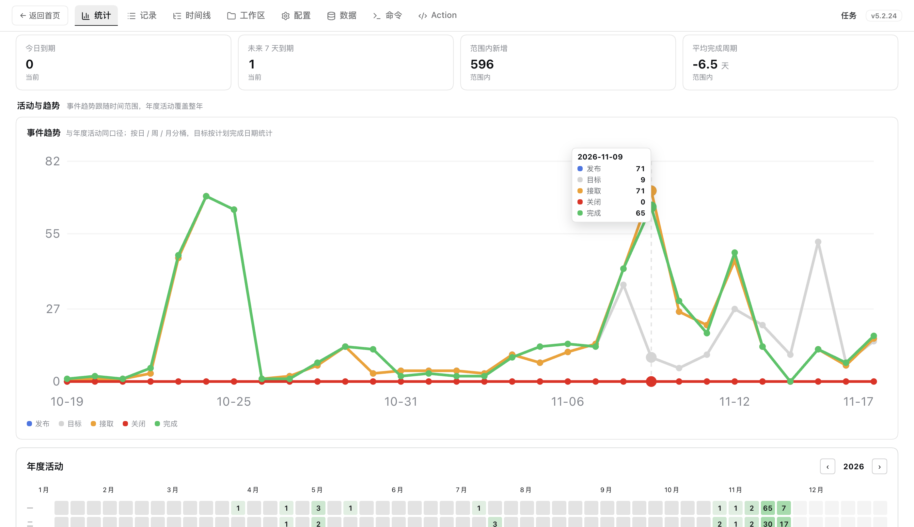
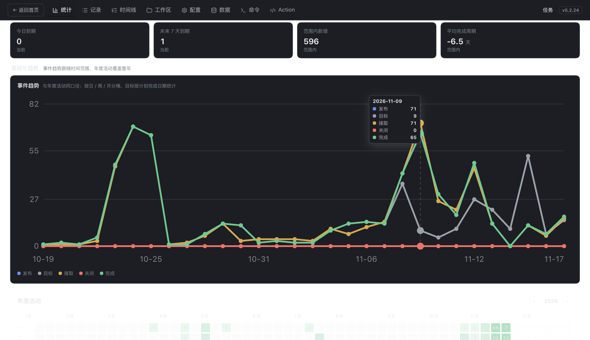

# 52 · 统计图表交互：事件趋势折线图

> 对应任务：`01a1e8a6-80f5-7445-91ee-0696acb42951`「事件趋势折线图加图例开关与按日期取值提示，序列顺序改为发布→目标→接取→关闭→完成」
> 落地版本：任务插件 5.2.24（`packages/addons/tasks`）

## 1. 用户诉求

1. 图例能选择哪些类型的线显示、哪些不显示；
2. 能看到某个日期下的具体数值；
3. 序列顺序为：发布、目标、接取、关闭、完成。

## 2. 范围与落点

| 关注点 | 落点 |
| --- | --- |
| 交互纯逻辑 | `packages/addons/tasks/client/stats/trend-interaction.cjs`（不引 React、不碰 DOM） |
| 组件 | `packages/addons/tasks/client/stats/charts.cjs` 的 `Trend` |
| 序列定义 | `packages/addons/tasks/client/views/stats.cjs` 的事件趋势卡 |
| 回归 | `scripts/test-task-event-trend.mjs`、`scripts/test-task-trend-interaction.mjs` |

`Trend` 只有事件趋势卡一个调用方（旧「新增/完成/到期趋势」卡已在 5.2.21 删除），改它不影响其它卡。

## 3. 序列顺序与配色

顺序按用户要求重排，**颜色跟着含义走、不跟着位置走**——换序不换色，否则读者要重新认一遍颜色。

| 位置 | key | 中文 | 英文 | 颜色 |
| --- | --- | --- | --- | --- |
| 1 | `publish` | 发布 | Published | `colors[0]` |
| 2 | `target` | 目标 | Target | `colors[5]` |
| 3 | `claimed` | 接取 | Claimed | `colors[2]` |
| 4 | `shutdown` | 关闭 | Closed | `colors[3]` |
| 5 | `done` | 完成 | Done | `colors[1]` |

## 4. 图例开关

- 图例项从 `span` 改为 `<button type="button" aria-pressed="true|false">`，可键盘聚焦与回车触发。
- 隐藏态：整项 `opacity:.45`、圆点从实心变空心（`background:transparent;border:1px solid currentColor`）。
- **至少保留一条**：最后一条可见序列的按钮 `disabled`，并给 `title`「至少要保留一条曲线」，避免空图。
- 隐藏集合只存在 `Trend` 内部（`useState`），不落到配置、不跨会话保存：这是临时观察动作，不是偏好设置。

## 5. 按日期取值

原来的取值入口是 SVG `<title>`（浏览器原生 tooltip）：有悬停延迟、样式不可控、不能同时看多条；更关键的是桶数 > 40 时 `charts.cjs` 会跳过 `i % 3 !== 0` 的数据点，**被跳过的日期完全没有取值入口**。

现在：

1. 每个桶一条**透明命中带** `rect`（宽 = 相邻间距，边缘处裁到绘图区内），覆盖整个绘图高度，接 `onMouseEnter` / `onTouchStart`；
2. 命中后渲染 HTML 覆盖层 `.wbt-trend-tip`：日期 + 每条**可见**序列的「名称 数值」（带各自颜色圆点），隐藏序列不列；
3. 同时画竖直虚线参考线，并把该列数据点 `r` 从 2.4 放大到 4（即使被抽样跳过，选中时也会画出来）；
4. 提示层 `pointer-events:none`，不挡鼠标；`position:absolute` + `left:百分比`，按**容器实际像素**换算，避免 viewBox 缩放误差；
5. 靠边翻转：`left > 72%` 用 `translateX(-100%)`，`left < 18%` 用 `translateX(0)`，其余居中，420px 窄屏也不溢出卡片。

## 6. 键盘可达

- 容器 `role="group"`、`tabIndex=0`、`aria-label` 保留原有合计汇总（只念可见序列）；
- 左右方向键在桶之间移动并同步提示，到头即停（不循环，循环会让人分不清首尾）；
- `Escape` 清除提示，`blur` 也清除；
- SVG 自身 `aria-hidden="true"`，语义统一交给容器，避免读屏重复朗读。

## 7. 量程

y 轴 max 改为**只按可见序列**算（最大值 × 1.15 后向上取整）。否则隐藏掉「发布」的尖峰后，其余四条会被压成一条平线。空数据返回 1，不出 `0` 或 `NaN`。

## 8. 主题与响应式

提示层、参考线、图例态全部走 `--dsw-alias-*` token：提示层底色 `--dsw-alias-bg-layer-1`、边框 `--dsw-alias-border-l2`、阴影用 `color-mix(in srgb, var(--dsw-alias-label-primary) 16%, transparent)`，不写死色值。浅色、深色 token 下提示层与图例都验证过；1440 / 1024 / 768 / 420px 无横向滚动。

真机截图（工作台 → 任务 → 统计，悬停 2026-11-09 这一桶）：

- 浅色：`docs/specs/assets/52-stats-trend/light.png`
- 深色：`docs/specs/assets/52-stats-trend/dark.png` —— **这张是把 `--dsw-alias-*` 换成深色值后在同一实例复拍的**（用时那只验证实例没有主题切换入口），用来确认组件确实吃 token 而不是写死浅色；真实深色主题下的最终观感仍以桌面端切换后为准。

## 9. 非目标

- 不加缩放 / 框选 / 导出 / 拖拽选区；
- 不引入图表库或新依赖，继续自绘 SVG；
- 不改后端 `tasks.statsReport` 的 `eventTrend` 字段与统计口径；
- 不动年度活动热力图。

## 10. 已知取舍

- **分页抽样**：桶数 > 40 时仍不画全部数据点（避免点糊成一片），但命中带保证每个日期都能取值——这比「画所有点」更省渲染，也比原来「跳过就取不到值」更完整。
- **命中带用 `onMouseEnter` 而不是 `onMouseMove`**：只在进入新桶时 setState，避免每移动一像素就重渲染。
- **图例态不持久化**：见第 4 节。
