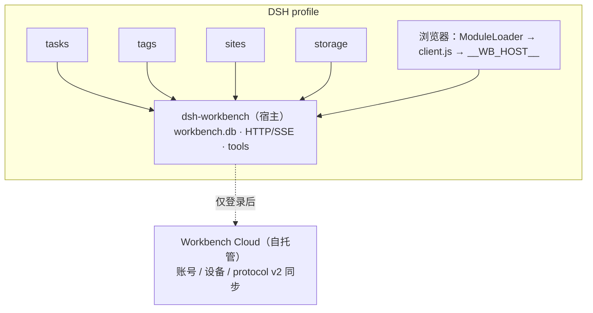

# 个人工作台（Personal Workbench）— 方案总览

> 状态：宿主与 tasks/tags/sites 已落地；新增 storage 原生储物插件。业务数据本地 SQLite，
> 登录后按 protocol v2 与自建云端同步（树表整表覆盖 + 行级 LWW）。本文档集基于
> 本机 DSH 与已装插件源码的实测调查。

## 一句话定位

「个人工作台」是 DSH 里的一个 **共享运行时宿主**：它提供本地 SQLite、HTTP/SSE、
agent 工具、账号与同步、客户端页面框架；任务、标签、站点、储物是四个独立的 DSH 业务插件，
各自向宿主注册数据、action 与视图。安装任意业务插件都会连带安装宿主；
安装/卸载由 DSH 自己管理，没有自建插件市场。



## 快速运行

```bash
# 1. 构建宿主
pnpm install
pnpm build && node scripts/dist-shell.mjs

# 2. 安装到 DSH profile（会同时准备宿主）
dsh plugin --profile web add file:$PWD/packages/shell-dist
dsh plugin --profile web add file:$PWD/packages/addons/tasks
dsh plugin --profile web add file:$PWD/packages/addons/tags
dsh plugin --profile web add file:$PWD/packages/addons/sites
dsh plugin --profile web add file:$PWD/packages/addons/storage

# 3. 重启 dsh web 后：设置 → 插件 → 个人工作台
#    业务插件的安装/卸载同样在 DSH 插件页完成

# 4. 云端（可选，宿主仓库的 cloud/ 子模块；开发期不打应用镜像）
git submodule update --init cloud   # 若 clone 时未加 --recurse-submodules
cd cloud
cp .env.example .env && chmod 600 .env   # 填数据库密码与 MinIO AK/SK
docker compose up -d postgres
set -a; . ./.env; set +a
mvn -DskipTests package
java -jar target/workbench-cloud.jar
```

## 文档导航

| 文档 | 内容 |
| --- | --- |
| [01-总体架构](./01-总体架构.md) | 分层结构、包拆分、命名、关键决策 |
| [02-DSH插件设计](./02-DSH插件设计.md) | 宿主服务、生命周期、manifest、profile 接入 |
| [03-UI设计](./03-UI设计.md) | 卡片首页、沉浸式全页、slot 用法、样式规范 |
| [04-插件体系](./04-子插件体系.md) | 原生包、域注册、客户端模块、安装/卸载、跨插件依赖 |
| [05-本地存储设计](./05-本地存储设计.md) | SQLite schema、迁移策略、目录布局 |
| [06-云端设计](./06-云端设计.md) | 账号、设备、protocol v2 同步 API |
| [07-同步与登录设计](./07-同步与登录设计.md) | 离线优先、变更日志、冲突处理、设备管理 |
| [08-路线图与里程碑](./08-路线图与里程碑.md) | M0~M4 分期交付与验收标准 |
| [09-任务模块迁移方案](./09-任务模块迁移方案.md) | 任务/任务树 1:1 迁移、路径枚举、action 契约与验收 |
| [10-标签模块迁移方案](./10-标签模块迁移方案.md) | 标签 1:1 迁移、软删除、tag_mapping、action 契约与验收 |
| [11-站点模块迁移方案](./11-站点模块迁移方案.md) | 站点/目录树 1:1 迁移、路径枚举、标签与链接、action 契约与验收 |
| [13-插件体系重构方案](./13-插件体系重构方案.md) | 从“自建插件市场”迁移到 DSH 原生插件的决策记录 |
| [14-发布与插件市场](./14-发布与插件市场.md) | 发布树、npm 包名、GitHub 镜像、awesome-dsh-plugin 收录流程 |
| [15-数据备份](./15-数据备份.md) | 按模块导出/导入、zip 格式、版本兼容与部分失败报告 |
| [16-数据同步方案](./16-数据同步方案.md) | 目标 protocol v2：会话锁、时钟校准、按表游标、树整表覆盖、冲突闭环 |
| [17-文件存储设计](./17-文件存储设计.md) | 文件上传、内容寻址、本地/云端存储、S3 后端、字节同步与 GC |
| [18-统计报表设计](./18-统计报表设计.md) | 三个业务插件的统计视图、指标口径、statsReport 契约与索引 |
| [19-业务评审与重构建议](./19-业务评审与重构建议.md) | v0.5 业务模型评审：不合理需求清单、主循环设计、P0/P1/P2 重构路线 |
| [20-配置表与配置页设计](./20-配置表与配置页设计.md) | 三个业务插件的配置存储（复用 meta 键值、不同步不入备份）、configGet/Set/Reset/Options 契约、配置页与配置项目录 |
| [21-数据页设计](./21-数据页设计.md) | 任务/标签/站点只读表浏览的原始设计与 action 契约；四域共享视图重构见 27 |
| [27-存储模块迁移方案](./27-存储模块迁移方案.md) | storage 储物、元数据与标签边界、四域共享数据视图重构、构建发布与验收 |
| [28-储物统计详细设计](./28-物品统计详细设计.md) | 储物统计增强的详细设计（待评审） |

## 已验证的宿主事实（方案地基，非猜测）

以下均来自对本机 `@deepseek-ai/dsh` 及已装插件源码的直接观察：

1. 插件 client bundle 运行在共享 React 上（`react/jsx-runtime`），有 CSS Modules 管道；
   `@deepseek-ai/dsh-client-ui-theme` 提供约 114 个 `--dsw-alias-*` 语义令牌。
2. slot 贡献 API：`slots.inject(id, register)`；实测 id 包括
   `settings.plugins.tab`、`settings.plugin.item`、`sidebar.right.pane.tab`、
   `sidebar.panellist`、`shell.overlay`、`plugins.detail.section`、`plugins.bundle.config`。
3. cordis 服务端形态：包导出 `apply(ctx)` + `export const inject = [...]`，
   清理用 `ctx.effect`。可用服务：`webServer`、`connection`、`tools`、`sessions`、`settings`。
4. dshmarket 有完整 `lib/install.js`、`catalog-npm.js`、`compatibility.js`、
   `drain-journal.js`，说明 DSH 原生安装链路成熟；工作台复用这条链路，
   不再自己下载/解包插件。
5. 本仓库安装约定：profile 直接依赖 + 每包 `cordis.patch.yml`；
   业务包在 `dependencies` 声明宿主，patch 同时插入宿主行与自身行，
   Cordis loader 按 id 折叠重复行。

## 核心决策速览（详见各分册）

| # | 决策 | 选择 | 理由 |
| --- | --- | --- | --- |
| D1 | 主体形态 | 宿主 `dsh-workbench` + 三个独立业务插件 `dsh-workbench-tasks/tags/sites` | 业务可独立安装/卸载；装业务插件自动带宿主 |
| D2 | 本地权威存储 | 直接 `node:sqlite` + WAL，不走 storageDomain JSON | 需要行级变更日志、索引与事务 |
| D3 | 插件协议 | DSH 原生包 + `ctx.workbench.registerDomain`；客户端 ModuleLoader + `__WB_HOST__` | 复用 DSH 安装/激活/依赖解析；宿主只做运行时聚合 |
| D4 | 同步模型 | 离线优先 + `sync_change_log`；A 类行级 LWW，B 类树表 reconcile + 整表 full | 行级冲突面可控；树表保证 sort/path 自洽 |
| D5 | 云端 | Java 21 + Spring Boot 3.4 + PostgreSQL 16 + S3/MinIO，只做账号/设备/数据同步与文件字节 | 与插件分发完全解耦，对象存储可直接换 S3 |
| D6 | 代码库 | 宿主 pnpm monorepo + 独立 `dsh-workbench-cloud` 仓库 | 云端独立构建/部署；宿主与云端只靠 protocol v2 契约耦合 |
