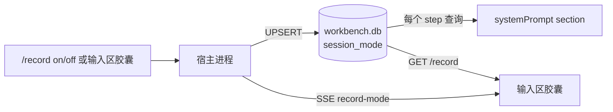

# 会话记录模式（/record）

> 状态：v1，随 dsh-workbench 宿主提供。
> 一句话：给单个 DSH 会话打开一个开关，agent 在完成主任务后，把这次真正可复用的交付物按各插件声明的能力记到个人工作台。

## 1. 定位：它是什么，不是什么

个人工作台已经有任务、站点、标签三套业务插件，也有统一的 Workbench 工具和 61 个 action。缺的从来不是“能不能写”，而是“什么时候写、写什么、由谁决定”。

过去有三种做法，都不太合适：

- **每次手动说“记一下”**：能用，但容易忘；会话一长，收尾时往往已经在处理下一个问题。
- **全局静默采集**：把浏览器历史、会话记录全部倒进工作台。噪声太大，而且会把“访问过”误当成“做过”。
- **写进 preset / skill**：只能规定“怎么记”，不能表达“这个会话现在要不要记”；preset 还会影响新会话的插件组合。

记录模式走中间路线：

> **会话级、显式开启、只记完成的可交付内容、只新增不修改。**

它不新增工具，也不扩大 agent 的能力边界。它改变的是 agent 在每个 step 看到的系统提示，从而改变收尾时的行为。

三个明确的“不是”：

- 不是 preset：不改插件组合，不影响新会话，不需要重启。
- 不是 skill：不需要手动加载，不会因为上下文压缩而消失；开关状态由宿主保存。
- 不是全局采集：只对当前 sessionId 生效，默认关闭，子 agent 不自动继承。

## 2. 快速使用

### 2.1 命令

| 命令 | 行为 |
| --- | --- |
| `/record on` | 开启当前会话的记录模式，并立即把状态写入本机数据库 |
| `/record off` | 关闭当前会话的记录模式；已经写入工作台的数据不受影响 |
| `/record status` | 查看当前会话是开启还是关闭 |
| `/record` | 显示用法和记录边界 |

开启后的回执：

```text
记录模式已开启（仅本会话）。后续我只把完成的可交付内容记到工作台，
不记聊天、日志、密钥和本地地址。
```

关闭后的回执：

```text
记录模式已关闭。之后只有你明确说“记一下”时，我才会写入工作台。
```

### 2.2 输入区胶囊

会话输入区左侧有一个“记录”胶囊，位置在“工作区内修改”右侧：

- 灰点 + “记录”：当前会话未开启。
- 高亮 + “记录中”：当前会话已开启，`aria-pressed="true"`。
- 点击胶囊等同于执行 `/record on` 或 `/record off`；请求进行中会禁用，失败只在 `title` 里提示，不打断输入。

胶囊不是状态的所有者，只是宿主状态的一个视图。命令、HTTP、胶囊三个入口最终都落到同一张表。

### 2.3 状态的生命周期

- 状态按 `sessionId` 保存，刷新页面、重连、重启 DSH 后仍然有效。
- 新会话默认关闭；不同会话互不影响。
- 子 agent 使用自己的 `sessionId`，不会继承父会话的开关。
- 关闭只停止后续注入，不会删除已经记录的任务、站点或标签。

> 命令回执由 DSH 的命令流程渲染。在欢迎页或空会话里，回执可能不显示；这时以输入区胶囊或 `/record status` 为准。

## 3. 它到底做什么

开启后，agent 在每个 step 前会多看到一段“记录模式”规则。规则要求它在完成本轮主要任务后，做一次很轻的收尾：

1. 先查 `capabilities.list`，看有哪些插件、各自能记录什么。
2. 需要字段细节时查 `capabilities.get`，再按需查 `actions.help`。
3. 只记录同时满足 `when`、且不满足 `notFor` 的内容；没有命中就不写。
4. 用对应记录的 `primaryAction` 写入，不猜 action 名。
5. 写入前查重；只新增，不修改、不删除已有数据。
6. 多条记录合并成一行回执，例如“已记录：任务 #42、标签 #7”；失败只提示一次，不阻塞主任务。

它不负责：

- 回扫历史消息，把开启之前的会话补记一遍。
- 把每一轮对话都变成任务。
- 自动创建大量一次性标签。
- 代替用户做任务状态流转、删除、合并。
- 跨设备同步这个开关。

### 3.1 记录边界

| 类型 | 会记 | 不会记 |
| --- | --- | --- |
| 任务 | 已完成的可交付项；明确的下一步 | 纯问答、一次性查询、模糊想法、聊天内容 |
| 站点 | 以后还会访问的外部站点；可复用的入口 | localhost、127.0.0.1、内网地址、临时页、搜索结果页 |
| 标签 | 可复用的主题分类 | 一次性描述、状态词、日期、临时标记 |

统一排除：聊天原文、日志、临时笔记、token/密钥/密码，以及用户明确拒绝记录的内容。

## 4. 原理

### 4.1 状态放在哪里：`session_mode` 表

记录模式的状态是一个布尔值，但它必须由**宿主进程**读取，而不是浏览器：

- `/record` 命令要读写它；
- 每次组装系统提示要读它；
- HTTP 接口和输入区胶囊要读写它。

所以它在 `workbench.db` 里单独占一张小表：

```sql
CREATE TABLE IF NOT EXISTS session_mode (
  session_id TEXT PRIMARY KEY,
  enabled    INTEGER NOT NULL DEFAULT 0,
  updated_at INTEGER NOT NULL
);
```

写入使用 UPSERT：

```sql
INSERT INTO session_mode(session_id, enabled, updated_at) VALUES(?, ?, ?)
ON CONFLICT(session_id) DO UPDATE SET
  enabled = excluded.enabled,
  updated_at = excluded.updated_at;
```

语义：

- 有行且 `enabled = 1`：开启。
- 有行且 `enabled = 0`：关闭。
- 没有行：从未切换过，按关闭处理。

当前实现关闭时保留 `enabled = 0` 的行，所以表里只有“切换过的会话”，不是“所有会话”。如果只想保留开启名单，可以把 `off` 改成 `DELETE`，读取逻辑不需要变；这是后续可以做的简化，不是 v1 的必需项。

这张表放在同一个 SQLite 文件里，但**不进入同步，也不进入备份**：

- 同步只处理各 domain 在 `tables` 里声明的业务表，`session_mode` 不属于任何 domain。
- 备份按 `backupDomains()` 导出 domain 数据，`session_mode` 同样不在其中。

这是有意的：它描述的是“这台机器上这个会话现在的行为”，不是用户的业务数据。

#### 为什么不是其他位置

| 位置 | 问题 |
| --- | --- |
| 浏览器 `localStorage` | 宿主读不到；换窗口、换设备、刷新后的行为不一致 |
| 宿主内存 `Map` | DSH 重启或会话恢复后丢失；多进程/多实例不共享 |
| DSH `session.meta` | 创建时冻结的会话头，插件没有运行时可变字段 |
| preset / AGENTS.md | 只能在会话开始前决定，不能中途开关；preset 还会改变插件组合 |
| task / site 表 | 业务数据会参与同步，且不该为了一个 UI 开关污染业务模型 |
| `sync_state` | 那是同步游标，不是用户偏好 |
| 单独 JSON 文件 | 要另造持久化、并发写、损坏恢复；SQLite 已经都有 |

#### 代价

多一张表、每次 step 一次主键查询。查询是 `WHERE session_id = ?`，有主键索引，成本可以忽略。真正的成本是开启后每次模型请求都会多带一段几百字的规则；只影响开启中的会话。

### 4.2 状态流



三个入口：

- **命令**：`ctx.commands.register` 注册 `record`，handler 里写库并 `emit("record-mode")`。
- **HTTP**：`GET /workbench/api/record?sessionId=...` 读状态；`POST /workbench/api/record` 写状态，body 是 `{ sessionId, enabled }`。
- **胶囊**：挂载时 GET 初始化，点击时 POST 切换，同时订阅 SSE `record-mode`，所以命令执行后胶囊会立刻翻转。

HTTP 对 `sessionId` 为空或超过 200、`enabled` 非布尔返回 400；命令只要求能确定当前会话。

### 4.3 提示注入：一个全局 section，按会话开门

插件在 `apply` 时注册一个系统提示 section：

```ts
sp.section({
  name: "workbench:record-mode",
  order: sp.getSectionOrder("PLAN_POLICY") + 10,
  text: (context) => {
    const sid = String(context?.agent?.session?.id ?? context?.agent?.id ?? "");
    return sid && sessionModeOf(state.db, sid) ? recordPrompt(sid) : "";
  },
});
```

几个关键点：

- **section 只注册一次**，不是每个会话复制一份。它挂在插件的作用域上，所有 agent 组装提示时都会经过它。
- **是否注入由 `text` 回调当场决定**。`context.agent` 提供当前会话；取不到 `sessionId` 就返回空串。
- **开关不需要 attach/detach**。`/record on` 只写数据库，下一次组装自然读到 1；`off` 同理。没有“给 agent 挂一段提示 / 摘一段提示”的生命周期。
- **顺序在 plan policy 之后**。`order` 取 `PLAN_POLICY + 10`（当前 510），让计划模式、安全约束先出现，记录规则跟在后面。老版本没有命名 order 时退回 510。

#### 什么时候执行

不是每个 token，也不是只在新会话，而是**每个 agent step 开始前、每次模型请求前**：

```text
用户消息
  └─ turn
      ├─ step 1: preStep → systemPrompt.assemble()
      │           └─ section.text(context) → sessionModeOf(sessionId)
      ├─ 模型请求 1
      ├─ 工具调用
      ├─ step 2: preStep → systemPrompt.assemble()
      │           └─ section.text(context) → sessionModeOf(sessionId)
      ├─ 模型请求 2
      └─ ...
```

一轮里如果有 5 次工具调用，通常会组装 6 次提示。每次组装都重新执行 `text`，所以：

- 空闲时执行 `/record on`：只写数据库，下一次用户消息的 step 才生效。
- 一轮中间切换：当前已经发出的模型请求不受影响，下一个 step 生效。
- 模型重试：复用同一次 assembly 的 sections，不会重新执行 `text`。

#### 为什么在宿主侧

提示组装发生在宿主进程（`dsh-agent-loop` 的 `preStep` 调用 `systemPrompt.assemble()`，后者执行 section 的 `text`）。浏览器里的 React state 不在这个进程里，所以状态必须在宿主能读到的地方。

每次 step 一次主键查询，看起来“每步都查”很频繁，但相对于一次模型请求可以忽略；如果以后会话量很大，可以在宿主里加一层 `Map<sessionId, boolean>` 缓存，在 `setSessionMode` 时失效。v1 没有加，是为了让“数据库是唯一事实来源”这件事足够简单。

### 4.4 记录阶段：能力清单 → 业务 action

记录模式没有第二个工具。写入仍然走现有的 Workbench 工具：

```text
agent
  └─ Workbench { action, args }
       └─ 宿主 invoke(action, args, "agent")
            └─ 对应 domain 的 action handler
```

区别在于 agent 怎么知道“该用哪个 action”：

1. 每个插件在 `DomainDef.capability` 里声明自己能记录什么：`records[].kind`、`when`、`notFor`、`primaryAction`、`keyArgs`、`dedupe`、`relations`、`examples`。
2. 宿主提供 `capabilities.list`，把所有域压成紧凑清单；`capabilities.get` 返回单个域的完整 manifest 和 action 列表。
3. 记录模式的提示要求 agent 先查清单，命中 `when` 且不命中 `notFor` 才写。
4. 字段不确定时查 `actions.help`，不猜参数。

这条链路解决的是“插件有能力，但 agent 不知道何时用”的问题。能力由插件声明，Workbench 聚合，DSH 统一查询；以后新增插件只需要补 `capability`，不需要改记录模式。

#### 去重

- 任务：`tasks.create` 支持 `dedupeKey`。提示要求每个条目一个稳定键，例如 `dsh-session:<sessionId>:<slug>`，不要整个会话共用一个键。同键且未删除的任务会直接返回已有记录。
- 站点：`sites.create` 没有 `dedupeKey`。提示要求先 `sites.list` 按标题/URL 查，已存在就复用。
- 标签：先 `tags.list` / `tags.search`，已存在就复用并补 `tags.link`，不造一次性标签。

站点还有一个现实约束：`sites.create` 必填 `siteName` 和 `dirIds`。记录模式不能凭空决定目录，所以提示要求使用已有目录；没有合适目录时宁可不记，也不硬塞。

### 4.5 边界与强制力

记录模式是**提示层**，不是策略层：

| 边界 | v1 行为 | 是否硬性拦截 |
| --- | --- | --- |
| plan mode 下不写 | 提示明确要求 | 否，agent 仍可能调用写入 action |
| 不记聊天/日志/密钥 | 提示明确排除 | 否，没有内容扫描或脱敏 |
| 子 agent 不继承 | 子 agent 的 sessionId 没有对应行 | 是，注入层按 sessionId 判定 |
| 不改删已有数据 | 提示只要求新增 | 否，agent 仍可调用删除类 action |
| 不参与同步/备份 | 表不在 domain 中 | 是，同步/备份按 domain 表遍历 |

这样设计是刻意的：v1 要验证“会话内自我记录”是否有用，不想先引入一套权限模型。真正需要强约束时，应该在宿主写入路径上做检查（例如 plan mode 拒绝写、敏感字段扫描、只允许 `primaryAction`），而不是继续堆提示词。

## 5. 设计取舍

### 5.1 为什么不做成 preset

Preset 是**完整的插件组合**，不是提示词片段：

- 它只影响新会话；已有 agent 保留原组合。
- 覆盖内置 preset 会替换整个子插件列表，不自动合并未来的更新。
- 把宿主放进 preset 会与全局安装的宿主重复；卸载后又可能导致预设缺失、已有会话无法恢复。
- 它无法表达“这个会话此刻开/关”。

一句话：preset 决定“这个会话有哪些插件”，不能决定“这个会话现在要不要记录”。

### 5.2 为什么不做成 skill

Skill 适合“按需加载的操作手册”，不适合“持续生效的会话状态”：

- 不保证每个 step 都在上下文里；上下文压缩后可能被移走。
- 没有开关状态，不能按会话持久化。
- 需要模型主动加载，容易在长会话里被遗忘。

记录模式需要的是“每个 step 都检查一次”的常驻规则，所以放在系统提示 section，而不是 skill。Skill 仍然可以作为人工手册，解释怎么记、记什么；但它不是开关。

### 5.3 为什么不做全局采集

早期调研过浏览器历史和会话文件：

- 浏览器历史里绝大多数是 localhost、内网地址和临时页面，直接入库只会制造噪声。
- 每个 DSH 会话都建一条任务，一周就是上百条，工作台会变成日志。
- 工作台还没有足够的真实标签，自动打标会冷启动出一堆一次性标签。
- 没有审核队列时，错误记录只能靠用户手工清理。

显式开启把“要不要记”交还给用户，把“记什么”交给插件能力清单，把“最后确认”留在一行回执里。这比全自动更可控，也比纯手动更不容易忘。

### 5.4 为什么单独建表，而不是复用别的状态

核心原因是**三个读取点都在宿主**，而且需要一个可持久、按会话 O(1) 读写的布尔值。`session_mode` 正好是这个最小模型：

- 主键查询，不需要扫表。
- 每个会话独立 UPSERT，不会互相覆盖。
- 关闭时可保留行，便于看最后切换时间；也可以改成删除，只留开启名单。
- 不挂 domain，所以同步/备份天然不包含它。
- 与业务表同库，不需要再引入一个 JSON 文件或第二个数据库。

代价只是同一 SQLite 文件里多一张很小的表；只有切换过的会话才会有行。

### 5.5 为什么保留“每步查库”，而不是缓存

v1 优先正确性和可解释性：

- 数据库是唯一事实来源，命令、HTTP、提示注入读的是同一份状态。
- 没有缓存失效问题；不会出现“命令说开了，提示还没开”的窗口。
- 单次主键查询的成本远小于一次模型请求。

如果以后要优化，可以加进程内缓存，并在 `setSessionMode` 里失效；但在没有性能证据前，不值得增加这条不变量。

## 6. 使用场景

### 6.1 开发交付

会话目标：把导出接口改成流式，补测试，提交。

开启记录模式后，收尾可能记：

- 任务：`导出接口改为流式输出`，状态完成，去重键按本次交付生成。
- 标签：`导出`、`流式`（如果已存在就复用）。
- 站点：如果这次查阅了外部文档且以后还会用，记文档站点；localhost 预览地址不记。

不会记：中间编译日志、失败的尝试、聊天里的讨论。

### 6.2 技术调研

会话目标：对比三款 SQLite 迁移工具，给出选型建议。

- 如果最终产出了可复用的结论/清单，记一条完成任务，描述里放结论和链接。
- 标签复用 `sqlite`、`迁移`。
- 工具官网如果是以后还会访问的外部站点，记站点。
- 纯问答、一次性搜索、没有落地的比较，不记。

### 6.3 内容与运营

会话目标：写完一篇发布稿并上线。

- 任务：`发布文章：……`，完成。
- 站点：文章的公网地址（不是后台编辑页、不是预览页）。
- 标签：主题标签，复用已有分类，不造“2026-11-08”这种日期标签。

### 6.4 运维与部署

会话目标：把服务部署到测试环境并验证。

- 任务：`部署 xxx 到测试环境`，完成；如果还有明确的下一步，可以再记一条待办型任务。
- 站点：不记内网 IP、localhost、临时隧道地址。
- 标签：`部署`、`测试环境`，可复用才记。

### 6.5 长期项目

同一个项目跨多个会话推进时：

- 每个会话只记自己完成的交付物，不重复记整个项目。
- 任务用 per-item 去重键，重复执行同一件事不会产生多条。
- 标签复用同一套主题，避免“项目名-1”“项目名-2”这类碎片。

### 6.6 不适合开启的场景

- 纯问答、查一个命令、翻译一段文字。
- 临时排障，结论没有复用价值。
- 涉及密钥、客户隐私、不能落到本地业务库的内容。
- 你只想让 agent 干活，不想让它顺手写工作台。

这些场景保持关闭即可；需要时仍然可以明确说“记一下”，手动调用 Workbench。

## 7. 数据与运维

### 7.1 位置

- 数据库：`$WB_HOME/workbench.db`，默认 `~/.dsh/workbench/workbench.db`。
- 表：`session_mode`，由 `packages/core/src/schema.ts` 的 `SCHEMA_SQL` 在打开数据库时创建。
- 不参与同步、不参与备份；换机器不会带走开关状态。

查看当前状态：

```sh
sqlite3 ~/.dsh/workbench/workbench.db \
  "select session_id, enabled, datetime(updated_at / 1000, 'unixepoch', 'localtime') from session_mode;"
```

清理某个会话：

```sql
DELETE FROM session_mode WHERE session_id = 'session-...';
```

清理后该会话回到默认关闭；已经记录的业务数据不受影响。

### 7.2 HTTP 接口

```sh
# 读
curl 'http://127.0.0.1:3080/workbench/api/record?sessionId=session-...'

# 写
curl -X POST 'http://127.0.0.1:3080/workbench/api/record' \
  -H 'content-type: application/json' \
  -d '{"sessionId":"session-...","enabled":true}'
```

返回：

```json
{ "ok": true, "sessionId": "session-...", "enabled": true }
```

### 7.3 升级与恢复

- 表用 `CREATE TABLE IF NOT EXISTS` 创建，旧数据库打开后会自动补表。
- 升级宿主后重启 DSH 即可；已有 `session_mode` 行保留。
- 删除 `workbench.db` 会同时丢失业务数据和开关状态；表会在下次打开时重建，所有会话默认关闭。
- 临时验证建议用独立的 `WB_HOME` 和独立 profile，不要动正在使用的主实例。

## 8. 故障排查

| 现象 | 可能原因 | 处理 |
| --- | --- | --- |
| 输入区没有记录胶囊 | 宿主版本旧、客户端资源未加载、当前没有 `sessionId` | 重启 DSH、硬刷新页面；确认宿主包含记录模式 |
| 胶囊显示“记录中”，但 agent 没记录 | 本轮没有可交付物；能力清单没有命中；agent 忽略了提示；在 plan mode | 先 `/record status` 确认；再让它 `capabilities.list`；必要时明确说“记一下” |
| 重复创建任务 | 去重键不稳定，或没有先 `tasks.list` | 检查 `dedupeKey` 是否按条目生成；用 `titleKey` 查已有任务 |
| 站点创建失败 | 缺少 `dirIds`，或没有合适目录 | 先建目录，或让 agent 复用已有目录；没有目录就不记 |
| 命令回执看不到 | 欢迎页/空会话不渲染命令输出 | 看胶囊或执行 `/record status` |
| 状态自己丢了 | 换了会话、换了 `WB_HOME`、换了 profile，或数据库被删 | 用同一 `WB_HOME` 和会话；检查 `session_mode` 行 |
| 点击胶囊报错 | 宿主未启动、接口 500、`sessionId` 非法 | 看宿主日志和 `/workbench/api/record` 返回；确认 `enabled` 是布尔值 |
| 记录模式把不该记的记了 | 提示层没有硬拦截，agent 判断错误 | 在工作台删除；把这类边界反馈成提示或能力清单的 `notFor` |

## 9. 已知限制

1. **提示层，不是强制层**：plan mode、敏感内容、只增不改都靠提示约束；agent 仍可能违反。
2. **没有回扫**：开启前的会话不会被自动补记；只影响开启后的 step。
3. **没有多域原子写**：任务、站点、标签是多次 action 调用；中途失败可能只写了一半。
4. **站点没有 `dedupeKey`**：只能先查再写，存在并发下重复的窗口。
5. **标签冷启动**：没有足够历史标签时，agent 可能选出过于宽泛或过于具体的标签；提示要求复用优先。
6. **没有审核队列**：记录直接入库，错误只能事后在工作台改/删。
7. **没有撤销**：`/record off` 不会撤销已写入的数据。
8. **有 token 成本**：开启期间每次模型请求都会多带规则；长会话建议完成目标后关闭。
9. **不跨设备**：开关状态只在本机数据库，不同步。

如果以后要把这套模式做深，优先级大致是：

- 写入路径的硬约束（plan mode、敏感字段、只允许 `primaryAction`）；
- `capture_item` 审计与“待整理”审核页；
- 站点去重键；
- 通用 `local_state(k, v)` 表，承载更多会话级偏好；
- 可选的提示缓存，减少每步查询。

## 10. 代码与测试地图

| 位置 | 作用 |
| --- | --- |
| `packages/core/src/schema.ts:60` | `session_mode` 表定义 |
| `packages/shell/src/index.ts:88` | `sessionModeOf`：按 `sessionId` 读开关 |
| `packages/shell/src/index.ts:97` | `setSessionMode`：UPSERT 开关 |
| `packages/shell/src/index.ts:104` | `/record` 帮助文本 |
| `packages/shell/src/index.ts:115` | `recordPrompt`：注入的记录规则 |
| `packages/shell/src/index.ts:701` | `workbench:record-mode` section 的注册与门控 |
| `packages/shell/src/index.ts:715` | `record` 命令注册与回执 |
| `packages/shell/src/index.ts:907` | `GET /workbench/api/record` |
| `packages/shell/src/index.ts:913` | `POST /workbench/api/record` |
| `packages/shell/client/client.js:838` | `RecordToggle` 胶囊组件 |
| `packages/shell/client/client.js:924` | `conversation.input.left` 插槽注册 |
| `scripts/test-native.mjs:341` | 第 16 段：命令、section、HTTP、跨会话隔离 |

验证命令：

```sh
pnpm build
pnpm test:native
pnpm test:clients
```

`test:native` 的第 16 段覆盖：

- `/record` 帮助、`on`、`status`、`off` 的回执；
- 默认不注入、开启后注入、关闭后不注入；
- 注入文本包含当前会话 ID 和 `dsh-session:<sessionId>` 去重键；
- 跨会话隔离、无 agent 时不注入；
- HTTP 默认 false、POST true、GET true；
- 非布尔 `enabled` 和空 `sessionId` 返回 400。

真实界面验证时注意：临时 profile 要安装 `packages/shell-dist`，不要安装 `packages/shell`。后者依赖 `@wb/core@workspace:*`，在临时 profile 的 workspace 里解析不到；`shell-dist` 已经打包了 core/sdk。

## 11. FAQ

**开启后会把之前的会话补记吗？**
不会自动回扫。它只影响开启后的 step；之前完成的内容需要你明确说“记一下”。

**关闭会删除已经记录的数据吗？**
不会。`/record off` 只停止后续注入；任务、站点、标签仍在工作台里。

**子 agent 会继承吗？**
不会。注入层按 `sessionId` 判定，子 agent 有自己的会话 ID。父会话开启不代表子 agent 开启；子 agent 里明确说“记一下”仍然可以手动写。

**需要新开会话吗？**
不需要。当前会话的下一个 step 就会读到新状态。

**会记录聊天内容吗？**
规则明确排除；但这是提示层，不是硬过滤。发现误记就在工作台删除，并把边界补进 `notFor`。

**为什么状态不放在 `session.meta`？**
会话头是创建时冻结的存储元数据，插件没有运行时可变字段；而且它更适合描述“会话是什么”，不适合描述“用户现在想不想记录”。

**为什么不用 `localStorage`？**
宿主进程读不到浏览器存储；提示组装、命令、HTTP 都在宿主侧。状态必须放在宿主能访问的地方。

**一个会话会记很多条吗？**
没有硬上限，但规则要求只记完成的可交付项，并用 per-item 去重键。正常一轮会话通常只有一条任务，加上少量标签/站点。

**关闭后还能记录吗？**
可以。关闭只关掉“自动收尾记录”；你明确说“记一下”时，agent 仍可通过 Workbench 手动写入。

**为什么 `/record` 的输出有时看不到？**
DSH 的命令回执由命令流程渲染，欢迎页/空会话可能不显示。用胶囊或 `/record status` 确认状态即可。

## 12. 一句话总结

记录模式不是“让 DSH 自动采集一切”，而是“让 agent 在用户明确开启的会话里，按插件自己声明的能力，把完成的可交付物记到工作台”。

它的技术核心只有三件事：

1. 一张按 `sessionId` 保存的 `session_mode` 表；
2. 一个每个 step 执行、按会话门控的系统提示 section；
3. 一条从 `capabilities.list` 到业务 `primaryAction` 的记录链路。

其余都是围绕这三件事的边界、去重和交互。
