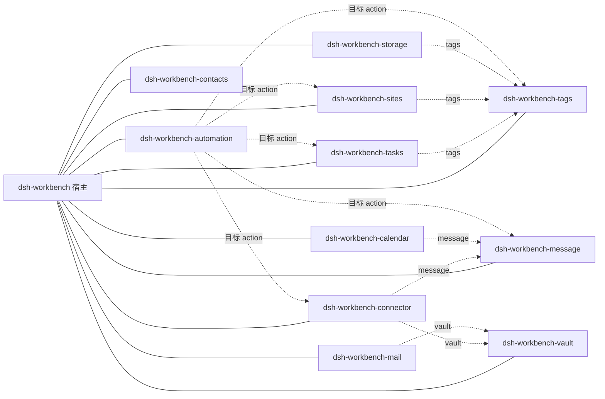

# 工作台插件依赖关系

> 适用版本：宿主 `dsh-workbench` 0.7.0；任务 5.2.15；标签 1.7.0；站点 1.10.0；储物 1.5.2；消息 0.1.0；凭据保险箱 0.2.0；连接器 0.1.0；自动化 0.1.0；联系人 0.1.0；日历 0.1.0；邮件 0.1.0。
>
> 本文按“安装依赖 / 宿主依赖 / 业务软依赖”三层说明。字段级 action 契约见 [`插件功能清单.md`](./插件功能清单.md)。

## 1. 先分清三种“依赖”

| 类型 | 含义 | 缺失后果 | 是否会自动安装 |
| --- | --- | --- | --- |
| DSH 插件安装 | 每个业务包都是独立 DSH bundle，可由 `dsh plugin add` 直接安装 | 插件不出现 | — |
| 宿主硬依赖 | `package.json` 依赖 `dsh-workbench`；运行时 `ctx.workbench` 必须存在；客户端 `dsh.client.inject` 先加载宿主 | 插件加载失败或被跳过 | 是，安装任意业务包会自动带宿主 |
| 业务软依赖 | 通过 `host.call` 调其它域 action，或读取标签域共用的 `tag_mapping` 表 | 插件仍加载，相关功能降级或该 action 报错 | **否**，必须单独安装 |

因此，你例子里的第 2 条严格说是**硬依赖**：没有 `dsh-workbench`，业务插件不会生效；第 3 条才是软依赖，`dsh-workbench-tags` 不装，任务插件仍可用，只是没有标签能力。

## 2. 总表

“软依赖”列是运行期依赖，不会写进 `package.json`，也不会被安装器自动解析。

| 插件 | DSH 直接安装 | 宿主硬依赖 | 业务软依赖 | 被谁软依赖 |
| --- | --- | --- | --- | --- |
| `dsh-workbench-tasks` | 是 | `dsh-workbench` | `dsh-workbench-tags`（标签/筛选/标签聚合） | 自动化（`tasks.create`） |
| `dsh-workbench-tags` | 是 | `dsh-workbench` | 无 | 任务、站点、储物、自动化 |
| `dsh-workbench-sites` | 是 | `dsh-workbench` | `dsh-workbench-tags`（标签；capability 声明 `requires`） | 自动化（`sites.create`） |
| `dsh-workbench-storage` | 是 | `dsh-workbench` | `dsh-workbench-tags`（可选标签与备份顺序） | 无 |
| `dsh-workbench-message` | 是 | `dsh-workbench` | 无 | 日历、连接器、自动化 |
| `dsh-workbench-vault` | 是 | `dsh-workbench` | 无 | 邮件、连接器 |
| `dsh-workbench-connector` | 是 | `dsh-workbench` | `dsh-workbench-vault`（凭据绑定/租约）、`dsh-workbench-message`（投递到消息） | 自动化（`connector.sourceRun`） |
| `dsh-workbench-automation` | 是 | `dsh-workbench` | `message` / `tasks` / `tags` / `sites` / `connector`（规则目标，按需） | 无 |
| `dsh-workbench-contacts` | 是 | `dsh-workbench` | 无 | 无 |
| `dsh-workbench-calendar` | 是 | `dsh-workbench` | `dsh-workbench-message`（提醒投递） | 无 |
| `dsh-workbench-mail` | 是 | `dsh-workbench` | `dsh-workbench-vault`（账户密码租约） | 无 |

## 3. 逐插件说明

### 3.1 `dsh-workbench-tasks`

1. **DSH 插件直接安装**：包内声明 `dsh.bundle.patch`，`cordis.patch.yml` 同时插入宿主行与自身行；可 `dsh plugin add dsh-workbench-tasks`。
2. **`dsh-workbench` 硬依赖**：`package.json` 的 `dependencies` 指向宿主；`apply(ctx)` 缺 `ctx.workbench` 会抛错；客户端 `dsh.client.inject: ["dsh-workbench"]`。
3. **`dsh-workbench-tags` 软依赖**：
   - `packages/addons/tasks/lib/tagging/tagging.js:22` 的 `tagsAvailable` 同时检查 `hasDomain("wb-addon-tags")` 与 `tag` / `tag_mapping` 表；
   - 标签域存在时，任务直接读写 `tag_mapping` 中 `item_type='task'` 的行（不是调 `tags.*` action）；
   - 未装标签域时：任务 CRUD、状态、优先级、时间线、工作区、搜索都正常，只是标签字段、按标签筛选、标签聚合降级。

### 3.2 `dsh-workbench-tags`

1. **DSH 插件直接安装**：独立 bundle。
2. **`dsh-workbench` 硬依赖**：同上。
3. **无业务软依赖**：标签域自己拥有 `tag` / `tag_mapping`，不要求任务、站点、储物先安装；它是多个业务域的“被依赖方”。

### 3.3 `dsh-workbench-sites`

1. **DSH 插件直接安装**：独立 bundle。
2. **`dsh-workbench` 硬依赖**：同上。
3. **`dsh-workbench-tags` 软依赖**：
   - `packages/addons/sites/lib/index.js:107` 的 capability 声明 `requires: ["wb-addon-tags"]`；标签域缺失时 `capabilities.list/get` 会给 warning，但插件仍加载；
   - 站点自身表声明包含 `tag_mapping`；标签域未装时站点收藏、目录树、链接仍可用，标签相关 UI/筛选降级。
   - 备份/同步说明见 `packages/addons/sites/lib/infra/sync.js:124`：`tag_mapping` 归标签域同步。

### 3.4 `dsh-workbench-storage`

1. **DSH 插件直接安装**：独立 bundle。
2. **`dsh-workbench` 硬依赖**：同上。
3. **`dsh-workbench-tags` 软依赖**：
   - `packages/addons/storage/lib/db/db.js:56` 用 `hasDomain("wb-addon-tags")` + `tag` / `tag_mapping` 表判断标签能力；
   - `packages/addons/storage/lib/index.js:66` 声明 `backupAfter: ["wb-addon-tags"]`，备份时让标签先落库；
   - 未装标签域时储物记录、库存、位置、图片 URL、备注仍可用，`tagIds` 与标签展示降级。

### 3.5 `dsh-workbench-message`

1. **DSH 插件直接安装**：独立 bundle。
2. **`dsh-workbench` 硬依赖**：同上；客户端 `client.js` 的 5 个视图依赖宿主 `registerAddon`。
3. **无业务软依赖**：消息只写本机 `message` 表，`sync: { tables: [] }`，不导出、不备份、不依赖其它域。
4. **反向**：日历提醒、连接器投递、自动化 `message.send` 都依赖它。

### 3.6 `dsh-workbench-vault`

1. **DSH 插件直接安装**：独立 bundle。
2. **`dsh-workbench` 硬依赖**：同上。
3. **无业务软依赖**：七张表自持（`vault_header` / `vault_device` / `vault_secret` / `vault_group` / `vault_binding` / `vault_subject_type` / `vault_secret_usage`），不读其它域表。`sync.tables` 只声明 `vault_header`（键 `id`）、`vault_secret`（`id`、`name`）、`vault_group`（`id`、`name`）、`vault_binding`（`id` 与 `subject_type+subject_id+group_id`）、`vault_subject_type`（`id`、`type`）；`vault_device` 与 `vault_secret_usage` 不参与同步，`vault_device` 也不进备份。`vault_subject_type` 用 `id` 主键而非 `type`，是因为宿主同步按 `id` 对齐行。
4. **反向**：邮件用 `vault.lease` 取账户密码；连接器用 `vault.secretList` / `vault.lease` 绑定和运行需要凭据的来源；业务域（站点、连接器等）可用 `vault.subjectRegister` + `vault.bind` 把自身对象关联到分组，再用 `vault.subjectSecrets` 取组内凭据清单。

### 3.7 `dsh-workbench-connector`

1. **DSH 插件直接安装**：独立 bundle。
2. **`dsh-workbench` 硬依赖**：同上。
3. **软依赖**：
   - `dsh-workbench-vault`：`packages/addons/connector/lib/domain/connector.js:160` 的 `sourceBind` 调 `vault.secretList`，`:179` 的 `sourceRun` 调 `vault.lease`；未装保险箱时，不需要凭据的 RSS 来源仍可创建/抓取，但绑定凭据、Webhook token/真实抓取会失败。
   - `dsh-workbench-message`：`:259` 的 `deliver` 在 `sink === "message"` 时调 `message.send`；未装消息时抓取与入库仍成功，投递失败只记日志，不阻断本次运行。
4. **反向**：自动化可调 `connector.sourceRun`。

### 3.8 `dsh-workbench-automation`

1. **DSH 插件直接安装**：独立 bundle。
2. **`dsh-workbench` 硬依赖**：同上。
3. **软依赖（规则目标，按需）**：`packages/addons/automation/lib/domain/rules.js:5` 的白名单固定为：
   - `message.send`
   - `tasks.create`
   - `tags.create`
   - `sites.create`
   - `connector.sourceRun`

   自动化插件本身不 import 这些域；规则执行时通过 `host.call(action, args)`（`rules.js:262`）调用。目标插件未安装时，自动化仍可创建/保存规则，但对应规则运行会失败并写入 `automation_run.error`。
4. **注意**：`automation.actionOptions` 返回的是静态白名单，不会按“当前已安装插件”过滤；配置 UI 需要自己提示目标域是否存在。

### 3.9 `dsh-workbench-contacts`

1. **DSH 插件直接安装**：独立 bundle。
2. **`dsh-workbench` 硬依赖**：同上。
3. **无业务软依赖**：四张联系人表自持，`sync: { tables: [] }`；只在宿主提供 `registerSearchProvider` 时注册搜索 provider（宿主 0.7.0+）。

### 3.10 `dsh-workbench-calendar`

1. **DSH 插件直接安装**：独立 bundle。
2. **`dsh-workbench` 硬依赖**：同上。
3. **`dsh-workbench-message` 软依赖**：
   - `packages/addons/calendar/lib/domain/calendar.js:100` 的提醒逻辑调 `host.call("message.send", …, "plugin")`；
   - 未装消息时日历、事件、参与人、提醒记录仍可用，但“到点提醒”不会产生消息。
4. 只在宿主提供 `registerSearchProvider` 时注册搜索 provider。

### 3.11 `dsh-workbench-mail`

1. **DSH 插件直接安装**：独立 bundle。
2. **`dsh-workbench` 硬依赖**：同上。
3. **`dsh-workbench-vault` 软依赖**：
   - `packages/addons/mail/lib/domain/mail.js:13` 在 IMAP/SMTP 操作前调 `host.call("vault.lease", { id: acc.secret_id, purpose: "mail:" + acc.id }, "plugin")`；
   - 账户 CRUD 只存 `secret_id`，未装保险箱仍可建账户；但收信、发信会因取不到密码失败。
4. 只在宿主提供 `registerSearchProvider` 时注册搜索 provider。

## 4. 反向依赖图



实线是宿主硬依赖；虚线是业务软依赖。

## 5. 版本与最低宿主

`minShell` 是插件声明的最低宿主版本；低于该版本，插件注册会被拒绝或功能不完整。

| 插件 | 包名 | 版本 | minShell | 域 id |
| --- | --- | --- | --- | --- |
| 宿主 | `dsh-workbench` / 发布名 `dsh-workbench-host` | 0.7.0 | — | `wb-shell` |
| 任务 | `dsh-workbench-tasks` | 5.2.15 | 0.6.3 | `wb-addon-tasks` |
| 标签 | `dsh-workbench-tags` | 1.7.0 | 0.5.0 | `wb-addon-tags` |
| 站点 | `dsh-workbench-sites` | 1.10.0 | 0.5.0 | `wb-addon-sites` |
| 储物 | `dsh-workbench-storage` | 1.5.2 | 0.5.7 | `wb-addon-storage` |
| 消息 | `dsh-workbench-message` | 0.1.0 | 0.6.5 | `wb-addon-message` |
| 保险箱 | `dsh-workbench-vault` | 0.2.0 | 0.6.7 | `wb-addon-vault` |
| 连接器 | `dsh-workbench-connector` | 0.1.0 | 0.6.7 | `wb-addon-connector` |
| 自动化 | `dsh-workbench-automation` | 0.1.0 | 0.6.7 | `wb-addon-automation` |
| 联系人 | `dsh-workbench-contacts` | 0.1.0 | 0.6.7 | `wb-addon-contacts` |
| 日历 | `dsh-workbench-calendar` | 0.1.0 | 0.6.7 | `wb-addon-calendar` |
| 邮件 | `dsh-workbench-mail` | 0.1.0 | 0.6.7 | `wb-addon-mail` |

## 6. 安装组合建议

| 目标 | 需要安装 | 说明 |
| --- | --- | --- |
| 只要任务 | `dsh-workbench-tasks`（会自动带宿主） | 标签、站点、储物都不需要 |
| 任务 + 标签 | `dsh-workbench-tasks`、`dsh-workbench-tags` | 任务标签、按标签筛选、标签聚合可用 |
| 站点/储物 + 标签 | 对应包 + `dsh-workbench-tags` | 不装标签仍可用，只是没有标签能力 |
| 邮件 | `dsh-workbench-mail` + `dsh-workbench-vault` | 不装保险箱只能建账户，不能收发 |
| 连接器（RSS） | `dsh-workbench-connector` | 不需凭据的 RSS 可独立跑；要投递再加 `message` |
| 连接器（Webhook/需凭据） | `connector` + `vault` | Webhook token/HMAC 凭据在保险箱 |
| 自动化 | `automation` + 规则目标插件 | 例如只调 `message.send` 就装 `message` |
| 日历提醒 | `calendar` + `message` | 不装消息则只有日历记录，没有提醒消息 |

## 7. 核对方法

```sh
# 1. 包依赖（硬依赖只有宿主）
for p in packages/addons/*/package.json; do
  node -e 'const p=require("./"+process.argv[1]); console.log(p.name, p.dependencies||{})' "$p"
done

# 2. 运行期跨域 action 调用
rg -n 'host\.(call|invoke)\(' packages/addons/*/lib --glob '!client.js'

# 3. capability 的 requires
rg -n 'requires:\s*\[' packages/addons/*/lib/index.js

# 4. 标签域表访问
rg -n 'tag_mapping|hasDomain\("wb-addon-tags"\)' packages/addons/{tasks,sites,storage}/lib
```

维护规则：新增跨域 `host.call`、读取其它域的表、或让 `capability.requires` 变化时，必须同步更新本文和 `docs/插件功能清单.md`；软依赖不要写进 `package.json`，否则安装器会把它当硬依赖自动解析。
