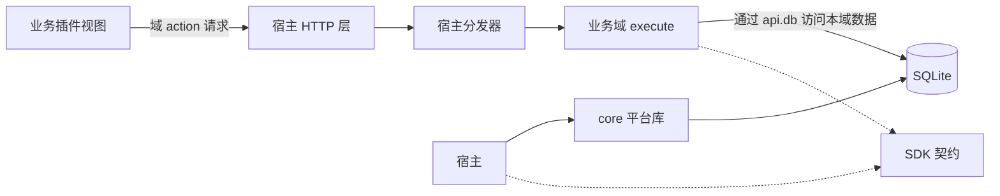
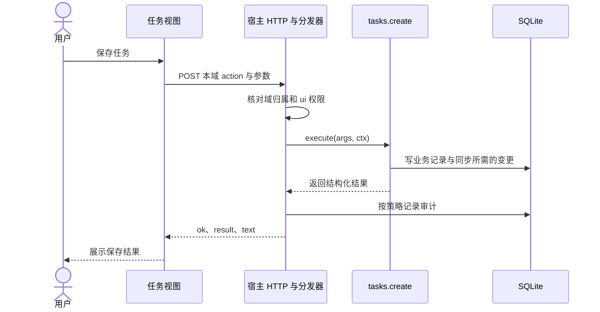

# 01 总体架构与分层

> 本章回答：仓库里有什么、谁负责什么、请求从界面到数据库怎么走、
> 哪些是产物哪些是源。读完后应该能在不翻代码的情况下判断「这个改动该落在哪个包」。

## 1. 包职责

| 包 | 路径 | 职责 | 产物形态 |
| --- | --- | --- | --- |
| `@wb/sdk` | `packages/sdk/src/index.ts` | 宿主与插件之间的**全部类型契约**：`DomainDef`、`DomainActionDef`、`DomainSetupApi`、事件、同步、插槽 | `lib/index.js`（tsc） |
| `@wb/core` | `packages/core/src/` | SQLite 适配器（`node:sqlite`）、平台表 schema、repo、事务 | `lib/*.js`（tsc） |
| `dsh-workbench` | `packages/shell/src/` + `packages/shell/client/` | 宿主插件：注册表、action 分发、事件队列、同步、备份、搜索、账号、系统页 | 后端 tsc → `lib/`；前端 esbuild → `client/client.js` |
| `dsh-workbench-*` ×13 | `packages/addons/<name>/` | 业务插件：自有表、action、视图、配置、同步声明 | 后端 ESM 源码直接跑 `lib/index.js`；前端同 shell 走 esbuild |
| `packages/addons/lib/` | 共享前端组件 | `data-view`、`action-schema-view`、`client-common`、`switch`、`number-field`、`tag-filter`、`stats-charts`、`icons`、`overlay`、`button`、`skeleton` | 被各插件 `require`，随各自 bundle 打包 |
| `packages/shell-dist/` | 发布用壳 | 把宿主打成可分发的 `dsh-workbench` 包（`pnpm dist:shell` 生成） | 构建产物 |

两篇基础包专章从这里展开：从数据库写入与冲突恢复看 [Core](02-Core与本地存储.md)，从注册声明与宿主注入看 [SDK](03-SDK与插件契约.md)。

下图的实线表示运行时依赖或调用，虚线表示遵循 SDK 定义的接口。业务插件按注入契约运行，具体的 npm 安装依赖以各包清单为准。

**core 与 sdk 不认识任何具体业务**；反过来业务插件也不许 import 宿主内部模块，
只通过注入的 `ctx.workbench` 与 `DomainSetupApi` 交互。

## 2. 两种运行形态

### 2.1 主进程（Node）

- DSH 启动时按 profile 里的插件清单加载：先 `dsh-workbench`（宿主），再各业务插件。
- 宿主在自己的 `apply(ctx)` 里建库、跑平台表迁移、造 action 分发器、起事件队列、
  挂 HTTP 前缀 `/workbench/api/*`，并通过 `ctx.provide("workbench", host)` 提供服务。
- 业务插件的 `apply(ctx)` 通过 `inject: ["workbench"]` 拿到宿主，调 `registerDomain()`。
  注册是**同步执行 setup**（可返回 Promise 与 dispose），任何时候都可以补注册。
- 同一条 SQLite（`~/.dsh/workbench/workbench.db`）由宿主打开，通过 `api.db` 交给插件；
  插件自己组织事务，宿主不替它开事务，也不读它的表。

### 2.2 浏览器

- 宿主前端入口 `packages/shell/client/client.src.cjs`，构建成 `client/client.js`；
  业务插件同理，各自产出 `lib/client.js`。
- 每个 bundle 都被包成 `window.__ModuleLoader__.load({ id, factory })`，
  由 DSH 前端按插件清单注入执行；执行时调用 `window.__WB_HOST__.registerAddon(mod)`。
- 工作台页面是**一个 React 应用**：顶栏 + 左侧/首页卡片 + 插件视图区。
  插件视图通过 `WbClientModule.views` 注册，宿主优先按客户端 `views` 的顺序排页签，未取得客户端视图时回退到后端声明。
- 业务 action 请求走 `POST /workbench/api/domains/:domainId/actions/:action`，
  **固定以 `ui` 来源分发**；实时性靠 SSE `/workbench/api/events`。

## 3. 一条写入的完整路径

以「在任务页新建一个任务」为例：

要点：

- **来源在入口固定**：HTTP 只能产生 `ui`，插件互调只能产生 `plugin`，agent 只能产生
  `agent`；任何 action 都无法自己声明来源。
- **审计在分发外层做一次**，不在每个 action 内部重复。
- **需行级推送的业务写入必须同时写 change log**（`logChange`），否则同步推不出去；`plugin` 来源的写入
  同样算本地变更，只是不进 agent 语义。

## 4. 数据面：平台表与业务表

| 类别 | 表 | 属主 | 是否随备份/同步 |
| --- | --- | --- | --- |
| 配置与状态 | `meta` | core | 按具体键的用途判断，当前选用的配置方案只存本机 |
| 同步 | `sync_change_log`、`sync_state`、`conflict_shadow`、`sync_dead_letter` | core | 不参与 |
| 审计 | `audit_log` | shell（`infra/audit.ts`） | 不参与 |
| 事件队列 | `host_event`、`host_event_delivery`、`host_event_subscription` | shell（`infra/event-queue.ts`） | 不参与 |
| 会话角色选择 | `session_role` | core | 不参与 |
| 业务表 | 各域自建（`task*`、`site*`、`mail*`…） | 业务插件 | 以同步声明／回退规则和导出实现分别判断 |

「不参与」是刻意的：队列、审计、同步日志是本机运行状态，跨设备合并没有意义，
还会放大冲突；`docs/AGENTS规范/02` 与 [`08-数据配置与同步.md`](08-数据配置与同步.md)
都重复了这条约束。

## 5. 目录与产物的对应关系（最容易踩的坑）

| 你看到的 | 真正该改的 | 说明 |
| --- | --- | --- |
| `packages/shell/lib/**` | `packages/shell/src/**` | `lib` 是 `tsc` 产物且被 gitignore，build 会整目录覆盖 |
| `packages/core/lib/schema.js` | `packages/core/src/schema.ts` | 同上；曾因直接改 lib 导致「表不存在」 |
| `packages/shell/client/client.js` | `packages/shell/client/client.src.cjs` | 前端是手写 CJS 源 + esbuild 产物 |
| `packages/addons/*/lib/client.js` | `packages/addons/*/client/client.src.cjs` | 每个插件一个入口，产物带版本串 |
| `packages/addons/*/lib/index.js` | 就是源文件（ESM） | 业务插件后端不编译，直接跑 |

判断方法：看文件头有没有「由 … 生成」。有就是产物，改源。

## 6. 分层原则（为什么不能更省事）

- **不把业务表放进 core**：`core` 只放「跟业务无关」的平台表，这样卸载任务插件不会留下
  一张没人认领的表，也不会让宿主知道「任务」是什么。
- **不让插件直接读别人的表**：跨域读会把两个插件的 schema 焊死；走 action 后，
  属主可以自由改表、加索引、换存储，只要 action 契约不变。
- **不让 UI 决定权限**：`origins` 写在 action 定义里，界面只能在范围内调整，且调整只存本机
  `meta`；这样「界面能点的」与「agent 能调的」是两套可审计的集合。
- **不把实时性绑在轮询上**：队列与 SSE 都是事件驱动；轮询只是降级路径（如云状态 15s 兜底）。

## 7. 读下一章的建议

- 要写新插件 → [02](04-宿主与业务插件.md) → [03](05-Action机制.md) → [05](07-视图与跨插件界面.md)
- 要解耦两个插件 → [04](06-事件队列.md)
- 要加表/加配置/动同步 → [06](08-数据配置与同步.md)
- 要给 agent 开口子 → [07](09-权限审计与安全.md)
- 要交付或发版 → [08](10-构建安装与发布.md)

[宿主入口](../../packages/shell/src/index.ts) · [SDK](../../packages/sdk/src/index.ts) · [客户端路由](../../packages/shell/client/client.src.cjs) · [回到架构入口](../ARCHITECTURE.md)
