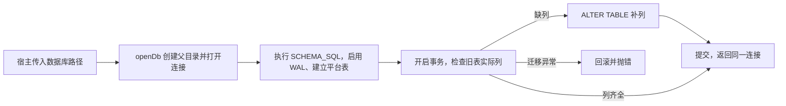
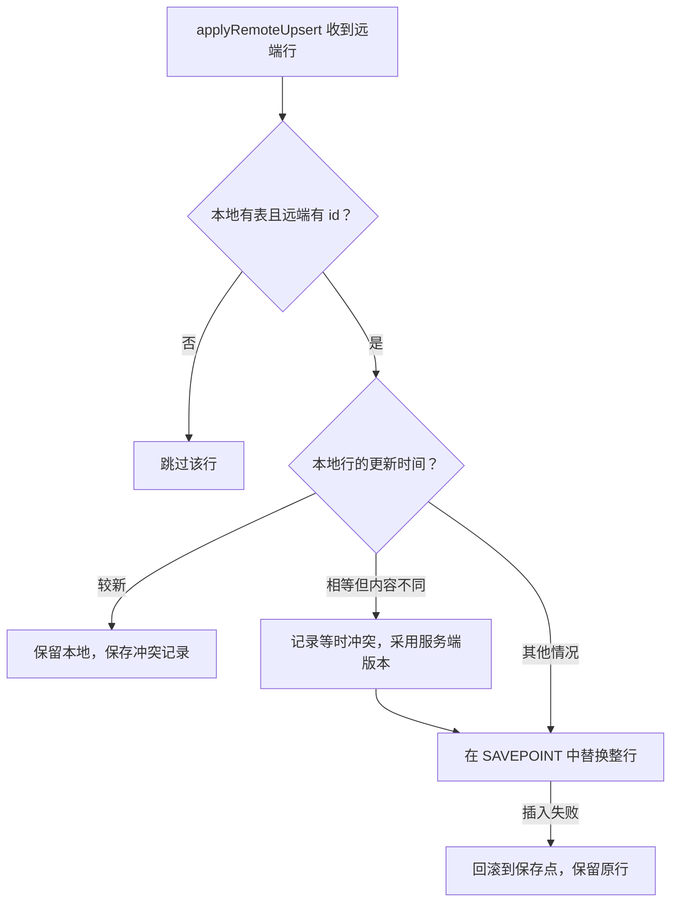

# 02 Core · 本地存储与同步基础

`@wb/core` 是宿主打开本地 SQLite、建立平台表和应用远端行的公共代码。业务插件在 `setup` 获得宿主已经打开的连接。任务的字段约束、保险箱的解锁条件等规则由相应业务域执行。[公共导出](../../packages/core/src/index.ts) · [宿主装配](../../packages/shell/src/index.ts)

## 启动时怎样兼容旧库

已有表遇到 `CREATE TABLE IF NOT EXISTS` 时会保留旧结构。`migrateLocalDb` 因而在事务中用 `PRAGMA table_info` 检查 `conflict_shadow`，逐列补上 `kind`、`resolution` 及两端的更新时间。新增平台字段时，空库与从旧库升级都要能够得到可用的结构。[开库与迁移](../../packages/core/src/db.ts) · [基线表结构](../../packages/core/src/schema.ts)

## 本地写入和远端写回走哪条路

业务域接到需同步的本地写入时，在自己的写事务里保存业务行和变更记录。`pendingChanges` 负责按 `seq > afterSeq` 升序取出待推记录，默认一批 200 条。何时联网、如何鉴权、如何推进设备水位，由宿主同步引擎协调。`monoNow()` 在当前进程内生成单调时间戳，`uuidv7()` 生成时间有序的记录 id。业务代码写业务时间时可使用宿主注入、带校时的 `api.now()`。[开库与时间工具](../../packages/core/src/db.ts) · [仓储函数](../../packages/core/src/repo.ts) · [同步引擎](../../packages/shell/src/sync/sync.ts)

例如，本地任务更新时间为 120、远端版本为 110 时，`applyRemoteUpsert` 保留本地内容并记录双方快照。若两边时间同为 120 且内容不同，则留存冲突并采用远端行。这个分支描述行级策略。树表要先看该域的 `reconcile` 契约。同步失败记入 `sync_dead_letter`，事件消费失败则查 `host_event_delivery`，两者对应不同的工作。[冲突处理与墓碑](../../packages/core/src/repo.ts) · [数据配置与同步](08-数据配置与同步.md)

## 改动落点

| 需求 | 修改位置和验证重点 |
| --- | --- |
| 为公共平台增加持久状态 | 在 Core 的 schema 增加基线及必要的旧库迁移，在宿主实现生命周期和访问边界。例：Core 建事件投递表，宿主负责派发。 |
| 为某个业务对象增加字段 | 在属主插件迁移数据，更新该域的 action、备份和同步定义。共享数据库连接仍服从表的归属。 |
| 为插件开放新操作 | 在 SDK 讲清方法与结果，在宿主实现，在业务插件接入。只有需要平台级持久化时才改 Core。 |

继续阅读：[SDK 契约](03-SDK与插件契约.md) · [架构入口](../ARCHITECTURE.md)。
