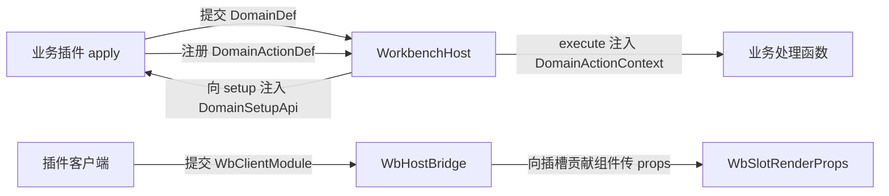
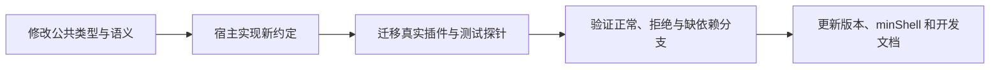

# 03 SDK · 宿主和插件之间的契约

`@wb/sdk` 给工作台后端和浏览器前端定义共同的接口。判读一个字段时，先找出谁提供它、谁读取它，再到对应实现核对生效条件。包的公共入口还导出来源常量 `ALL_ACTION_ORIGINS`。[SDK 源码](../../packages/sdk/src/index.ts) · [包清单](../../packages/sdk/package.json)

## 按接入阶段查接口

| 阶段 | 接口 | 生效条件与结果 |
| --- | --- | --- |
| 装载业务域 | `WorkbenchHost.registerDomain(def)`、`DomainDef` | 插件给出稳定域 id、版本、视图等声明。宿主创建域记录，向 `setup` 提供运行时服务，并返回反注册函数。 |
| 实现业务动作 | `DomainSetupApi.action`、`DomainActionDef` | 插件定义 `input`、`execute`、`origins`。执行时由宿主填入 `DomainActionContext.origin`，调用方可读取结构化 `result`。 |
| 接入事件队列 | `DomainEventDecl`、`DomainEventBus`、`DomainEventPushOptions`、`DomainEventDeliveryArgs` | 声明允许的类型、注册本域 `*.onEvent`，再 `subscribe(type)`（广播）；要点名下发就在声明里写 `mode: "targeted"` + `targets`，push 时传 `options.targets`，此时不订阅。宿主分配 `eventId` 与 `deliveryId`，消费方用 `type` 分派、用 `deliveryMode` 分辨投递语义。 |
| 接入内置自动化 | `BuiltinAutomationDecl`、`DomainDef.automations` | 插件声明自己的定时/事件规则，宿主注册域时即建规则并调度：id 固定为 `auto:<domain>:<key>`，可重复注册（按 key 幂等）。规则只能调本域 action，`event` 触发的事件必须已在 `events.subscriptions` 里声明；声明消失时规则停用但不删运行记录。用户可启停、可按 `editableArgs` 改参数，不能改触发与 action。 |
| 持久化、导入与同步 | `DomainSyncDef`、`DomainSyncTable`、`DomainDataContext`、`DomainImportReport` | 域说明哪些表参与同步及其合并策略，通过导入导出钩子约定业务数据格式与处理结果。 |
| 注册网页能力 | `WbHostBridge`、`WbClientModule`、`WbSlotContribution`、`WbItemRef` | 视图与插槽贡献携带真正的组件，宿主将域与导航、语言和 API 绑定。条目引用使用带命名空间的 `kind`。 |

## 从一个事件看类型与运行时的分工

以保险箱解锁触发收件为例，`DomainDef.events` 写明 `vault.unlocked` 的发布和监听意图。邮件的 `setup(api)` 注册 `mail.onEvent` 后调用 `api.events.subscribe('vault.unlocked')`。订阅方法接收事件类型，返回可用于清理的退订函数。队列送达时，`DomainEventDeliveryArgs` 包括 `eventId`、`deliveryId`、`type`、`source`、`payload`、`createdAt` 与 `deliveryMode`（`broadcast`/`targeted`）。定向类型无法订阅，收件人由发布方在 `push` 时按白名单点名。具体载荷仍由事件双方约定，插件读到 `payload: unknown` 时需先判形状。[保险箱发布端](../../packages/addons/vault/lib/domain/actions.js) · [邮件注册端](../../packages/addons/mail/lib/index.js) · [队列实现](../../packages/shell/src/infra/event-queue.ts)

内置自动化规则的来源模型和事件声明同构：`DomainDef.automations` 是**授权清单**，注册阶段就校验，跨域 action 直接报错且不落库。规则表用 `origin`（`user`/`plugin`）+ `owner_domain` + `rule_key` 区分来源，页面与能力目录按来源展示，备份只导出用户覆盖（启用状态、改过的参数）。[内置规则实现](../../packages/shell/src/infra/automation/builtin.ts) · [示例声明](../../packages/addons/mail/lib/index.js)

编译能检查 TypeScript 调用者是否按 `subscribe(type)` 传参。仓库中还有直接执行的 JavaScript 插件，实际来源、域内注册的消费入口、允许监听的事件清单都由宿主在运行时检查。`origins` 声明的是动作支持的来源上界，`originsDefault` 指定默认开启的子集，当前机器上的有效集合由权限实现计算。[宿主组装 API](../../packages/shell/src/index.ts) · [来源权限](../../packages/shell/src/actions/origin-access.ts)

## 修改 SDK 时沿着调用链验证

SDK 0.5.0 移除了 `subscribe` 的 action 参数。这个变更同时涉及宿主在本域寻找 `*.onEvent`、邮件和消息插件各自的分派函数，以及插件所需的最低宿主版本。审查类似改动时，至少跟踪一个实际发布者和一个实际订阅者。只看接口签名无法验证事件是否落到了正确的域。[事件机制](06-事件队列.md) · [邮件到消息的集成测试](../../scripts/test-mail-message-queue.mjs) · [Core 基础](02-Core与本地存储.md) · [架构入口](../ARCHITECTURE.md)
