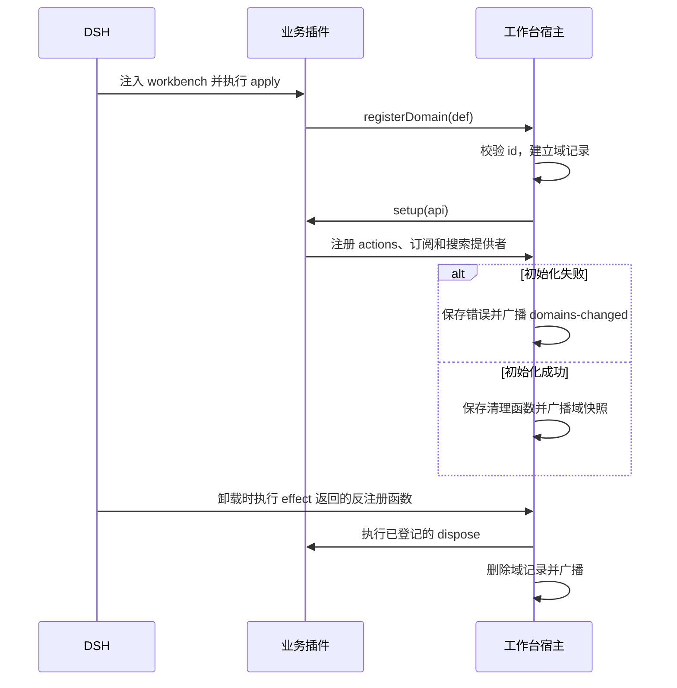

# 04 宿主与业务插件

> 本章回答：一个业务插件长什么样、注册时宿主做了什么、`DomainDef` 每个字段的语义、
> 插件之间能不能互相依赖、卸载与热重载怎么收尾。

## 1. 一个插件的最小形态

```
packages/addons/<name>/
├── package.json          # wb.addon 清单 + dsh.client + cordis.patch.yml 引用
├── cordis.patch.yml      # 安装时插入的插件行（含共享宿主行，必须流式）
├── lib/index.js          # 后端入口（ESM，直接运行）
└── client/
    ├── client.src.cjs    # 前端入口（CJS 源，esbuild 打包）
    └── views/*.cjs       # 视图组件
```

宿主加载这个业务域主要用到两个导出：

```js
export const inject = ["workbench"];        // 没装宿主就不加载本插件

export function apply(ctx) {
  const host = ctx.workbench;
  if (!host) throw new Error("dsh-workbench 未加载：缺少 workbench 服务");
  // 用 ctx.effect 包住注册：DSH 卸载插件时会调它的返回值反注册
  ctx.effect(() => host.registerDomain({ /* DomainDef */ }), "<name>-domain");
}
```

`registerDomain` 返回反注册函数，负责：调 `def.setup` 返回的 dispose、从注册表删除域、
广播 `domains-changed`。`ctx.effect` 保证插件被 DSH 卸载时一定走这条路径。

前端入口末尾调用宿主桥：

```js
window.__WB_HOST__.registerAddon({
  id: "wb-addon-mail",
  views: [{ id: "messages", title: { zh: "邮件" }, component: MessagesView }],
  slots: [ /* 可选的插槽贡献 */ ],
});
```

## 2. 注册生命周期

`packages/shell/src/index.ts:263` 的 `registerDomain(def)` 按顺序做这些事：

| 步骤 | 行为 | 失败时 |
| --- | --- | --- |
| 1. 校验 id | `DOMAIN_ID_RE` 校验格式，仓库业务域惯用 `wb-addon-*` | 打日志、返回空函数（不抛） |
| 2. 去重 | 同 id 已注册 | 打日志、忽略重复注册 |
| 3. 解析栏目 | `def.category` → `HOME_CATEGORIES` | 未声明/未知落 `other` 并日志，不阻断 |
| 4. 建记录 | `{ def, category, actions: Map, hooks: Map, error, dispose }` 放进 `domains` | — |
| 5. 造 `setupApi` | 见第 4 节 | — |
| 6. 执行 `def.setup(api)` | 同步或异步；返回值作为 dispose | 异常被捕获写 `rec.error`，域仍存在但 `enabled=false` |
| 7. 广播 | `emit("domains-changed", listDomains())` | — |



两条由此产生的纪律：

- **setup 里抛错不会让进程崩，但这个域会一直是错误态**：首页卡片会显示错误、
  `capabilities` 会带上它。所以「依赖没装」这类可预期情况必须降级，不要让它炸 setup。
- **setup 必须可重复执行**：热重载会重新注册（旧注册已 dispose）。用
  `CREATE TABLE IF NOT EXISTS`、`INSERT OR REPLACE` 这类幂等写法。

## 3. `DomainDef` 字段

定义在 `packages/sdk/src/index.ts:372`。按「宿主拿它干什么」分组：

### 3.1 身份与展示

| 字段 | 必填 | 语义 |
| --- | --- | --- |
| `id` | 是 | 稳定域 id，如 `wb-addon-tasks`；用于 action 归属、跨域探测、DOM 与首页卡片 |
| `title` / `description` | 是 / 否 | 首页卡片与页头 |
| `version` | 是 | 与 `package.json` 一致（首页卡片读的是注册值） |
| `category` | 否 | 首页栏目 id（`work`/`comm`/`assets`/`finance`/`auto`/`other`） |

### 3.2 声明型字段（宿主只读、不代替执行）

| 字段 | 语义 | 常见错误 |
| --- | --- | --- |
| `tables` | **只列自己建的表**，用于备份清单、文档与设置卡片 | 把别人的表列进来（曾把 `tag_mapping` 列进站点） |
| `views` | 视图 id + 标题，决定页签与首页卡片 | 声明了但客户端没注册同名 view → 页签空白 |
| `sync` | 参与同步的表与模式（`row`/`tree`） | 声明了但不写 `sync_change_log` → 永远不推 |
| `events` | 发布/订阅的**授权清单**（见 [04](06-事件队列.md)） | 只写文案忘了真声明 → push/subscribe 直接抛错 |
| `automations` | **内置自动化规则**声明：注册即在宿主内存里建规则（`auto:<domain>:<key>`，不落库、不进云同步），用户只能启停与（`editableArgs` 时）改参数 | 声明跨域 action 或未订阅的事件 → 注册阶段直接报错，规则不落库 |
| `slots` / `slotHosts` | 我贡献到哪些槽 / 我渲染哪些槽（见 [05](07-视图与跨插件界面.md)） | 只声明不实现 → 能力清单报「暂无落点」 |
| `capability` | 给 agent 的能力清单：记录什么、首选 action、依赖、边界 | `primaryAction` 指向不存在的 action |

### 3.3 行为型字段

`schemaVersion` 不存在于 `DomainDef`——迁移由插件在自己的 `lib/db` 里用 `meta` 记录；
`DomainDef` 只有 `setup`、`exportData`、`importData`、`backupAfter`。

## 4. `DomainSetupApi`：插件能碰到什么

`packages/sdk/src/index.ts:259`。它是有意做小的，因为每一项都是长期契约：

| 成员 | 用途 | 不该用它做什么 |
| --- | --- | --- |
| `db` | 宿主打开的 `node:sqlite` 连接，自己开事务 | 直接读别人的表 |
| `now()` | 已校准、单调递增的本地时钟 | 用 `Date.now()` 写 `updated_at`（会破坏 LWW） |
| `action(name, def)` | 注册 action | 注册不声明 schema 的 action |
| `call(action, args)` | 以 `plugin` 来源调别人的 action | 用它绕开来源权限做 ui 才该做的事 |
| `hasDomain(id)` | 能力探测（可选依赖） | 用 id 字符串猜「装了就能用」 |
| `on(event, fn)` | 订阅宿主 `domain-event` 广播（进程内、不落库） | 用它替代事件队列做可靠投递 |
| `events.push/subscribe` | 事件队列（见 [04](06-事件队列.md)） | push 后 await 下游结果 |
| `emit(event, data)` | 向本域 SSE 订阅者广播，驱动前端刷新 | 跨域广播 |
| `registerHook(name, fn)` | 注册 `/workbench/hooks/<domain>/<name>` 外部 HTTP 入口 | 在 hook 里做无鉴权的批量写 |
| `registerSearchProvider` | 参与跨域搜索聚合 | 在 search 里做写操作 |
| `markSyncDirty(table)` | 手动标脏（一般由 change log 自动判定） | 每次写入都调 |
| `log(...)` | 带域前缀的日志 | 打密码、token、正文 |

## 5. 插件之间怎么互相「看见」

架构上只承认三种关系，强度依次递减：

1. **硬依赖（安装层）**：`package.json` 里写对方包 —— 尽量避免。业务插件依赖宿主；邮件还明确依赖保险箱包。安装依赖只说明哪些组件需要一起部署，解锁后的业务通知仍然可以异步。
2. **能力探测（运行层）**：`capability.requires` 声明 + `api.hasDomain()` 判断。
   缺依赖时必须**降级而不是崩**：
   - 站点类：传了标签参数才报「标签域未安装…；去掉参数即可继续」；
   - 任务类：忽略标签参数、正文照常落库，回执带 `notices.tag_domain_missing`；
   - 邮件类：没装保险箱时账户页提示先装，其它功能不受影响。
3. **事件解耦（时间层）**：`api.events.push` 后立刻返回，对方订阅与否都不影响自己。
   **这是默认推荐的跨插件方式**，尤其适用于「通知」「触发刷新」这类不需要返回值的场景。

调用方当场需要对方结果时，使用 `await api.call(...)` —— 有返回值、有失败语义，但也意味着
调用方开始关心对方的可用性，用它就要写降级分支。

## 6. 卸载、热重载与错误隔离

- **卸载**：DSH 调 `ctx.effect` 的清理 → `registerDomain` 返回的函数 → `rec.dispose()`
  → 从 `domains` 删除 → `domains-changed`。插件要在这里停掉定时器、取消订阅
  （`api.events.subscribe` 返回的退订函数、`setInterval`）。
- **热重载**：DSH 重新加载插件时先卸载再注册；同名 action 再注册会覆盖（宿主用 Map）。
  表结构必须 `IF NOT EXISTS`，配置迁移必须幂等。
- **错误隔离**：
  - setup 抛错 → 只影响该域（`enabled=false`），其它插件照常；
  - action execute 抛错 → 只让本次调用失败，审计记一条失败；
  - 事件消费抛错 → 队列重试，最终进死信，不影响 push 方；
  - 客户端视图抛错 → 宿主错误边界包住该视图，其它页签照常（插槽贡献由单独的错误边界隔离，路由自身仍需做切换回归）。

## 7. 版本与兼容

| 地方 | 必须一致 | 说明 |
| --- | --- | --- |
| `package.json` `version` | ✅ | 包版本 |
| `package.json` `wb.addon.version` | ✅ | 首页卡片展示、能力清单 |
| `lib/index.js` 里注册的 `version` | ✅ | 从 package.json 读最好 |
| `client/client.src.cjs` 的 `__ADDON_VERSION__` | ✅ | 构建时替换进 client.js |
| `wb.addon.minShell` | — | 需要的新宿主能力下限；宿主升到破坏性版本时必须抬 |

`minShell` 不是装饰：`@wb/sdk` 的破坏性变更（例如 `subscribe(type)` 去掉 action 参数）意味着
旧宿主跑不了新插件，新插件必须把 `minShell` 抬到对应宿主版本（如 0.13.0）。

## 8. 新插件落地清单

1. `packages/addons/<name>/package.json`：`wb.addon` 段（id/title/version/minShell/tables/views/client）
   与 `dsh.client` 段；`cordis.patch.yml` 用**流式共享行** + 自己的块式行。
2. `lib/db/db.js`：建表、迁移、`logChange`。
3. `lib/index.js`：`inject`、`apply`、`registerDomain`，setup 里注册 action、订阅事件。
4. `client/client.src.cjs` + `views/`：注册视图；配置页/数据页复用共享组件。
5. 同步与备份：声明 `sync.tables` 与 `exportData/importData`（不参与就明确不写）。
6. 文档与版本五处同步：[`AGENTS规范/02`](../AGENTS规范/02-ActionSchema与页面数据.md)。

[域注册实现](../../packages/shell/src/index.ts) · [邮件插件注册实例](../../packages/addons/mail/lib/index.js) · [邮件安装依赖](../../packages/addons/mail/package.json) · [回到架构入口](../ARCHITECTURE.md)
