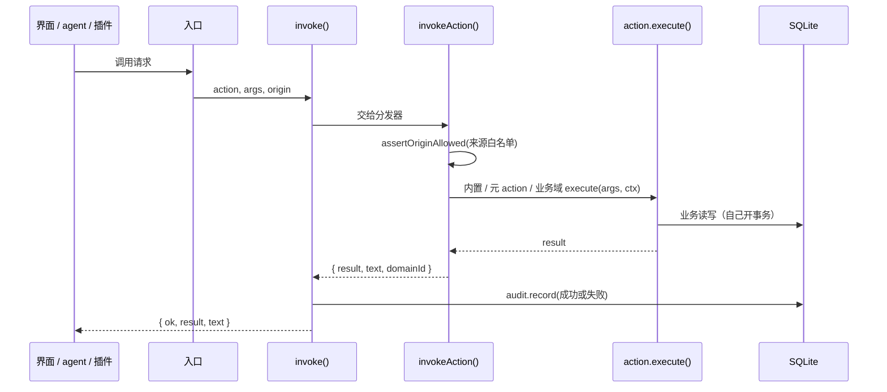

# 05 Action 机制

> 本章回答：一个「业务动作」怎样被定义、注册、发现和调用；`execute` 拿到的 `ctx` 有什么；
> 返回值怎样变成界面上的一块内容；界面、agent、插件三条入口为什么最终都落在同一个分发函数上。
> 权限判定与审计留痕的细节在[09 权限、审计与安全](09-权限审计与安全.md)，本章只讲机制。

## 1. 一个 action 是什么

action 是工作台里**唯一可被外部调用的业务入口**。它有名字（点号命名，例如 `tasks.create`）、
一段 JSON Schema 入参、一个执行函数，可选地有给 agent 看的文本渲染。下面这段只示意结构，
字段含义与真实插件的写法以各插件的 `lib/domain/*.js` 为准。

```js
api.action("tags.create", {
  description: "创建一个标签；同名视为已存在并直接返回原标签。",
  input: {
    type: "object",
    properties: {
      name: { type: "string", description: "标签名，1–40 字" },
      color: { type: "string", description: "可选颜色" },
    },
    required: ["name"],
  },
  examples: [{ name: "待整理" }],
  origins: ["ui", "agent"],          // 上界：只允许界面与 agent
  originsDefault: ["ui"],            // 默认只给界面，agent 需要用户在 Action 页打开
  execute: (args, ctx) => repo.create(args, ctx.origin),
});
```

类型契约在 [`packages/sdk/src/index.ts:129`](../../packages/sdk/src/index.ts#L129) 的
`DomainActionDef`，执行上下文在[同文件 `:32`](../../packages/sdk/src/index.ts#L32)：

| 字段 | 作用 | 省略时 |
| --- | --- | --- |
| `description` | `actions.list` / Action 页 / agent 工具描述都读它 | 空串 |
| `input` | JSON Schema，`actions.help` 与 Action 页按它渲染参数 | 空对象 |
| `execute(args, ctx)` | 唯一执行体；`ctx.origin` 是调用来源，`ctx.emit` 广播本域事件 | 必填 |
| `render(result)` | 给 agent 的文本；界面拿结构化的 `result` 自己渲染 | `JSON.stringify` |
| `examples` | `actions.help` 原样返回，帮 agent 自举 | 无 |
| `origins` / `originsDefault` | 允许/默认允许的来源，见第 6 节 | `ui/plugin/agent` |

两条容易忽略的语义：

- **`result` 与 `text` 是两个通道**。界面 RPC 返回 `{ ok, result, text }`，视图用 `result`
  做渲染；agent 工具只把 `text` 贴回对话。所以业务结果要可序列化，而 `text` 是给人读的摘要。
- **`input` 是契约，不是建议**。宿主不替你校验（校验在 `execute` 里），但 agent 的
  `actions.help`、Action 页的参数表、`scripts/audit-actions.mjs` 都会读它；
  声明了却从不读的字段会被审计脚本当成缺陷抓出来（见[规范 02](../AGENTS规范/02-ActionSchema与页面数据.md)）。

## 2. 注册：三种 action 同表

宿主把 action 分成三张表，但**发现与分发走同一套**，所以界面与 agent 都不需要知道
某个名字到底是谁注册的。

| 类别 | 注册方式 | 归属 domain | 例子 |
| --- | --- | --- | --- |
| 业务 action | 插件在 `setup(api)` 里 `api.action(name, def)` | 插件自己的 `wb-addon-*` | `tasks.create`、`mail.onEvent` |
| 宿主元 action | 宿主内部 `META_ACTIONS.set(name, def)` | 固定 `wb-shell` | `audit.list`、`wb.eventReplay`、`wb.configSet` |
| 宿主内置 action | `BUILTIN_ACTIONS`，`invokeAction` 最前面特殊分发 | 固定 `wb-shell` | `capabilities.list`、`actions.help` |

业务 action 的注册链只有三层：

```mermaid
flowchart LR
    P["插件 apply(ctx)"] -->|ctx.effect 包住| R["host.registerDomain(def)"]
    R --> S["def.setup(api)"]
    S -->|api.action(name, def)| M["rec.actions.set(name, def)"]
    M --> L["actions.list / actions.help / Action 页"]
    L --> D["invoke(action, args, origin)"]
```

- `registerDomain` 在 [`packages/shell/src/index.ts:263`](../../packages/shell/src/index.ts#L263)，
  `registerAction` 在[同文件 `:256`](../../packages/shell/src/index.ts#L256)；
  非法名字（不满足 `ACTION_RE`）直接抛错，setup 失败会让整个域进入错误态。
- 同名 action 后注册的覆盖先注册的（`Map.set` 语义），但**跨域不允许重名**：
  分发时按 `findActionDef` 的固定顺序取第一个命中（内置 → 元 action → 各业务域），
  所以业务域名里带域前缀是硬要求（`tasks.*`、`mail.*`）。
- 插件卸载时 `ctx.effect` 触发的反注册会把整个 `rec` 从 `domains` 删掉，action 随之消失。

## 3. 发现：四条入口，同一份 schema

发现入口不执行业务逻辑，只读注册表：

| 入口 | 实现 | 谁用 |
| --- | --- | --- |
| `actions.list` | [`actions.ts:263`](../../packages/shell/src/actions/actions.ts#L263) | agent 自举、宿主「Agent 权限」页 |
| `actions.help` | [`actions.ts:330`](../../packages/shell/src/actions/actions.ts#L330) | agent 查真实字段与示例 |
| 业务插件 `<域>.actionSchema` | 各插件自己注册，例如 [`message/lib/index.js:45`](../../packages/addons/message/lib/index.js#L45) | 插件自己的 Action 页（插件自证数据源） |
| `GET /workbench/api/schema` | [`network.ts:323`](../../packages/shell/src/infra/network.ts#L323) → [`actions.ts:584`](../../packages/shell/src/actions/actions.ts#L584) | 调试用只读快照，不执行、不写库、不记审计 |

三者共享同一个 `actionEntry()`（[`actions.ts:248`](../../packages/shell/src/actions/actions.ts#L248)），
所以「一个 action 长什么样」不会因为入口不同而漂移。`actionSchema` 的结果还会经过
`decorateSchemaResult()`（[`actions.ts:470`](../../packages/shell/src/actions/actions.ts#L470)）
补上来源权限字段，并补全插件漏列的 action——Action 页那一排开关就来自这里。

## 4. 分发：一条 invoke 管所有来源

所有调用最终都进 `invoke(action, args, origin)`（[`actions.ts:377`](../../packages/shell/src/actions/actions.ts#L377)），
它的外层只做两件事：**来源拦截**与**审计留痕**；真正的分发在 `invokeAction`。



三个入口怎样确定 `origin`：

- **界面**：`POST /workbench/api/domains/:id/actions/:action`，`network.ts:409` 固定传 `"ui"`；
  只允许调本域注册的 action（先核对 `actionNames()` 里的归属，不属于该域直接 404）。
- **agent**：Workbench 工具的 `execute`（[`actions.ts:497`](../../packages/shell/src/actions/actions.ts#L497)）
  固定传 `"agent"`；没有命名空间的旧调用会被映射成 `tasks.*`，并提示被忽略的顶层字段。
- **插件**：`api.call(...)`、`host.call(...)`、`host.invoke(...)` 全部固定 `"plugin"`
  （[`index.ts:288`](../../packages/shell/src/index.ts#L288) 与[`:388`](../../packages/shell/src/index.ts#L388)）。
  插件无法把自己伪装成 ui 或 agent。

分发顺序（`invokeAction`）：

1. `assertOriginAllowed()` 先按生效来源集合拦一次（细节见 09 章）；
2. 四个内置 action 由特殊分支处理：`capabilities.list/get`、`actions.list/help`；
3. 元 action 从 `META_ACTIONS` 里取 `execute`，`ctx.emit` 的 domainId 是 `wb-shell`；
4. 业务 action 遍历 `domains`，取第一个命中域的 `def.execute`；
5. 都没有则抛「没有业务插件注册 action」。

**参数不在这里做 schema 校验**。宿主只做一件事：Workbench 工具会剔除一批旧版“看起来通用、
实际没人接”的字段（`TRAP_FIELDS`，[`actions.ts:210`](../../packages/shell/src/actions/actions.ts#L210)），
并在返回文本顶部列出被忽略项，避免静默丢参。真实校验由插件在 `execute` 里完成——这也是
`actions.help` 必须准确的原因。

## 5. 返回值、渲染与错误

| 场景 | 约定 |
| --- | --- |
| 界面渲染 | 拿 `result`；`text` 只用于日志或纯文本场景 |
| agent 输出 | 用 `render(result)`；缺省 `JSON.stringify` 一行 |
| 业务校验失败 | `execute` 里 `throw new Error("可读原因")`；界面 RPC 返回 `{ ok:false, error }` |
| agent 可见的错误 | `actionErrorText()`（[`action-output.ts:1`](../../packages/shell/src/actions/action-output.ts#L1)）会保留 `code` 与 `details` 字段，便于区分“参数错”和“被权限挡下” |
| 权限类错误 | `code = ACTION_ORIGIN_DENIED / ACTION_UI_ONLY`，并带 `details`（action、origin、allowed），见 09 章 |

分页类 action 一律返回 `{ items, total, page, pageSize, pageable: true }` 这类显式结构，
不要只回数组——Action 页与数据页按字段名取值，数组会被当成空列表。

## 6. 来源声明：写在 action 上，不写在代码路径上

`origins` 是 action **本身支持**的来源上界，`originsDefault` 是**默认启用**的子集；
用户可以在 Action 页在上界内调整，落在本机 `meta`，不进备份与云同步。
四个来源与三层模型的完整规则、错误码与审计影响都在
[09 权限、审计与安全](09-权限审计与安全.md)，这里只记设计动作时的三条纪律：

1. **不写 `origins` 就是 `ui/plugin/agent` 全开**。只给界面的写 `["ui"]`；给 agent 但默认
   不给的写 `origins: ["ui","agent"]` + `originsDefault: ["ui"]`。
2. **声明与执行期 guard 必须一致**。插件里常见的 `only(ctx, [...], name)` 是第二道门，
   `scripts/test-origin-decls.mjs` 会比对两者；声明少了会让 guard 里写着的来源永远调不通。
3. **`sync` 必须显式声明**。默认集合里没有 sync，避免旧版本客户端替别的设备改数据。

## 7. 常见失败与定位

| 现象 | 原因 | 去哪儿看 |
| --- | --- | --- |
| 「没有该 action」 | 域名拼错 / 插件没注册 / 域 setup 报错没跑到 `api.action` | `actions.list` 看域与 actionCount；宿主日志看「业务域初始化失败」 |
| 「不允许 agent 来源调用」 | 生效来源集合里没有 agent（声明没写或用户关了） | Action 页看三列（支持/默认/生效）；`audit.list` 看被拒记录 |
| agent 看不到但界面能用 | 同一原因，`actions.list` 对 agent 会隐藏不可调的 action | 09 章第 3 节 |
| 参数“传了没生效” | 字段不在 schema 里，被当成旧版通用字段忽略 | Workbench 工具返回顶部的「已忽略」提示 |
| 界面白屏或空列表 | 把 `{ ok, result }` 整包当数据，或把工厂当组件渲染 | 见[07 章第 6 节](07-视图与跨插件界面.md)与宿主页面实现 |
| 声明的参数从不被读 | schema 与实现漂移 | `node scripts/audit-actions.mjs` 会直接指出 |

## 8. 验证清单

```bash
node scripts/audit-actions.mjs        # 五处一致：实现、schema、版本、文档、示例
node scripts/test-origin-decls.mjs    # 声明来源 ⊇ 执行期 guard
pnpm test:schema                      # /workbench/api/schema 快照与 actions.list 同源
pnpm test:audit                       # 审计采集与脱敏
```

新增或改动 action 后，还要按[规范 02](../AGENTS规范/02-ActionSchema与页面数据.md)同步
「五处」：实现、`input` 声明、版本号、能力清单、文档与测试。

---

[SDK 契约](../../packages/sdk/src/index.ts) · [分发实现](../../packages/shell/src/actions/actions.ts) · [共享 Action 页](../../packages/addons/lib/action-schema-view.cjs) · [回到架构入口](../ARCHITECTURE.md)
