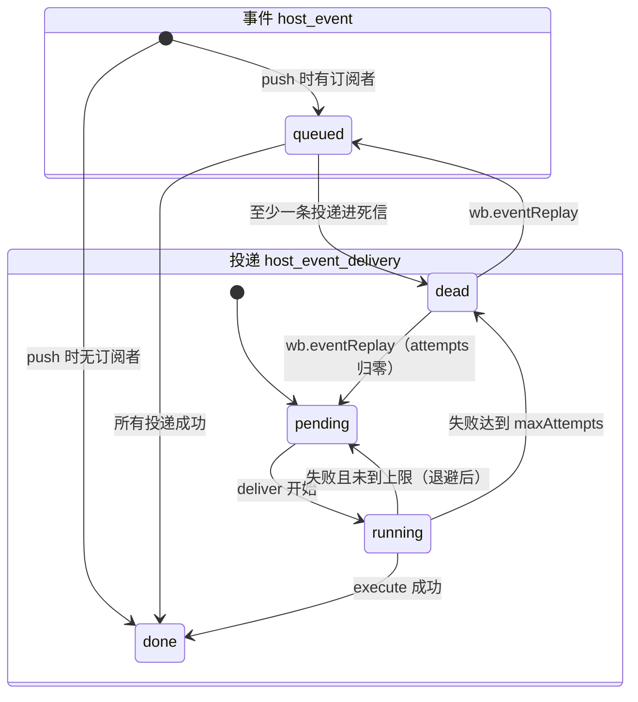
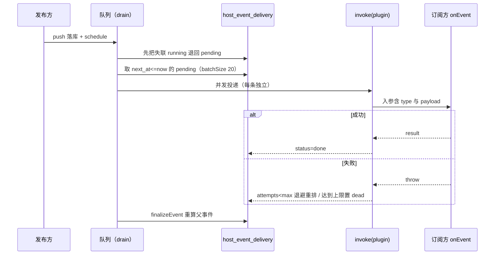

# 06 事件队列

> 本章回答：插件之间怎样“只发布事实、让下游自己决定”而不互相依赖；一条事件从 `push`
> 到被消费、失败重试、进死信、重启续投分别发生什么；插件怎样声明自己会发/会收，
> 宿主又怎样把这套声明变成一张可核对的授权清单；以及「广播」与「定向」两种投递语义
> 各自的授权边界。运行视图与排障在最后几节。

## 1. 三个通道，什么时候用哪个

工作台里有三条插件间通信路径，语义完全不同：

| 通道 | 语义 | 谁决定下游做什么 | 失败影响 |
| --- | --- | --- | --- |
| `api.call(action, args)` | **同步请求**，等结果 | 调用方 | 下游失败直接抛给调用方 |
| `api.emit(event, data)` | 进程内广播 + SSE，给已打开页面刷新用 | 无（没人订阅就丢掉） | 不影响任何人 |
| `api.events.push(type, payload)` | **主 push 的持久化事件**，写库即返回 | 订阅方 | 与推送方彻底隔离 |

队列解决的是第三种：邮件插件拉到新邮件，只需要说“有一批新邮件”，不需要知道消息插件
装没装、跑得快不快；保险箱解锁只需要说“解锁了”，邮件插件自己决定要不要立刻补一轮。
这也是这两处旧代码（`hasDomain("wb-addon-message")` + `api.call("message.send")`）被删掉的原因。

**push 是单向的**：宿主与插件都能推，但谁都不能“等下游处理完”。push 的返回值只有
`{ id, deliveries }`，不代表消费成功。

push 还有**两种投递语义**：默认的广播（收件人由订阅登记表决定）和定向（收件人由发布方在
push 时点名）。两者授权模型不同，见下一节。

## 2. 两种投递语义：广播与定向

同一张队列表，收件人的来源有两个，由发布声明里的 `mode` 决定（缺省 `broadcast`）：

| 维度 | `broadcast`（默认） | `targeted`（定向） |
| --- | --- | --- |
| 收件人来源 | 订阅登记表 `host_event_subscription`（含 `"*"` 通配） | push 时传入的 `options.targets`，且必须是声明 `targets` 的子集 |
| 谁能收 | 任何声明了 `subscriptions` 并 `subscribe` 的域 | 只有被发布方点名的域，**不看订阅表** |
| 授权边界 | 声明发布 + 声明订阅 + 登记订阅 | 发布方声明的 `targets` 白名单即全部授权 |
| 订阅 | 允许 | **禁止**：`subscribe` 直接抛「定向事件不接受订阅」 |
| 目标未安装/无入口 | 不适用（没登记就没投递） | 跳过并记日志，**不落死信** |
| 典型用途 | 事实广播：「有新邮件了」，下游自己决定 | 点名下发/定向补齐：「解锁了，请指定插件立刻同步」 |

发布方声明：

```js
events: {
  publishes: [
    { type: "mail.messages-synced" },                                  // 广播
    { type: "vault.unlocked", mode: "targeted", targets: ["wb-addon-mail", "wb-addon-message"] },
  ],
}
```

推送与校验：

```js
// 定向：目标必须非空且全部在 targets 白名单内
api.events.push("vault.unlocked", { at: Date.now() }, { targets: ["wb-addon-mail"] });

// 广播：传了 options.targets 会直接报错（一个类型只能一种模式，避免双投）
api.events.push("mail.messages-synced", { accountId, inserted });
```

- 白名单是**唯一**授权边界：点名不在清单里的域（或一个都不点）直接抛错，且**一行都不落库**。
  这样“谁可以被告知”在代码里可审，不靠订阅方自觉。
- 定向投递在 drain 时按 `hasDomain`/`resolveOnEvent` 解析目标域的 `onEvent`：没装、没入口就跳过，
  不生成死信，避免「没装插件」被当成故障反复重试。
- 事件行用 `mode` 列区分（老库补列后一律视为 `broadcast`），投递入参带 `deliveryMode`，
  消费方据此可以分辨这算广播还是点名。

## 3. 三张表与两个状态机

DDL 在 [`packages/core/src/schema.ts:68`](../../packages/core/src/schema.ts#L68)，属于平台表，
各业务域不建、不声明、**不进备份与云同步**。

| 表 | 一行是什么 | 关键列 |
| --- | --- | --- |
| `host_event` | 一次发布 | `id`、`type`、`source`（域 id 或 `host`）、`payload`（JSON 文本）、`mode`（`broadcast`/`targeted`）、`status`、`created_at` |
| `host_event_delivery` | 一条事件 × 一个订阅 = 一次投递 | `event_id`、`domain`、`action`、`status`、`attempts`、`next_at`、`started_at`、`last_error` |
| `host_event_subscription` | 一条订阅登记 | `domain`、`type`、`action`、`created_at`（三者联合主键） |

状态流转：



`finalizeEvent()` 在每条投递结束后重算一次父事件：还有 `pending/running` 就保持 `queued`；
没有活跃投递且有 `dead` 就标 `dead`，否则 `done`。

## 4. 发布：写库即返回

`push(type, payload, source, declared?, options?)` 在 [`packages/shell/src/infra/event-queue.ts:209`](../../packages/shell/src/infra/event-queue.ts#L209)。

```js
// 插件里（source 由宿主填成本域 id）
const { id, deliveries } = api.events.push("mail.messages-synced", {
  accountId, mailbox, inserted, latestUid, messages,
});
// 宿主里（source 固定 "host"，不受声明限制，也可以点名收件人）
host.events.push("cloud.sync-finished", { ok: true });
```

校验按顺序发生，任一失败都**不落库**：

1. 类型必须匹配 `TYPE_RE`（小写字母开头，允许数字/`._-`，最长 80）；
2. 业务域必须已在 `DomainDef.events.publishes` 里声明该类型，否则
   `事件未声明，不允许发布：<type>（先在 <domain> 的 DomainDef.events.publishes 里声明）`
   ——宿主自己推不受限；
3. 定向类型的 `options.targets` 必须非空且 ⊆ 声明 `targets`，否则
   `定向事件必须指定收件人：…` / `定向投递目标不在发布方声明的白名单内：…（允许：…）`；
   广播类型传了 `options.targets` 也会报错；
4. `payload` 必须能 `JSON.stringify`（`undefined` 视为 `null`）；
5. 事务内写 `host_event`（带 `mode`）与投递行（`BEGIN IMMEDIATE`）。

**没有收件人时事件直接写 `done`**（广播即无订阅者，定向即目标全部未安装/无入口），
避免历史事件长期停在 `queued` 把队列页刷满；定向被跳过的目标只记日志、不进死信。
写完后 `schedule()` 只是 `setTimeout(drain, 0).unref()` 调度一次后台分发，**push 从不 await 消费者**；
消费者的慢、抛错、域未加载都不会冒泡回推送方。

## 5. 订阅：声明 + 唯一入口 `onEvent`

订阅是一次登记，写在插件 `setup` 里：

```js
api.events.subscribe("vault.unlocked");   // 返回退订函数
```

`subscribe` 在 [`event-queue.ts:269`](../../packages/shell/src/infra/event-queue.ts#L269)，依次校验：

| 校验 | 失败文案（原文） |
| --- | --- |
| 类型合法（或 `"*"`） | `非法事件类型（或使用 "*" 订阅全部）：…` |
| 不是定向类型 | `定向事件不接受订阅：…（收件人由发布方 <domain> 在 push 时用 options.targets 指定）` |
| 已在 `DomainDef.events.subscriptions` 声明 | `事件未声明，不允许订阅：…` |
| 消费 action 名形如 `mail.onEvent` | `非法消费 action 名（应形如 tasks.onEvent）：…` |
| 消费 action 已在本域注册 | `消费 action 未注册：…（域内必须提供 onEvent 作为统一事件入口）` |
| `origins` **恰好** `["plugin"]` | `消费 action 必须声明 origins: ["plugin"]（只允许插件后台调用，ui/agent 不得消费）：…` |

设计要点：

- **一个域只有一个事件入口**，固定叫 `<前缀>.onEvent`。宿主在 `rec.actions` 里找
  `name.endsWith(".onEvent")`（[`index.ts:318`](../../packages/shell/src/index.ts#L318)）——
  前缀不一定等于域名（`wb-addon-message` → `message.onEvent`），所以不按字符串拼。
- 插件按 `args.type` 自己分派；新增一种订阅只需要改 `onEvent` 里的一个分支，
  不必再加 action、不必再动 Action 页与能力清单。
- 未知类型要显式返回 `{ ok: true, handled: false }` 并记一行日志，**不要静默吞**：
  否则「订阅了但没反应」无法从审计里看出来。
- 宿主以固定 `plugin` 来源 invoke 消费 action，所以界面与 agent 调不到它；
  这也是 `origins` 必须恰为 `["plugin"]` 的原因（多一个来源就多一条绕过审计的路径）。
- **定向类型订阅不上**：收件人只能由发布方点名，订阅方无法靠声明 `subscriptions` 把自己接进去。

真实例子：邮件插件既发布也订阅，消息插件只订阅。

```js
// packages/addons/mail/lib/index.js:71
events: {
  publishes: [{ type: "mail.messages-synced", description: "自动同步拉到新邮件后推送…" }],
  subscriptions: [{ type: "vault.unlocked", description: "保险箱解锁成功后立刻补一轮收件…" }],
},
```

## 6. 分发：drain 做什么

`drain()` 在 [`event-queue.ts:432`](../../packages/shell/src/infra/event-queue.ts#L432)，是**单飞**的：
同一时刻只有一个 drain 在跑，期间的调度只置 `again`，结束后再补一轮。



参数与超时：

| 参数 | 默认值 | 含义 |
| --- | --- | --- |
| `maxAttempts` | 5 | 单条投递最大尝试次数（含首次） |
| `retryBaseMs` | 250 | 首次重试延迟，之后每次翻倍（250 → 500 → 1000 → 2000…） |
| `batchSize` | 20 | 一轮最多取多少条投递 |
| `deliveryTimeoutMs` | 15000 | 单个消费 action 的执行上限，超时按失败处理 |
| `sweepIntervalMs` | 500 | 后台补扫间隔（捞到期重试、恢复失联投递、每小时清理一次） |
| `staleRunningMs` | 60000 | `running` 超过该时长视为进程失联，退回 `pending` 重投 |
| `retentionMs` | 7 天 | 终态（`done`/`dead`）事件与投递的保留时长 |

消费 action 的入参是固定的（`deliver()` 里构造，[`event-queue.ts:359`](../../packages/shell/src/infra/event-queue.ts#L359)）：

```json
{ "eventId": "…", "deliveryId": "…", "type": "vault.unlocked", "source": "wb-addon-vault", "payload": { "at": 1795… }, "createdAt": 1795…, "deliveryMode": "targeted" }
```

`deliveryMode` 与事件行的 `mode` 一致（`broadcast`/`targeted`）。定向投递在每次重试前会重新解析
目标域入口，解析不到就按失败处理并把原因写进 `last_error`（「定向投递目标已不可用…」）。

**投递不保证恰好一次**：进程在 `done` 落库前崩溃、或消费方超时后才完成，都可能重投。
所以消费 action 必须幂等——邮件用 `dedupeKey`、消息用 `mail:new:<accountId>:<uid>` 这类
业务键去重，而不是假设只来一次。

## 7. 授权清单与运行对账

队列页（宿主 route `queue`）的数据源是 `wb.event*` 元 action，
集中在 [`packages/shell/src/actions/host-events.ts`](../../packages/shell/src/actions/host-events.ts)：

| action | 作用 | origins |
| --- | --- | --- |
| `wb.eventOverview` | 事件/投递按状态计数、订阅数、类型分布 | 默认（ui/plugin/agent） |
| `wb.eventList` | 事件列表（status/type/source/mode 过滤、分页、payload 截 200） | 默认 |
| `wb.eventDeliveryList` | 投递列表（join 事件类型与 mode，支持 status/domain/mode 过滤） | 默认 |
| `wb.eventSubscriptionList` | 队列登记表原样 | 默认 |
| `wb.eventDomains` | 每个域声明的发布/监听 + 运行对账 | 默认 |
| `wb.eventReplay` | 重投单条终态投递（`done` 与 `running` 拒绝），事件 `dead` 拉回 `queued` | `["ui","plugin"]` |
| `wb.eventCleanup` | 只删 `done/dead` 且早于保留期的事件与投递（默认 7 天，上限 365） | `["ui","plugin"]` |

`wb.eventDomains` 的数据来自 `queue.describe(domain, def.events)`
（[`event-queue.ts:531`](../../packages/shell/src/infra/event-queue.ts#L531)）：发布的类型带
`mode/targets` 与 `sent/lastAt/lastStatus`（按 `source+type` 统计），声明监听的类型带 `registered`
（是否真订上了），真实订阅再按 action 汇总广播的 `done/dead/pending` 与最近 `last_error`；
新增的 `receives` 汇总「别人点名发给我的定向事件」（按 `type+source` 计数），两种口径分开展示。

页面因此有四个页签：插件（声明与对账）、事件、投递、订阅。**订阅一律来自登记表**，
不让插件再声明一遍，避免「声明说订了、实际没订」两处失真。事件与投递表都有「投递方式」列，
工具栏可只看广播或只看定向；插件卡片里的「定向收件」列出被谁点名、投了几次。

## 8. 接入一条事件的完整步骤

以“保险箱解锁 → 邮件立刻同步”为例：

1. **发布方声明**（`packages/addons/vault/lib/index.js:59`）：
   `events: { publishes: [{ type: "vault.unlocked", description: "…" }] }`。
2. **发布方推送**（`packages/addons/vault/lib/domain/actions.js` 的 `vault.unlock`）：
   解锁成功后 `api.events.push("vault.unlocked", { at: Date.now() })`，推送失败只记日志。
3. **订阅方声明**（`packages/addons/mail/lib/index.js:78`）：把 `vault.unlocked` 写进 `subscriptions`。
4. **订阅方提供唯一入口**（`packages/addons/mail/lib/domain/auto-sync.js:323`）：

   ```js
   api.action("mail.onEvent", {
     origins: ["plugin"],
     input: { type: "object", properties: { eventId: { type: "string" }, type: { type: "string" } } },
     execute: (args) => {
       if (args.type !== "vault.unlocked") return { ok: true, handled: false, type: args.type };
       return autoSync.syncNow("vault-unlocked:" + args.eventId).then((r) => ({ ok: true, handled: true, ...r }));
     },
   });
   ```

5. **订阅方登记**：`api.events.subscribe("vault.unlocked")`，用 `try/catch` 包住——
   旧宿主没有 `api.events` 时只记日志，不让 setup 崩掉。
6. **写测试**：`pnpm test:event-queue`（队列语义）、`pnpm test:event-queue-page`（视图与重投）、
   插件级用 `scripts/test-mail-vault-kick.mjs` 这种“引导宿主 + 插件 + 推一条事件”的写法。
7. **同步文档与版本**：功能清单的「2.5 宿主事件队列」与对应插件章节、`minShell` 要求。

如果是**定向**投递，第 3~5 步换成两件事：发布方在声明里写 `mode: "targeted"` + `targets`，
push 时传 `options.targets`；订阅方不需要 `subscriptions` 声明，也不能 `subscribe`，
但**仍然要提供 `*.onEvent`**（定向投递要靠它落地）。

## 9. 边界与非目标

- **不跨设备**：队列三张表是平台表，不进备份、不进云同步；重启只续投本机未完成的投递。
- **不做手工造事件**：没有“凭空 push 一条测试事件”的界面，避免队列变成绕过业务逻辑的旁路。
  调试用 `wb.eventReplay` 重投已有事件。
- **队列不替消费方做业务补偿**：进死信只留 `last_error`，要不要补由人判断并手动重投。
- **顺序只保证“同一事件内按登记顺序生成投递”，不保证跨事件串行**；需要顺序语义的业务
  应把顺序编码进一个事件里。
- **一个类型只有一种模式**：定向类型不能广播，广播类型不能点名；要两种都有就声明两个类型。
- **定向的“必达”是本机必达**：目标域装了、有入口就一定会为它生成投递并重试到上限；
  没装/没入口则跳过——这是刻意的，避免把部署差异当成投递故障。

## 10. 排障对照

| 现象 | 先看什么 | 常见原因 |
| --- | --- | --- |
| 订阅时报「域内必须提供 onEvent」 | 该域是否注册了 `*.onEvent` | 名字写成了 `onMailSynced`，或注册顺序在 subscribe 之后 |
| 推事件报「事件未声明」 | `DomainDef.events.publishes` | 声明加了但没重启，或 type 拼错（声明清单就是白名单） |
| 队列页空但业务说推了 | `host_event` 里有没有行、`source` 是谁 | 走的是 `api.emit` 而不是 `api.events.push` |
| 推定向事件报「必须指定收件人」/「不在白名单内」 | 声明里的 `mode`/`targets` 与 `options.targets` | 忘了传 targets、类型还是广播声明、或点名了未授权的域 |
| 定向事件显示 `done` 但目标说没收到 | 目标域是否安装、是否有 `*.onEvent` | 定向跳过未安装/无入口的域，只在进程日志里留一行，不进死信 |
| 一直 `pending` | `next_at`、`attempts`、`last_error` | 消费方持续失败在退避；或 drain 没被调度（进程未重启到新版） |
| `dead` | 投递的 `last_error` | 消费 action 抛错达上限；改完代码后点「重投」，`attempts` 会归零 |
| 页面显示 `0` 却有点 | `wb.eventOverview` 的计数键 | 状态键必须显式落 0（历史 bug：`GROUP BY` 只回出现过的状态） |

## 11. 验证

```bash
pnpm test:event-queue        # push 不阻塞、退避重试、死信、通配订阅、退订、授权校验、定向白名单/跳过/禁订阅/deliveryMode
pnpm test:event-queue-page   # 概览/列表/重投/清理/插件对账 + SSR 不崩
node scripts/test-mail-message-queue.mjs   # 真实插件链路：邮件发布 → 消息消费（含幂等）
node scripts/test-mail-vault-kick.mjs      # 真实插件链路：保险箱发布 → 邮件即时同步
pnpm test:host-data          # 数据页白名单包含队列与自动化三张表（共 13 张）
```

---

[队列实现](../../packages/shell/src/infra/event-queue.ts) · [事件页 action](../../packages/shell/src/actions/host-events.ts) · [表结构](../../packages/core/src/schema.ts) · [邮件接入实例](../../packages/addons/mail/lib/index.js) · [回到架构入口](../ARCHITECTURE.md)
