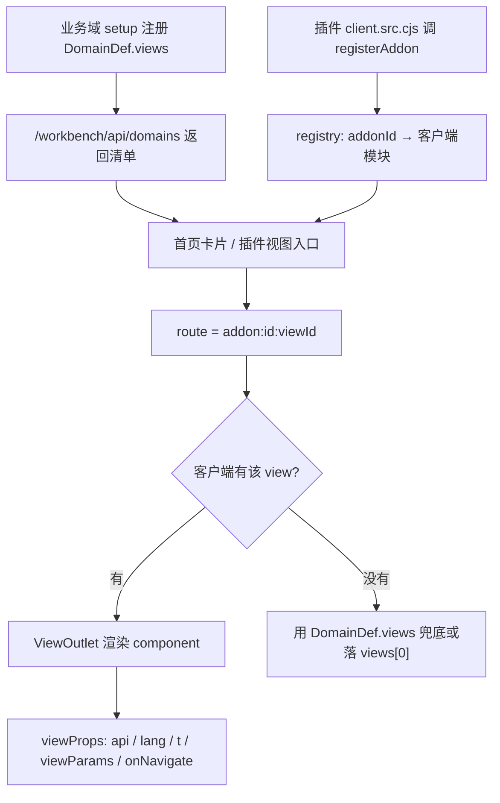
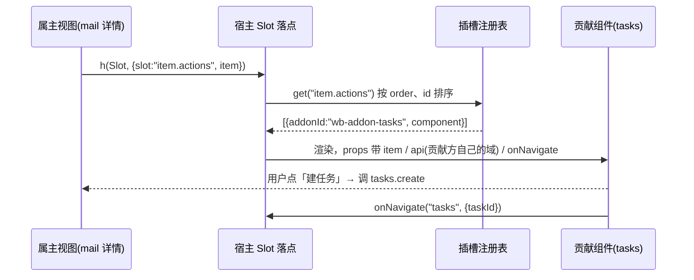
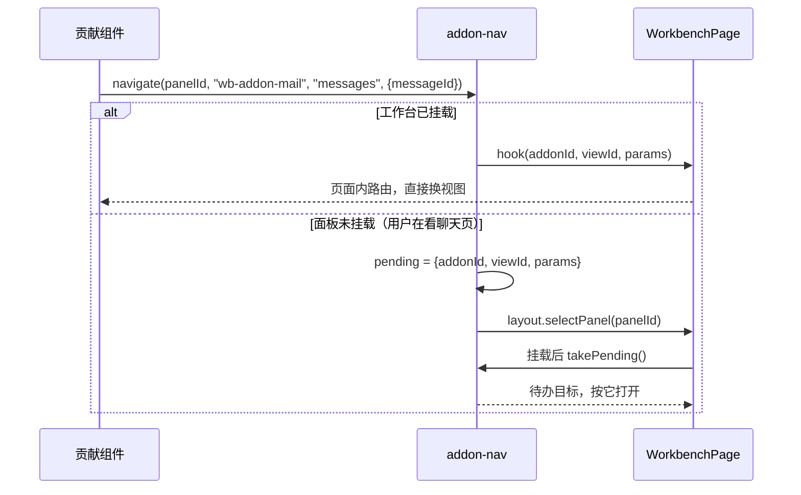

# 07 视图与跨插件界面

> 本章回答：一个插件视图从声明到渲染经过哪些环节、视图组件拿到什么上下文、
> 怎样把自己的按钮放进别人的界面、跳转为什么要经过宿主路由、哪些界面规范是不能绕开的。

## 1. 视图从声明到渲染

后端和前端各声明一次视图列表，宿主按"客户端优先、清单兜底"合成最终页签：

| 位置 | 内容 | 作用 |
| --- | --- | --- |
| `DomainDef.views`（[`../../packages/addons/tasks/lib/index.js`](../../packages/addons/tasks/lib/index.js)） | `{ id, title }` 元数据 | 未加载客户端时仍能列页签、做能力说明 |
| `registerAddon({ views })`（[`../../packages/addons/tasks/client/client.src.cjs`](../../packages/addons/tasks/client/client.src.cjs)） | `{ id, title, icon?, component, keepAlive? }` | 真正的渲染入口 |

宿主在 [`../../packages/shell/client/client.src.cjs`](../../packages/shell/client/client.src.cjs) 里取 `mod.views`，为空才回退到
`currentAddon.views`；路由形如 `addon:<addonId>:<viewId>`，找不到 viewId 时落 `views[0]`。
业务插件可以只声明一部分视图给后端（如任务后端声明 5 个、客户端注册 8 个），
但**客户端注册的 id 必须能对上路由与 `onNavigate` 的目标**。



渲染细节：

- `view-tabs.cjs` 只在**两个以上视图**时输出 `.wb-page-tabs`；少于两个不画标签条，
  避免单页插件顶栏出现一个孤零零的页签。
- `view-outlet.cjs` 为声明了 `keepAlive: true` 的视图保留挂载点，用 `hidden` 切换并
  在切回时恢复滚动位置；未声明的视图每次切换都重新挂载。
- 沉浸式布局只有一层顶栏：`.wb-immersive-bar` 依次放图标、返回、页签与标题+版本徽标，
  `.wb-immersive-main > .wb-inner.wb-wide` 承载视图内容。页签必须留在这一行，
  不要再包一层标题栏（见 [04-UI规范 第 2 条](../AGENTS规范/04-UI规范.md)）。

## 2. 视图拿到的上下文

| prop | 来源 | 用途 |
| --- | --- | --- |
| `api` | `apiFor(addonId)` | 调 action、订阅宿主事件；`api.call("mail.messageSend")` 之类带域前缀的调用会路由到对应域 |
| `lang` | 宿主当前语言 | 视图内文案切换 |
| `t` | 宿主动词表 | 只用来取宿主通用文案；业务文案留在插件内 |
| `viewParams` | `go(route, params)` 的第二个参数 | 跨插件跳转带来的参数，如 `{ messageId }` |
| `onNavigate(viewId, params)` | 宿主绑定到**本插件** | 插件内部换视图；跳别家请用 `host.navigateAddon` |

`apiFor` 按 addonId 缓存（[`../../packages/shell/client/client.src.cjs`](../../packages/shell/client/client.src.cjs) 的 `apiFor`），
同一个插件所有视图共享一个 api 实例，因此事件订阅不要在每个视图里各订一份，
应放在模块级或用引用计数。

**页面数据自证**：视图只调用本插件注册的 action 取数，不走宿主的统一数据接口。
数据页、配置页、Action 页都遵循这条（见 [02-ActionSchema 规范](../AGENTS规范/02-ActionSchema与页面数据.md)）。

## 3. 四类视图的现成基件

不要从零写页面。先看 [`../../packages/addons/lib/`](../../packages/addons/lib/) 里已有一份的形态：

| 视图形态 | 直接复用的模块 | 参考实现 |
| --- | --- | --- |
| 记录列表 / 详情 | 自己写视图，按钮与空态用 `client-common.cjs` 的 `Btn`/`Empty`/`Notice` | [`../../packages/addons/tasks/client/views/tasks-view.cjs`](../../packages/addons/tasks/client/views/tasks-view.cjs) |
| 数据页（只读浏览本插件表） | `data-view.cjs`，工厂返回 `{ DataView }` | [`../../packages/addons/sites/client/views/data.cjs`](../../packages/addons/sites/client/views/data.cjs) |
| 配置页（含方案切换） | `config-scheme-bar.cjs` + `switch.cjs`/`number-field.cjs` | [`../../packages/addons/sites/client/views/config.cjs`](../../packages/addons/sites/client/views/config.cjs) |
| Action 页（运行时 action 清单） | `action-schema-view.cjs` | `../../packages/addons/*/client/views/actions.cjs` |

共享控件的边界（同一份理由见 [04-UI规范](../AGENTS规范/04-UI规范.md)）：

- 颜色、边框、阴影只来自 `--wb-*` 主题 token，禁止写死 `#fff`/`#2563eb` 之类；
- 按钮、骨架屏、对话框外壳、图标渲染、标签筛选、数字输入、布尔开关必须走共享件；
- 图标表按插件保留（体积原因），但渲染逻辑只有一份：`icons.cjs` 的工厂；
- 样式模块可能返回数组，交给 `inject-styles.cjs` 规范化后再注入，别自己拼字符串。

`pnpm test:shared-ui` 会拦住"13 个插件里某个又自研 Button/Skeleton/Modal"的回退。

## 4. 跨插件界面：插槽

想让别的插件界面出现一个入口，**不改对方代码**，而是往宿主白名单插槽贡献组件。
目录由宿主维护，只有四个 id 有效：

| 插槽 | 落点 | 载荷 |
| --- | --- | --- |
| `item.actions` | 单条对象的操作条（邮件详情、任务详情） | `item: WbItemRef`，`kind` 如 `mail.message` / `task` |
| `view.toolbar` | 插件视图工具条 | `view: { addonId, viewId }` |
| `settings.sections` | 配置页的分段 | `owner: string` |
| `home.card.footer` | 首页插件卡片底部 | `card: { addonId, title }` |

两个方向各有约定：

- **贡献方**在 `registerAddon({ slots: [...] })` 里声明。写在数组里，宿主卸载插件时能按
  `addonId` 一起撤销；用 `host.registerSlot()` 单独注册的贡献无法回收，只用于动态场景。
- **属主**在自己视图里渲染 `h(host.Slot, { slot, ownerId, ...载荷 })`。没有贡献时落点
  渲染 `null`，不占位、不报错；每个贡献单独包错误边界，一个抛错只消失它自己。



### 4.1 一对真实例子

邮件详情动作条提供落点，任务是贡献方：

```js
// 属主：packages/addons/mail/client/views/detail-tools.cjs
h(o.Slot, {
  slot: "item.actions",
  ownerId: "wb-addon-mail",
  lang: o.lang,
  item: { kind: "mail.message", id: String(current.id), title: current.subject, subtitle: senderDetail(current) },
});
```

```js
// 贡献方：packages/addons/tasks/client/client.src.cjs
host.registerAddon({
  id: "wb-addon-tasks",
  slots: [{ slot: "item.actions", id: "tasks.create-from-mail", order: 100, component: slotTaskFromMessage }],
  views: [/* ... */],
});
```

反向那一条更值得看：任务详情也提供 `item.actions` 落点，邮件贡献"回原邮件"按钮
（[`../../packages/addons/mail/client/views/slot-back-to-message.cjs`](../../packages/addons/mail/client/views/slot-back-to-message.cjs)）。邮件从任务描述里认出
自己写的 `wb-mail:<id>` 标记，再用 `props.onNavigate("messages", { messageId })` 跳回去。
**任务侧不解析任何来源格式**——以后加"从站点建任务"只需站点自己写贡献组件，属主零改动。
属主里一旦出现 `MAIL_REF`/`SITE_REF` 这类分支，就说明插槽用错了。

### 4.2 四条容易踩的规则

1. 插槽 id 打错**不会报错，只会永不显示**。改完跑 `pnpm test:slots`
   （[`../../scripts/test-addon-slots.mjs`](../../scripts/test-addon-slots.mjs) 覆盖排序、隔离、撤销、双向贡献，
   [`../../scripts/audit-slots.mjs`](../../scripts/audit-slots.mjs) 检查已构建产物里的 id 是否在白名单）。
2. `order` 只表达视觉顺序（升序，同值按 id 字典序，保证与安装顺序无关），
   不表达依赖；需要对方的数据就调 action，别用 order"等"对方先渲染。
3. 贡献组件渲染在别人页面里，拿不到属主的 CSS 变量；颜色仍用主题 token，
   带兜底写法如 `var(--wbt-line, var(--wb-border))`。
4. 贡献组件要轻：渲染期不发同步重活，需要数据用 `api.call(...)` 异步取并自己处理
   加载与失败。

## 5. 跨插件跳转

路由是 `WorkbenchPage` 的局部 state，没有 URL 深链，因此跳转统一走
[`../../packages/shell/client/addon-nav.cjs`](../../packages/shell/client/addon-nav.cjs)：



对外只有两个入口：宿主桥的 `host.navigateAddon(addonId, viewId?, params?)` 与渲染 props 里的
`onNavigate`。它们都不需要贡献方拼 addonId，来源归属由宿主按"贡献方的域"绑定。

## 6. 首页、系统页与宿主自己的页面

- **首页卡片**：`/workbench/api/domains` 返回 `category`，宿主用 `home-categories.cjs`
  按 [`../../packages/shell/src/infra/categories.ts`](../../packages/shell/src/infra/categories.ts) 的栏目表分组；未声明或未知栏目落 `other`，
  空栏目不渲染。栏目 id 一旦发布只能新增。
- **系统页**（账号、备份、审计、Agent 权限、数据、配置、事件队列）是宿主页面，不属于任何
  业务域；入口是首页"管理"区的 `manageCards`（[`../../packages/shell/client/system-pages.cjs`](../../packages/shell/client/system-pages.cjs)）。
- **宿主的数据/配置页**复用与插件相同的共享件：数据页用 `data-view.cjs` 浏览 10 张平台表，
  配置页只有 `audit.recordReads`、`audit.retentionDays` 两项。实现见
  [`../../packages/shell/client/host-pages.cjs`](../../packages/shell/client/host-pages.cjs) 与 [08 数据配置与同步](08-数据配置与同步.md)。

两条 React 事故的教训（都会整页白屏，已有测试守着）：

- **别把工厂返回值当组件渲染**：`data-view.cjs` 返回 `{ DataView, DOMAIN }`，必须取 `.DataView`，
  否则 React #130（元素类型是对象）。
- **别在路由分支里直接调用页面函数**：`queuePage({...})` 会把页面 hooks 挂到 `WorkbenchPage`
  的 hook 链上，切路由时数量变化就是 React #310。页面要导出组件外壳
  （`function QueueView(props){ return queuePage(props); }`），路由用 `jsx.jsx(QueueView, {...})`。

## 7. 验证清单

- `pnpm test:clients`：13 个插件的客户端都能加载、注册视图并通过宿主桥冒烟。
- `pnpm test:slots`：插槽排序/隔离/撤销与"属主零来源解析"。
- `pnpm test:shared-ui`：共享控件全量接入。
- `pnpm test:workbench-navigation`：跨插件跳转、viewParams 与面板未挂载时的待办。
- `pnpm test:view-icons`：页签图标（组件形态、`aria-hidden`、渲染尺寸）。
- 改布局后按 [04-UI规范](../AGENTS规范/04-UI规范.md) 在浅色/深色、宽屏/窄屏各看一次；
  壁纸主题下额外确认卡片有磨砂，正文不被背景图案顶掉。

相关章节：[01 总体架构](01-总体架构.md)、[04 宿主与业务插件](04-宿主与业务插件.md)、
[05 Action 机制](05-Action机制.md)、[06 事件队列](06-事件队列.md)、
[08 数据配置与同步](08-数据配置与同步.md)、[10 构建安装与发布](10-构建安装与发布.md)。
插槽设计取舍见 [跨插件界面插槽设计.md](../跨插件界面插槽设计.md)。
