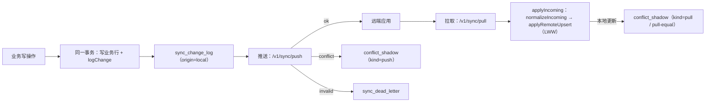
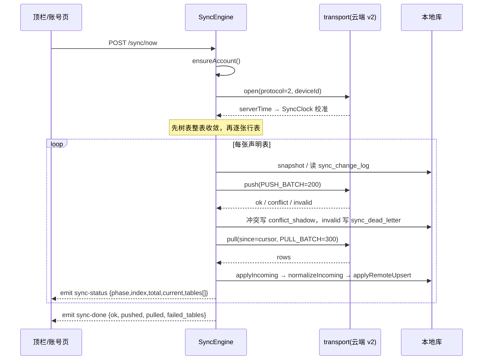

# 08 数据配置与同步

> 本章回答：一张表到底归谁建、谁写、谁同步、谁备份；为什么"页面上能看见"不等于"会同步"；
> 配置项和配置方案分别存在哪、冲突和死信怎么处理。

## 1. 四层所有权，先看清再动手

| 层 | 谁负责 | 表/文件 | 是否进同步 | 是否进备份 |
| --- | --- | --- | --- | --- |
| 平台表 | 宿主（`packages/core/src/schema.ts`、`packages/shell/src/infra/*`） | `meta`、`sync_change_log`、`conflict_shadow`、`sync_dead_letter`、`sync_state`、`session_mode`、`host_event`、`host_event_delivery`、`host_event_subscription`、`audit_log` | 否 | 否 |
| 业务表 | 各业务插件自己的 `lib/db/` | 如 `task*`、`site*`、`mail_*` | 由该域 `sync.tables` 声明决定 | 由该域 `exportData()` 决定 |
| 标签映射 | **标签域独占** `tag`、`tag_mapping` | `item_type` 区分归属 | 标签域同步声明 | 标签域导出；业务域可自行导出自己的行 |
| 配置 | 业务域 ITEMS + 方案表；指针在 `meta` | `config.<domain>.<id>`、`<domain>_config_scheme` | 方案行同步，指针不同步 | 域自己决定（通常随 exportData） |

宿主数据页的白名单固定 10 张（7 张同步/审计/会话表 + 3 张队列表），业务表在业务插件自己的
"数据"页看——**业务页面自证数据源**，不靠宿主统一接口。

> 关键约束：一张表只能有一个属主。站点曾把 `tag_mapping` 写进自己的
> `tables` 声明，看起来无害，实际让两处手写同一套唯一键与墓碑策略，最终在设置卡片上
> 显示成"站点维护标签映射"。现在 `tag_mapping` 只由标签域声明、建表、同步，
> 站点与任务只读写 `item_type='site'` / `'task'` 的行。



## 2. 业务表：怎么建、怎么演进

DDL 写在插件的 `lib/db/` 里，`ensureSchema(db, log)` 在 `setup` 阶段执行。以站点
（[`../../packages/addons/sites/lib/db/db.js`](../../packages/addons/sites/lib/db/db.js)）为标准流程：

1. 建 `meta`（若尚未存在）；
2. 检测旧结构不兼容就**抛错停止**，不做静默迁移；
3. 执行各表 DDL（`CREATE TABLE IF NOT EXISTS` + 索引）；
4. 用 `ALTER TABLE ... ADD COLUMN` 给旧库补列；
5. 删除已下线表（如 `site_account`、`site_account_external`）；
6. `log("sites schema ready")`。

表的公共列约定（任务 [`../../packages/addons/tasks/lib/db/db-core.js`](../../packages/addons/tasks/lib/db/db-core.js) 的 `TASK_DDL`）：

| 列 | 含义 |
| --- | --- |
| `id` | 主键；同步时不允许被改写（`normalizeIncoming` 发现 id 变了抛 `SYNC_ROW_ID_CHANGED`） |
| `created_at` / `updated_at` | 毫秒时间戳；`updated_at` 是 LWW 的唯一依据 |
| `deleted_at` | 软删墓碑；删除靠它同步，不依赖物理 DELETE |
| `rev` | 本地递增版本，供排查与冲突记录 |

演进原则：**只加列、不删表**。已下线表在 `ensureSchema` 里显式 DROP（要对旧库安全），
运行期"清空数据"则只删行、不删表——宿主持有 `DatabaseSync` 句柄，删表会让句柄悬空
（[`../../packages/shell/src/infra/data-clear.ts`](../../packages/shell/src/infra/data-clear.ts)）。

## 3. 写路径：没有 change log 就没有同步

同步不是靠"扫表比对"，而是靠变更日志。规则只有一条：
**写业务行和写 `sync_change_log` 必须在同一个事务里**。

```js
// packages/addons/tasks/lib/tree/task-node-write.js
tx(db, () => {
  db.prepare("UPDATE task_node SET ... WHERE id = ?").run(...);
  logChange(db, "task_node", id, "upsert", nextRow, "local", ts);
});
```

`logChange`（[`../../packages/addons/tasks/lib/db/db-core.js:212`](../../packages/addons/tasks/lib/db/db-core.js)）的细节：

- 入参 `origin === "sync"` 直接 return —— 同步应用远端行时不能再记一条变更，否则来回反弹；
- `op === "delete"` 且没给 payload 时回读当前行，保证墓碑带着最后状态；
- 写入 `sync_change_log(table_name, row_id, op, payload, origin, updated_at)`。

`tx(db, fn)` 用 `BEGIN IMMEDIATE` / `COMMIT` / `ROLLBACK`；跨表写入（例如建节点同时改父节点
sort）必须在同一个 `tx` 里，否则一次同步可能只推走一半。

## 4. 同步声明：row 还是 tree

声明在 `DomainDef.sync`（SDK 类型 [`../../packages/sdk/src/index.ts`](../../packages/sdk/src/index.ts) 的 `DomainSyncDef`）：

```ts
registerDomain({
  id: "wb-addon-tasks",
  sync: { tables: taskSync },
  // ...
});
```

```ts
// packages/addons/tasks/lib/infra/sync.js
export const taskSync = {
  tables: [
    { name: "task", mode: "row" },
    { name: "task_node", mode: "tree", reconcile: reconcileTaskTree },
    { name: "task_timeline", mode: "row", normalizeIncoming: normalizeTimelineTask, afterApply },
    // ...
  ],
};
```

| 字段 | 作用 | 什么时候需要 |
| --- | --- | --- |
| `mode: "row"` | 逐行 LWW | 绝大多数实体表 |
| `mode: "tree"` | 整表结构收敛后按行合并 | 层级/顺序敏感的表（任务节点、站点节点） |
| `normalizeIncoming(ctx)` | 应用远端行前修正/拒绝 | 需要补默认值、拒收非法行 |
| `afterApply(ctx)` | 应用后做派生更新 | 需要重算计数、索引列 |
| `reconcile(rows)` | 只收敛结构，不写库 | 树表：合并版本、修孤儿、重排 sort、重算 path/depth |
| `uniqueKeys` + `uniquePolicy` | 唯一键冲突策略 | 同一自然键可在两台设备各建一行时 |

`reconcile` 的契约要记牢：它返回 `{ rows, dirtyRowTables }`，**不直接写库**；同级同名不是
合并而是报 `PATH_AMBIGUOUS`，因为系统无法猜测用户的意图。

标签表不写进业务域声明。业务域要写标签映射，调用标签域的 action，或只操作
`item_type` 属于自己的行；两边都声明同一张表会让唯一键与墓碑策略出现两份实现
（[`../../packages/addons/sites/lib/infra/sync.js`](../../packages/addons/sites/lib/infra/sync.js) 的注释与 spec 25 都记了这个教训）。

## 5. 一轮同步发生了什么

引擎在 [`../../packages/shell/src/sync/sync.ts`](../../packages/shell/src/sync/sync.ts)（约 665 行），入口是 `SyncEngine.run()`：



几个容易被忽略的点：

- **首次同步做 backfill**：远端有本地无、本地有远端无都算差异，走 `enqueueRepair` 补一条变更，
  否则新设备只能单向接收、永远传不上去。
- **时钟必须校准且单调**：`SyncClock` 取服务端时间后保证只增不减，否则同一毫秒的两次写入
  会让 `updated_at` 相等，LWW 退化成"内容比较"。
- **进度事件是给 UI 的契约**：`sync-status` 带 `phase`（`open`/`table`/`table-error`/`done`）、
  `index`/`total`/`current` 与逐表结果；顶栏胶囊和账号页都只读这些字段，不要在客户端
  自己猜"到第几张表了"。
- **同步是串行的**：`syncBusy` 为真时再次触发直接返回进行中；`/data/clear` 这类破坏性操作
  在同步中返回 409。

## 6. 冲突、死信与人工处置

| 现象 | 落点 | 处置 |
| --- | --- | --- |
| 推上去被服务端判冲突 | `conflict_shadow(kind="push")` | 应用服务端行，本地差异留档 |
| 拉下来但本地 `updated_at` 更新 | `conflict_shadow(kind="pull", resolution="local")` | 保留本地，等下一轮再推 |
| 两边 `updated_at` 相等但内容不同 | `conflict_shadow(kind="pull-equal")` | 人工看一眼，避免无意义覆盖 |
| 唯一键撞车（`uniquePolicy: "lww-tombstone"`） | `conflict_shadow(kind="unique")` | 保留新的一方，旧的一方软删并 enqueueRepair |
| 服务端拒绝该行 | `sync_dead_letter` | 修数据后重试，不阻塞整轮 |

冲突列表与解决走宿主 HTTP（[`../../packages/shell/src/infra/network.ts`](../../packages/shell/src/infra/network.ts)）：
`GET /sync/conflicts`、`POST /sync/conflicts/:id/resolve`，`action` 取
`keep_local | keep_server | dismiss`。死信不自动重试，重投由用户或脚本显式触发。

## 7. 配置项与配置方案

配置有两层，职责不同：

| 层 | 存哪 | 是否同步 | 例子 |
| --- | --- | --- | --- |
| 单值配置 | `meta` 的 `config.<domain>.<id>` | 否（本机偏好） | 同步间隔、通知开关 |
| 配置方案 | `<domain>_config_scheme` 表 + `data` JSON | 是（方案行进 change log） | "工作微信/个人微信"两套账户布局 |

当前方案指针存在 `meta` 的 `configScheme.<domain>.active`，**不同步**：同一个人在两台机器上
可以用不同方案，但方案本身随数据走。

配置项声明（范本 [`../../packages/addons/sites/lib/infra/config.js`](../../packages/addons/sites/lib/infra/config.js)）：

```js
{
  id: "download.parallel",
  group: "download",
  type: "int",              // bool | int | enum | multi | string
  surface: "ui",            // ui 可改；api 只读展示
  apply: "mount",           // mount 重新挂载；api 立即生效
  default: 2,
  min: 1, max: 8,
  zh: "同时下载数", en: "Parallel downloads",
  hint: { zh: "…", en: "…" },
}
```

- 读：`loadConfig` = 默认值 ← 方案覆盖项，坏 JSON、越界值、未知项都只记 warning，不抛错；
- 写：`writeValues` 先整批校验，再在同一个事务里 `writeSchemeData` + `logScheme`；
- action：`configGet` / `configSet` / `configReset` / `configSchemeCreate` / `...Rename` /
  `...Delete` / `...Activate` / `configOptions`，由 `registerConfigActions` 统一注册；
- 页面：配置页用共享 `config-scheme-bar.cjs`（方案下拉 + 另存为/重命名/删除），
  控件用 `switch.cjs` / `number-field.cjs`，不要写原生 `type="number"`。

### 宿主备份偏好方案（0.14.0）

在工作台「配置」页保存命名方案。重新打开「数据备份」或「账号与同步」时，页面读取当前方案。方案及选中状态保存在本机。

| 页面 | 方案字段 | 初始值与用途 |
| --- | --- | --- |
| 数据备份 | `backup.exportFormat` | `zip`。也可选择 `json`、`csv`、`txt` 作为下次导出的初始格式。 |
| 数据备份 | `backup.moduleIds` | `null` 表示动态全选，后续安装的模块也会被选中。指定列表时按域 id 匹配当前可用模块，空数组表示初始不选。 |
| 账号与同步 | `cloud.conflictLimit` | 默认显示 20 条冲突记录，当前方案决定请求条数。 |

单次导入的同 ID 处理策略在备份页核对。云端类型、服务地址、凭据和同步游标沿用连接设置。修改方案只保存偏好，导出、导入与同步均由原页面的执行入口触发。审计保留天数和读操作记录开关是独立的本机全局设置。

## 8. 备份与可读导出

宿主只做三件事，域自己决定内容（[`../../packages/shell/src/infra/backup.ts`](../../packages/shell/src/infra/backup.ts)）：

1. 逐个域调 `exportData()` 拿到任意 JSON（也可返回 `undefined` 表示"本域不导出"）；
2. 按 `BackupManifest` 打 ZIP，每模块一个文件 + `sha256`；
3. 导入时按 manifest 把每个文件交回对应域的 `importData(raw, ctx, options)`。

```json
{
  "kind": "dsh-workbench-backup",
  "formatVersion": 1,
  "shellVersion": "0.13.0",
  "exportedAt": 1795300000000,
  "modules": [{ "id": "wb-addon-mail", "title": "邮件", "version": "0.9.0", "file": "mail.json", "size": 48213, "sha256": "…" }],
  "skipped": [{ "id": "wb-addon-automation", "reason": "本域不导出台账" }]
}
```

导入策略 `DomainImportPolicy = "skip" | "overwrite" | "newest"`，默认 `newest`：按记录自身的
`updated_at` 合并，不整库覆盖；返回 `ok | partial | failed | skipped` 四态，页面据此显示
每个域的导入结果。

可读导出（[`../../packages/shell/src/infra/backup-export.ts`](../../packages/shell/src/infra/backup-export.ts)）是另一条路：把数据 JSON 摊平成
`json|csv|txt` 甚至 ZIP，产物 `kind = "dsh-workbench-export"`，**导入侧会明确拒绝它**——
它是给用户看/给表格软件用的，不是用来恢复的。CSV 带 BOM，保证 Excel 打开中文不乱码。

域侧分工的例子：

- 邮件导出 `{ schemaVersion: 2, accounts, mailboxes, messages, configSchemes }`；
- 站点只导出 `item_type='site'` 的 `tag_mapping` 行，不导出整张标签表
  （[`../../packages/addons/sites/lib/infra/backup.js`](../../packages/addons/sites/lib/infra/backup.js)）；
- 标签域导出 `tag` 与全部映射，但排除 `item_type` 属于其他域的缓存行时以各域自述为准。

## 9. 页面与接口的边界

- 业务"数据"页只读本域表：`<domain>.dataTables` / `<domain>.dataQuery`
  （范本 [`../../packages/addons/sites/lib/infra/data.js`](../../packages/addons/sites/lib/infra/data.js)）。参数白名单很窄：`pageSize` 只能取
  `[10,25,50,100,200]`、`sort` 必须是真实列、`search` 只匹配 TEXT 列、`filters` 最多 20 条；
  不提供任意 SQL、不提供写操作、不暴露 `meta` 与 `sync_*`。
- 宿主"数据"页只读 10 张平台表（`wb.dataTables` / `wb.dataQuery`，实现在
  [`../../packages/shell/src/actions/host-data.ts`](../../packages/shell/src/actions/host-data.ts)），宿主"配置"页只有
  `audit.recordReads`、`audit.retentionDays` 两项（`wb.configGet/configSet/configReset`）。
- 排队运行状态看宿主"事件队列"页（`wb.event*`），那里能重投死信、清理历史。

## 10. 验收清单

- `pnpm test:data`：数据页 action 的分页/排序/搜索/过滤与越权表拒绝。
- `pnpm test:config`：配置读写、方案增删改、越界与坏 JSON 的 warning 行为。
- `pnpm test:backup`：导出 ZIP 的 manifest/sha256、三种导入策略、可读导出被导入侧拒绝。
- `pnpm test:data-clear`：确认词、同步中 409、只删行不删表、凭据文件被清。
- `pnpm test:sites` / `pnpm test:tasks` / `pnpm test:tags`：各域 schema 与同步声明的断言
  （含"只声明自己的表"这类红线）。
- `pnpm test:host-data`：10 张平台表清单与配置白名单。
- 改同步声明后额外跑 `pnpm test:native`，它会把各域声明的表与实际 DDL 对一遍。

相关章节：[01 总体架构](01-总体架构.md)、[04 宿主与业务插件](04-宿主与业务插件.md)、
[06 事件队列](06-事件队列.md)、[07 视图与跨插件界面](07-视图与跨插件界面.md)、
[10 构建安装与发布](10-构建安装与发布.md)。规则细节见
[AGENTS规范/02-ActionSchema与页面数据.md](../AGENTS规范/02-ActionSchema与页面数据.md)。
