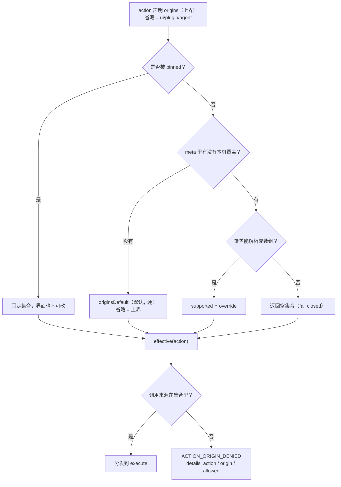
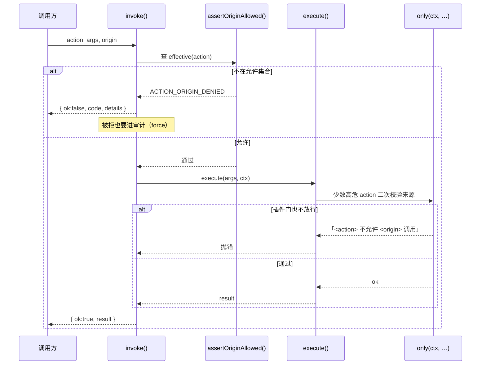
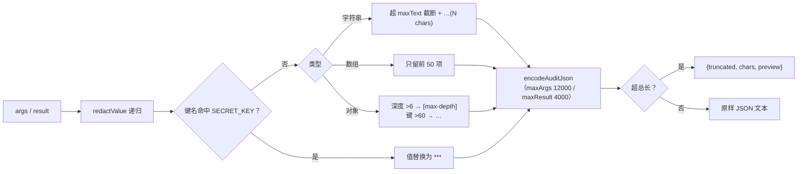

# 09 权限、审计与安全

> 本章回答：谁能调哪个 action 由什么决定；为什么“界面能开、agent 不能”不是前端隐藏；
> 一次被拒的调用会留下什么；审计里为什么看不到密码；本机还有哪些不可让渡的安全边界。
> action 的定义与分发机制在[05 Action 机制](05-Action机制.md)，事件队列的订阅授权在
> [06 事件队列](06-事件队列.md)。

## 1. 威胁模型：防的是“误用与越权”，不是“入侵者”

工作台是**单用户本机应用**，数据库文件在用户自己的目录里。因此这里的安全设计不假设
有攻击者能读内存或改磁盘，而是盯住三类现实风险：

| 风险 | 例子 | 对应机制 |
| --- | --- | --- |
| agent 越权 | 用户只让 agent 读任务，agent 却调用 `tasks.delete`，或给自己打开权限 | 来源模型 + 开关不可自改（第 3 节） |
| 提示注入/误操作 | 模型被网页内容带偏，批量删除或把凭据写进日志 | 来源默认最小 + 审计留痕 + 脱敏（第 6 节） |
| 敏感数据外流 | 密码、token、保险箱明文出现在审计或界面 | 键名脱敏、截断、凭据文件 0600（第 7 节） |

推论：**权限判定必须在宿主里做**，不能靠界面不渲染按钮，也不能靠插件自觉。

## 2. 四个来源与三层模型

SDK 只定义四个来源（[`packages/sdk/src/index.ts:25`](../../packages/sdk/src/index.ts#L25)）：

| 来源 | 谁产生 | 现状 |
| --- | --- | --- |
| `ui` | 界面 RPC `POST /workbench/api/domains/:id/actions/:action` | 唯一能改权限的来源 |
| `plugin` | 插件 `api.call` / `host.call` / `host.invoke` / 事件队列投递 | 插件间调用与后台任务 |
| `agent` | Workbench 工具的 `execute` | 模型发起的调用 |
| `sync` | —— | **声明层预留，当前没有任何分发点产生**；同步写行走 `sync-incoming` 直接写表，不经过 action |

一个 action 的最终允许集合由三层叠加（实现在
[`packages/shell/src/actions/origin-access.ts`](../../packages/shell/src/actions/origin-access.ts)）：



几个刻意的取舍：

- `originsDefault` 只允许是 `origins` 的子集（`defaultEnabled()` 做交集），
  声明者不能靠默认值把上界放大。
- 覆盖串读坏时**返回空集合**而不是回退默认：宁可让 action 暂时不可用，也不要静默放宽权限。
- 归一化会丢掉未知来源、去重，并按 `ui → plugin → agent → sync` 固定排序
  （[`origin-access.ts:23`](../../packages/shell/src/actions/origin-access.ts#L23)），
  所以审计里同一个配置不会出现两种顺序。

## 3. 配置面：只有界面能改，且不能改宽

用户看到的入口是宿主「Action」页：每个 action 一行，三列分别是**声明支持 / 默认启用 / 生效**，
勾选后写本机 `meta`。写操作只有一个：`actions.setActionOrigins`。

- **它自己钉死为 `["ui"]`**：`createOriginAccess(db, { pinned: { "actions.setActionOrigins": ["ui"] } })`
  （[`actions.ts:27`](../../packages/shell/src/actions/actions.ts#L27)），并且 execute 里再判一次
  `if (ctx.origin !== "ui") throw uiOnlyError()`——agent 调它会得到 `ACTION_UI_ONLY`，
  文案明确写「agent 不能修改 action 的调用权限」。这样模型无法给自己解锁，也无法把别人的权限打开。
- **越界即拒绝**：只能从声明支持里取舍，越界抛「该 action 本身不支持这些来源：…」，
  由 action 包成 `ACTION_ORIGIN_UNSUPPORTED`（[`actions.ts:176`](../../packages/shell/src/actions/actions.ts#L176)），
  调用方可以据此区分“配置错误”与“被拦下”。
- **不放大**：`set()` 最终写的是 `supported ∩ 请求值`；与默认值相同时直接删掉 meta 行，
  避免 `meta` 里堆满“等于默认”的噪声。
- **只影响本机**：键是 `config.wb-shell.actionOrigins.<action>`，属于本机配置，
  **不进备份、不进云同步**，也不进别的设备。

## 4. 执行期：一道宿主门 + 一道插件门



**宿主门**在 `invoke()` 里，所有入口共享，未知 action 不拦截（仍走“没有该 action”的报错，
避免把探测变成权限 oracle）。

**插件门**是少数高危动作的自保：`only(ctx, ["ui"], name)`
（[`packages/addons/vault/lib/domain/actions.js:8`](../../packages/addons/vault/lib/domain/actions.js#L8) 一类）。
它和声明是**两条独立的信息**，容易漂移，所以有专门的检查：

```bash
node scripts/test-origin-decls.mjs   # 声明来源 ⊇ 执行期 guard 允许的来源
```

两者不一致的后果很具体：声明漏了某个来源，guard 里写得再对也永远调不通；声明多了，
guard 会挡下但错误码变成普通异常，排查时容易被当成业务错误。

**事件消费**还有第三条约束：消费 action 的 `origins` 必须**恰好**是 `["plugin"]`
（多一个来源就多一条绕开队列与审计的路径），由 `queue.subscribe()` 在登记时校验，
细节见[06 章第 4 节](06-事件队列.md)。

## 5. agent 能看到什么

“不可见”和“不可调”是两件事，宿主两边都做：

| 层 | 行为 | 实现 |
| --- | --- | --- |
| `actions.list` | 对 agent **隐藏**生效集合里没有 agent 的 action | [`actions.ts:263`](../../packages/shell/src/actions/actions.ts#L263) |
| `actions.help` | 查不可见的 action 抛同一个 `ACTION_ORIGIN_DENIED`，不泄露字段 | [`actions.ts:330`](../../packages/shell/src/actions/actions.ts#L330) |
| `GET /workbench/api/schema` | agent 视角下过滤掉 origins 不含 agent 的条目 | `decorateSchemaResult` [`actions.ts:470`](../../packages/shell/src/actions/actions.ts#L470) |
| `capabilities.list/get` | 统计里的 actionCount 与清单同样按 agent 可见性过滤 | [`capabilities.ts:182`](../../packages/shell/src/actions/capabilities.ts#L182)、[`:272`](../../packages/shell/src/actions/capabilities.ts#L272) |

界面（`ui`）始终看全量：用户要能看见“有个 action，但我没给 agent 开”，否则无从配置。

## 6. 审计：谁在何时调了什么

### 6.1 采集点

只有一处采集：`invoke()` 外层（[`actions.ts:377`](../../packages/shell/src/actions/actions.ts#L377)），
成功与失败各记一条。三条规则决定了“记什么”：

1. **三组前缀整体不记**：`capabilities.*`、`actions.*`、`audit.*`——它们本身就是发现与审计工具，
   记下来只会自激（读审计产生新审计）。
2. **只读默认不记**：`isReadAction()` 看 action 名最后一段是否在 `READ_SUFFIX`
   （`list/get/search/stats/help/report/history/schema/export/data/config/view…`，
   [`audit.ts:35`](../../packages/shell/src/infra/audit.ts#L35)）。写操作一律记。
   想看读操作，把 `audit.recordReads` 打开（本机 meta，默认关）。
3. **被权限挡下必须记**：`isPolicyDenied()` 命中 `ACTION_ORIGIN_DENIED` / `ACTION_UI_ONLY`
   （以及历史码 `ACTION_AGENT_DISABLED`）时，即使属于上面两类也 `force: true` 留痕。
   这是排查“agent 说它调了但没反应”的关键证据。

### 6.2 表与查询

表 `audit_log`（[`packages/core/src/schema.ts`](../../packages/core/src/schema.ts)）：
`at / actor / action / domain / ok / error / target / args / result / duration_ms`，
按 `at`、`action`、`ok` 建索引。查询走三个只读 action：

| action | 用途 |
| --- | --- |
| `audit.list` | 按时间/action/域/成败过滤，分页（默认 50，上限 200） |
| `audit.get` | 取单条完整记录（含 args/result 的脱敏后 JSON） |
| `audit.stats` | 默认 30 天，按 action / actor / 天分布（天按本地时区切） |
| `audit.prune` | 手动按保留期清理 |

保留期默认 90 天，可用 `audit.retentionDays`（1–3650）覆盖；写入每满 200 条惰性清理一次，
启动时也清理一次（[`audit.ts:286`](../../packages/shell/src/infra/audit.ts#L286)、[`:462`](../../packages/shell/src/infra/audit.ts#L462)）。
**审计不参与备份与云同步**：它是本机行为账本，跟着设备走。

`target` 从参数里取第一个像“对象标识”的字段（`id/ids/taskId/siteId/tagId/nodeId/tableId/titleKey/name/title`），
写成 `key=value` 并截到 120 字——目的是“能定位到哪条数据”，不是把整份参数再抄一遍。

### 6.3 脱敏与截断



- `SECRET_KEY`（[`audit.ts:31`](../../packages/shell/src/infra/audit.ts#L31)）覆盖
  `password/pwd/token/secret/credential/authorization/cookie/api_key/access_key/private_key/vault/encrypted/seed_phrase`，
  **按键名判定**，所以插件只要把敏感值放在像样的字段名下就能被自动挡住。
- 深度、数组长度、单串长度都有上限（`AUDIT_LIMITS`，[`audit.ts:14`](../../packages/shell/src/infra/audit.ts#L14)），
  保证审计表不会被一次大 payload 撑爆。
- `duration_ms` 与 `ok` 是排查性能与失败率的主键，不要只看 error 文本。

## 7. 其它不可让渡的边界

| 边界 | 做法 | 位置 |
| --- | --- | --- |
| 云凭据 | 写 `~/.dsh/workbench/cloud-creds.json`，权限 `0600` | [`index.ts:77`](../../packages/shell/src/index.ts#L77) |
| 保险箱 | scrypt 派生 KEK + AES-256-GCM，解锁态只在内存 | [`vault/lib/infra/crypto.js:2`](../../packages/addons/vault/lib/infra/crypto.js#L2) |
| 清空数据 | 必须传确认常量 `CLEAR_CONFIRM = "清空全部数据"`；同步进行中直接 409 | [`data-clear.ts:14`](../../packages/shell/src/infra/data-clear.ts#L14) |
| 插件目录隔离 | 各插件只读写自己声明的表；跨域读写走 action / 事件 / 插槽 | 04 章、06 章 |
| 事件授权 | 发布/订阅都要先在 `DomainDef.events` 声明，未声明直接抛错 | 06 章第 3–4 节 |

## 8. 排障对照

| 现象 | 去哪儿看 | 常见原因 |
| --- | --- | --- |
| 「该 action 不允许 agent 来源调用」 | Action 页三列 + `audit.list` 的 `code` | 声明没写 agent、用户关了开关、或 `originsDefault` 只给了 ui |
| agent 在 `actions.list` 里找不到某 action | 同上 | 可见性按生效集合算，和可调性同源 |
| 「只允许在界面中执行」 | `audit.list` 里 `action=actions.setActionOrigins` | 模型尝试给自己/别人开权限，被 pinned + uiOnly 双重挡住 |
| 「该 action 本身不支持这些来源」 | 调用方拿到的 `code` | 请求里带了声明外的来源（`ACTION_ORIGIN_UNSUPPORTED`） |
| 改完开关不生效 | `meta` 里 `config.wb-shell.actionOrigins.<action>` | 覆盖串损坏会 fail closed 成空集合；或改的是别的设备 |
| 审计里看不到某次调用 | 是否只读 / 是否 `capabilities\|actions\|audit.` 前缀 | 默认不记只读；打开 `audit.recordReads` |
| 审计里全是 `***` | 字段名命中 `SECRET_KEY` | 预期行为；要留调试信息请换字段名 |

## 8.1 角色在权限链路中的位置

会话角色是**额外的收窄层**，不是来源模型的一部分：

| 层 | 回答什么 | 实现 |
| --- | --- | --- |
| 角色白名单 | 这一轮允许调哪些工作台动作 | `packages/shell/src/session/tool-policy.ts` |
| agent 来源开关 | agent 这个来源本身能不能用该动作 | `packages/shell/src/actions/origin-access.ts`（第 3 节） |
| 动作 `origins` | 动作支持的来源上界 | 插件声明（第 2 节） |

三者取交集，角色只可能更窄。计划模式再叠第四层：非只读动作一律拒绝。角色被拒的文案是
`本轮工作台角色或计划模式不允许该动作：<action>`（`ACTION_ROLE_DENIED`），与来源拒绝的
文案不同，可以据此判断是哪一层拦下的。角色声明、注入与版本绑定见
[13 会话角色](13-会话角色.md)。

## 9. 验证

```bash
pnpm test:audit            # 采集规则、脱敏、截断、分页、保留期
pnpm test:origin-decls     # 声明来源 ⊇ 插件 guard（也在 test:native 里）
pnpm test:agent-access     # agent 可见性与不可自解锁
node scripts/audit-actions.mjs   # schema/实现/文档/版本一致
pnpm test:action-schema    # Action 页三列与 actions.setActionOrigins
```

新增 action 时的最低要求：写清 `origins`/`originsDefault`；需要 agent 就显式声明；
有 `only()` guard 就保证声明覆盖它；改了权限语义就把本章与
[规范 02](../AGENTS规范/02-ActionSchema与页面数据.md) 一起更新。

---

[来源开关实现](../../packages/shell/src/actions/origin-access.ts) · [审计实现](../../packages/shell/src/infra/audit.ts) · [分发与拦截](../../packages/shell/src/actions/actions.ts) · [回到架构入口](../ARCHITECTURE.md)
