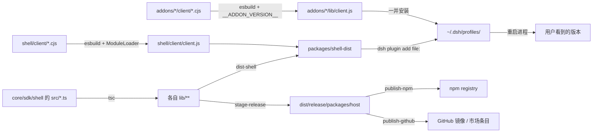
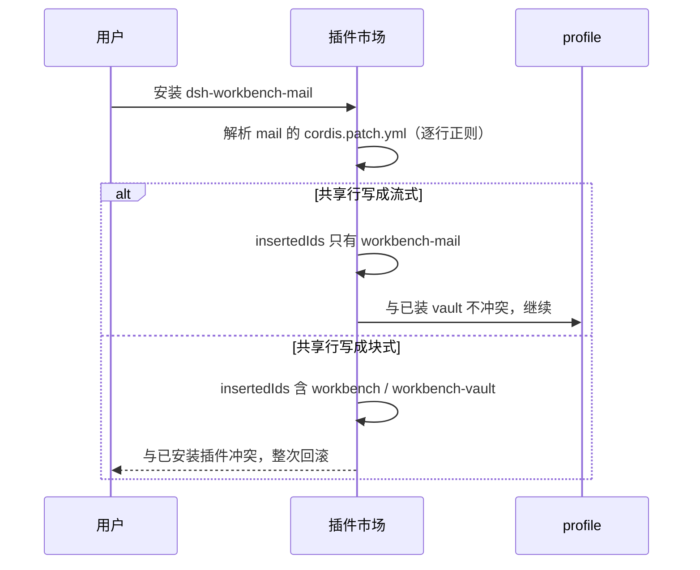

# 10 构建安装与发布

> 本章回答：为什么"仓库代码已经改了、测试也过了"，运行中的插件还是旧行为；
> 本地怎么装才算装对；发布一棵树要经过哪些脚本，顺序为什么不能颠倒。

## 1. 先记住四条断点

插件从源码到用户屏幕要穿过四道门，每一道都可能让新代码停在半路：

| 断点 | 现象 | 检查 |
| --- | --- | --- |
| `packages/*/lib/` 是 tsc 产物，被 `.gitignore` | 改了 `src/*.ts` 没 `pnpm build`，跑测试仍用旧 `lib` | 改完必跑 `pnpm build`；不要直接改 `lib`（下次构建覆盖） |
| 插件客户端 `lib/client.js` 是 esbuild 产物 | 改了 `client/*.cjs` 页面不生效 | `pnpm build` 会跑 `build-addon-clients.mjs`，或 `pnpm build:clients` |
| profile 里的包是 `file:` 拷贝 | 构建产物新、profile 里旧 | `pnpm audit:profile` 比对版本并 import 冒烟 |
| 运行中的进程已加载旧模块 | profile 正确、界面仍是老样子 | 重启桌面端；只重启一次不够时先看 §5 |

附带一条：**同一个版本号重装不会重拷**。pnpm 认为 `file:` 目录内容"已是最新"，
所以改完必须升版本号（或换一个新的 staging 目录），否则 `plugin add` 会成功但文件没变。

## 2. 源与产物

| 源 | 构建手段 | 产物 | 消费方 |
| --- | --- | --- | --- |
| `packages/core/src/**`、`packages/sdk/src/**`、`packages/shell/src/**` | `tsc -p`（`pnpm -r --filter`） | 各自 `lib/**` | 宿主进程 `require` |
| `packages/shell/client/*.cjs` | esbuild 打成 `client/client.js`，包在 `__ModuleLoader__.load({ id:"dsh-workbench", factory })` | 宿主客户端 bundle | 浏览器/桌面 WebView |
| `packages/addons/<插件>/client/client.src.cjs` | 同一条 esbuild 链，注入 `__ADDON_VERSION__ = package.json.version` | 插件 `lib/client.js` | 同样是模块加载器 |
| `packages/shell/lib` + `packages/core/lib`（内联为 `lib/core`）+ 客户端 + `cordis.patch.yml` + `package.json` | [`scripts/dist-shell.mjs`](../../scripts/dist-shell.mjs) | `packages/shell-dist` | `dsh plugin add file:` 的安装源 |
| 全部包 | `scripts/stage-release.mjs` | `dist/release/packages/*`、`dist/release/marketplace/*.yml`、`dist/release/release.json` | `publish-npm.mjs` / `publish-github.mjs` / 插件市场 |



## 3. 构建

```bash
pnpm build
# = pnpm -r --filter @wb/core --filter @wb/sdk --filter dsh-workbench build
#   && node scripts/build-addon-clients.mjs
pnpm dist:shell     # 生成可安装的 packages/shell-dist
```

- **不要手工改 `lib/`**：`packages/core/lib`、`packages/sdk/lib`、`packages/shell/lib` 都在
  `.gitignore` 里，是构建产物；手改会在下一次 `tsc` 时被覆盖，也进不了发布树。
- **`build-addon-clients.mjs` 的 `ADDONS` 数组是显式清单**：新增业务插件要同时补这里、
  根 `package.json` 的 `file:` 依赖、`stage-release.mjs` 的 `ADDON_META`，漏一处
  要么客户端不构建，要么发布树直接报错（宁可失败也不要静默漏发）。
- **`__ADDON_VERSION__` 由构建注入**：客户端源码里写死 `version: "x.y.z"` 会被
  `audit-addon-version.mjs` 判失败。
- 单文件红线由 [`scripts/audit-lines.mjs`](../../scripts/audit-lines.mjs) 把关：手写源 >600 行告警、>900 行失败；
  构建产物与 `specs/` 不计。

## 4. 版本号与兼容性

| 位置 | 谁读 | 规则 |
| --- | --- | --- |
| `packages/addons/<插件>/package.json` 的 `version` | npm、profile、构建注入 | 唯一事实来源 |
| 同文件 `wb.addon.version` | 首页卡片、设置页 | 必须与上一行一致 |
| 同文件 `wb.addon.minShell` | 宿主安装时校验 | 用到的宿主能力（如 `api.events`）要求最低版本，如 `0.13.0` |
| [`packages/shell/src/index.ts`](../../packages/shell/src/index.ts) 的 `SHELL_VERSION` | `/workbench/api/health`、客户端版本徽标 | 与 `packages/shell/package.json` 一致 |
| `packages/shell-dist/package.json` | profile 安装 | 由 `dist:shell` 重新生成，不要手改 |

`pnpm audit:version`（`scripts/audit-addon-version.mjs`）把三处钉在一起：
服务端 `lib/index.js` 不许出现版本字面量、客户端源码不许出现、已构建的 `lib/client.js`
注册版本必须等于 `package.json`。发布树里宿主包名会变成 `dsh-workbench-host`
（npm 上 `dsh-workbench` 已被占用），源码内部仍叫 `dsh-workbench`，改名由
`stage-release.mjs` 的 `rewritePatch()` 与 `rewriteHostClient()` 完成。

## 5. 本地安装与交付

```bash
pnpm build && pnpm dist:shell
STAGE=~/.dsh/workbench/local-packages/$(date +%Y%m%d-%H%M)/packages
mkdir -p "$STAGE"
rsync -a --exclude node_modules packages/addons/ "$STAGE/addons/"
rsync -a packages/shell-dist "$STAGE/shell-dist"
CLI="/Applications/DeepSeek Harness.app/Contents/Resources/runtime/cli/bin/dsh"
"$CLI" plugin --profile desktop add \
  "file:$STAGE/shell-dist" \
  "file:$STAGE/addons/tasks" … "file:$STAGE/addons/vault" --force
pnpm audit:profile
```

几条实测教训：

1. **`rsync` 用单源、不要尾斜杠**：`packages/addons/*/` 多源会把每个子目录的内容摊平到
   `addons/` 根，长出 `addons/client`、`addons/shared` 这类假依赖，pnpm 报
   `ERR_PNPM_LINKED_PKG_DIR_NOT_FOUND` 或 `exit 254`。
2. **一次装全**：邮件依赖保险箱、大多数插件依赖宿主；缺兄弟包会装一半。安装源里
   必须同时有 `shell-dist` 与**全部** addons。
3. **profile 的 `package.json` 可能被污染**：如果之前手工加过指向不存在路径的 `file:`
   依赖，先删掉再装，否则每次 install 都会重复失败。
4. **`pnpm audit:profile` 是唯一可信的"装好了"**：它逐包比对 `package.json` 版本并
   import 入口冒烟，退出码 0 才算一致。安装命令成功、GUI 里能看到入口都不等于生效。
5. **进程未重载时必须说"仍需重启"**：桌面端加载的是已安装模块，替换磁盘文件不会热更新
   宿主与插件服务端代码（客户端 bundle 有 HMR 的前提是 `pnpm run dev:web` 在跑）。

## 6. 子插件的 `cordis.patch.yml` 与安装顺序

每个业务插件都带一份 patch，声明自己往宿主里插什么：

```yaml
# packages/addons/mail/cordis.patch.yml（节选）
- insert:
    - id: workbench-mail
      name: dsh-workbench-mail
- { id: workbench, name: 'dsh-workbench' }
- { id: workbench-vault, name: 'dsh-workbench-vault' }
```

后两行是**共享行**：指向宿主与保险箱，安装时由 DSH 合并，不能删。写法必须是流式单行：

- 插件市场解析 patch 用的是逐行正则（`dshmarket` 的 `parsePatchRows()`），块式
  （`- id: workbench` + 换行 `  name: …`）会被算成这个子插件自己的 insertedIds，
  装第二个 workbench 系插件时立刻判"和已安装的插件冲突"并整次回滚——先装 vault 再装 mail
  就是踩这个；
- 流式写法与 `js-yaml`/DSH 的 `applyPatches()` 语义等价，只是市场正则认不出，因此不冲突；
- 发布时 `stage-release.mjs` 的 `rewritePatch()` 会把宿主名改成 `dsh-workbench-host`，
  漏改直接抛错。



两个守卫脚本：

- [`scripts/test-market-conflict.mjs`](../../scripts/test-market-conflict.mjs)：用 profile 里真实的
  `dshmarket/lib/profile.js` 对拍每个包的"市场视角 insertedIds"，要求两两不相交；
- [`scripts/verify-install-order.mjs`](../../scripts/verify-install-order.mjs)：在临时 profile 里按 宿主 → tasks → sites → vault → mail
  的顺序真装一遍。

## 7. 发布

```bash
pnpm stage:release          # dist/release/{packages,marketplace,release.json}
pnpm publish:npm            # 默认 dry-run，加 --publish 才真发
pnpm publish:github         # GitHub 镜像与市场条目
```

- **发布树是快照**：[`scripts/publish-npm.mjs`](../../scripts/publish-npm.mjs) 会把 `release.json` 里的版本与源码逐一比对，
  不一致就拒绝发布（避免"npm 上不是最新"），确认要用旧快照才加 `--allow-drift`。
- **顺序来自 `release.json`**：宿主必须先发，业务插件的依赖（`dsh-workbench-vault` 等）
  才能解析；仓库约定顺序是 **host → tasks → tags → sites**，其余插件按依赖补。
- **只往官方 npm registry 发**，token 与 GitHub token 只放在本机 0600 私有文件里。
- **市场条目由脚本生成**（`dist/release/marketplace/*.yml`），`ADDON_META` 里的
  `marketZh`/`marketEn`/`marketExtra` 直接进条目；新增插件不登记 `ADDON_META` 会报错。
- 发布前跑：`pnpm build && pnpm dist:shell && pnpm audit:lines && pnpm test:profile-sync`，
  再挑与改动相关的测试（`test:schema`、`test:slots`、`test:shared-ui`、`test:market-conflict`）。

## 8. 云端两套与宿主的关系

- 共享云端 `cloud/`（Java + Postgres）与私人云端 `cloud-private/`（Node + SQLite）都是
  git 子模块，**不在本仓库复制源码**。初始化用
  `git submodule update --init --recursive cloud`，更新用 `pnpm cloud:update`，
  构建用 `pnpm cloud:build`。
- 改云端时先在子模块里提交推送，再回宿主 `git add cloud && git commit` 提交 gitlink；
  只推云端不提交宿主，宿主仍指向旧 commit。
- 私人云端本地起服务 `pnpm cloud-private:start`（需 `WB_PRIVATE_SECRET`），测试
  `pnpm cloud-private:test`。
- 云端类型在账号页选择（`none | private | shared`），切换云端会清空本机同步游标并重新
  全量同步，业务数据不动——细节见 [08 数据配置与同步](08-数据配置与同步.md)。

## 9. 排错对照表

| 症状 | 最可能的原因 | 处理 |
| --- | --- | --- |
| 页面是新代码，接口行为是旧的 | 只构建了客户端 | `pnpm build` 全量（tsc + clients） |
| 接口新了，页面旧 | 没跑 `build-addon-clients` 或没重装 | `pnpm build:clients` + 重装 profile |
| 装完 `audit:profile` 报版本不一致 | 版本没升，pnpm 没重拷 | 升 `version`（含 `wb.addon.version`）后重装 |
| 装完报 `ERR_PNPM_LINKED_PKG_DIR_NOT_FOUND` | staging 目录结构摊平或缺兄弟包 | 用单源 `rsync`，装全所有包 |
| 市场安装报"和已安装的插件冲突" | 共享行写成了块式 | 改流式，跑 `test-market-conflict` |
| 发布出去指向不存在的包名 | patch 宿主名没改写 | 重跑 `stage:release`（`rewritePatch` 会抛错） |
| 重启后仍是旧界面 | 装的是别的 profile / 进程没重载 | 确认 `--profile`、核对 `audit:profile`、再重启 |
| 新插件市场里没有 | `ADDON_META` 漏登记或缺 `release.json` | 补 `ADDON_META`，重建发布树 |

## 10. 验收清单

- `pnpm build && pnpm dist:shell` 无 error；
- `pnpm audit:lines`、`pnpm test:profile-sync`（profile 核对脚本自测）、`pnpm audit:version` 通过；
- `pnpm test:clients`、`pnpm test:schema`、`pnpm test:slots`、`pnpm test:shared-ui` 通过；
- 装进目标 profile 并 `pnpm audit:profile` 退出码 0；
- 交付说明里写清版本号、commit、以及"是否需要重启"。

相关章节：[01 总体架构](01-总体架构.md)、[04 宿主与业务插件](04-宿主与业务插件.md)、
[08 数据配置与同步](08-数据配置与同步.md)、[07 视图与跨插件界面](07-视图与跨插件界面.md)。
规则原文见 [AGENTS规范/03-安装与交付.md](../AGENTS规范/03-安装与交付.md) 与
[AGENTS规范/05-发布与插件市场.md](../AGENTS规范/05-发布与插件市场.md)。
