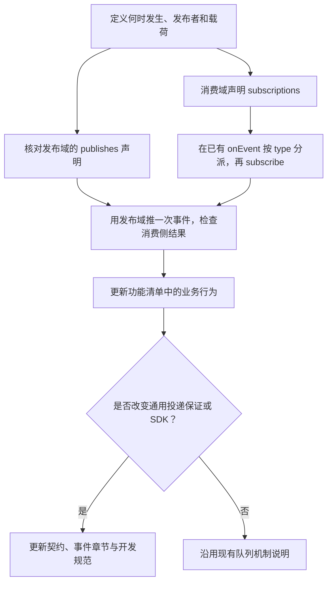

# 11 文档分工与演进

把架构问题写在负责解释它的地方。这样下一次改变宿主行为时，读者仍能从同一个入口找到约定、实现和验证依据。

| 读者的问题 | 维护位置 | 更新时机 |
| --- | --- | --- |
| 插件之间如何协作？为什么由这一层处理失败？ | [架构入口](../ARCHITECTURE.md)和它指向的专题 | 交互方式、责任边界或交付保证变化 |
| 开发者实际要改哪些文件、运行哪些检查？ | [仓库约定](../../AGENTS.md)与[操作规范](../AGENTS规范/) | 操作步骤、版本约束、质量门槛变化 |
| 当前可以调用哪些功能？参数和版本是什么？ | [插件功能清单](../插件功能清单.md)、运行时 `actions.help` | 已交付能力或可见契约变化 |
| 当时有哪些方案、迁移假设是什么？ | [设计记录](../specs/README.md) | 提出方案或需要保存决策依据 |

## 例子：为已有插件增加一个事件订阅

核对这个改动时，宿主「事件队列 → 插件」中的声明回答“允许收什么”，订阅登记回答“这次是否接上”，投递记录回答“实际有没有执行”。诊断要按这三个问题依次取证。邮件接收解锁事件和消息插件生成提醒的回归用例分别见[解锁触发收件](../../scripts/test-mail-vault-kick.mjs)和[新邮件通知](../../scripts/test-mail-message-queue.mjs)。

## 维护图和示例

- 图里每个箭头标动作。跨浏览器／进程边界注明调用入口，跨插件标事件类型或 action 名。时序图分别画出发布确认与下游执行，状态图分别描述事件和投递。
- 用具体的域 id、action、view id 验证示例。声明中的 `wb-addon-mail`、消费入口 `mail.onEvent` 和订阅的 `vault.unlocked` 各有不同职责。
- 行为有分歧时，以当前实现和覆盖该行为的测试说明现状。将可选策略写成建议，并指出由谁负责实现。这样可以保留历史设计的背景，同时让新插件按当前契约接入。
- 新增章节后，从入口加入一个能回答的具体问题。在章节末尾链接源码、验证用例和相邻章节，检查相对路径能从当前文件打开。
